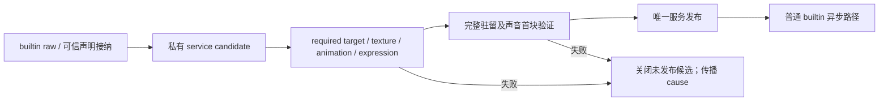

# Intrinsic default 的启动与驻留

本页展开[客户端资源的 required default](overview.md#关键契约与设计取舍)。产品依据为[启动硬依赖](../../../product-decisions/decisions/model-fallback.md#bcdefault-startup-is-required)与[物化后的磁盘独立](../../../product-decisions/decisions/model-fallback.md#bcdefault-has-no-disk-dependency)。

## 私有构造与唯一发布

Client 在私有 service candidate 内完成 required targets、纹理、动画、表达式与驻留验证，随后发布唯一可达服务。Required owner 显式持有 lease，不能用来源标志或 preload set 隐式保活。

任一步失败都关闭未发布候选并传播原始 cause，不暴露 partial service 或超时恢复。Finalization 直接转移唯一候选所有权，不经过通用资源发布 callback。普通 builtin 只在服务发布后启动，不能回滚 required publication。Dedicated server 只承担本侧只读内容物化。

## 声明与首次使用

Default 使用同一次可信接纳结果的 builtin-only 声明投影，保留适用的内置可选联动，排除第三方声明和组件。编译、artifact 身份、binding、holder 与 transient 使用同一投影。显式 default、失败替代、GUI 与 main/arm 共用该身份；真实根类型仍参与 runtime binding。

Default 源引用第三方符号时应阻止 required publication，不能以局部 UNSET 恢复掩盖依赖。普通模型借 default 动画源仍使用自己的普通声明视图和 animation set，不借 default module 的 ProgramRef，也不取得 intrinsic default 身份。

Required 准备完成全部动画、controller 与 Common 绑定，并驻留未绑定默认源。服务发布后的首次 entity 绑定只建立私有 instance/component，不再次读源、共享编译、load、绑定动画或 bake。

## 驻留与缓存

Builtin raw 直接生成内存容器。Default 全部声音驻留；每个 required target 在发布前验证并保留 Common 声音首块。之后 default 播放不依赖磁盘、网络或音频 LRU 取得声音。

启动物化可读写派生缓存，命中后仍完成加载、绑定与驻留。物化完成后的 load/bind 只依赖驻留内容；不能把允许启动缓存写入解释为后续读盘依赖。

## 实现入口

`Collector.collectBuiltins()` 保存可信来源，`ExpressionHost.builtinOnly()` 从同一冻结接纳结果派生绑定。`ManagedContainer.openResidentDefault` 形成驻留表示；`ClientModelRenderTargetManager` 采用 candidate 并持 required lease，构造失败路径关闭未发布候选。Required 使用客户端本地玩家队列，不改变其唯一发布门禁。
