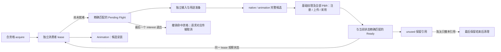

# 客户端模型资源

上级契约：[模型管理](../overview.md#seam-contract)。

## 职责与边界

本级负责客户端模型资源的共享准备、Ready target 发布与消费者 `lease` 管理。正常流程上，消费者按发布角色和用途提交申请后立即获得一份独立 `lease`；若对应目标尚未就绪，后台会通过去重后的 Pending Flight 准备几何、动画与声音首块，再由渲染线程完成基础纹理及全部 PBR 组件的宿主注册与上传，最终发布为 Ready target。

必需默认模型的启动与常驻契约由独立下级子系统[Intrinsic default](default-model.md#seam-contract)定义。

## Seam Contract

### 边界与权威

本子系统细化[模型管理的发布与使用](../overview.md#发布与使用的独立终点)，管理共享准备、Pending Flight、Ready target 与消费者 `lease`。相邻职责由各自 owner 承担：实体安装、组件与当前输出归动画，网络传输结束归网络，宿主已采用纹理的物理销毁归宿主。

必需默认模型的[启动与驻留](default-model.md#seam-contract)是本级的特殊硬约束：只有完整就绪后才能发布服务，不能套用普通资源的可恢复失败路径。

### 前置条件与输入

#### 资源身份

`ResourceRequest` 始终保留发布角色。稳定的资源键覆盖发布角色、精确内容、逻辑 target、用途、runtime profile 以及静态声明特化。运行期 Flight、Ready 缓存、共享准备、失败记录和 `lease` 的当前性检查都区分发布角色，内容字节相同也不能让普通模型取得必需默认模型（required）的使用资格。

此外，持久化生产还受实际存储区域约束：来源切换到新存储区域后，不能加入旧区域正在进行的工作。Java 内容对象的引用相等或展示来源相同都不能证明资源等价，真实的 `Class` 身份也不能用类名或指纹（fingerprint）代替。

#### 用途与派生物

资源 owner 在声明冻结之后、必需默认模型构建与服务发布之前，一次性建立全部受支持的 subject 特化。后续普通请求和后台准备只读取这份固定映射，intrinsic 请求始终使用它的 `LivingEntity` 特化。初始化过程不调用 provider，也不依赖目标资源就绪。日后新增 subject 类型时，必须同时补齐构造入口与请求入口。

所有取得模式都严格匹配请求指定的用途与绑定，不跨用途借用：

- **普通 GUI 与 FULL 隔离**：普通模型的 GUI 消费自己的 Ready 结果和独立未绑定动画输入，建立内存解释程序；FULL 路径保留 AOT 编译。普通 GUI 不会借用 FULL 的 Ready、字节码、inventory 或实例，即使 FULL 已有缓存也不会改变 GUI 的执行方式。
- **必需默认模型与中央预览**：[Intrinsic default](default-model.md#私有构造与唯一发布) 的所有请求统一消费驻留的 FULL 资源。中央动画预览使用 FULL，先取得自己的 `lease` 再释放来源使用，私有变量和执行状态在接收实体上初始化。只要几何、纹理和声音精确等价，仍由原资源 owner 共享。
- **Cache-only 模式**：只读取现有本地派生物，并从未绑定动画与程序输入解码、绑定内存解释程序；它不执行 AOT、不联网、不新写盘，但仍会校验目标实际依赖的 chunk。输入不足时返回未命中；局部未加载不会转换成语言缺值，求值期间读失败沿实例失败出口结束。Cache-only 不加入在线 Flight，也不会把离线未命中固化为普通准备失败。派生物的身份与信任条件见[派生物复用](../storage/derived-artifacts.md)。

#### 申请与观察

资源方接纳申请时立即为消费者建立一份独立的 `lease`。Pending、Ready、合法 Missing、Failed 和 Ended 都是通过这份 `lease` 观察到的状态：从 Pending 变为 Ready 不会另发一份新 `lease`，重复观察也不会增加引用计数。如果目标已经完整就绪，当次申请即可直接返回 Ready。

取得模式按能力分三档：`Cached` 只读已有派生物，`Offline` 允许本地读取与构建，`Online` 允许联网补取缺件。模式探测和回退策略由资源方控制。消费者需要提高获取模式时，先建立新 `lease`，再关闭旧 `lease`。离线未命中不会冻结后续普通准备，但 OOM 仍会直接结束本次取得。

[启动预热](../../runtime/overview.md#启动模型一次性预热)作为普通的 Offline FULL 消费者走同一套链路，取得资格与本地来源仍由当前目录和资源 owner 判断。预热只保留自己的 `lease`，目标 Ready 后即刻释放，完整资源按普通的闲置保留策略留存。

### 结果与保证

#### 数据流与交接

#### Ready 与宿主交接

后台 worker 产出的是尚未发布的预就绪候选（pre-Ready candidate）。只有当 native 与动画资源全部构造完成，且渲染线程（render owner）完成了基础纹理以及全部存在的 PBR 组件的注册、可采样上传与宿主采用后，系统才将其提交为与当前状态精确匹配的 Ready。其中任何一步失败都只拒绝该候选，已有的旧 Ready、采样映射（sampled mapping）和请求纹理意图保持有效。

资源 Ready 与实体绑定（Bound）相互独立。接收方拿到独立 `lease` 后进入[实体生命周期](../../animation/entity-lifecycle.md)，由实体 owner 校验请求、profile、真实 subject 与私有 holder 后再执行安装。安装失败、Busy 或旧合法安装的处理都不会反写共享 Ready 状态。

### 所有权与时序

#### 运行作用域与所有权

客户端服务负责对外提供资源取得。Pending `lease` 持有具体消费者对正在进行工作的 interest，Ready `lease` 强持有不可变的已完成资源。消费者如果保存了裸 target，就必须同时保留产生它的 `lease`。Ready 缓存与 Pending 注册表保持分离，不合并为一个可变容器。

必需默认模型由显式的 required `lease` 常驻持有；普通 Ready 的 unused 缓存只保留当前没有消费者的 target。缓存淘汰撤销的是缓存自身的引用，绝不能关闭仍有消费者持有的资源。共享准备依赖通过独立的 interest 和 pin 连接到 target，不建立第二套 LRU。

Flight 的去重、取消与替换规则如下：

- 相同资源键只命中当前精确匹配的 Flight。
- 最后一个 interest 退出时，先撤销该 Flight 的命中资格；如果尚未进入下载阶段，就不产生传输承诺；如果已经发起下载，则只向对应的传输 owner 请求取消。
- Flight 结束时，先按对象身份从 Pending 注册表中移除自身，再对外公开结果。旧 Flight 结束不能误删已经替换上去的新 Flight，已经结束的传输也不会被迟到的 release 追溯取消。
- 同一发布角色下，共享的 main 或 arm 准备可以服务多个不同纹理的 target，每个 target 持有自己的 pin。准备 owner 结束时只取消 Pending 工作，不追溯关闭已经交给 Ready target 的 pin；因此活跃 target 可以延续共享准备的寿命，而取消和迟到候选只释放自身的使用。

#### 动画资源所有权与退休

根 `AnimationStore` 统一持有已绑定的动画、本地与 fallback 索引、controller 定义、函数与事件程序引用，以及解释环境与程序表或 AOT 运行资源。它对应一次由精确内容、逻辑 target、动画集、用途、主体 binding 与实际加载环境共同确定的准备结果：不同纹理可以共享同一个 store，但 GUI 与 FULL、main 与 arm 各自持有独立的 store。未绑定的动画输入仍归存储区域的输入缓存所有，普通默认补全则在接收模型的语义选项和环境内完成绑定。

共享准备成功后接管完整的 `AnimationStore`，构造失败则由构造方负责回滚；Ready target 通过独立 pin 保留共享准备。Ready 缓存、实体和在途工作各自持有自己的引用，缓存淘汰只撤除缓存自身的那一份。在 store 存活期间，已访问的动画和成功绑定的程序会被复用，GUI 则依然只按需准备实际消费的表达式和首次调用的函数。已绑定程序没有独立的闲置过期或 LRU，页面图片的保留与关闭也完全独立。`ModelRetentionCount` 只限制闲置（unused）target 的个数，不保证堆内存、native 内存或显存的上界。

实体对 store 的关系是执行借用：实体独占实例、变量、组件、controller 状态、播放时间线与上下文；实体结束时先清理私有状态和资源引用，再关闭实例并归还借用，它没有共享 store 的关闭权。查询视图（query view）只是固定 store 和失败门禁的只读封装，没有独立的关闭状态。名称与定义查询不打开文件；可能触发按需加载的解析操作则使用局部读取批次。

`AnimationStore` 的退休和清理遵循明确的状态与计数规则：

- **单向退休**：状态只能沿 `OPEN → RETIRING → CLOSED` 推进。当最后一个准备 pin 释放或构造失败时，`close()` 以幂等方式封锁新的使用。若此时仍有活动使用，`close()` 立即返回，由最后一个归还使用保护的一方领取唯一清理责任；若已无活动使用，则由关闭方当场领取。昂贵的准备、I/O 与后端清理一律在接纳锁外执行。即使清理过程抛错，状态也会进入 `CLOSED`，异常沿实际执行清理的调用栈传播。
- **独立的使用保护**：私有执行实例、实际准备与构造、无外层保护的读取批次，以及可能跨过安装寿命的后台工作，各自申请一份使用保护。实例内部的表达式、函数和同步读取直接复用外层保护；Ready 缓存、候选等待和查询视图不计入活动使用。
- **封口后的收尾**：读取批次封口后，已经进入回调的操作仍可继续读取并切换 fallback，等最后一个回调退出后再关闭本批读取阶段并归还保护。已被接纳的工作在 store 封口后也可以完成内部的嵌套准备、绑定与读取，而服务层的资格门禁会阻止新任务启动和迟到结果对外发布。
- **异步清理边界**：调用 `close()` 并不意味着物理清理已经完成，各使用者仍沿各自的生命周期归还保护，最后归还者完成共享清理。关闭单个实体或读取批次只结束它自己的使用，不影响其他合法使用者。普通共享 JVM 对象随最后强引用消失交由 GC 回收，显式构造失败则保留确定性的回滚路径。服务不另建全局 store 登记表或全域等待点；[JVM 进程退出](../../runtime/overview.md#jvm-进程退出)直接放弃运行资源，不影响 reload 或 disconnect 对合法旧安装的保留规则。

#### 固定内容与预览

普通目录预览申请当前精确内容的 GUI `lease`。对于尚未发布的内容，调用方通过已验证的内容 capability 获取固定输入，既不回填普通 Catalog，也不污染普通 Ready 键。导出（Export）和管理补图只复用精确匹配的既有 Ready；如需新建工作，则持有独立固定输入，不加入普通 Pending Flight。管理补图只能使用本次传入的 fetcher，不能借用普通会话的网络资格。固定输入工作的结果一律不进入 unused 保留缓存。

预览 owner 只管自己的 `lease`、渲染、像素读取、编码与导出；游离的候选对象、宿主纹理采用以及迟到结果的清理由资源方兜底，预览退出后不需要为了清理而继续轮询。

#### 准备输入

内容 capability 提供独立的准备输入保留机制。Loader 在启动异步读取前先取得一份保留；共享准备和完整 target 构建也各自持有自己的输入保留。请求被拒收时立即归还；已启动工作被取消时，必须等后台 worker 实际退出后再归还。如果生成的产物后续仍要读取输入，产物必须先建立一份属于自己的独立保留。

本地输入保留原始只读 capability 和 metadata，但不保证外部用户文件不被修改。远端输入则保留已验证的共享字节，即使远端来源退出，也不会撤销已生成产物的读取能力。Loader 不依赖具体远端类型来延长输入寿命。

#### 引用撤销与物理关闭

Catalog、缓存和消费者各自撤销自己的引用。已经完成且不携带会话、fetcher 或查询 capability 的资源，可以跨越具体会话继续保留；但未来有新消费者复用时，仍须按[sessions](../sessions/overview.md#新使用资格)重新检查当前使用权限。

共享的 native 底层内存默认靠最后一个强引用消失后触发 exactly-once cleanup 来回收，不承诺同步回收的硬时限。不过，GC 绝不能用来替代下载取消、锁与文件句柄释放、活动预算归还或任务真实结束；只要涉及容量配额或及时停机要求，就必须有显式归还责任，同时不能把共享底层资源的关闭权分散给借用者。

Target 对宿主已采用的纹理绑定只发出一次逻辑释放（logical release）；底层映射、纹理对象与 GPU ID 的物理销毁，分别由 Minecraft 的 `TextureManager` 以及采用 PBR 子纹理的 Iris 宿主负责。物理清理可能晚于 target 退休，且不能回滚模型权威。独立的 GUI 纹理则归页面图片 owner 管理。

### 失败与拒收

失败或已取消的 Flight 不会留在可命中集合中。后续新的申请可以建立新的 Flight，但仍受领域失败资格约束；用于诊断的信息不得顺带保活旧的 interest、传输或完成权。

#### 取得失败与纹理回退

普通模型内容使用独立的失败包装，确保同源普通模型的加载失败不会污染常驻的 intrinsic 默认模型。内容本身的确定性失败与暂时访问失败严格区分，后台 worker 容量满导致的拒收不会冻结该内容。

请求的纹理与实际生效纹理分开管理：当请求的纹理无效时，依次回退到有效的 Manifest 默认纹理、Manifest 稳定顺序中的第一项纹理。这种回退既不改写请求和服务端选择，也不增加额外的网络拉取、ACK、别名或缓存修复。

资源准备链路中已有的 Error 通道由 cache owner 统一接纳 OOM 结束状态（包括同步 loader 抛出以及异步 Completion 包装的 OOM）。OOM 不会被当成确定性内容失败或离线缓存未命中；当次取得直接失败，绝不交付半成品 Ready。在完整条目被接纳之前发生的失败，由原候选 owner 负责清理，已独立存在的 Ready 和现有 `lease` 保持不受影响。

对于没有纹理的非玩家（non-player）target：不激活、不主动预加载，也不建立渲染 `lease`、默认替代、持久不可用标记或 publication 回滚，已有作用域内的替换直接恢复宿主原貌。玩家（player）target 缺少纹理时则由 M1 reader 直接拒绝，不能借用其他 target 的纹理。

### 证据与依赖

本级依赖[sessions 的新使用资格](../sessions/overview.md#新使用资格)判断新请求权限，接收实体依赖[完整安装与替换](../../animation/entity-lifecycle.md#模型使用与完整安装)。验证入口见[模型管理验证](../../../verification/model-management.md)，尚未覆盖的边界见[模型管理问题](../../../status/known-issues/model-management.md)。

## 设计取舍

把后台工作取消与已完成资源的保留拆开管理，可以防止某个消费者释放 `lease` 时误伤其他仍在借用同一 target 的消费者；在宿主采用门禁处要求基础纹理与全部 PBR 组件整体就绪，则避免了半成品 PBR 发布后再补齐或回滚的复杂性。相应的代价是系统需要短时驻留候选项、维护独立 `lease`，且共享资源没有同步回收的硬时限。

## 实现与验证入口

当前关键类与所有权映射见[共享准备与发布](implementation/resource-ownership.md)。
