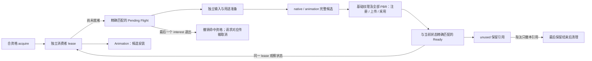

# 客户端模型资源

上级契约：[模型管理](../overview.md#seam-contract)。

## 职责与边界

本级负责客户端模型资源的共享准备、Ready target 发布与消费者 `lease` 管理。消费者按发布角色和用途提交申请后立即拿到独立 `lease`；目标尚未就绪时，后台通过去重的 Pending Flight 准备几何、动画与声音首块，再由渲染线程完成基础纹理与全部 PBR 组件的宿主注册与上传，最终发布为 Ready target。

必需默认模型的启动与常驻见下级子系统[Intrinsic default](default-model.md#seam-contract)。

## Seam Contract

### 边界与权威

细化[模型管理的发布与使用](../overview.md#发布与使用的独立终点)，管理共享准备、Pending Flight、Ready target 与消费者 `lease`。必需默认模型的[启动与驻留](default-model.md#seam-contract)在服务发布前完成全量驻留，不走普通资源的可恢复失败路径。

### 前置条件与输入

#### 资源身份

`ResourceRequest` 始终保留发布角色。稳定资源键覆盖发布角色、精确内容、逻辑 target、用途、runtime profile 与静态声明特化；Flight、Ready 缓存、共享准备、失败记录与 `lease` 当前性检查均区分发布角色。持久化生产另受实际存储区域约束，来源切区后不加入旧区在途工作。Java 内容对象引用相等或展示来源相同不代表资源等价，真实 `Class` 身份不用类名或指纹代替。

#### 用途与派生物

资源 owner 在声明冻结后、必需默认模型构建与服务发布前一次性建立全部受支持 subject 特化，后续请求与后台准备只读该映射（intrinsic 固定 `LivingEntity`）。新增 subject 类型时需同步补齐构造入口与请求入口。

各取得模式匹配指定用途与绑定，不跨用途借用：
- **普通 GUI 与 FULL 隔离**：普通 GUI 消费自身 Ready 与独立未绑定动画输入建立内存解释程序；FULL 保留 AOT 编译，两者不借用字节码、inventory 或实例。
- **必需默认模型与中央预览**：[Intrinsic default](default-model.md#私有构造与唯一发布)统一消费驻留 FULL 资源；中央动画预览用 FULL，先取自身 `lease` 再释放来源，私有状态在接收实体初始化。
- **Cache-only 模式**：只读现有本地派生物并从未绑定输入构建内存解释程序，不执行 AOT、不联网、不写盘，仍校验目标实际依赖的 chunk；输入不足返回未命中，不加入在线 Flight，也不把离线未命中固化为普通失败（见[派生物复用](../storage/derived-artifacts.md)）。

#### 申请与观察

接纳申请即发一份独立 `lease`，`Pending`/`Ready`/`Missing`/`Failed`/`Ended` 均通过同一份 `lease` 观察，重复观察不增计数。取得模式分 `Cached`、`Offline`、`Online` 三档；需提高模式时先建新 `lease` 再关旧 `lease`。离线未命中不冻结后续普通准备，OOM 直接结束本次取得。[启动预热](../../runtime/overview.md#启动模型一次性预热)作为普通 Offline FULL 消费者复用同一链路，Ready 后即刻释放 `lease`。

### 结果与保证

#### 数据流与交接

#### Ready 与宿主交接

后台 worker 产出 pre-Ready 候选；只有 native 与动画资源构造完成，且渲染线程完成基础纹理及全部存在 PBR 组件的注册、上传与宿主采用后，才发布为 Ready（任一步失败只拒绝候选，保留旧 Ready）。资源 Ready 与实体绑定独立，安装失败、Busy 或旧合法安装不反写共享 Ready 状态（见[实体生命周期](../../animation/entity-lifecycle.md)）。

### 所有权与时序

#### 运行作用域与所有权

Pending `lease` 持有对在途工作的 interest，Ready `lease` 强持有不可变已完成资源（保存裸 target 须同时保活其 `lease`）；Ready 缓存与 Pending 注册表分离。必需默认模型由显式 required `lease` 常驻持有；普通 unused 缓存只保活当前无消费者的 target，淘汰只撤缓存自身引用。共享准备依赖通过独立 interest 与 pin 挂到 target，不设第二套 LRU。

Flight 去重、取消与替换：
- 同键只命中当前精确 Flight。
- 最后一个 interest 退出时先撤销 Flight 命中资格：未进下载阶段不产生传输，已发起下载则向对应传输 owner 请求取消。
- Flight 结束时按对象身份从 Pending 移除后再公开结果，避免旧 Flight 误删新 Flight 或迟到 release 追溯取消已结束传输。
- 同发布角色下，共享 main/arm 准备可服务多个纹理 target（各持独立 pin）；准备 owner 结束只取消 Pending，不关闭已交付给 Ready target 的 pin。

#### 动画资源所有权与退休

根 `AnimationStore` 持有已绑定动画、本地与 fallback 索引、controller 定义、函数/事件程序引用及解释或 AOT 运行资源（同模型不同纹理共享，GUI 与 FULL、main 与 arm 独立）。未绑定动画输入归存储区域输入缓存所有。Ready target 通过独立 pin 保留共享准备；`ModelRetentionCount` 只限 unused target 个数，不承诺堆/native/显存硬上界。

实体对 store 为执行借用：实体结束时先清私有状态与引用，再关实例归还借用，无共享 store 关闭权。名称与定义查询不打开文件，按需加载解析用局部读取批次。

`AnimationStore` 退休规则：
- **单向退休**：`OPEN → RETIRING → CLOSED`。最后一份准备 pin 释放或构造失败时，`close()` 幂等封锁新使用；仍有活动使用时立即返回，由最后一个归还使用保护者领取唯一清理权，否则当场清理。昂贵 I/O 与后端清理在接纳锁外执行；清理抛错仍进入 `CLOSED` 并沿清理调用栈传播。
- **独立使用保护**：私有执行实例、实际准备构造、无外层保护读取批次、跨安装寿命后台工作各申请一份使用保护（内部同步调用复用外层保护；Ready 缓存、候选等待和查询视图不计入）。
- **封口后收尾**：已进入回调的读取批次与已接纳工作可完成当前阶段再归还保护，服务门禁挡住新任务与迟到发布。
- **异步清理边界**：`close()` 不代表物理清理已完成；不建全局 store 登记表；[JVM 进程退出](../../runtime/overview.md#jvm-进程退出)直接放弃运行资源。

#### 固定内容与预览

普通目录预览申请精确内容的 GUI `lease`；未发布内容经已验证内容 capability 取得固定输入，不回填 Catalog 也不污染普通 Ready 键。导出与管理补图只复用精确匹配的既有 Ready，否则用独立固定输入（管理补图只用传入 fetcher），固定输入结果不进 unused 缓存。游离候选与迟到结果由资源方兜底清理。

#### 准备输入

Loader 启动异步读取前、共享准备与完整 target 构建各自取得内容 capability 的准备输入保留：拒收立即归还，取消需等后台 worker 实际退出后归还；后续仍需读输入的产物先建立独立保留。本地输入保留原始只读 capability 与 metadata（不保证外部用户文件不被修改）；远端输入保留已验证共享字节，远端来源退出不撤销已生成产物的读取能力。

#### 引用撤销与物理关闭

已完成且不带会话/fetcher/查询 capability 的资源可跨会话保留，新消费者复用前按[sessions](../sessions/overview.md#新使用资格)重检权限。共享 native 内存默认随最后强引用消失经 exactly-once cleanup 回收（不承诺同步回收时限），但下载取消、锁与文件句柄、活动预算与任务结束均需显式归还。

Target 对宿主已采用纹理只发一次逻辑释放，底层纹理对象与 GPU ID 物理销毁由 Minecraft `TextureManager` 与 Iris 宿主负责。独立 GUI 纹理归页面图片 owner。

### 失败与拒收

失败或已取消的 Flight 立即移出可命中集合，诊断信息不反向保活 interest、传输或完成权。

#### 取得失败与纹理回退

普通模型与常驻 intrinsic 使用独立失败包装，互不污染；确定性内容失败与暂态访问失败区分，worker 满载拒收不冻结内容。

请求纹理无效时依次回退至有效 Manifest 默认纹理、Manifest 稳定顺序首项纹理（不改写请求与服务端选择）。

资源准备链路的 OOM 经既有 Error 通道由 cache owner 统一接纳：不当作确定性内容失败或离线未命中，当次直接失败，不交付半成品 Ready。

无纹理非玩家（non-player）target 不激活、不建渲染 `lease` 或默认替代，已有替换直接恢复宿主原貌；玩家 target 缺纹理由 M1 reader 拒绝。

### 证据与依赖

依赖[sessions 新使用资格](../sessions/overview.md#新使用资格)与[实体安装](../../animation/entity-lifecycle.md#模型使用与完整安装)；验证与缺口见[模型管理验证](../../../verification/model-management.md)和[模型管理问题](../../../status/known-issues/model-management.md)。

## 设计取舍

把后台工作取消与已完成资源的保留拆开管理，可以防止某个消费者释放 `lease` 时误伤其他仍在借用同一 target 的消费者；在宿主采用门禁处要求基础纹理与全部 PBR 组件整体就绪，则避免了半成品 PBR 发布后再补齐或回滚的复杂性。相应的代价是系统需要短时驻留候选项、维护独立 `lease`，且共享资源没有同步回收的硬时限。

## 实现与验证入口

当前关键类与所有权映射见[共享准备与发布](implementation/resource-ownership.md)。
