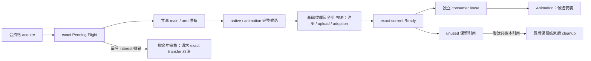

# 客户端模型资源

上级契约：[模型管理](../overview.md#seam-contract)。

## 职责与边界

本级提供共享准备、Ready target 和消费者 lease。完整下级子系统[Intrinsic default](default-model.md#seam-contract)拥有 required 启动与驻留契约。

## Seam Contract

### 边界与权威

本子系统细化[模型管理的发布与使用](../overview.md#发布与使用的独立终点)，拥有共享准备、Pending Flight、Ready target 和消费者 lease。实体安装、组件与当前输出归动画；传输终态归网络；adopted texture 的物理关闭归宿主。

Required default 的[启动与驻留](default-model.md#seam-contract)是本级特殊组合约束：完整就绪才发布服务，不能套用普通资源的可恢复失败。

### 前置条件与输入

#### 资源身份

Stable resource key 覆盖精确内容、逻辑 target、用途、runtime profile 与静态声明特化。实际存储区域还约束持久生产：切换来源区域不能加入旧区工作。Java content 对象 identity 和展示来源不证明等价；真实 `Class` identity 不能由类名或 fingerprint 代替。

#### 用途与派生物

所有取得模式均匹配请求的精确 purpose 与 binding。GUI 只消费 GUI Ready、prepared 值或派生物，不借 FULL Ready 或 FULL MAIN。中央动画预览使用 FULL，先取得自身 lease，再释放来源使用；私有变量和执行状态在接收实体初始化。精确等价的 geometry、纹理和声音仍由原资源 owner 共享。

Cache-only 只读取现有派生物，不编译、不写缓存、不发 model-body 请求；仍验证目标实际依赖的 chunks。它不加入在线 Flight，也不把离线 miss 固化为普通准备失败。派生物的身份与信任条件见[派生物复用](../storage/derived-artifacts.md)。

### 结果与保证

#### 数据流与交接

#### Ready 与宿主交接

Worker 成功只是 pre-Ready candidate。Native/animation 资源完整后，render owner 完成基础纹理及全部 present PBR component 的注册、sample-ready upload 与 host adoption，才能提交 exact-current Ready。任一步骤失败只拒绝候选，旧 Ready、sampled mapping 与 requested texture intent 保持有效。

Ready 与实体 Bound 分开。接收者持独立 lease 后进入[实体生命周期](../../animation/entity-lifecycle.md)，由实体 owner 验证 request/profile、真实 subject 和私有 holder，再安装。安装失败、Busy 与旧合法安装的处置不反写共享 Ready。

### 所有权与时序

#### 运行作用域与所有权

Client 服务提供资源取得。Pending lease 持有 exact consumer 的 interest，Ready lease 强持有不可变完成资源。消费者保存裸 target 时应同时保留产生它的 lease。Ready cache 与 Pending registry 不组成一个可变 cell。

Required default 由显式 required lease 保留；普通 Ready 的 unused cache 只保留没有消费者的 target。撤缓存引用不能关闭仍有消费者的资源。准备依赖由独立 interest/pin 连接 target，不建立第二套 LRU。

同 key 只命中当前 exact Flight。最后 interest 退出时先撤命中资格；未 admission 不产生传输承诺，已 admission 仅向 exact transfer owner 请求取消。Flight 终态先按对象身份移除自己的 Pending entry，再公开结果。旧终态不能移除 replacement；已 terminal transfer 不被后来的 release 追溯取消。

共享 main/arm 准备可以服务不同纹理；每个 target 持独立 pin。准备 owner 结束只取消 Pending，不追溯关闭已交给 Ready target 的 pin。活跃 target 因而可延续准备身份；取消与迟到候选只释放自己的使用。

#### 引用撤销与物理关闭

Catalog、cache 与消费者分别撤自己的引用。已完成且不携带 session/fetcher/query capability 的资源可跨 exact session 继续保留；未来访问资格按[sessions](../sessions/overview.md#新使用资格)重新判断。

共享 native backing 默认由最后引用和 exactly-once cleanup 汇合，不承诺同步回收时限。GC 不替代下载取消、锁/文件句柄释放、活动预算归还或任务真实终态。显式责任适用于容量或及时结束要求，不能把 close 权分散给借用者。

Target 对 adopted texture binding 只发一次 logical release；Minecraft TextureManager 与已采用 PBR children 的 Iris host 负责 mapping、texture 与 GPU id 的物理关闭。Cleanup 可晚于 target 退休，不能回滚模型权威。Standalone GUI texture 另归页面图片 owner。

### 失败与拒收

Failed/cancelled Flight 不留在命中集合。新 acquire 可建新 Flight，但仍受领域失败资格约束；诊断不能保留旧 interest、transfer 或完成权。

#### 取得失败与纹理回退

内容失败与暂时访问失败分开；worker admission 拒绝不冻结内容。Requested texture 与有效纹理分开：请求无效时依次使用有效 Manifest default、Manifest 稳定顺序首项；不改请求或 server selection，也不增加 exact fetch、ACK、alias 或 cache repair。

资源准备的既有 Error 通道由 cache owner 接纳 OOM 终态，包含同步 loader 与异步 Completion 包装。OOM 不成为确定性内容失败或 offline cache miss；本次取得失败不交付半完成 Ready。完整 entry 接纳前失败由原 candidate owner 清理，独立 Ready 与已有 lease 保留。

Textureless non-player target 不激活，不主动 preload，不建立 render lease、default replacement、持久 unavailable 或 publication rollback；既有 scoped replacement 恢复宿主。Player target 缺纹理由 M1 reader 拒绝，不能借其他 target 纹理。

### 证据与依赖

本级依赖[sessions 的新使用资格](../sessions/overview.md#新使用资格)，接收实体依赖[完整安装与替换](../../animation/entity-lifecycle.md#模型使用与完整安装)。验证入口为[模型管理验证](../../../verification/model-management.md)，未验证边界见[模型管理问题](../../../status/known-issues/model-management.md)。

## 设计取舍

工作取消与资源保留分开，防止某个 consumer release 销毁其他消费者仍借用的 target。完整 host 门禁避免部分 PBR 发布与补齐回滚。代价是候选驻留、独立 lease 和无同步时限的共享回收。

## 实现与验证入口

当前关键映射见[共享准备与发布](implementation/resource-ownership.md)。
