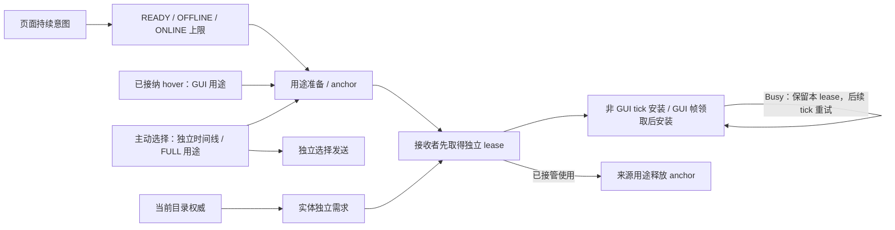

# 客户端模型需求

上级契约：[模型管理](../overview.md#seam-contract)。

## 职责与边界

本级把客户端的持续使用意图（模型页面浏览、鼠标悬停预览、玩家主动选择和世界实体展示）转化为具体的资源获取请求，并负责按用途准备资源、向接收实体交接独立 `lease` 以及协调主动选择的发送与反馈。

## Seam Contract

- 持续的页面浏览或交互何时获准启动本地或联网工作：[连续意图与工作准入](#连续意图与工作准入)。
- Ready 资源如何交接给实体，遇到 Busy 或取消时由谁归还：[用途准备与安装交接](#用途准备与安装交接)。
- 主动选择的发送、反馈期限和实体独立需求如何互不干扰：[选择发送与反馈](#选择发送与反馈)。

### 共同规则

适用范围：“连续意图与工作准入”“用途准备与安装交接”和“选择发送与反馈”。三项契约继承本节的职责、scope 所有权、取消、调度类别及验证依赖。

本子系统细化[模型管理的数据流与交接](../overview.md#新使用接纳与独立保留)，负责决定各类持续意图何时启动、按何种用途推进，以及如何把准备好的资源交接给接收方。

相邻职责保持清晰：领域访问权限归[sessions](../sessions/overview.md#新使用资格)，资源容量与共享准备归[client resources](../client-resources/overview.md#seam-contract)，实体绑定与安装归[动画实体生命周期](../../animation/entity-lifecycle.md)。取消一条需求不会赋予调用方关闭共享 target、网络传输或 GPU 资源的权限。

需求 owner 只管持续意图本身，不能充当第二把资源发布锁或资源关闭器。纹理导航的“仅限 Ready 且失败即拒绝”规则由展示层自己定义，不转化为后台待启动意图。

#### 数据流与交接

#### 运行作用域与所有权

客户端服务负责推进所有活跃的 scope。页面、主动选择、hover 和每个实体各自维护自己的持续状态，实体安装端点通过弱引用关联。用途操作本身持有本次请求的 `lease` 或 Ready anchor；实体安装成功后，则由实体 binding 持有属于自己的独立 `lease`。

实体与页面的登记、遍历和关闭统一由 client owner（主线程）执行。GUI 后台 worker 只更新获准范围内的私有安装，等主线程 join 之后才上报安装使用并推进 Demand。遍历基于快照进行，允许同步回调登记或关闭 scope，但绝不授予 worker 修改登记集合的权限。

页面只管理明确登记过的卡片、实体和图片操作。某个 scope 结束时只释放它自己的 `lease` 或 anchor，共享准备和未采用产物由资源方独立清理。协调者不持有 `Screen` 实例，也不遍历无关的 Catalog 条目。

#### 需求取消与失败归属

取消某个 scope 时，先撤销它的继续推进与接收资格，再释放自身持有的 attempt 或 anchor。如果页面正处于活跃帧借用期间，关闭调用会立即封口，把卡片、实体和图片操作的清理延后到本帧所有已接纳任务交接完毕后执行。清理过程中若某个子项抛错，不会跳过同级其他 owner 的清理。其他用途、已安装的 `lease` 以及独立实体需求继续服从各自 owner；共享 Flight 和网络传输是否终止也由各自 owner 决定。同一用途的资源共享仍由同一个资源 owner 统一管理。

容量契约见[运行模型](../../runtime/overview.md)，需求验证与证据边界见[需求准备](../../../tools/benchmark/README.md#gui-与-full-需求准备)。

### 连续意图与工作准入

**边界与权威**

本契约继承[共同规则](#共同规则)的职责与 scope 所有权。

**前置条件与输入**

#### 连续准入

页面与交互触发的资源获取分三档上限：`READY` 只拿已经完整的 Ready 资源；`OFFLINE` 允许读取本地文件与本地构建；`ONLINE` 允许联网补取缺件。为了避免快速翻页时触发大量短命加载，页面按停留时长分步放开门槛：

- **首次打开或慢速翻页**：如果是首次进入页面，或者上一页连续停留超过 700 ms，当前页的时间门槛立即放开。
- **快速翻页**：如果上一页停留不超过 700 ms，当前页在停留满 300 ms（含）时放开本地工作，满 700 ms（含）时放开联网工作。两个门槛从同一起点计时，不串联叠加。
- **起点重置条件**：相同内容下的初始化或窗口缩放（resize）保留当前页面起点；当页面成员、顺序、页码或内容发生变化时，重新建立起点。缓存命中、异步未命中或开始联网都不会重置起点。
- **Ready 与名额限制**：已经完整的 Ready 资源可以直接取得，但首次实体绑定仍占用本帧的新准备名额；磁盘文件和 metadata 不会绕过时间门槛。显式选择与 hover 或 focus 各自维护独立的时间线。

不同 UI 元素的放行规则如下：

- **自动卡片与图片**：自动卡片最高只允许 `OFFLINE`；如果卡片上已有同用途的 hover，卡片本身只以 `READY` 接收结果；同一目标的 FULL 选择不会改变 GUI 卡片的放行上限。图片 adapter 遵守同一上限。
- **eager 配置切换**：页面在下一次推进时发布新的 eager 配置，不重置停留起点。开启 eager 时不请求或消费独立 preview，跳过预览不算缺图或失败；此前已经接纳的非 eager 补图继续服从原 owner，切换配置不强行取消。关闭 eager 后，新需求恢复非 eager 策略。自动准备与补图只针对默认贴图的 GUI body，不探测或消费 FULL Ready、字节码或实体私有状态；独立的未绑定动画输入仍按自身身份共享。页面展示资格由[客户端展示](../../client-presentation/overview.md)定义，资源 Ready 不会反过来授予展示资格。
- **交互接纳**：新的交互操作必须同时满足持续资格和当前页面的本地放行门槛才会被接纳。指针移出会清零悬停计时，但已经被接纳的 hover 会按原页面放行上限继续推进；未被接纳的目标不保留待启动意图。显式选择使用自己的起点，不叠加来源页面的停留等待。

**结果与保证**

本次用途获取受[连续准入](#连续准入)规定的 `READY`、`OFFLINE`、`ONLINE` 上限约束，后续独立接收按[用途准备与安装交接](#用途准备与安装交接)推进。

**所有权与时序**

本契约继承[共同规则](#共同规则)的 scope 取消与调度规则。

**失败与拒收**

未被接纳的交互与 eager 跳过按[连续准入](#连续准入)处理；资源获取后的失败处理见[用途准备与安装交接](#用途准备与安装交接)。

**证据与依赖**

本契约继承[共同规则](#共同规则)的容量与需求验证依赖。

### 用途准备与安装交接

**边界与权威**

本契约继承[共同规则](#共同规则)的职责、scope 所有权与调度规则。

**前置条件与输入**

#### 用途准备与独立接收

真实玩家选择始终按 FULL 用途和真实主体特化去获取资源，GUI Ready 不能替代 FULL。实体 binding 严格消费 `lease` 对应的实际准备用途，不凭请求去猜安装能力。

**结果与保证**

交接遵循“先接管、再松手”的原则：接收实体必须先拿到属于自己的独立 `lease`，来源用途才释放 anchor，因此即使 unused 缓存容量为 0，也不会出现资源引用归零的空窗。Ready 交接本身既不转移实体私有状态，也不代表实体安装已经完成。

实体 binding 独自维护[请求与安装关系](../../animation/entity-lifecycle.md#指派请求与安装关系)。需求协调层不复制 Matching 逻辑；Catalog 中原有请求条目消失本身，也不会自动终止世界里已有的合法旧安装。

渲染帧执行 Ready-only 查询时，可以直接发现两次 tick 之间刚发布的新 Ready 结果；查询未命中不会降低当前放行上限，也不会撤销正在进行的 Pending 请求。

**所有权与时序**

同一时刻，系统最多保留一个固定为 FULL 的选择准备操作和一个固定为 GUI 的已接纳 hover。针对同一个模型的两种用途各自独立推进，而同用途的精确请求仍会复用既有的后台资源工作。新接纳的 hover 会替换旧 hover；关闭页面不会取消独立的主动选择。替换同用途操作时，一律先取得新操作的 interest 或 `lease`，再撤销旧操作。

接收与安装按场景分开推进：

- **实体安装 owner**：`EntityModelDemand` 持有当前选择操作派生的候选，协调器只负责调度该 owner；模型列表的 tick 只管准备资源并保留 Ready anchor。
- **GUI 帧交接**：帧 owner 获得本帧新准备名额后，申请与请求匹配的独立接收 `lease`，来源 anchor 一直保留到实体观察到实际安装或用途结束。未提交的 claim 自行关闭 `lease`；任务接管 `lease` 后承担关闭责任，安装被接纳后再移交给 binding。帧本身不向需求协调器回报安装结果，而是由实体根据 binding 的完整安装状态对外报告使用，并在主线程安装窗口或 GUI join 后发布使用事件。
- **世界实体安装**：世界实体的安装 owner 在 tick 中以非阻塞方式尝试安装。遇到 Busy 时直接保留原候选，后续 tick 即可重试，无需等待帧结束来解锁。

**失败与拒收**

Busy 表示当前有任务、借用或候选正占用串行安装窗口（具体门禁见[完整安装与替换](../../animation/entity-lifecycle.md#安装接纳与-busy)）。此时接收方保留 Ready anchor 和原有放行上限，在后续 tick 重试，既不阻塞等待动画 worker，也不把 Busy 记为内容失败。

需求执行层面的失败由协调者汇总处理，具体候选的安装失败仍归 binding 负责。确定性内容失败与暂时访问失败严格分开；廉价的资格检查不会演变成逐帧发起的昂贵重试。离线未命中只结束本次探测，不阻止后续具备联网能力时的普通请求。

**证据与依赖**

放行上限依赖[连续意图与工作准入](#连续意图与工作准入)，实体 Busy 门禁依赖[完整安装与替换](../../animation/entity-lifecycle.md#安装接纳与-busy)；scope 取消与验证限制继承[共同规则](#共同规则)。

### 选择发送与反馈

**边界与权威**

本契约继承[共同规则](#共同规则)的职责与 scope 所有权。

**前置条件与输入**

#### 选择反馈

`ClientDemandCoordinator` 统一管理主动选择的资源准备、偏好读取、发送资格以及反馈期限。整体流程为：分配新操作编号 -> 准备 FULL 资源并取出完整的 MAIN roaming 声明字典 -> 恢复或继承初值 -> 本地提交并尝试发送一次 -> 等待实体实际安装。

具体规则如下：

- **单调 intent**：每次新的选择操作都会分配一个在当前业务会话内严格递增的正 `signed long` intent。显式选择同一模型、重选和 clear 都会建立新操作；编号耗尽后直接拒绝新选择，绝不回绕。
- **声明字典与初值**：发送前必须先从 FULL 准备结果拿到完整的 MAIN roaming 声明字典。当前已安装使用、合法内存值或明确空值只用来提供初值，不能替代声明准备。普通选择优先复制原 scope 的合法内存值；没有可用内存值时，按不可变字段集合从本地偏好恢复。数据库查询任务不持有 target，偏好存储层也不另行发起 FULL 请求。
- **准备与查询边界**：FULL 准备失败时，保留旧选择和旧生产者不变。偏好查询失败时，以临时空初值继续推进，并标记本次 scope 不可持久化。进入发送边界前，必须复核原上下文、intent、授权与目标，并完成整份字典和初值的编码校验。

**结果与保证**

准备完成后，客户端先在本地提交新目标、初值与持久资格，同时退休旧生产者，再尝试向服务端发送一次请求；服务端发回的 self 回显不参与本地提交。真实实体安装仍需独立等待：资源 Ready、旧的 Retained 使用和本地选择提交都不代表实体已完成 Matching 安装。

UI 反馈按展示区域隔离：只有左侧角色名称消费真实玩家的安装等待状态，模型卡片上的名称保持显示内容名称；GUI 和图片的加载状态也各自独立。只有观察到与本次选择操作对应的实际安装后才算切换成功。显式重选同一模型同样要求重新做私有初始化；仅做兼容纹理更新时，则保留原操作和私有运行状态。

**所有权与时序**

协调器同时只保留一个当前反馈状态和一份准备关联。本地提交时，协调器把初值与持久资格交给偏好 scope，并结束准备关联。每次选择从接纳起算只有一个 30 秒的反馈期限，阶段推进不续期；超时后只结束本次反馈和准备，既不撤销已经本地提交的选择，也不保留 target `lease`。关闭模型页面不会取消真实玩家的主动选择。

FULL 准备本身仍是独立资源用途。复制完字段信息后，anchor 会保留到接收者拿到独立使用或用途结束为止。安装候选携带原操作编号、主体、用途、binding 与精确内容，实体采用前必须全部复核。

对当前生效目标执行 clear 时，会建立一个带明确空初值的新操作：在本地提交边界先结束旧生产者并建立新 scope，再向存储 FIFO 提交 clear，最后尝试发送网络请求，确保新生产者后续的写入排在 clear 之后。对非当前目标执行 clear 只提交存储清理，不制造新的选择操作。

**失败与拒收**

每个选择操作在发送前即封住发送资格，重入、轮询或发送失败都不会自动重发。底层物理发送失败不回滚已经本地提交的选择和 scope；偏好持久化被拒或失败也不回滚运行期状态。准备失败、发送失败和安装失败分别给出对应反馈，绝不把未发生的回退显示成“已切换”。

偏好查询失败只记录 DEBUG 日志，并且只在 `DebugAnimationScreen.isEnabled()` 开启时向聊天栏提示。取消选择不保证已提交的数据库工作立刻停止，也不回滚已经提交的首次填充。用户发起显式新操作即可重新尝试，系统不会每 tick 自动重放请求。

**证据与依赖**

业务选择请求与权威状态依赖[玩家状态](../../network/player-state.md#seam-contract)；需求验证限制继承[共同规则](#共同规则)。

## 设计取舍

通过集中式协调器统一管理页面、选择和实体的需求，减少了跨模块的状态组合爆炸，代价是需要维护显式 scope、用途状态以及客户端 tick 轮询。用停留时间门槛过滤短命浏览需求可以避免无谓加载，代价是翻页后的新内容可能延后出现，且这一策略的实际收益目前尚未量化。

## 实现与验证入口

真实玩家与显式选择走本地玩家调度队列，hover 与 GUI 预览走后台队列，具体队列与容量配额见[客户端资源调度](../../runtime/overview.md#客户端资源调度)。

`ClientModelService.tick()` 负责推进资源需求与主动选择，构造时会向协调器注入已有的 `PlayerPreferences`。模型页面在每次渲染开头通过 `PageScope.advance()` 发布当帧策略。`Operation` 持有获取状态与 anchor，`EntityModelDemand` 负责实体候选与 Busy 重试，渲染帧则通过独立的 Ready 候选移交使用；未采用和迟到的结果由资源方兜底清理。`ClientDemandSelections` 提供宿主上下文、有效内存值和同步提交已准备命令的能力，不再内部启动异步恢复。
