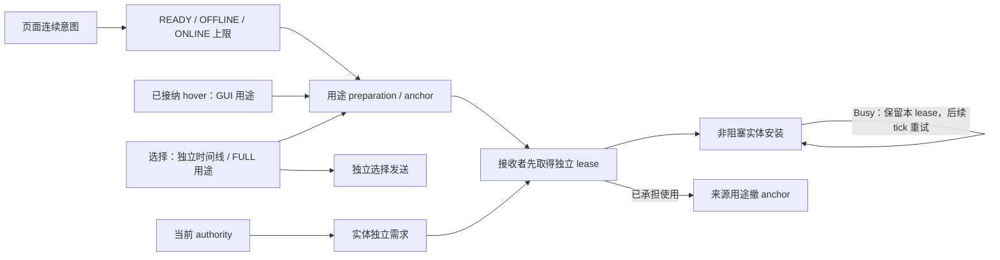

# 客户端模型需求

## 职责与边界

本子系统细化[模型管理的数据流与交接](../overview.md#数据流与交接)，把页面、交互、选择和实体的连续意图变成资源取得。它决定何时按何种用途推进，负责用途接管和独立接收交接。

领域访问资格归[sessions](../sessions/overview.md#新使用资格)，资源容量与共享工作归[client resources](../client-resources/overview.md#pending-与-ready)，实体安装归[动画实体生命周期](../../animation/entity-lifecycle.md)。需求取消不授予共享 target、transfer 或 GPU 的关闭权。

## 运行作用域与所有权

Client 服务推进活跃 scope。页面、选择、hover 和每个实体保留自己的连续状态；实体安装端点为弱引用。用途操作持有本次 acquisition 或 Ready anchor，安装成功后由 binding 持有自己的 lease。

页面只拥有明确登记的卡片、实体和图片 action。Scope 结束释放自身 attempt/anchor；资源 adapter 处置不可取消 future 的迟到 lease。协调者不持 Screen，不遍历无关 Catalog。

## 数据流与交接

### 连续准入

READY 只取得完整 Ready；OFFLINE 允许本地读取与构建；ONLINE 允许补取缺件。页面和显式选择各用一条连续时间线，本地与联网门槛分别从同一起点计算，不串联等待。缓存命中、异步 miss 和开始联网不重置起点；完整 Ready 可直接取得，但不授予展示资格。

自动卡片最多 OFFLINE；卡片已有同用途 hover 时只以 READY 接收结果；同目标 FULL 选择不改变 GUI 准入。图片 adapter 消费同一准入上限。普通列表在向预览 owner 提交时固定 eager 政策：只读已有图，或允许缺图生成。配置变化只影响新提交；缺图跳过不登记永久失败。自动准备与补图只新建默认贴图 GUI body，不探测或消费 FULL Ready 和派生物。页面展示资格由[客户端展示](../../client-presentation/overview.md)定义，资源 Ready 不能反向授予资格。

新交互须连续资格及页面本地准入均成立才接纳。移出撤销指针计时，但已接纳 hover 继续按原页面准入推进；未接纳目标不保留待启动意图。显式选择使用自己的起点，不叠加来源页面等待。集中推进过滤短命需求，代价是新内容可能延后，实际收益尚未量化。

### 用途准备与独立接收

同时只保留一个固定 FULL 的 selection preparation 和一个固定 GUI 的已接纳 hover。同目标两种用途独立推进；同用途精确请求仍复用既有资源工作。新接纳 hover 替换旧 hover，页面关闭不取消独立选择。

真实玩家选择按 FULL 和真实主体特化取得，GUI Ready 不代表 FULL。替换同用途操作时先取得新 interest/lease，再撤旧操作。接收实体先持有独立 lease，来源用途才退出，因此 unused cache 为零也不产生零持有间隙。

Ready 交接不转移实体私有状态，也不证明安装完成。Busy 表示任务、借用或候选占用串行安装窗口，具体门禁见[完整安装与替换](../../animation/entity-lifecycle.md#完整安装与替换)。接收方保留 Ready anchor 与原准入，在后续 tick 重试，不等待动画 worker、不记录内容失败。

## 生命周期与失败

### 需求取消与失败归属

取消先撤本 scope 的推进和接收资格，再释放自身 attempt/anchor；其他用途、已安装 lease 和独立实体需求继续服从各自 owner。共享 Flight 及 transfer 是否终结由各自 owner 裁决。

需求执行失败由协调者归约，精确候选安装失败仍归 binding。确定性内容失败与暂时访问失败分开；廉价资格检查不建立逐帧昂贵重试。离线 miss 只结束本次探测，不阻止后来具有网络能力的普通请求。

### 选择反馈

选择发送独立于资源取得终态，预取失败不抑制仍获准的选择。ACTIVE 阶段不乐观修改模型或 Roaming；迟到 authority 仍建立正常实体需求。

只有左侧名称消费真实玩家安装等待，卡片名称保留内容名称；GUI 和图片的加载投影独立。Accepted、资源 Ready 与 Retained 不能证明 Matching 安装。反馈期限、发送异常、拒绝或失败只终结本次反馈与用途准备，不重发选择、不回滚 authority、不清领域失败，也不取消实体独立需求。

## 关键契约与设计取舍

集中协调减少页面、选择和实体之间的状态组合，代价是显式 scope、用途状态与 client tick 轮询。需求 owner 只拥有连续意图，不能成为第二个资源发布锁或关闭器。纹理导航的 Ready-only 及失败即拒绝规则由展示层定义，不转化为后台待进入意图。

## 实现与验证入口

`ClientDemandCoordinator` 由 `ClientModelService.tick()` 唯一推进；`Operation` 持 acquisition/anchor，`EntityScope` 保留 Busy 接收 lease。`ModelResourceDemand` 负责 attempt 与迟到结果，`ClientDemandSelections` 区分 LOCAL 应用与业务会话发包。`ResourceLease.purpose()` 返回实际准备用途，binding 不按请求猜安装能力。

实际玩家和显式选择使用本地玩家调度类别，hover/GUI 使用后台类别；同用途共享仍归同一资源 owner。容量契约见[运行模型](../../runtime/overview.md)。需求验证及证据边界见[需求准备](../../../tools/benchmark/README.md#gui-与-full-需求准备)。
