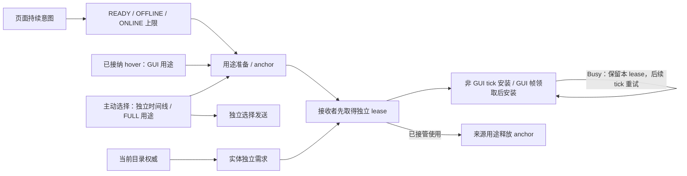

# 客户端模型需求

上级契约：[模型管理](../overview.md#seam-contract)。

## 职责与边界

本级把客户端持续使用意图（模型页面浏览、鼠标悬停预览、玩家主动选择和世界实体展示）转化为资源获取请求，按用途准备资源、向接收实体交接独立 `lease` 并协调主动选择的发送与反馈。

## Seam Contract

- 持续的页面浏览或交互何时获准启动本地或联网工作：[连续意图与工作准入](#连续意图与工作准入)。
- Ready 资源如何交接给实体，遇到 Busy 或取消时由谁归还：[用途准备与安装交接](#用途准备与安装交接)。
- 主动选择的发送、反馈期限和实体独立需求如何互不干扰：[选择发送与反馈](#选择发送与反馈)。

### 共同规则

适用范围：“连续意图与工作准入”“用途准备与安装交接”和“选择发送与反馈”。

细化[模型管理的数据流与交接](../overview.md#新使用接纳与独立保留)。相邻职责：访问权限归[sessions](../sessions/overview.md#新使用资格)，容量与共享准备归[client resources](../client-resources/overview.md#seam-contract)，实体安装归[动画实体生命周期](../../animation/entity-lifecycle.md)，纹理导航“仅限 Ready、失败即拒”归展示层。容量契约见[运行模型](../../runtime/overview.md)，需求验证见[需求准备](../../../tools/benchmark/README.md#gui-与-full-需求准备)。

#### 数据流与交接

#### 运行作用域与所有权

客户端服务推进活跃 scope；页面、主动选择、hover 与各实体各自维护状态，实体安装端点通过弱引用关联。用途操作持有本次请求 `lease` 或 Ready anchor，实体安装成功后由 binding 持有独立 `lease`。

实体与页面登记、遍历和关闭由 client owner（主线程）执行；GUI 后台 worker 只更新获准范围内的私有安装，主线程 join 后再上报使用并推进 Demand。遍历基于快照，允许同步回调登记或关闭 scope，不开放给 worker 修改登记集合。协调者不持有 `Screen` 实例。

#### 需求取消与失败归属

取消 scope 先撤销推进与接收资格，再释放自身 attempt 或 anchor。页面处于活跃帧借用期间关闭时立即封口，把卡片、实体和图片操作清理延后到本帧任务全部交接后执行；单子项抛错不跳过同级清理。其他用途、已安装 `lease` 与独立实体需求不受影响。

### 连续意图与工作准入

**前置条件与输入**

#### 连续准入

页面与交互触发的资源获取分三档上限：`READY`（仅取已就绪）、`OFFLINE`（本地读盘与构建）、`ONLINE`（联网补取）。为过滤快速翻页的短命加载，按停留时长分步放开门槛：
- **首次打开或慢速翻页**（上一页停留 > 700 ms）：时间门槛立即放开。
- **快速翻页**（上一页停留 ≤ 700 ms）：停留满 300 ms 放开本地工作，满 700 ms 放开联网工作（同一起点计时，不叠加）。
- **起点重置**：内容不变的 init 或 resize 保留起点；成员、顺序、页码或内容变化时重置；缓存命中、异步未命中或开始联网不重置。
- **Ready 与名额**：Ready 资源可直接取得，首次实体绑定仍占本帧新准备名额；显式选择与 hover/focus 维护独立时间线。

分元素放行规则：
- **自动卡片与图片**：最高 `OFFLINE`；卡片已有同用途 hover 时卡片本身仅以 `READY` 接收；同目标 FULL 选择不改变 GUI 卡片上限。图片 adapter 同口径。
- **eager 切换**：下次推进生效且不重置停留起点；开启 eager 不请求独立 preview（已接纳的非 eager 补图继续服从原 owner），跳过预览不算缺图或失败。自动准备仅针对默认贴图 GUI body，不探测 FULL Ready/字节码。展示资格见[客户端展示](../../client-presentation/overview.md)。
- **交互接纳**：需同时满足持续资格与页面本地放行门槛；指针移出清悬停计时，已接纳 hover 按原页面上限继续推进，未接纳目标不留待启动意图。显式选择用自身起点，不叠加页面停留等待。

### 用途准备与安装交接

**前置条件与输入**

#### 用途准备与独立接收

真实玩家选择按 FULL 用途和真实主体特化获取资源，GUI Ready 不替代 FULL；实体 binding 消费 `lease` 对应的实际准备用途。

**结果与保证**

交接遵循“先接管、再松手”：接收实体先拿到独立 `lease`，来源用途才释放 anchor，保证即使 unused 缓存容量为 0 也没有引用归零空窗。Ready 交接不转移实体私有状态，也不代表安装完成。

实体 binding 独自维护[请求与安装关系](../../animation/entity-lifecycle.md#指派请求与安装关系)；Catalog 条目消失不自动终止世界合法旧安装。渲染帧 Ready-only 查询可直接发现两次 tick 间新发布的 Ready，未命中不降上限也不撤销 Pending 请求。

**所有权与时序**

同一时刻至多保留一个 FULL 选择准备和一个 GUI 已接纳 hover（同模型两种用途独立推进，同用途精确请求复用后台工作）；新 hover 替换旧 hover，关闭页面不取消主动选择；替换同用途操作先取得新 interest/`lease` 再撤销旧操作。

分场景推进：
- **实体安装 owner**：`EntityModelDemand` 持有当前选择派生候选；模型列表 tick 准备资源并留 Ready anchor。
- **GUI 帧交接**：帧 owner 获本帧新准备名额后申请匹配的独立接收 `lease`（来源 anchor 保留至实体观察到实际安装或用途结束）。未提交 claim 自行关闭 `lease`，任务接管后承担关闭权，安装接纳后移交 binding；实体在主线程安装窗口或 GUI join 后上报使用。
- **世界实体安装**：tick 中非阻塞尝试安装，遇 Busy 保留原候选待下 tick 重试。

**失败与拒收**

Busy 表示串行安装窗口被占用（见[安装接纳与 Busy](../../animation/entity-lifecycle.md#安装接纳与-busy)），保留 Ready anchor 与放行上限待后续 tick 重试，不阻塞等待动画 worker 也不记为内容失败。确定性内容失败与暂态访问失败分开；离线未命中只结束本次探测。

### 选择发送与反馈

**前置条件与输入**

#### 选择反馈

`ClientDemandCoordinator` 串联主动选择流程：分配新操作编号 → 准备 FULL 资源取完整 MAIN roaming 声明字典 → 恢复/继承初值 → 本地提交并尝试发送一次 → 等待实体实际安装。

- **单调 intent**：当前业务会话内严格递增的正 `signed long`（重选同模型与 clear 均建新操作；耗尽后拒绝，不回绕）。
- **声明字典与初值**：发送前先从 FULL 准备取完整 MAIN roaming 声明字典；普通选择优先复制原 scope 合法内存值，否则按不可变字段集从本地偏好恢复（数据库查询不持有 target，存储层不发起 FULL 请求）。
- **准备与查询边界**：FULL 准备失败保留旧选择与旧生产者；偏好查询失败以临时空初值继续并标记不可持久化；发送前复核原上下文、intent、授权与目标并做编码校验。

**结果与保证**

准备完成后先本地提交新目标、初值与持久资格并退休旧生产者，再尝试发送一次（不依赖服务端 self 回显）。仅左侧角色名称消费真实玩家安装等待状态，卡片名称始终显示内容名称；观察到对应操作的实际安装才算切换成功（显式重选同模型需重新私有初始化，兼容纹理更新保留原操作与运行态）。

**所有权与时序**

协调器同时只保留一个当前反馈状态与一份准备关联；本地提交时把初值与持久资格交偏好 scope 并结束准备关联。每次选择自接纳起 30 秒统一反馈期限（不续期），超时结束本次反馈与准备但不撤销已本地提交选择，也不保留 target `lease`。关闭模型页面不取消真实玩家主动选择。

对当前生效目标执行 clear：建立带明确空初值的新操作，本地提交先结束旧生产者并建新 scope → 向存储 FIFO 提交 clear → 尝试发网络请求（保证新生产者写入排在 clear 后）；对非当前目标 clear 仅提交存储清理。

**失败与拒收**

选择操作发送前封住发送资格，不自动重发；物理发送失败或偏好持久化失败不回滚已本地提交的选择与运行态。偏好查询失败仅记 DEBUG 日志，并在 `DebugAnimationScreen.isEnabled()` 开启时向聊天栏提示。取消选择不回滚已提交首次填充。业务选择权威见[玩家状态](../../network/player-state.md#seam-contract)。

## 设计取舍

- **集中式需求协调**：统一管理页面、选择和实体需求，减少跨模块状态组合；代价是需维护显式 scope、用途状态与客户端 tick 轮询。
- **停留时间门槛**：过滤快速翻页的短命浏览加载，避免无效 I/O 与网络消耗；代价是翻页后新内容可能延后出现（实际收益待量化）。

## 实现与验证入口

真实玩家与显式选择走本地玩家调度队列，hover 与 GUI 预览走后台队列，具体队列与容量配额见[客户端资源调度](../../runtime/overview.md#客户端资源调度)。

`ClientModelService.tick()` 负责推进资源需求与主动选择，构造时会向协调器注入已有的 `PlayerPreferences`。模型页面在每次渲染开头通过 `PageScope.advance()` 发布当帧策略。`Operation` 持有获取状态与 anchor，`EntityModelDemand` 负责实体候选与 Busy 重试，渲染帧则通过独立的 Ready 候选移交使用；未采用和迟到的结果由资源方兜底清理。`ClientDemandSelections` 提供宿主上下文、有效内存值和同步提交已准备命令的能力，不再内部启动异步恢复。
