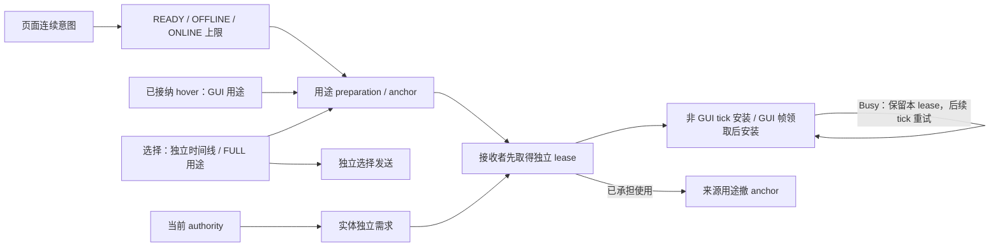

# 客户端模型需求

上级契约：[模型管理](../overview.md#seam-contract)。

## 职责与边界

本级把页面、交互、选择和实体的连续意图变成资源取得，负责用途准备和独立接收。

## Seam Contract

- 连续页面或交互何时能开始工作：[连续意图与工作准入](#连续意图与工作准入)。
- Ready 如何交给实体，Busy 或取消由谁归还：[用途准备与安装交接](#用途准备与安装交接)。
- 选择发送、反馈结束和实体需求如何独立：[选择发送与反馈](#选择发送与反馈)。

### 共同规则

适用范围：“连续意图与工作准入”“用途准备与安装交接”和“选择发送与反馈”。三项契约继承本节的职责、scope 所有权、取消、调度类别及验证依赖。

本子系统细化[模型管理的数据流与交接](../overview.md#新使用接纳与独立保留)，把页面、交互、选择和实体的连续意图变成资源取得。它决定何时按何种用途推进，负责用途接管和独立接收交接。

领域访问资格归[sessions](../sessions/overview.md#新使用资格)，资源容量与共享工作归[client resources](../client-resources/overview.md#seam-contract)，实体安装归[动画实体生命周期](../../animation/entity-lifecycle.md)。需求取消不授予共享 target、transfer 或 GPU 的关闭权。

需求 owner 只拥有连续意图，不能成为第二个资源发布锁或关闭器。纹理导航的 Ready-only 及失败即拒绝规则由展示层定义，不转化为后台待进入意图。

#### 数据流与交接

#### 运行作用域与所有权

Client 服务推进活跃 scope。页面、选择、hover 和每个实体保留自己的连续状态；实体安装端点为弱引用。用途操作持有本次 acquisition 或 Ready anchor，安装成功后由 binding 持有自己的 lease。

页面只拥有明确登记的卡片、实体和图片 action。Scope 结束释放自身 attempt/anchor；资源 adapter 处置不可取消 future 的迟到 lease。协调者不持 Screen，不遍历无关 Catalog。

#### 需求取消与失败归属

取消先撤本 scope 的推进和接收资格，再释放自身 attempt/anchor。页面存在活跃帧借用时，关闭立即封口；卡片、实体和图片 action 的清理延迟到本帧所有已接纳任务交接后。清理异常不跳过 sibling owner。其他用途、已安装 lease 和独立实体需求继续服从各自 owner。共享 Flight 及 transfer 是否终结由各自 owner 裁决。

同用途共享仍归同一资源 owner。

容量契约见[运行模型](../../runtime/overview.md)。需求验证及证据边界见[需求准备](../../../tools/benchmark/README.md#gui-与-full-需求准备)。

### 连续意图与工作准入

**边界与权威**

本契约继承[共同规则](#共同规则)的职责与 scope 所有权。

**前置条件与输入**

#### 连续准入

READY 只取得完整 Ready；OFFLINE 允许本地读取与构建；ONLINE 允许补取缺件。首次页面或前页连续停留超过 700 ms 时，页面时间门槛立即开放。前页停留不超过 700 ms 时，当前页本地工作在 300 ms 开放，联网工作在 700 ms 开放，端点包含等号。两个门槛从同一起点计算，不串联等待。

同内容 init/resize 保留语义页面起点。成员、顺序、页码或内容改变时，页面建立新起点。缓存命中、异步 miss 和开始联网不重置起点。完整 Ready 可直接取得，但首次绑定仍占本帧新准备名额；磁盘文件与 metadata 不旁路。显式选择和 hover/focus 保留各自时间线。

自动卡片最多 OFFLINE；卡片已有同用途 hover 时只以 READY 接收结果；同目标 FULL 选择不改变 GUI 准入。图片 adapter 消费同一准入上限。页面在下一次推进发布 eager 配置，不重置起点。eager 不请求或消费 preview，跳过不构成缺图或失败。已接纳的 non-eager 补图继续服从原 owner；配置开关不新增强制取消。关闭 eager 后，新需求恢复 non-eager 政策。自动准备与补图只新建默认贴图 GUI body，不探测或消费 FULL Ready 和派生物。页面展示资格由[客户端展示](../../client-presentation/overview.md)定义，资源 Ready 不能反向授予资格。

新交互须连续资格及页面本地准入均成立才接纳。移出撤销指针计时，但已接纳 hover 继续按原页面准入推进；未接纳目标不保留待启动意图。显式选择使用自己的起点，不叠加来源页面等待。

**结果与保证**

本次用途取得受[连续准入](#连续准入)给出的 READY/OFFLINE/ONLINE 上限约束；后续独立接收按[用途准备与安装交接](#用途准备与安装交接)推进。

**所有权与时序**

本契约继承[共同规则](#共同规则)的 scope 取消与调度规则。

**失败与拒收**

未接纳的交互与 eager 跳过按[连续准入](#连续准入)处置；取得后的失败见[用途准备与安装交接](#用途准备与安装交接)。

**证据与依赖**

本契约继承[共同规则](#共同规则)的容量与需求验证依赖。

### 用途准备与安装交接

**边界与权威**

本契约继承[共同规则](#共同规则)的职责、scope 所有权与调度。

**前置条件与输入**

#### 用途准备与独立接收

真实玩家选择按 FULL 和真实主体特化取得，GUI Ready 不代表 FULL。

Binding 消费 lease 的实际准备用途，不按请求猜安装能力。

**结果与保证**

接收实体先持有独立 lease，来源用途才退出，因此 unused cache 为零也不产生零持有间隙。

Ready 交接不转移实体私有状态，也不证明安装完成。

帧的 Ready-only 查询可发现两次 tick 之间发布的结果；未命中不降低准入或撤销 pending。

**所有权与时序**

同时只保留一个固定 FULL 的 selection preparation 和一个固定 GUI 的已接纳 hover。同目标两种用途独立推进；同用途精确请求仍复用既有资源工作。新接纳 hover 替换旧 hover，页面关闭不取消独立选择。

替换同用途操作时先取得新 interest/lease，再撤旧操作。

模型列表 GUI scope 的 tick 只取得资源并保留 Ready anchor。

帧 owner 获得新准备名额后，先取得匹配请求的独立接收 lease，再结束来源 anchor。

未提交的 claim 关闭自身 lease；任务取得 lease 后承担关闭责任，安装接纳后再转给 binding。

帧 owner 在完整交接后显式通知安装结果，scope 关闭后的通知不复活需求。

其他 owner 继续在 tick 非阻塞安装。

**失败与拒收**

Busy 表示任务、借用或候选占用串行安装窗口，具体门禁见[完整安装与替换](../../animation/entity-lifecycle.md#安装接纳与-busy)。

这些接收方保留 Ready anchor 与原准入，在后续 tick 重试，不等待动画 worker、不记录内容失败。

需求执行失败由协调者归约，精确候选安装失败仍归 binding。确定性内容失败与暂时访问失败分开；廉价资格检查不建立逐帧昂贵重试。离线 miss 只结束本次探测，不阻止后来具有网络能力的普通请求。

**证据与依赖**

准入依赖[连续意图与工作准入](#连续意图与工作准入)，实体 Busy 门禁依赖[完整安装与替换](../../animation/entity-lifecycle.md#安装接纳与-busy)；scope 取消与验证限制继承[共同规则](#共同规则)。

### 选择发送与反馈

**边界与权威**

本契约继承[共同规则](#共同规则)的职责与 scope 所有权。

**前置条件与输入**

#### 选择反馈

选择发送独立于资源取得终态，预取失败不抑制仍获准的选择。

**结果与保证**

ACTIVE 阶段不乐观修改模型或 Roaming；迟到 authority 仍建立正常实体需求。

只有左侧名称消费真实玩家安装等待，卡片名称保留内容名称；GUI 和图片的加载投影独立。

Accepted、资源 Ready 与 Retained 不能证明 Matching 安装。

**所有权与时序**

反馈与页面、用途准备、实体需求的所有权分别按[共同规则](#共同规则)及[用途准备与独立接收](#用途准备与独立接收)保留。

**失败与拒收**

反馈期限、发送异常、拒绝或失败只终结本次反馈与用途准备，不重发选择、不回滚 authority、不清领域失败，也不取消实体独立需求。

**证据与依赖**

业务请求与权威状态依赖[玩家状态](../../network/player-state.md#seam-contract)；需求验证限制继承[共同规则](#共同规则)。

## 设计取舍

集中协调减少页面、选择和实体之间的状态组合，代价是显式 scope、用途状态与 client tick 轮询。

集中推进过滤短命需求，代价是新内容可能延后，实际收益尚未量化。

## 实现与验证入口

实际玩家和显式选择使用本地玩家调度类别，hover/GUI 使用后台类别；类别与容量见[客户端资源调度](../../runtime/overview.md#客户端资源调度)。

`ClientModelService.tick()` 推进资源需求；模型页面在 render 开头通过 `PageScope.advance()` 发布当帧政策。`Operation` 持 acquisition/anchor；模型列表显式启用 `EntityScope` 的帧安装模式，通过 Ready claim 交接独立 lease。其他 `EntityScope` 保留 Busy 接收 lease。`ModelResourceDemand` 负责 attempt 与迟到结果，`ClientDemandSelections` 区分 LOCAL 应用与业务会话发包。
