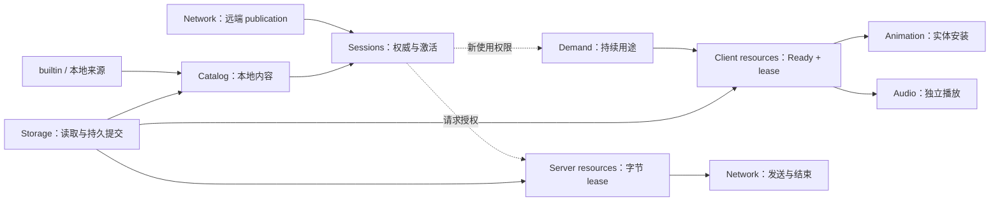

# 模型管理

上级契约：[系统边界](../README.md#系统边界)。

## 职责与边界

本级打通“模型来源、会话权限与下游消费”三段链路：上游扫描校验本地来源，中间由会话维护当前可见目录与访问权限，下游按页面、选择、实体或网络发送需要准备资源，并向每个消费者交付独立 `lease`。

## Seam Contract

- 接纳目录、内容或 Ready 结果后可以依赖哪些保证：[内容接纳与投影交付](#内容接纳与投影交付)。
- 消费者何时接管新资源，何时归还并独立收尾：[新使用接纳与独立保留](#新使用接纳与独立保留)。

### 共同规则

适用范围：“内容接纳与投影交付”和“新使用接纳与独立保留”。

本级只定义各子域之间的组合与交接边界，各子域细化各自接纳、保留与结束条件（不设统一失败码表、全局状态机或全局关闭器）：

| 责任域 | 交付结果 |
|---|---|
| [Catalog](catalog/overview.md#seam-contract) | 本地来源发现、验证与唯一的当前内容目录 |
| [Sessions](sessions/overview.md#seam-contract) | 当前领域目录权威、使用权限与远端内容的激活状态 |
| [Demand](demand/overview.md#seam-contract) | 持续意图（页面、交互、选择、实体）的资源取得、接管与安装交接 |
| [Client resources](client-resources/overview.md#seam-contract) | 共享准备、Ready target 与消费者独立的 `lease` |
| [Server resources](server-resources/overview.md#seam-contract) | 已校验的编码 chunk、有界图片快照与发送 `lease` |
| [Storage](storage/overview.md#seam-contract) | 精确来源读取、固定存储区域与持久提交 |
| [Audio](audio/overview.md#seam-contract) | 独立音频播放、顺序 chunk 读取与共享 PCM 保留 |

#### 数据流与交接

实线表示内容交付或权威输入，虚线表示权限约束；节点按职责划分。

#### 运行作用域与所有权

不同模块的存活周期（启动与关闭顺序见[运行模型](../runtime/overview.md)）：
- **进程作用域**：Catalog、Storage 与服务端字节保留随进程存活，跨会话复用。
- **领域会话作用域**：客户端与游戏服务端领域会话仅在本次会话有效。
- **客户端服务与消费端**：客户端资源与音频服务归客户端运行时持有；页面、选择和实体各自管理需求与 `lease`。

失败按 owner 隔离：单个来源损坏、单条远端激活失败、下游需求失败或单实体安装失败互不扩散；必需默认模型启动失败阻止服务发布，普通模型缺失或失败按[模型回退](../../product-decisions/decisions/model-fallback.md)处理；暂态失败、容量拒收、cache-only 未命中与接纳前过期不视作内容损坏；保证范围内的违约按[普通失败隔离](../../product-decisions/decisions/failure-isolation.md#bcordinary-failure-keeps-game-running)保留原异常收尾。

产品约束见[权威模型生命周期](../../product-decisions/requirements.md#reqauthoritative-model-lifecycle)，验证与已知问题见[模型管理验证](../../verification/model-management.md)与[模型管理状态](../../status/known-issues/model-management.md)。

### 内容接纳与投影交付

**前置条件与输入**

#### 身份与来源

模型管理用两层身份标识内容：`ModelId` 为完整规范业务身份（同名不保证同内容），`ContainerId` 区分具体容器字节表示。运行时发布分 `IntrinsicDefault` 与 `Model(ModelId)` 两种角色，同一内置默认源可同时以两种角色发布（`default` 专指进程必需默认发布，`builtin:default` 为普通内置条目）。

按[身份决策](../../product-decisions/decisions/model-identity.md)，仅具备本地来源证明的 `hash:` 身份允许用同模型其他本地容器替代；命名身份与远端缓存/服务端内容均要求精确匹配 `(ModelId, ContainerId)`。该二元组仅在模型管理、网络、存储与私有派生缓存内部流转，不向动画、渲染、实体或公开缓存接口暴露为普通 hash。

内容接纳时锁定实际来源与存储区域：
- 远端 publication 独立保存服务端身份、路径与访问信息，本地可替代内容不改写这些事实。
- 读取包装、reopen 与持久化沿用实际来源绑定的存储区域，不从远端逻辑位置反推。
- 缓存命中不赋予可见性、权限或会话资格；本地索引仅表示候选存在及重开位置。
- `direct` 来源外部文件可能随时被用户修改，强引用内容对象不保证后续读盘必成；已验证资源靠自身保留机制维持有效。

**结果与保证**

目录发布、内容验证、资源 Ready 与实体安装分属独立阶段，前一层完成不等价于后一层完成。

#### 接纳结果与保证范围

| 交接结果 | 消费者可以依赖的事实与边界 |
|---|---|
| 本地 Catalog snapshot | [Catalog](catalog/overview.md#seam-contract) 已接纳的完整不可变目录，本地内容已过本轮来源与完整性检查，渲染 target 尚未必 Ready |
| 远端 publication | [Sessions](sessions/overview.md#权威提交与通知) 已接纳的身份、成员、位置与权限列表，内容尚未必下载 |
| 远端激活后的 Ready content | [激活](sessions/overview.md#目录权威与内容激活) 已确定可消费内容及实际来源；metadata 校验不覆盖未读 chunk，也不代表 target Ready |
| Target Ready 与 `lease` | [客户端资源](client-resources/overview.md#ready-与宿主交接) 已完成准备与宿主纹理采用，消费者通过独立 `lease` 持有，实体尚未安装 |
| 实体安装 | [实体 owner](../animation/entity-lifecycle.md#模型使用与完整安装) 已核对请求、profile、真实 subject 与私有 holder 并完成绑定 |

内容分层检验归资产管线（见[分层验证](../asset-pipeline/overview.md#分层验证与发布)）；新使用放行与迟到结果接纳由各接收方判断。

### 新使用接纳与独立保留

**前置条件与输入**

#### 接纳与保留责任

后台异步完成不等于接收方已接纳。接收方先核对本次请求、当前权限与精确 owner，再接管自己的 `lease` 或独占结果；若拒收、取消或已结束，未移交结果由原 owner 关闭。接收方只归还自身 `lease`，不关闭其他消费者持有的共享 backing（流程见[需求](demand/overview.md#用途准备与安装交接)和[客户端资源](client-resources/overview.md#seam-contract)）。

**结果与保证**

目录层级不代表上级可直接关闭下级正在使用的资源：Catalog 强持有当前目录内容，消费者凭独立 `lease` 保活已取得资源；目录替换时 Catalog 只撤销自身引用，不关闭仍在使用的资源。

**所有权与时序**

保存裸 target 引用须同时保留产生它的 `lease`；临时借用不取得底层关闭权（逻辑释放、活动借用与物理关闭见[引用撤销与物理关闭](client-resources/overview.md#引用撤销与物理关闭)）。

#### 发布与使用的独立终点

- **启动与远端切换**：必需默认模型就绪后发布服务，普通本地来源随后异步加载。进远端会话只换对外可见目录，本地 Catalog 后台照常更新；退远端后直接切回最新本地目录，无需重建或等待共享 worker。
- **权限与生命周期解耦**：发起新使用检查当前权限，已接纳使用的存续由各自契约决定；网络连接撤销见[连接撤销交接](../network/overview.md#连接撤销交接)。
- **音频独立存活**：[音频播放](audio/overview.md#接纳与读取)在接纳时取得独立顺序读取能力，实体或 target 退休不中断已在播音频；断连和运行时关闭按[播放终态](audio/overview.md#播放终态)停止对应范围播放。

## 设计取舍

本级将目录权威、异步工作与运行资源拆开管理，避免目录一替换就引发全局资源回收。相应的代价是系统内存在多个独立的结束时机，且共享资源没有同步回收的硬时限。

## 实现与验证入口

`ModelSystem` 串联起进程级 Catalog、Storage 与资源服务，客户端和游戏服务端再各自提交所属领域的目录与状态事实；细粒度类映射见各子域的“实现与验证入口”。

核心载体分工如下：
- `ModelFileIdentity` 成对保存模型身份与容器身份。
- `ModelRepresentation` 统一封装身份、已解析的 `ModelFileView` 与 metadata 前缀，供 Catalog 元数据和同一表示下的 target 共享，避免各自复制 Manifest。
- `ContentBinding` 强持有内容对象及实际来源绑定；远端 publication 另行保存服务端的身份、路径与访问信息，二者分别维护。
