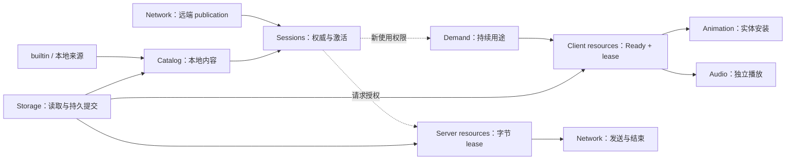

# 模型管理

上级契约：[系统边界](../README.md#系统边界)。

## 职责与边界

本级细化[系统边界](../README.md#系统边界)。模型管理负责打通“模型来源、会话权限与下游消费”三段链路：上游扫描并校验本地来源，中间由会话维护当前可见目录与访问权限，下游再按页面、玩家选择、实体或网络发送的实际需要准备资源，并向每个消费者交付独立的 `lease`。

## Seam Contract

- 接纳目录、内容或 Ready 结果后可以依赖哪些保证：[内容接纳与投影交付](#内容接纳与投影交付)。
- 消费者何时接管新资源，何时归还并独立收尾：[新使用接纳与独立保留](#新使用接纳与独立保留)。

### 共同规则

适用范围：“内容接纳与投影交付”和“新使用接纳与独立保留”继承本节的责任划分、运行作用域、失败隔离与产品依据。

本级只定义各子域之间的组合与交接边界，各子域在自己的文档中细化接纳、保留与结束条件：

| 责任域 | 交付结果 |
|---|---|
| [Catalog](catalog/overview.md#seam-contract) | 本地来源发现、验证与唯一的当前内容目录 |
| [Sessions](sessions/overview.md#seam-contract) | 当前领域目录权威、使用权限与远端内容的激活状态 |
| [Demand](demand/overview.md#seam-contract) | 持续意图（页面、交互、选择、实体）的资源取得、接管与安装交接 |
| [Client resources](client-resources/overview.md#seam-contract) | 共享准备、Ready target 与消费者独立的 `lease` |
| [Server resources](server-resources/overview.md#seam-contract) | 已校验的编码 chunk、有界图片快照与发送 `lease` |
| [Storage](storage/overview.md#seam-contract) | 精确来源读取、固定存储区域与持久提交 |
| [Audio](audio/overview.md#seam-contract) | 独立音频播放、顺序 chunk 读取与共享 PCM 保留 |

相邻子系统的职责保持分离：资产管线负责校验和转换内容，网络负责完成传输，动画负责把资源安装到实体并维护实体私有状态，渲染负责消费输出。模型管理不接管这些职责。

同样，父级只约束跨子域的交接关系，不强行建立统一的失败码表、全局状态机或全局关闭器。

#### 数据流与交接

下图概括模型管理内部的主流程。实线表示内容交付或权威输入，虚线表示权限约束；图中节点按职责划分，不对应同一个运行实例。

#### 运行作用域与所有权

不同模块的存活周期与归属如下（具体启动与关闭顺序由[运行模型](../runtime/overview.md)规定）：

- **进程作用域**：Catalog、Storage 以及服务端字节保留随进程存活，可跨多次会话复用。
- **领域会话作用域**：客户端与游戏服务端的领域会话只在本次会话期间有效。
- **客户端服务与消费端**：客户端资源与音频服务归客户端运行时持有；页面、选择和实体各自管理自己的需求与 `lease`。

失败严格按 owner 隔离，避免局部问题演变成全局故障：

- 单个来源损坏不会阻塞其他健康模型；单条远端 entry 的激活失败只影响该条目；下游需求失败不会回写目录权威；单个实体安装失败也不会把共享内容标为全局损坏。
- 必需默认模型（default）启动失败会直接阻止服务发布；普通模型缺失或加载失败则按[模型回退](../../product-decisions/decisions/model-fallback.md)处理。
- 暂时访问失败、容量拒收、cache-only 未命中以及接纳前已过期都属于正常业务结果，不能据此把内容判为损坏或永久缺失。
- 一旦在保证范围内出现非法结果或所有权违约，必须保留原始异常原因与责任身份，按[普通失败隔离](../../product-decisions/decisions/failure-isolation.md#bcordinary-failure-keeps-game-running)结束受影响操作；消费者不得把违约吞掉并伪装成成功或缺失。

本级遵循[权威模型生命周期](../../product-decisions/requirements/req-authoritative-model-lifecycle.md)的产品约束，具体实现由各子域提供。验证入口见[模型管理验证](../../verification/model-management.md)，已知未决问题见[模型管理状态](../../status/known-issues/model-management.md)。

### 内容接纳与投影交付

**边界与权威**

本契约继承[共同规则](#共同规则)的责任划分、数据流与运行作用域。

**前置条件与输入**

#### 身份与来源

模型管理用两层身份标识内容：`ModelId` 是完整的规范业务身份（同名并不保证内容相同），`ContainerId` 区分具体的容器字节表示。运行时发布则分为 `IntrinsicDefault` 和 `Model(ModelId)` 两种角色，同一个内置默认源可以同时以这两种角色发布。其中 `default` 专指本进程必需的默认发布，而 `builtin:default` 只是普通内置条目。

按[身份决策](../../product-decisions/decisions/model-identity.md)，只有具备本地来源证明的 `hash:` 身份允许用同模型的其他本地容器替代；命名身份必须精确匹配 `(ModelId, ContainerId)` 二元组；远端缓存与服务端内容也始终要求精确匹配。

这种精确二元组只在模型管理和网络内部流转（包括存储层和私有派生缓存）。动画、渲染、实体、资源、lease 以及公开缓存接口只能拿到资源对象或不透明的派生键，不得把容器身份换个名字当作普通 hash 绕过这一边界。

内容被接纳时会同时锁定它的实际来源与存储区域：

- 远端 publication 独立保存服务端的身份、路径与访问信息，即使本地存在可替代内容，也不能改写这些远端权威事实。
- 读取包装、重新打开（reopen）和持久化工作一律沿用实际来源绑定的存储区域，不从远端逻辑位置反推。
- 命中缓存不会凭空赋予可见性、访问权限或会话资格；本地索引只说明候选存在及重开位置，不代表内容或 target 已 Ready。
- `direct` 来源对应的外部文件可能被用户随时修改，因此强引用内容对象并不能保证后续读盘必然成功；已经验证完成的资源则靠自身的保留机制维持有效。

**结果与保证**

从扫描到实体可见，目录发布、内容验证、资源 Ready 与实体安装分属不同阶段，前一层完成不自动等价于后一层完成。

#### 接纳结果与保证范围

各 owner 在对外发布前必须满足下表承诺；消费者只能在对应身份与保留窗口内依赖这些保证：

| 交接结果 | 消费者可以依赖的事实与边界 |
|---|---|
| 本地 Catalog snapshot | [Catalog](catalog/overview.md#seam-contract) 已接纳的完整不可变目录，其中本地内容已通过本轮来源与完整性检查，但对应的渲染 target 尚未必 Ready |
| 远端 publication | [Sessions](sessions/overview.md#权威提交与通知) 已接纳的身份、成员、位置与权限列表，此时内容尚未必下载到本地 |
| 远端激活后的 Ready content | [激活](sessions/overview.md#目录权威与内容激活) 已确定可消费的内容及实际来源；metadata 校验不覆盖尚未读取的 chunk，也不代表 target 已 Ready |
| Target Ready 与 `lease` | [客户端资源](client-resources/overview.md#ready-与宿主交接) 已完成该 target 的准备与宿主纹理采用，消费者通过独立 `lease` 持有资源，实体尚未安装 |
| 实体安装 | [实体 owner](../animation/entity-lifecycle.md#模型使用与完整安装) 已核对本次请求、profile、真实 subject 与私有 holder 并完成绑定，不影响共享内容或其他实体 |

内容的分层检验归资产管线负责（见[分层验证](../asset-pipeline/overview.md#分层验证与发布)）。模型管理只接纳其产出，不重复构造第二份 Manifest，也不把“文件能解析”当作发布资格；新使用是否放行、迟到结果是否接纳，仍由各接收方自行判断。

**所有权与时序**

消费者只能在交付结果对应的身份和保留窗口内依赖上述保证，具体的接管与释放责任由[新使用接纳与独立保留](#新使用接纳与独立保留)约束。

**失败与拒收**

本契约继承[共同规则](#共同规则)的失败隔离与违约归属规则。

**证据与依赖**

本契约继承[共同规则](#共同规则)的产品依据与验证入口。

### 新使用接纳与独立保留

**边界与权威**

本契约继承[共同规则](#共同规则)的责任划分与运行作用域。

**前置条件与输入**

#### 接纳与保留责任

后台异步计算完成，并不等于接收方已经接纳了结果。接收方必须先核对本次请求、当前权限和精确匹配的 owner，再接管属于自己的 `lease` 或独占结果。如果接收方拒收、取消或已经结束，尚未移交的结果仍由原 owner 负责关闭；接收方只归还自己已接管的 `lease`，绝不能关闭其他消费者正在持有的共享底层资源（backing）。具体交接流程见[需求](demand/overview.md#用途准备与安装交接)和[客户端资源](client-resources/overview.md#seam-contract)。

**结果与保证**

目录的层级只表示职责划分，不代表上级可以直接关闭下级正在使用的资源。Catalog 强持有当前目录的内容，消费者则通过独立 `lease` 保活自己已取得的资源；当目录发生替换时，Catalog 只撤销自己的引用，不会替消费者关闭仍在使用的资源。

**所有权与时序**

消费者如果保存了裸 target 引用，就必须同时保留产生它的 `lease`；临时借用不会获得底层资源的关闭权。[引用撤销与物理关闭](client-resources/overview.md#引用撤销与物理关闭)明确区分了逻辑释放、活动借用和最终清理，不能指望靠 Catalog 替换或缓存淘汰来代替消费者主动归还。

#### 发布与使用的独立终点

不同流程各自独立推进和收尾，不能硬合并为同一个结束点：

- **启动与远端切换**：必需的初始默认模型就绪后才能发布本侧服务，普通本地来源随后异步加载。进入远端会话时只替换对外可见目录，本地 Catalog 仍在后台照常更新；退出远端会话后直接切回最新本地目录，无需重建内容或等待共享 worker。
- **权限与生命周期解耦**：发起新使用必须检查当前权限，但已经接纳的使用能否继续存活由各自契约决定。目录替换、请求取消、Ready 完成、实体退休和物理资源释放各自独立，网络侧的连接撤销见[连接撤销交接](../network/overview.md#连接撤销交接)。
- **音频独立存活**：[音频播放](audio/overview.md#接纳与读取)在接纳时获得独立的顺序读取能力。实体或 target 退休不会中断已经开始的播放；断连和运行时关闭则按[播放终态](audio/overview.md#播放终态)分别停止各自范围内的播放。

**失败与拒收**

本契约继承[共同规则](#共同规则)的失败隔离与违约归属规则。

**证据与依赖**

具体接管条件分别由[需求](demand/overview.md#seam-contract)、[客户端资源](client-resources/overview.md#seam-contract)和[音频](audio/overview.md#seam-contract)定义；验证入口继承[共同规则](#共同规则)。

## 设计取舍

本级将目录权威、异步工作与运行资源拆开管理，避免目录一替换就引发全局资源回收。相应的代价是系统内存在多个独立的结束时机，且共享资源没有同步回收的硬时限。

## 实现与验证入口

`ModelSystem` 串联起进程级 Catalog、Storage 与资源服务，客户端和游戏服务端再各自提交所属领域的目录与状态事实；细粒度类映射见各子域的“实现与验证入口”。

核心载体分工如下：
- `ModelFileIdentity` 成对保存模型身份与容器身份。
- `ModelRepresentation` 统一封装身份、已解析的 `ModelFileView` 与 metadata 前缀，供 Catalog 元数据和同一表示下的 target 共享，避免各自复制 Manifest。
- `ContentBinding` 强持有内容对象及实际来源绑定；远端 publication 则另行保存服务端的身份、路径与访问信息，二者不能混用。
