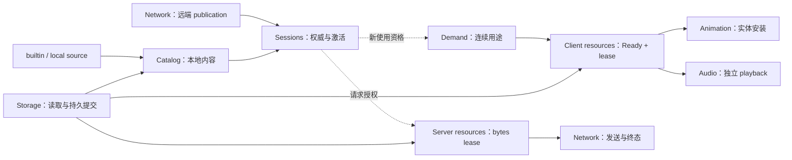

# 模型管理

上级契约：[系统边界](../README.md#系统边界)。

## 职责与边界

本级细化[系统边界](../README.md#系统边界)。模型管理把来源、会话权威和消费者需求连接起来，交付独立的资源使用。

## Seam Contract

- 接纳一个目录、内容或 Ready 结果后能依赖什么：[内容接纳与投影交付](#内容接纳与投影交付)。
- 新使用何时接管资源，何时归还：[新使用接纳与独立保留](#新使用接纳与独立保留)。

### 共同规则

适用范围：“内容接纳与投影交付”和“新使用接纳与独立保留”继承本节的责任划分、运行作用域、失败隔离与产品依据。

本级拥有各责任域的组合关系。下级分别定义自己的接纳、保留与结束条件：

| 责任域 | 交付结果 |
|---|---|
| [Catalog](catalog/overview.md#seam-contract) | 本地来源与唯一当前内容目录 |
| [Sessions](sessions/overview.md#seam-contract) | 当前领域权威、使用资格与远端激活投影 |
| [Demand](demand/overview.md#seam-contract) | 连续用途的取得、接管和接收交接 |
| [Client resources](client-resources/overview.md#seam-contract) | 共享准备、Ready target 与独立 lease |
| [Server resources](server-resources/overview.md#seam-contract) | 经验证的 chunk 或有界图片快照及发送 lease |
| [Storage](storage/overview.md#seam-contract) | 精确读取、绑定区域与持久提交 |
| [Audio](audio/overview.md#seam-contract) | 独立播放、顺序读取与 PCM 保留 |

资产管线验证和转换内容；网络终结传输；动画安装并维护实体私有状态；渲染消费输出。模型管理不接管这些责任。

父级只约束交接，不建立统一失败表、统一状态机或全局关闭器。

#### 数据流与交接

图中实线表示交付内容或权威输入，虚线表示资格约束；各节点不代表同一运行实例。

#### 运行作用域与所有权

Catalog、storage 与服务端字节保留属于进程作用域。领域会话属于本次 client/game server 会话。客户端资源与音频属于 client 服务，页面、选择和实体分别保留自己的需求。具体建立与关闭编排由[运行模型](../runtime/overview.md)定义。

失败按 owner 隔离：来源失败不阻塞健康项，activation 失败局限于 entry，需求失败不改权威，实体安装失败不把内容标记为全局损坏。Default 启动失败阻止服务发布；普通模型缺失或失败按[模型回退](../../product-decisions/decisions/model-fallback.md)处置。

暂时访问失败、容量拒绝、cache-only miss 和接纳时过期可以是正常结果，不能据此认定内容损坏或永久缺失。保证范围内的非法结果或所有权违约应保留原始原因与责任身份，并按[普通失败隔离](../../product-decisions/decisions/failure-isolation.md#bcordinary-failure-keeps-game-running)终结受影响操作；消费者不把违约改成成功或缺失。

本级依赖[权威模型生命周期](../../product-decisions/requirements/req-authoritative-model-lifecycle.md)的产品约束，各下级提供表中结果与局部接纳规则。验证设施见[模型管理验证](../../verification/model-management.md)，未闭合问题见[模型管理状态](../../status/known-issues/model-management.md)。

### 内容接纳与投影交付

**边界与权威**

本契约继承[共同规则](#共同规则)的责任划分、数据流与运行作用域。

**前置条件与输入**

#### 身份与来源

`ModelId` 是跨模块模型身份，`ContainerId` 区分精确容器表示。[身份决策](../../product-decisions/decisions/model-identity.md)允许经本地来源证明的同模型替代；remote cache 与 server 内容始终精确匹配。

精确 tuple 只在模型管理与网络内部流动，包括存储和私有派生 cache。动画、渲染、entity、resource、lease 和公开 cache interface 只接收资源或 opaque 派生键。容器身份改名为普通 hash 不能绕过边界。

内容接纳同时固定实际来源和存储区域。Remote publication 独立保存 server identity、path 和 access；本地替代不能改写这些权威事实。Wrapper、reopen 和持久工作沿用实际来源绑定，不从远端位置反推存储区域。

Cache 命中不创建可见性、访问权限或会话资格。Local index 证明候选与重新打开位置，不证明内容或 target Ready。Direct 来源可被用户修改，强引用不能保证未来读盘成功；已验证资源仍由自己的保留关系维持。

**结果与保证**

目录发布、内容验证、资源 Ready 与实体安装是不同边界。

#### 接纳结果与保证范围

各 owner 在发布结果前建立本行保证。消费者在对应身份和保留窗口内复用这些保证，不把前一层成功当作后一层完成。

| 交接结果 | 消费者可以依赖的事实与边界 |
|---|---|
| 本地 Catalog snapshot | [Catalog](catalog/overview.md#seam-contract)已接纳的完整不可变目录；本地内容通过本轮来源与完整验证，不代表对应 target Ready |
| 远端 publication | [Sessions](sessions/overview.md#权威提交与通知)已接纳的身份、成员、位置与权限事实；不证明内容已取得 |
| 远端 activation Ready content | [激活](sessions/overview.md#目录权威与内容激活)已确定可消费内容及实际来源；metadata 验证不覆盖未读取 chunks，也不代表 target Ready |
| Target Ready 与 lease | [客户端资源](client-resources/overview.md#ready-与宿主交接)已完成本 target 的准备和宿主采用；消费者通过独立 lease 保留资源，实体尚未安装 |
| 实体安装 | [实体 owner](../animation/entity-lifecycle.md#模型使用与完整安装)已接纳本次 request/profile、真实 subject 与私有 holder；不改变共享内容或其他实体的状态 |

资产管线拥有[分层验证](../asset-pipeline/overview.md#分层验证与发布)。模型管理接纳其结果，不重建第二份 Manifest 或以解析成功补造发布资格。新使用资格与迟到接纳仍由各接收 owner 裁决。

**所有权与时序**

消费者在交付结果对应的身份和保留窗口内依赖既有保证；各层保留责任由[新使用接纳与独立保留](#新使用接纳与独立保留)约束。

**失败与拒收**

本契约继承[共同规则](#共同规则)的失败隔离与违约归属。

**证据与依赖**

本契约继承[共同规则](#共同规则)的产品依据与验证入口。

### 新使用接纳与独立保留

**边界与权威**

本契约继承[共同规则](#共同规则)的责任划分与运行作用域。

**前置条件与输入**

#### 接纳与保留责任

异步计算完成不等于接收方已接纳。接收方应先核对本次请求、当前接纳资格和精确 owner，再接管自己的 lease 或独占结果。拒收、取消或接收方已结束时，尚未转移的结果仍由原 owner 关闭；接收方归还自己已接管的 lease，不能关闭其他消费者保留的共享 backing。具体交接由[需求](demand/overview.md#用途准备与安装交接)和[客户端资源](client-resources/overview.md#seam-contract)定义。

**结果与保证**

目录层次表示职责分解，不表示逐级关闭权。Catalog 强持有当前内容；消费者通过独立 lease 保留已取得资源。目录替换只撤销 Catalog 的引用，不能替消费者关闭资源。

**所有权与时序**

消费者保存裸 target 时应同时保留产生它的 lease；借用不取得 backing 的关闭权。[引用撤销与物理关闭](client-resources/overview.md#引用撤销与物理关闭)分别约束逻辑 release、活动借用和最终 cleanup，不能用 Catalog 替换或 cache 淘汰代替消费者归还。

#### 发布与使用的独立终点

初始 required default 就绪后才能发布本侧服务；普通来源随后异步激活。远端会话只替换公开投影，本地 Catalog 继续更新。退出远端投影后直接使用最新本地目录，不重建内容或等待共享 worker。

新使用依赖当前权限；已接纳的使用是否继续有效由其契约裁决。目录替换、请求取消、Ready 完成、实体退休和物理释放不能合并为一个终态。网络撤销规则见[连接撤销交接](../network/overview.md#连接撤销交接)。

[音频播放](audio/overview.md#接纳与读取)在接纳时取得独立读取能力。实体或 target 退休不结束已接纳播放；disconnect 与 runtime close 按[播放终态](audio/overview.md#播放终态)结束各自范围的播放。

**失败与拒收**

本契约继承[共同规则](#共同规则)的失败隔离与违约归属。

**证据与依赖**

具体接管条件由[需求](demand/overview.md#seam-contract)、[客户端资源](client-resources/overview.md#seam-contract)和[音频](audio/overview.md#seam-contract)分别提供；验证入口继承[共同规则](#共同规则)。

## 设计取舍

本级分开权威、工作与资源，避免目录替换触发全局资源回收。代价是多个独立终点及共享资源没有同步回收时限。

## 实现与验证入口

`ModelSystem` 连接进程 Catalog、storage 与资源服务；client/game server 服务分别提交所属领域事实。具体映射由各下级“实现与验证入口”定位。

`ModelFileIdentity` 成对携带模型和容器身份，`ModelRepresentation` 统一 identity、已解析 `ModelFileView` 与 metadata prefix。Catalog metadata 和同表示 target 共享该解析事实，不各自复制 Manifest。`ContentBinding` 强持内容及实际来源绑定；远端 publication 另持 server identity/path/access，不能混同。
