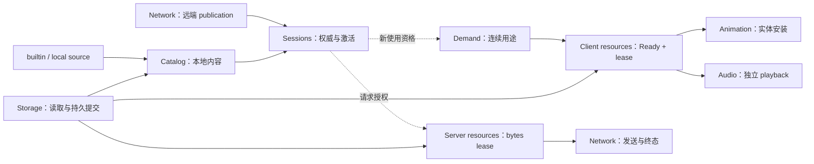

# 模型管理

## 职责与边界

本级细化[系统边界](../README.md#系统边界)。模型管理把来源、会话权威和消费者需求连接起来，交付独立的资源使用。目录发布、内容验证、资源 Ready 与实体安装是不同边界。产品义务见[权威模型生命周期](../../product-decisions/requirements/req-authoritative-model-lifecycle.md)。

本级拥有各责任域的组合关系。下级分别定义自己的接纳、保留与结束条件：

| 责任域 | 交付结果 |
|---|---|
| [Catalog](catalog/overview.md) | 本地来源与唯一当前内容目录 |
| [Sessions](sessions/overview.md) | 当前领域权威、使用资格与远端激活投影 |
| [Demand](demand/overview.md) | 连续用途的取得、接管和接收交接 |
| [Client resources](client-resources/overview.md) | 共享准备、Ready target 与独立 lease |
| [Server resources](server-resources/overview.md) | 经验证的 chunk 或有界图片快照及发送 lease |
| [Storage](storage/overview.md) | 精确读取、绑定区域与持久提交 |
| [Audio](audio/overview.md) | 独立播放、顺序读取与 PCM 保留 |

资产管线验证和转换内容；网络终结传输；动画安装并维护实体私有状态；渲染消费输出。模型管理不接管这些责任。

## 运行作用域与所有权

Catalog、storage 与服务端字节保留属于进程作用域。领域会话属于本次 client/game server 会话。客户端资源与音频属于 client 服务，页面、选择和实体分别保留自己的需求。具体建立与关闭编排由[运行模型](../runtime/overview.md)定义。

目录层次表示职责分解，不表示逐级关闭权。Catalog 强持有当前内容；消费者通过独立 lease 保留已取得资源。目录替换只撤销 Catalog 的引用，不能替消费者关闭资源。

## 数据流与交接

图中实线表示交付内容或权威输入，虚线表示资格约束；各节点不代表同一运行实例。

### 身份与来源

`ModelId` 是跨模块模型身份，`ContainerId` 区分精确容器表示。[身份决策](../../product-decisions/decisions/model-identity.md)允许经本地来源证明的同模型替代；remote cache 与 server 内容始终精确匹配。

精确 tuple 只在模型管理与网络内部流动，包括存储和私有派生 cache。动画、渲染、entity、resource、lease 和公开 cache interface 只接收资源或 opaque 派生键。容器身份改名为普通 hash 不能绕过边界。

内容接纳同时固定实际来源和存储区域。Remote publication 独立保存 server identity、path 和 access；本地替代不能改写这些权威事实。Wrapper、reopen 和持久工作沿用实际来源绑定，不从远端位置反推存储区域。

## 生命周期与失败

### 发布与使用的独立终点

初始 required default 就绪后才能发布本侧服务；普通来源随后异步激活。远端会话只替换公开投影，本地 Catalog 继续更新。退出远端投影后直接使用最新本地目录，不重建内容或等待共享 worker。

新使用依赖当前权限；已接纳的使用是否继续有效由其契约裁决。目录替换、请求取消、Ready 完成、实体退休和物理释放不能合并为一个终态。网络撤销规则见[连接撤销交接](../network/overview.md#连接撤销交接)。

失败按 owner 隔离：来源失败不阻塞健康项，activation 失败局限于 entry，需求失败不改权威，实体安装失败不把内容标记为全局损坏。Default 启动失败阻止服务发布；普通模型缺失或失败按[模型回退](../../product-decisions/decisions/model-fallback.md)处置。

## 关键契约与设计取舍

Cache 命中不创建可见性、访问权限或会话资格。Local index 证明候选与重新打开位置，不证明内容或 target Ready。Direct 来源可被用户修改，强引用不能保证未来读盘成功；已验证资源仍由自己的保留关系维持。

本级分开权威、工作与资源，避免目录替换触发全局资源回收。代价是多个独立终点及共享资源没有同步回收时限。父级只约束交接，不建立统一失败表、统一状态机或全局关闭器。

## 实现与验证入口

`ModelSystem` 连接进程 Catalog、storage 与资源服务；client/game server 服务分别提交所属领域事实。具体映射由各下级“实现与验证入口”定位。验证设施见[模型管理验证](../../verification/model-management.md)，未闭合问题见[模型管理状态](../../status/known-issues/model-management.md)。

`ModelFileIdentity` 成对携带模型和容器身份，`ModelRepresentation` 统一 identity、已解析 `ModelFileView` 与 metadata prefix。Catalog metadata 和同表示 target 共享该解析事实，不各自复制 Manifest。`ContentBinding` 强持内容及实际来源绑定；远端 publication 另持 server identity/path/access，不能混同。
