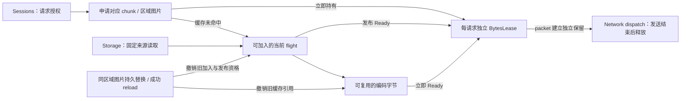

# 服务端资源保留

上级契约：[模型管理](../overview.md#seam-contract)。

## 职责与边界

本级负责为服务端网络发送准备编码后的模型 chunk 或独立预览图快照。调用方发起申请后，本级立即返回一份独立的 `BytesLease`；未命中缓存时由后台共享读取并校验，发送封包前再从 Ready `BytesLease` 派生出发送保留，确保发送期间的底层字节不受缓存淘汰或会话退出影响。

## Seam Contract

- 发送者拿到的字节与 `BytesLease` 具备哪些保证：[发送字节取得与交付](#发送字节取得与交付)。
- 图片替换或目录 reload 发生时，旧等待者与新请求如何隔离：[图片替换与旧读取](#图片替换与旧读取)。

### 共同规则

适用范围：“发送字节取得与交付”和“图片替换与旧读取”继承本节的职责、进程与会话所有权、保留预算、失败处理和依赖。

本子系统细化[模型管理的数据交接](../overview.md#新使用接纳与独立保留)，专门向发送者提供校验后的编码 chunk、有界独立图片快照以及独立的 `BytesLease`。它不负责领域权限校验、磁盘持久化或网络传输收尾。

#### 数据流与交接

#### 运行作用域与所有权

服务端字节运行时归进程级的 `ModelSystem` 所有，由它统一驱动 tick 与关闭，因此缓存可跨越多次 game server 实例存续。单个玩家会话从申请起持有自己的 `BytesLease`；全局 dispatch 接纳 packet 后，独占该 packet 对应保留的发送与释放责任。缓存淘汰只撤销缓存自身的引用，绝不能关闭正在发送的底层字节。

某个玩家会话退出时，只关闭它自己的请求与 `BytesLease`，进程级缓存和其他消费者不受影响。

容量与清理边界如下：

- Chunk 与独立图片共用编码缓存保留预算。该预算不包含全部 in-flight 读取、正在发送的 `BytesLease` 以及对象头开销，因此不承诺进程内存硬上限。超大结果可以直接交付给调用方，但不写入缓存保留；缓存淘汰也不限制活动底层内存的瞬时分配。
- 缺失和失败结果不进入 Ready 缓存。关闭某次使用只撤销本请求的 interest；最后一个 interest 退出时，撤销该 flight 的加入与发布资格。但已经启动的旧读取仍继续占用工作容量直到实际读完退出，迟到的结果也不会复活已经结束的使用。
- 运行时关闭时会封口所有 Pending 请求、清理仍在活动的 flight 并等待后台 worker 退出；已经建立好的 Ready `BytesLease` 继续独立存活到其所有者释放。

授权检查依赖[sessions 的当前使用资格](../sessions/overview.md#新使用资格)，图片持久成功通知依赖[图片提交](../storage/overview.md#独立图片与提交资格)，发送收尾依赖[dispatch 所有权](../../network/overview.md#传输接管与发送终态)。当前已知证据范围见[模型管理问题](../../../status/known-issues/model-management.md)。

### 发送字节取得与交付

**边界与权威**

本契约继承[共同规则](#共同规则)的职责与进程级所有权。

**前置条件与输入**

每次请求前都必须重新检查资源授权，命中缓存不能跳过授权检查。

**结果与保证**

申请调用立即返回一份调用方可关闭的独立 `BytesLease`。其可观察状态分为 `Pending`、`Ready`、`Missing`、`Failed` 和 `Ended`：重复观察不增加保留计数，`Pending` 变为 `Ready` 也不另发新 `lease`。如果缓存中已有合法数据，申请当场即可返回 `Ready`。其中 `Missing` 仅用于表示独立图片不存在；容量满导致的拒收以及读取错误都会携带原始原因进入 `Failed`。

不同字节数据的校验深度明确区分：Chunk 严格按目标 descriptor 校验完整性；普通独立图片只保证来自固定来源且为有界的完整字节快照，不在服务端做媒体解码，因此长度合法但内容损坏的图片仍可能被发送。客户端展示解码与管理上传校验由各自的接收方负责。

**所有权与时序**

消费者在原 owner tick 中观察 `BytesLease` 状态，退出时直接关闭即可，无需为了等迟到结果继续轮询。构造网络 packet 时，先从 Ready `BytesLease` 建立一份独立的发送保留，再关闭原先申请用的 `BytesLease`。Packet 交给 dispatch 接纳前由调用方负责关闭，接纳后只由 dispatch 负责关闭。

管理端请求可以向资源方交入一份独立的读取保留。当请求被拒收、尚未启动就被取消或后台读取实际结束时，该保留随之结束；取消上层使用不会提前结束已经移交给 flight 的读取保留。保留的释放动作只归还预算，不得阻塞、抛错、重入资源运行时或直接驱动网络采用。

会话、`lease`、dispatch 与缓存的保留窗口继承[共同规则](#共同规则)；图片替换场景的额外约束见[图片替换与旧读取](#图片替换与旧读取)。

**失败与拒收**

请求被拒收时直接返回 `Failed` 状态的 `BytesLease`，不在后台留下隐藏工作。处于 `Pending` 的 `lease` 被关闭后，资源方独立清理请求和迟到结果，调用方无需自己处理“取消与结果交付并发”的竞态。其余失败与关闭规则继承[共同规则](#共同规则)。

**证据与依赖**

本契约继承[共同规则](#共同规则)的授权、持久提交与发送收尾依赖。

### 图片替换与旧读取

**边界与权威**

本契约继承[共同规则](#共同规则)的职责、进程级所有权与缓存预算规则。

**前置条件与输入**

#### 图片失效与旧请求

Chunk 与独立图片共享字节保留缓存、flight 登记与工作容量。图片缓存键同时区分实际存储区域与 `ContainerId`，不同区域之间互不失效。进程内 writer 成功持久替换图片后，只撤销对应区域和键的缓存保留；显式 reload 成功后则撤销全部独立图片保留，不额外引入文件系统 watcher 或逐次 stat 检查。

**结果与保证**

图片失效只会撤销旧 flight 的加入资格与发布资格：已经在等待该 flight 的旧消费者仍可拿到完整的旧快照，已经发出的活动 `lease` 也继续有效。旧读取 worker 直到实际结束才归还工作容量；迟到的旧读取结束时只能移出自身，既不能把旧图回填进缓存，也不能误删已经建立的新读取。目录 reload 不保证新图片一定可读，也不强制推送刷新客户端已有图片；在未触发 reload 前，热门旧图可以持续命中缓存。

**所有权与时序**

运行时把“当前可加入的 flight 索引”和“全部尚未结束的活动 flight 集合”分开维护（后者按对象身份独立登记）。发布资格检查与写入 Ready 缓存必须在同一把锁内原子完成。`BytesLease` 保活共享底层字节，packet 发送结束只释放它自己的那份 `lease`。

`PreviewStore` 在持久化成功后负责通知字节运行时执行内存失效，运行时绝不在持有自身锁期间回调 storage 或 session；运行时关闭后的失效通知为无操作（no-op）。存储事务见[图片提交](../storage/overview.md#独立图片与提交资格)，发送责任见[资产传输](../../network/implementation/asset-transfer.md)。

**失败与拒收**

本契约继承[共同规则](#共同规则)的取消、迟到结果以及全部活动 flight 的关闭规则。

**证据与依赖**

本契约继承[共同规则](#共同规则)的持久成功通知、发送收尾与证据限制。

## 设计取舍

Chunk 与独立图片共用同一份保留预算，实现简单但两者会互相挤出。把“可加入索引”与“实际活动集合”拆开，可以避免图片失效时提前归还仍在占用的工作容量，代价是旧读取与新读取可能短时并存。

## 实现与验证入口

`ServerResourceRuntime` 统筹进程级字节保留、flight 调度与工作容量，其中可加入索引和全部活动集合分别由 `pending` 和 `activeFlights` 维护。`BytesLease` 从申请时起代表一次发送请求的使用，调用 `retain` 可为网络 packet 派生出独立的 Ready 保留。`PreviewStore` 负责在持久提交成功后发出失效通知。

编码缓存的默认保留预算为 64 MiB，由 tick 按需淘汰缓存引用；发布资格复核与插入 Ready 缓存都在同一把运行时锁内完成。
