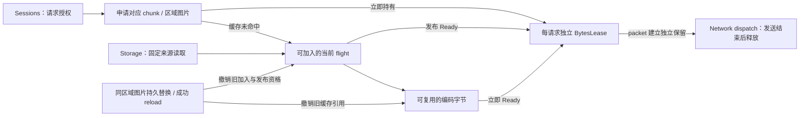

# 服务端资源保留

上级契约：[模型管理](../overview.md#seam-contract)。

## 职责与边界

本级为服务端网络发送准备编码后的模型 chunk 与独立预览图快照：申请即返独立 `BytesLease`，未命中缓存时后台共享读取并校验，封包前从 Ready `BytesLease` 派生发送保留，避免发送期间受缓存淘汰或会话退出影响。

## Seam Contract

- 发送者拿到的字节与 `BytesLease` 具备哪些保证：[发送字节取得与交付](#发送字节取得与交付)。
- 图片替换或目录 reload 发生时，旧等待者与新请求如何隔离：[图片替换与旧读取](#图片替换与旧读取)。

### 共同规则

适用范围：“发送字节取得与交付”和“图片替换与旧读取”。

细化[模型管理的数据交接](../overview.md#新使用接纳与独立保留)，不承担领域权限校验、磁盘持久化或网络发送收尾。依赖[sessions 新使用资格](../sessions/overview.md#新使用资格)、[图片提交](../storage/overview.md#独立图片与提交资格)与[dispatch 所有权](../../network/overview.md#传输接管与发送终态)；验证缺口见[模型管理问题](../../../status/known-issues/model-management.md)。

#### 数据流与交接

#### 运行作用域与所有权

服务端字节运行时归进程级 `ModelSystem` 所有，跨多次 game server 存续。单玩家会话持有自身 `BytesLease`，退出时只关闭自身请求与 `BytesLease`；dispatch 接纳 packet 后独占该发送保留的释放权；缓存淘汰只撤销缓存自身引用。

容量与清理边界：
- Chunk 与独立图片共用编码缓存保留预算（不含 in-flight 读取、正在发送的 `BytesLease` 与对象头，不构成进程内存硬上限）；超大结果直接交付不入缓存。
- 缺失与失败结果不入 Ready 缓存；最后一份 interest 退出撤销 flight 加入与发布资格，已启动读取继续占工作容量至实际读完退出。
- 运行时关闭封口 Pending、清理活动 flight 并等后台 worker 退出；已建立的 Ready `BytesLease` 独立存活至所有者释放。

### 发送字节取得与交付

**前置条件与输入**

每次请求前需检查资源授权，缓存命中不跳过授权。

**结果与保证**

申请即返独立 `BytesLease`，可观察状态为 `Pending`、`Ready`、`Missing`（仅独立图片不存在）、`Failed`（含容量满拒收与读取错误）与 `Ended`；重复观察不增计数，`Pending` 转 `Ready` 不换新 `lease`。

校验深度区分：Chunk 按目标 descriptor 校验完整性；普通独立图片只保证来自固定来源且为有界完整字节快照，服务端不做媒体解码（可能发出长度合法但内容损坏的图片，由客户端解码或管理上传校验把关）。

**所有权与时序**

消费者在原 owner tick 观察 `BytesLease`，退出时直接关闭即可。构造 packet 先从 Ready `BytesLease` 派生独立发送保留，再关闭原申请用 `BytesLease`；packet 移交 dispatch 前由调用方关闭，接纳后归 dispatch。

管理端请求可向资源方交入一份独立读取保留：拒收、未启动取消或后台读取实际结束时释放（取消上层使用不提前结束已移交给 flight 的读取保留）。释放动作只归还预算，不阻塞、抛错、重入资源运行时或直接驱动网络采用。

**失败与拒收**

请求拒收直接返回 `Failed` 的 `BytesLease`，不留隐藏后台工作；关闭 `Pending` 的 `lease` 后由资源方独立清理迟到结果。

### 图片替换与旧读取

**前置条件与输入**

#### 图片失效与旧请求

图片缓存键区分实际存储区域与 `ContainerId`，跨区域互不失效。进程内 writer 持久替换成功后只撤销对应区域和键的缓存保留；显式 reload 成功后撤销全部独立图片保留（无文件系统 watcher 或逐次 stat）。

**结果与保证**

图片失效只撤销旧 flight 的加入与发布资格：已等待旧 flight 的消费者仍拿到完整旧快照，已发出活动 `lease` 继续有效；旧读取 worker 实际结束才归还工作容量，迟到旧读取只移出自身而不回填缓存或误删新读取。目录 reload 不强制推送刷新客户端已有图片，未 reload 前热门旧图持续命中缓存。

**所有权与时序**

运行时把“当前可加入 flight 索引”与“全部活动 flight 集合”分开维护（后者按对象身份登记）；发布资格检查与写入 Ready 缓存同锁原子完成。`PreviewStore` 持久成功后通知字节运行时失效，运行时不在持锁期间回调 storage 或 session（关闭后失效通知为 no-op）；存储事务见[图片提交](../storage/overview.md#独立图片与提交资格)，发送责任见[资产传输](../../network/implementation/asset-transfer.md)。

## 设计取舍

Chunk 与独立图片共用同一份保留预算，实现简单但两者会互相挤出。把“可加入索引”与“实际活动集合”拆开，可以避免图片失效时提前归还仍在占用的工作容量，代价是旧读取与新读取可能短时并存。

## 实现与验证入口

`ServerResourceRuntime` 统筹进程级字节保留、flight 调度与工作容量，其中可加入索引和全部活动集合分别由 `pending` 和 `activeFlights` 维护。`BytesLease` 从申请时起代表一次发送请求的使用，调用 `retain` 可为网络 packet 派生出独立的 Ready 保留。`PreviewStore` 负责在持久提交成功后发出失效通知。

编码缓存的默认保留预算为 64 MiB，由 tick 按需淘汰缓存引用；发布资格复核与插入 Ready 缓存都在同一把运行时锁内完成。
