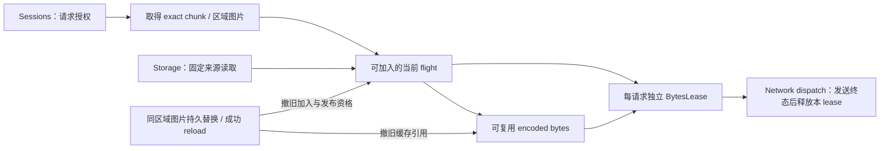

# 服务端资源保留

## 职责与边界

本子系统细化[模型管理的数据交接](../overview.md#数据流与交接)，为发送者提供验证后的 encoded chunk 或独立图片快照及独立 bytes lease。它不拥有领域授权、持久存储或传输终态。

Chunk 按目标 descriptor 验证。普通独立图片只保证固定来源、有界完整快照，不在服务端解码；长度合法的坏媒体仍可能被传输。客户端解码与管理上传验证由各自接收者完成。

## 运行作用域与所有权

进程 `ModelSystem` 拥有字节 runtime 的 tick 与关闭，可跨多次 game server 实例存续。Session 只取得自己的 lease；global dispatch 接纳 packet 后拥有该请求发送与终结。缓存淘汰只撤保留引用，不能关闭活动发送的 backing。

## 数据流与交接

### 图片失效与旧请求

Chunk 与图片共享字节保留、flight 和工作容量。图片 key 区分实际 store 与 `ContainerId`，不同区域互不失效。进程 writer 持久替换成功后只撤对应区域 key 的保留；成功显式 reload 撤全部独立图保留，不新增 watcher 或逐次 stat。

失效撤旧 flight 的加入、发布资格，但旧 waiter 仍可取得完整旧快照，活动 lease 仍有效。旧 worker 直到真实终态才归还容量；迟到终态只能移除自身，不能回填旧图或删除 replacement。Reload 不证明新图可读，不强制刷新客户端有效图片；未 reload 的热门旧图可持续命中。

## 生命周期与失败

缺失和失败不进入 Ready。取消只撤本请求 interest；交付输给取消时交付方释放新 lease。关闭应处置全部尚未物理结束的 flight，包括已退出可加入索引的旧读取。迟到 bytes 不能发布，仍有唯一释放方。

资源授权在每次请求重新检查，cache 命中不能代替授权。Session 退出只结束自己的请求与 lease，进程 cache 及其他消费者不随之退休。

## 关键契约与设计取舍

Chunk 与图片共享保留预算，会互相挤出。保留预算不包括全部 in-flight、发送 lease 与对象开销，不承诺进程内存硬上限。分开可加入索引与真实活动集合，避免失效提前归还容量；代价是旧读取与新读取可短时并存。

## 实现与验证入口

`ServerResourceRuntime` 的 chunk 与独立图片共用 64 MiB encoded 缓存保留预算。超大结果可交付但不进入保留；tick 淘汰缓存引用，不限制全部活动 backing 的瞬时分配。

`ServerResourceRuntime.pending` 只索引可加入 flight，`activeFlights` 按对象 identity 记录全部未终结工作。发布资格检查和 Ready 插入在同一 runtime 锁内。`BytesLease` 保留共享 backing；packet terminal 只释放本请求 lease。

`PreviewStore` 在持久成功后通知 runtime 内存失效，runtime 不持锁回调 storage/session；关闭后观察为 no-op。存储事务见[图片提交](../storage/overview.md#独立图片与提交资格)，发送责任见[资产传输](../../network/implementation/asset-transfer.md)。
