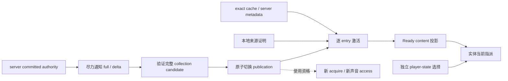

# 模型领域会话

上级契约：[模型管理](../overview.md#seam-contract)。

## 职责与边界

本级承担领域目录权威、使用资格、远端 activation 与客户端投影。

## Seam Contract

- 权威何时提交，内容何时可消费：[目录权威与内容激活](#目录权威与内容激活)。
- 当前权限对新使用和选择意味着什么：[新使用与选择资格](#新使用与选择资格)。
- 缺图观察或补图提交何时过期：[成员观察与管理提交](#成员观察与管理提交)。

### 共同规则

适用范围：“目录权威与内容激活”“新使用与选择资格”和“成员观察与管理提交”。三项契约继承本节的责任划分、单写 owner、领域状态与退出、未决项和验证限制。

本子系统细化[模型管理的发布与使用](../overview.md#发布与使用的独立终点)，拥有领域目录权威、使用资格、远端 activation 与 client 投影。握手资格、连接路由、assembly 和传输终态归网络；权限语义以[模型授权](../../../product-decisions/decisions/model-authorization.md)为准。

#### 数据流与交接

#### 运行作用域与所有权

Server game owner 单写各玩家 session 的 catalog、grants、内容策略与选择事实；client owner 单写当前远端 publication 和 activation。进程 Catalog 不属于 session，远端期间继续扫描并保留完整本地内容。

握手后的业务资格与 catalog ACTIVE 独立。Collection 失败不自动结束已握手的业务会话；整体撤销由[网络连接撤销交接](../../network/overview.md#连接撤销交接)定义。

#### 领域状态与退出

Client 领域状态为 Local、Negotiating、Active、Default Only、Closed。进入远端阶段时公开 view 先收缩为 intrinsic default，再由当前 publication/activation 形成投影；不混合本地和远端目录。

协议失败、disconnect 或 replacement 按网络契约先撤连接资格；本域随后撤销旧 entry 的提交、查询与远端投影。恢复 Local 时直接发布最新本地 snapshot，不等待共享 worker，不清已完成资源 cache。Server session seal 先拒绝新领域请求，再请求网络终结所属 transfer，最后撤领域引用；其他 session 不受影响。

Server-private forced-selection 相对 `RESTRICTED_AUTH` 的产品例外仍未裁决，见[Q-09](../../../complexity-map/java-models-and-network/open-questions.md#q-09)，不得由现行机制补造产品规则。

传输映射见[Catalog 同步](../../network/implementation/catalog-sync.md)，差异见[模型管理问题](../../../status/known-issues/model-management.md)。

### 目录权威与内容激活

**边界与权威**

本契约继承[共同规则](#共同规则)的责任划分与领域状态。

**前置条件与输入**

激活依次尝试 active exact、local exact、active local same-`ModelId`、当前 local index 其余同模型候选、remote exact cache、server metadata prefix。只有本地来源证明允许非精确替代；remote cache/server 始终 exact。坏内容可继续候选，访问错误保留来源。实际内容沿用自己的来源与存储绑定，不修改 server path/access。

**结果与保证**

#### 权威提交与通知

Server 先提交事实，再构造并尽力发送 full/delta。编码或 enqueue 失败不回滚 authority，不关闭 session，也不建立 retry/history/resync；后续 delta 从 server current snapshot 继续。

Client 验证全部 operation 后原子替换 collection。Collection 不联合发布 selection，也不协调 player-state sender。选择请求结果只表达 disposition；Accepted 不证明安装。Wire 规则见[Protocol V1](../../../standards/protocol-v1/README.md)。

重连提供确定收敛。

#### 远端权威与激活

Publication 只表达身份、目录与访问事实；Pending、Ready、Failed 属于 entry activation，不反向修改 authority。只有完整 Ready content 进入可消费投影；metadata Ready 不证明 model chunks 齐全或 target Ready。

**所有权与时序**

未变 exact tuple 的 Ready/Failed 终态可保留。仅使用资格变化时，已接纳 metadata action 继续，终态重绑定当前 entry；内容成员变化时，取消旧共同 action，退休其 Pending entry owner，再为当前全部 Pending entry 建立共同 action。迟到旧结果不能覆盖 replacement 或伪装成 sibling 故障。

权威、激活和传输拥有独立终点；接收方不会以通知成功、metadata Ready 或 cache 命中代替授权。

**失败与拒收**

#### 失败与恢复资格

无效 full 或 wire/domain 自身无效的 delta 结束远端 owner，进入 intrinsic-default-only。结构有效但不兼容旧 baseline 的 delta 被丢弃，当前 authority 保留，不主动 resync；remove 不存在项为 no-op。Default-only 不关闭 Minecraft 连接，也不清实体指派；普通安装不再获准求值或消费，实体按回退规则结束使用。

Activation 内容失败与暂时访问失败分开。Metadata 的 NOT_FOUND、BUSY、UNAVAILABLE 可由 tuple 切换或容量造成，不能固化为内容损坏。显式 retry/reload，或内容、权限、连接、宿主能力变化才能建立新的昂贵尝试资格；时间经过与切走切回不清失败记忆。

**证据与依赖**

本契约继承[共同规则](#共同规则)的产品依据、传输映射与验证限制。

### 新使用与选择资格

**边界与权威**

本契约继承[共同规则](#共同规则)的责任划分与领域状态。

Selection 独立于资源取得。`builtin_default` 的 wire 状态在 client 单向映射为本进程常驻 default 身份；不能据 client applied identity 创建第二套选择 authority。

**前置条件与输入**

#### 新使用资格

新 acquire、Ready/cache 命中和新音频播放均检查当前普通内容使用资格。

`CatalogAddressResolver` 按完整位置精确匹配；相对 entry 先判歧义再判权限，不猜扩展名。选择仍提交 `ModelId`。

**结果与保证**

同一会话内 publication 的使用资格变化不改变内容身份，也不撤销已接纳 attempt 或已安装 lease。

**所有权与时序**

Default-only 和连接结束另按[领域状态与退出](#领域状态与退出)及网络撤销契约处置。

Local authority 与 intrinsic default 使用本地资格。

**失败与拒收**

拒绝新使用不记录内容损坏，恢复资格后可继续需求。

**证据与依赖**

昂贵尝试的恢复另见[失败与恢复资格](#失败与恢复资格)；授权依据、Q-09 未决项与验证限制继承[共同规则](#共同规则)。

### 成员观察与管理提交

**边界与权威**

本契约继承[共同规则](#共同规则)的责任划分与领域状态。

远端缺图是当前 session 对精确成员的观察。

**前置条件与输入**

#### 缺图观察与管理提交资格

ABSENT、独立图媒体拒绝及迟到页面结果都复核发送时 token。

Repository 的图片请求另绑定 Catalog 与 session 成员 incarnation、exact connection。

展示图片不使用运行资产的权限门禁。

管理图片 commit 在原 session/member 的 effect gate 复核资格，具体持久事务由[独立图片与提交资格](../storage/overview.md#独立图片与提交资格)定义。

**结果与保证**

独立图片的内容版本还复用此观察；图可读通知只撤旧版本，不改变成员 incarnation，也不主动下载。

声明图可复用资源侧已经证明的相同内容，但新 use 应重新检查当前资格。

已成功提交的结果不因通知失败回滚。

**所有权与时序**

无关 publication/grants 更新保留观察；移除重加成员、换表示、图可读通知和 session 结束撤销旧 token。

页面关闭不清除观察，GUI 不持第二份缺图表。

**失败与拒收**

移除重加后旧请求不能借新成员的资格发布。

取消、成员替换和 session seal 拒绝旧提交。

**证据与依赖**

持久事务依赖[独立图片与提交资格](../storage/overview.md#独立图片与提交资格)；本页领域退出、未决项与验证限制继承[共同规则](#共同规则)。

## 设计取舍

通知因此不成为权限事务，代价是 client 可暂时保留旧 view。

## 实现与验证入口

`ServerModelSession` 保存 committed authority，`ClientModelSession` 保存领域状态及成员观察 token。`RemoteCatalogActivation` 拥有 entry action；`ClientCatalogManager` 始终订阅最新本地目录并切换公开投影。`ClientCatalogSnapshot` 提供接收方资格，`ClientModelRenderTargetManager` 在新使用前检查。
