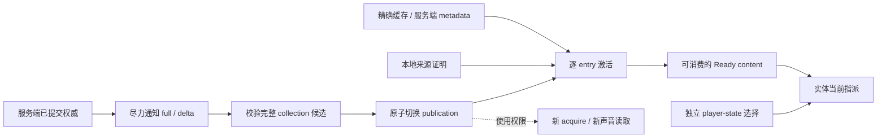

# 模型领域会话

上级契约：[模型管理](../overview.md#seam-contract)。

## 职责与边界

本级负责模型领域的目录权威、当前使用权限、远端条目激活与客户端对外视图：服务端结合本地目录与配置策略维护各玩家权威目录与授权并尽力推送；客户端按本地/联机状态切换对外目录，将远端条目逐个激活为可消费内容，并为新资源申请、模型选择和预览图观察提供资格门禁。

## Seam Contract

- 目录权威何时提交，远端条目何时进入可消费状态：[目录权威与内容激活](#目录权威与内容激活)。
- 服务端配置与本地目录如何串行合并并发布：[配置与目录发布](#配置与目录发布)。
- 当前权限对新资源申请和模型选择意味着什么：[新使用与选择资格](#新使用与选择资格)。
- 缺图观察与管理补图提交何时失效：[成员观察与管理提交](#成员观察与管理提交)。

### 共同规则

适用范围：“目录权威与内容激活”“新使用与选择资格”和“成员观察与管理提交”。

本子系统细化[模型管理的发布与使用](../overview.md#发布与使用的独立终点)；授权语义以[模型授权](../../../product-decisions/decisions/model-authorization.md)为准，传输映射见[Catalog 同步](../../network/implementation/catalog-sync.md)，已知缺口见[模型管理问题](../../../status/known-issues/model-management.md)。

#### 数据流与交接

#### 运行作用域与所有权

- **服务端**：游戏主线程单线写入各玩家会话的 catalog、授权（grants）与内容策略；玩家当前选择保存在 capability，会话只读访问。
- **客户端**：客户端主线程单线写入当前远端 publication 与激活状态；进程级本地 Catalog 独立存在，联机期间照常后台扫描。
- **跨模块读取**：动画通过[共享事实读写窗口](../../integration/overview.md#共享事实读写窗口)读客户端会话状态，组合方等全部普通读者与 GUI 读者交接后才接纳下次写入；跨帧资源与传输消费者走同步读取。

握手业务资格与目录 `ACTIVE` 独立；目录同步失败不断开业务会话，整体连接撤销见[网络连接撤销交接](../../network/overview.md#连接撤销交接)。

#### 领域状态与退出

客户端领域状态为五种：`Local`、`Negotiating`、`Active`、`Default Only`、`Closed`。进远端会话时普通目录视图先清空仅留 intrinsic 槽位，再由远端 publication 与激活填充，不混放本地与远端目录。

退出与撤销顺序：
- 协议失败、断连或连接替换时，网络层先撤连接资格，本域再撤旧条目提交、查询与远端视图。
- 切回 `Local` 时直接发布最新本地目录快照，不等待共享后台 worker，也不清已完成资源缓存。
- 服务端会话封口（seal）时先拒绝新领域请求 → 通知网络层终止所属传输 → 撤销领域引用，不影响其他玩家。
- 管理员强制选择复用普通 grant，无私有绕过标记，授权矩阵对后续下载照常生效。

### 目录权威与内容激活

**前置条件与输入**

客户端激活远端条目依次尝试六级来源：
1. 当前已激活的精确匹配内容；
2. 本地目录中精确匹配的内容；
3. 当前已激活的本地同 `ModelId` 内容；
4. 当前本地索引中的其余同模型候选；
5. 远端精确缓存；
6. 向服务端请求 metadata 前缀。

仅 `hash:` 身份且具本地来源证明时才走第 3、4 步非精确本地替代；命名身份跳过这两步，远端缓存与服务端拉取始终精确匹配。损坏内容继续试下一候选，暂时访问错误保留该来源。最终激活内容沿用自身来源与存储区域绑定，不改写远端 publication 记录的服务端路径或访问信息。

**结果与保证**

#### 配置与目录发布

`ServerConfigSpec` 在 Forge 自动纠错前接纳原始受限模型候选列表，保留“解析失败”与“字段缺省”区分；合法候选生成不可变 `RestrictedModelPolicy`，配置 watcher 不自动修正非法候选，读失败沿用上次已接纳策略。

服务端主线程串行接纳配置变更与本地目录更新，每次发布按当前有效配置重算策略、更新各玩家权威目录并重处理失权玩家选择（网络通知为独立后续动作）。后台扫描不预设访问权限，旧扫描结果不覆盖新策略；启动初期尚无有效配置时仅保留 builtin 与 intrinsic。

#### 权威提交与通知

服务端先本地提交权威变更，再构造并尽力发送 full/delta 通知：编码或入队失败不回滚已提交权威、不关会话也不建重试队列或重同步机制，后续 delta 基于服务端当前快照继续发送（重连自然回到一致）。

客户端校验全部 operation 后原子替换整个 collection。目录 collection 不与玩家选择联合发布（线协议见 [Protocol V1](../../../standards/protocol-v1/README.md)）。

#### 远端权威与激活

远端 publication 声明身份、成员与权限；`Pending`/`Ready`/`Failed` 为单条目激活状态，不反向改写权威目录。只有完整激活为 `Ready` 的内容进入可消费目录（metadata 就绪不代表其余 chunk 齐全或 target Ready）。

**所有权与时序**

远端目录更新时，精确二元组未变的条目保留既有 `Ready`/`Failed` 结果。仅权限变化时已接纳的 metadata 激活任务继续运行并重绑到当前条目；内容成员变化时取消旧共同激活任务、退休其 Pending owner，再为当前 Pending 条目建新共同任务。迟到旧结果不覆盖新条目也不伪装成同级故障。

**失败与拒收**

#### 失败与恢复资格

客户端收到无效 full 或线格式/领域语义无效的 delta 时，结束远端会话 owner 并降级为 `Default Only`（不断开连接，不清空实体指派，普通安装失权按回退规则结束旧使用）。结构合法但与本地旧 baseline 不兼容的 delta 直接丢弃并保留当前权威（移除不存在条目为 no-op）。

条目激活失败区分“内容损坏”与“暂时访问失败”：metadata 返回 `NOT_FOUND`/`BUSY`/`UNAVAILABLE` 不固化为内容损坏。仅显式 retry/reload，或内容、权限、网络连接、宿主能力变化时重新获得昂贵重试资格，时间推移或重开页面不清除失败记忆。

### 新使用与选择资格

**边界与权威**

模型选择独立于客户端资源安装，主动选择须携带[完整合法初值](../../network/player-state.md#选择请求与处置)。网络字段 `builtin_default` 专指本进程必需默认模型（intrinsic required），`model_hash` 始终表示普通模型身份（即使哈希恰好相同）。持久化选择按发布角色保存，Roaming 偏好以 `UUID + 完整发布身份` 为键，intrinsic 与同源普通模型分开存取。

**前置条件与输入**

#### 新使用资格

每次发起新资源申请、命中 Ready/缓存与启动新音频播放均检查当前普通内容使用资格。命令与选择入口共用 `ModelSelector`：
- 相对路径先判歧义再查权限，不猜扩展名；
- 明确完整 ID 仅精确匹配，非法值不自动回退；
- 普通模型提交真实 `ModelId`，保留地址 `default` 提交 intrinsic 分支；
- 参数解析保留未加引号 ID 中的 `/@+:`，含空格须双引号包裹。

**结果与保证**

同一会话内 publication 使用权限变化不改变内容身份，也不撤销已接纳获取尝试或已安装实体的 `lease`。

**失败与拒收**

权限不足拒绝新使用不标记为内容损坏，权限恢复后下游需求可继续（昂贵激活恢复条件见[失败与恢复资格](#失败与恢复资格)）。

### 成员观察与管理提交

**边界与权威**

远端缺图记录是当前会话对特定成员的时效性观察。

**前置条件与输入**

#### 缺图观察与管理提交资格

服务端返回 `ABSENT`、独立预览图校验拒绝与迟到页面结果均复核发起时的成员观察 token；Repository 图片请求同时绑定 Catalog 与会话成员 incarnation 及同一网络连接。展示预览图不走运行期模型资产权限门禁；管理端补图提交在原会话与原成员 effect gate 内复核资格（持久事务见[独立图片与提交资格](../storage/overview.md#独立图片与提交资格)）。

**结果与保证**

独立图片内容版本号复用成员观察机制：收到“图片已可读”通知只撤销旧图片版本，不改成员 incarnation 也不主动下载。声明内嵌图可复用已证明的相同内容，新使用前仍复核当前权限。管理补图持久化成功后不因后续通知失败回滚。

**所有权与时序**

无关 publication 或授权更新保留现有缺图观察；成员移除后重加、更换容器表示、收到图片可读通知或会话结束时旧 token 失效。关闭模型页面不清除缺图观察。

**失败与拒收**

成员移除并重加后，旧请求不能借新成员资格发布；请求取消、成员替换或会话封口时拒绝旧补图提交。

## 设计取舍

让服务端权威提交与网络通知解耦，避免了把目录通知做成分布式权限事务；代价是网络发送失败后，客户端可能短时保留旧的目录视图，直到后续更新或重连。

## 实现与验证入口

`ServerModelSession` 维护服务端目录权威并读取玩家当前选择视图，`ClientModelSession` 维护客户端领域状态与成员观察 token。`RemoteCatalogActivation` 管理远端条目的激活任务；`ClientCatalogManager` 持续订阅最新的本地目录，并在本地与远端视图之间切换。`ClientCatalogSnapshot` 提供接收方资格检查，`ClientModelRenderTargetManager` 在接纳新资源使用前先调用它核对权限。
