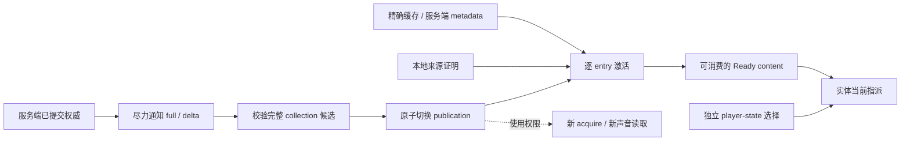

# 模型领域会话

上级契约：[模型管理](../overview.md#seam-contract)。

## 职责与边界

本级负责模型领域的目录权威、当前使用权限、远端条目激活与客户端对外视图。在服务端，本级结合本地目录与配置策略维护每个玩家的权威目录和授权，并尽力推送全量或增量同步；在客户端，本级根据所处的本地或联机状态切换对外目录，将远端条目逐个激活为可消费内容，并为新资源申请、模型选择和预览图观察提供统一的资格门禁。

## Seam Contract

- 目录权威何时提交，远端条目何时进入可消费状态：[目录权威与内容激活](#目录权威与内容激活)。
- 服务端配置与本地目录如何串行合并并发布：[配置与目录发布](#配置与目录发布)。
- 当前权限对新资源申请和模型选择意味着什么：[新使用与选择资格](#新使用与选择资格)。
- 缺图观察与管理补图提交何时失效：[成员观察与管理提交](#成员观察与管理提交)。

### 共同规则

适用范围：“目录权威与内容激活”“新使用与选择资格”和“成员观察与管理提交”。三项契约继承本节的责任划分、单写 owner、领域状态与退出、未决项和验证限制。

本子系统细化[模型管理的发布与使用](../overview.md#发布与使用的独立终点)，管理领域目录权威、使用资格、远端内容激活与客户端目录视图。网络层的握手资格、连接路由、消息拼装与传输收尾归网络子系统；授权语义以[模型授权](../../../product-decisions/decisions/model-authorization.md)为准。

#### 数据流与交接

#### 运行作用域与所有权

各端状态严格实行单写控制：

- **服务端**：游戏主线程（game owner）单线写入各玩家会话的 catalog、授权（grants）与内容策略；玩家当前选择只保存在玩家 capability 的已提交选择中，会话仅读取只读视图。
- **客户端**：客户端主线程（client owner）单线写入当前的远端 publication 与激活状态。进程级本地 Catalog 独立于会话之外，联机期间仍继续后台扫描并保留完整本地内容。
- **跨模块读取**：动画通过[共享事实读写窗口](../../integration/overview.md#共享事实读写窗口)直接读取客户端会话状态，组合方等全部普通读者与 GUI 读者交接完毕后才接纳下一次会话写入。跨帧的资源与传输消费者继续使用同步读取；读写窗口不授予任何会话写权限。

握手完成后的业务资格与目录 `ACTIVE` 状态相互独立。目录同步失败不会自动断开已握手的业务会话，整体连接撤销由[网络连接撤销交接](../../network/overview.md#连接撤销交接)定义。

#### 领域状态与退出

客户端领域状态分为五种：`Local`、`Negotiating`、`Active`、`Default Only` 和 `Closed`。进入远端会话时，普通目录视图会先清空、只保留必需的 intrinsic 槽位，再由远端 publication 与激活结果填充普通视图，绝不把本地目录与远端目录混在一起。

退出与撤销按清晰顺序收尾：

- 发生协议失败、断连或连接替换时，网络层先撤销连接资格，本域随后撤销旧条目的提交、查询与远端目录视图。
- 切回 `Local` 状态时，直接对外发布最新的本地目录快照，不等待共享后台 worker，也不清空已完成的资源缓存。
- 服务端会话封口（seal）时，先拒绝新的领域请求，再通知网络层终止所属传输，最后撤销领域引用，整个过程不影响其他玩家会话。
- 管理员强制选择同样复用普通授权（grant），服务端不维护私有绕过标记或对应的恢复字段；授权矩阵对后续资产下载请求同样生效。

传输消息映射见[Catalog 同步](../../network/implementation/catalog-sync.md)，已知差异与缺口见[模型管理问题](../../../status/known-issues/model-management.md)。

### 目录权威与内容激活

**边界与权威**

本契约继承[共同规则](#共同规则)的责任划分与领域状态流转。

**前置条件与输入**

客户端激活一条远端条目时，按固定顺序依次尝试六级来源：
1. 当前已激活的精确匹配内容；
2. 本地目录中精确匹配的内容；
3. 当前已激活的本地同 `ModelId` 内容；
4. 当前本地索引中的其余同模型候选；
5. 远端精确缓存；
6. 向服务端请求 metadata 前缀。

其中只有 `hash:` 身份且具备本地来源证明时，才允许走第 3、4 步的非精确本地替代；命名身份直接跳过这两个同 `ModelId` 阶段；远端缓存与服务端拉取则始终要求精确匹配。遇到损坏内容时继续尝试下一候选，遇到暂时访问错误则保留该来源。最终激活的实际内容沿用它自己的来源与存储区域绑定，绝不改写远端 publication 记录的服务端路径或访问信息。

**结果与保证**

#### 配置与目录发布

`ServerConfigSpec` 在 Forge 自动纠错之前接纳原始受限模型候选列表，完整保留“解析失败”与“字段缺省”的区别。合法候选生成不可变的 `RestrictedModelPolicy`，其余配置项从有效副本读取。配置 watcher 不自动修正或回写非法候选；读取失败时沿用上一次已接纳的策略。

服务端主线程串行接纳配置变更与本地目录更新。每次发布都根据当前有效配置重新计算完整策略结果，再更新各玩家会话的权威目录，并重新处理失去授权的玩家选择；网络通知仍是独立的后续动作。后台扫描不预先给模型贴上访问权限标签，旧扫描结果也不能覆盖新配置策略。服务刚启动且尚无有效配置时，对外只保留 builtin 与 intrinsic。配置本身不写入 SQLite，路径移动或完整 ID 变更都在发布时重新求值。

#### 权威提交与通知

服务端总是先在本地提交权威变更，再构造并尽力发送全量（full）或增量（delta）通知。如果编码或入队发送失败，既不回滚已提交的权威状态、不关闭会话，也不建立重试队列、历史缓冲或主动重同步机制，后续 delta 直接基于服务端当前快照继续发送。客户端在重连时自然回到与服务端一致的状态。

客户端收到同步消息后，先校验全部 operation，再原子替换整个 collection。目录 collection 不与玩家选择（selection）联合发布，也不协调 player-state 发送器：主动选择由客户端准备完成后本地提交、服务端独立接纳，不存在选择结果 ACK，服务端发回的 self 回显也不参与客户端本地提交。线协议细节见[Protocol V1](../../../standards/protocol-v1/README.md)。

#### 远端权威与激活

远端 publication 只声明身份、目录成员与访问权限；`Pending`、`Ready`、`Failed` 属于单个条目的激活状态，不会反向改写权威目录。只有完整激活为 `Ready` 的内容才进入可消费目录；metadata 就绪并不代表模型其余 chunk 已经齐全，也不代表渲染 target 已 Ready。

**所有权与时序**

当远端目录更新时，精确二元组未发生变化的条目可以保留已有的 `Ready` 或 `Failed` 结果。如果只是使用权限变化，已经接纳的 metadata 激活任务继续运行，完成后重新绑定到当前条目；如果内容成员发生变化，则取消旧的共同激活任务、退休其 Pending 条目 owner，再为当前所有 Pending 条目建立新的共同任务。迟到的旧结果绝不能覆盖新条目，也不能伪装成同级其他条目的故障。

目录权威提交、内容激活与网络传输各自独立结束；接收方绝不能把通知发送成功、metadata 就绪或命中本地缓存当作权限放行。

**失败与拒收**

#### 失败与恢复资格

客户端收到无效的 full 同步，或者线格式与领域语义本身无效的 delta 时，会直接结束远端会话 owner 并降级进入 `Default Only`（仅保留 intrinsic default）。如果 delta 结构合法但与本地旧 baseline 不兼容，则直接丢弃该 delta 并保留当前权威，不主动触发重同步；移除不存在的条目视为无操作（no-op）。进入 `Default Only` 不会断开 Minecraft 网络连接，也不会清空实体当前指派，但普通模型安装不再获准求值或消费，实体按回退规则结束旧使用。

条目激活失败严格区分“内容损坏”与“暂时访问失败”：metadata 请求返回的 `NOT_FOUND`、`BUSY` 或 `UNAVAILABLE` 可能源于远端二元组切换或服务端容量限制，不能固化为内容损坏。只有发生显式 retry 或 reload，或者内容、权限、网络连接、宿主能力发生变化时，才重新获得发起昂贵重试的资格；单纯经过时间或切换页面再切回，不会清除失败记忆。

**证据与依赖**

本契约继承[共同规则](#共同规则)的产品依据、传输映射与验证限制。

### 新使用与选择资格

**边界与权威**

本契约继承[共同规则](#共同规则)的责任划分与领域状态流转。

模型选择的判定独立于客户端资源安装，但发起主动选择请求仍必须携带[完整合法初值](../../network/player-state.md#选择请求与处置)。网络字段中，`builtin_default` 专指请求客户端本进程的必需默认模型（intrinsic required），而 `model_hash` 始终表示普通模型身份——即使它的哈希恰好等于默认源的真实哈希也是如此。持久化选择按发布角色分别保存，不按哈希、路径或来源自动互转。Roaming 偏好以 `UUID + 完整发布身份` 为键，intrinsic 与同源普通模型分开存取。选择 intent 与原操作生产者资格见[玩家状态](../../network/player-state.md#表现报告与真实基线)。

**前置条件与输入**

#### 新使用资格

每次发起新的资源申请、命中 Ready 或缓存以及启动新的音频播放，都必须检查当前的普通内容使用资格。

命令与选择入口共用 `ModelSelector` 完成完整 ID 与路径解析、结果返回和命令补全：
- 输入相对路径时先判断是否存在歧义，再检查权限，不自动猜测文件扩展名；
- 输入明确完整 ID 时只做精确匹配，非法值不自动回退；
- 普通模型提交真实 `ModelId`，保留地址 `default` 提交 intrinsic 分支；
- 命令参数解析保留未加引号 ID 中的 `/@+:` 字符，含空格的选择器须用双引号包裹。

**结果与保证**

在同一个会话内，publication 的使用权限变化不会改变内容身份，也不会撤销已经接纳的获取尝试或已经安装到实体上的 `lease`。

**所有权与时序**

进入 `Default Only` 状态或连接结束时的清理，按[领域状态与退出](#领域状态与退出)与网络撤销契约执行。本地目录权威与 intrinsic default 使用本地资格判定。

**失败与拒收**

因权限不足拒绝新使用不会把模型标为内容损坏；待权限恢复后，下游需求可以正常继续。

**证据与依赖**

昂贵激活尝试的恢复条件见[失败与恢复资格](#失败与恢复资格)；授权依据与验证限制继承[共同规则](#共同规则)。

### 成员观察与管理提交

**边界与权威**

本契约继承[共同规则](#共同规则)的责任划分与领域状态流转。远端缺图记录本质上是当前会话对特定成员的一次时效性观察。

**前置条件与输入**

#### 缺图观察与管理提交资格

服务端返回的 `ABSENT`、独立预览图媒体校验拒绝以及迟到的页面结果，都必须先复核发起请求时的成员观察 token。Repository 发出的图片请求还同时绑定 Catalog 与会话成员的 incarnation 以及同一个网络连接。

展示用预览图不走运行期模型资产的权限门禁。管理端补图提交（commit）必须在原会话与原成员的 effect gate 内复核资格，对应的磁盘持久事务见[独立图片与提交资格](../storage/overview.md#独立图片与提交资格)。

**结果与保证**

独立图片的内容版本号也复用这套成员观察机制：收到“图片已可读”通知时只撤销旧图片版本，不改变成员 incarnation，也不主动触发下载。声明的内嵌图可以复用资源侧已经证明过的相同内容，但新使用前仍须复核当前权限。管理补图一旦持久化成功，不会因为后续通知发送失败而回滚。

**所有权与时序**

无关的 publication 或授权更新会保留现有的缺图观察；当成员被移除后重新加入、更换容器表示、收到图片可读通知或会话结束时，旧观察 token 立即失效。关闭模型页面不会清除缺图观察，GUI 也不另外维护第二份缺图表。

**失败与拒收**

成员被移除并重新加入后，旧请求不能借用新成员的资格发布结果。请求取消、成员被替换或会话封口时，一律拒绝旧的补图提交。

**证据与依赖**

持久化事务依赖[独立图片与提交资格](../storage/overview.md#独立图片与提交资格)；领域退出、未决项与验证限制继承[共同规则](#共同规则)。

## 设计取舍

让服务端权威提交与网络通知解耦，避免了把目录通知做成分布式权限事务；代价是网络发送失败后，客户端可能短时保留旧的目录视图，直到后续更新或重连。

## 实现与验证入口

`ServerModelSession` 维护服务端目录权威并读取玩家当前选择视图，`ClientModelSession` 维护客户端领域状态与成员观察 token。`RemoteCatalogActivation` 管理远端条目的激活任务；`ClientCatalogManager` 持续订阅最新的本地目录，并在本地与远端视图之间切换。`ClientCatalogSnapshot` 提供接收方资格检查，`ClientModelRenderTargetManager` 在接纳新资源使用前先调用它核对权限。
