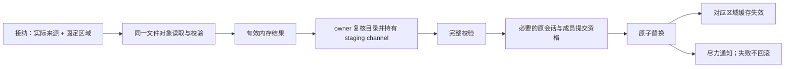

# 模型存储

上级契约：[模型管理](../overview.md#seam-contract)。

## 职责与边界

本级负责模型文件的只读来源访问、固定存储区域内的精确缓存与原子持久化提交。整体策略是“文件与索引分离、业务与数据库解耦”：文件在事务外生成经 staging 原子发布，再用 SQLite 短事务提交索引；Java 负责区域选择、业务键与资格检查，native 私有持有 SQLite 连接与 schema。

下级子系统：[派生物](derived-artifacts.md#seam-contract)（几何、未绑定动画输入、AOT 制品）与[玩家偏好](preferences.md#seam-contract)（UUID 偏好与高频状态周期提交）。

## Seam Contract

| 消费者问题 | 契约 |
|---|---|
| 从用户来源建立并结束一次精确读取阶段 | [用户来源与精确读取](#用户来源与精确读取) |
| 复用精确缓存、提交可选持久工作并参与共享清理 | [精确缓存与持久工作](#精确缓存与持久工作) |
| 读取独立预览图，或按原成员资格提交管理补图 | [独立图片与提交资格](#独立图片与提交资格) |
| 执行有界数据库操作并安全关闭 native 资源 | [数据库执行](#数据库执行) |
| 按 UUID 存取偏好、执行首次继承并关闭周期缓冲 | [玩家偏好与周期提交](preferences.md#seam-contract) |

完整模型制品导出由[资产管线](../../asset-pipeline/overview.md#导出批次与提交)组合。

### 共同规则

适用范围：前三个契约共享固定区域与目录观察前提；数据库执行共享固定区域；持久替换与坏读适用于精确缓存及独立图片持久路径。

细化[身份与来源](../overview.md#身份与来源)；产品依据见[来源只读](../../../product-decisions/decisions/artifact-storage.md#dduser-model-sources-are-readonly)与[精确内容提交](../../../product-decisions/decisions/catalog-publication.md#bccache-publishes-only-verified-exact-content)。

#### 固定区域与目录观察

进程启动时一次性探测并冻结目录布局：全局来源目录与全局 CACHE 目录同时启用或同时停用，远端内容不单独回退全局目录（见[平台目录政策](../../../product-decisions/decisions/platform-baselines.md#bcglobal-model-directory-selection)）。

内容接纳时锁定持久化存储区域：全局来源与纯远端走启用的全局 CACHE，实例来源与 builtin 走实例 CACHE；全局停用时统一落实例 CACHE，已绑定旧工作不跨区。存储区域不参与业务身份、权限或渲染器 ABI。

存储 owner 经 Java 标准库复核根目录、路径范围与目录观察记录（writer 与 validator 共用同一 staging channel），目录稳定前提见[缓存维护约束](../../../product-decisions/decisions/artifact-storage.md#bccache-maintenance-does-not-own-sources)。目录观察通过可选 `fileKey`、文件类型与真实路径检查替换，底层不提供 `fileKey` 时依赖目录稳定前提兜底，也不提供句柄相对操作的竞态隔离；查索引不访 payload 路径，同一次打开复核一次目录。

#### 数据流与交接

普通可选存盘失败仍可向调用方交付有效内存结果；管理端补图 `commit` 仅在持久化成功后算完成。

#### 持久替换与坏读

缓存文件在事务外生成校验，经文件池 staging 目录原子发布后再由 SQLite 短事务更新精确索引。每次生产独占预留整数文件名；发布或写索引失败最多留孤儿文件或未命中，不覆盖索引指向的旧有效文件。坏读不删物理文件；`converted` 坏读只按原生产实例撤销复用资格，物理删除由共享清理在安全窗口执行。

#### 存储证据与依赖

派生物本地加载信任范围见[派生物复用](derived-artifacts.md#seam-contract)；主循环 atomic move 成本证据与支持范围见[支持状态](../../../status/support-and-verification.md)。

### 用户来源与精确读取

**前置条件与输入**

每个读取阶段绑定已接纳 capability、实际文件对象与独立 expected，不按路径字符串合并来源。同源动画按消费批次复用打开通道，图片与 raw 单流在读取结束时关闭；读写前后复核文件长度，每个 payload 按 descriptor 与摘要独立校验。

**结果与保证**

- **`direct` 容器**：从已校验 preamble 建立 `ContainerId`；读 metadata 校 preamble，读 Manifest 或其他 chunk 校对应 chunk（同 CID + 同校验 profile 可复用不可变 metadata 证明，新打开可变 preamble 仍重检）。常规读取不遍历未消费 chunk，不建本地副本（用户改外部文件可能导致后续局部读失败，已校验字节仍有效）。
- **raw、legacy、builtin 与 remote**：Catalog 扫描 raw/legacy 按[来源转换规则](../../asset-pipeline/overview.md#冻结输入与单向转换)直接解析为完整 inline 容器；仅 remote owner 可建“metadata 前缀 + 外置 chunk”拆分形态。完整离线校验入口遍历全部 payload。

**所有权与时序**

读取阶段 owner 关闭时先封口拒新借用，再由最后活动借用者关底层 channel（无借用当场关闭）；同一 channel 上 `seek → read → validate` 串行执行，封口不阻塞等在途 I/O。长期存活的 source、module、target 与实体不留空闲 channel。普通动画读失败时批次 owner 结束当前阶段，fallback 或健康动画经原 capability 开新阶段继续，不重试当次损坏动画也不把封口拒绝记入健康动画长期失败门禁；关闭失败、取消与 OOM 直接终止操作。

**失败与拒收**

运行时接纳来源建立独立精确读取实例，访问或校验失败单向撤销该实例后续读取资格（已开始且校验成功的读取仍有效，新实例不继承旧失败标记），不回写用户原件也不建全局路径失败表。实现见[固定区域与文件边界](implementation/persistence.md#固定区域与文件边界)。

### 精确缓存与持久工作

**前置条件与输入**

#### 精确身份与原子提交

远端 metadata 要求精确匹配当前 publication 二元组，`hash:` 本地替代需具备来源证明，命名身份精确匹配二元组。`PREAMBLE` 与 `Manifest` 作为连续 metadata 前缀一并校验并原子提交（见[Manifest prefix 标准](../../../standards/model-schema/manifest-and-identity.md#exact-tuple-与-representation-激活)）。远端 descriptor 仅指定固定编码格式，不带路径、URL 或自定义 provider。

**结果与保证**

校验后的文件池 staging 按[持久替换与坏读](#持久替换与坏读)原子提交，内存结果与磁盘提交独立交付。动画输入与 AOT 各自持久化，FULL 候选由构造方发布前核对组合一致性（见[派生物契约](derived-artifacts.md#seam-contract)）。

**所有权与时序**

`ModelStorageInfra` 拥有全进程唯一派生存储工作域，队列只限总任务数，饱和时直接拒绝可选写入，不阻塞也不退回调用线程。每个持久化任务只捕获精确键、固定区域与不可变输入，同步保活至执行完毕即释放（队列与事务见[派生持久工作](implementation/persistence.md#派生持久工作)）。

#### Remote 使用事件

仅成功向资源消费者交付 metadata 或 chunk 时由 remote owner 记录 UTC 秒级时间戳（扫描、查索引、仅下载、失败与取消不记录）。`ModelStorageInfra` 的唯一 `StorageWriteBuffer` 按区域 remote 能力与 `ContainerId` 合并最大时间戳，主循环按单调时钟每秒尝试提交一次，数据库更新取已有值与新值原子最大值。受控域关闭时先停生产者 → drain 排空 → 关 `DatabaseWork`；[JVM 进程退出](../../runtime/overview.md#jvm-进程退出)不触发关闭链。当前 remote 缓存无自动淘汰。

#### 共享存储与清理

- **身份与版本隔离**：`converted` 保存 `DATA`、来源相对路径、转换 profile 与完整 `MODEL_SCHEMA`；几何用 `CACHE_GEOMETRY`，动画输入与 AOT 共用 `ANIMATION` 与 `CACHE_ANIMATION` 并以内部私有布局域隔离精确键。YSM 发布版本不参与缓存复用或淘汰（见[ABI 规则](../../../abi/maintenance.md)）。
- **扁平文件池与 ID 分配**：各区域单调分配 `uint64`（不回绕，遇占用避让递增），正式与 staging 统一用固定深度 16 位小写十六进制文件名；实例 token 与 file ID 独立，迟到损坏反馈只撤销原 token。不读/不迁/不删旧缓存布局。
- **暖比较与缓存读取**：Catalog 按相对路径查候选，暖提示只建候选不打开 `converted` 文件，加载 metadata 失败则冷转换一次（见[转换契约](../../asset-pipeline/overview.md#来源转换与内容准入)）。所有缓存文件直接以 `READ + NOFOLLOW_LINKS` 打开后校验长度与内容：缺失、访问被拒、普通 I/O、越界与损坏归为 miss（取消、关闭、OOM 与程序错误继续传播）。
- **跨进程协调与本地保留保护**：每个实际 CACHE 根拥有唯一跨进程协调域（同 JVM 多服务与路径别名共享 coordinator），消费缓存前须先登记；多根不同时持 admission 锁，进程崩溃由 SQLite/OS 回收锁。本进程曾取得或发布的 `(pool, fileId, token)` 记入本地保留集合持续至 JVM 结束（文件取得、来源更新、发布与删除共用本地根门禁，数据库 worker 不反向获取该门禁）。
- **启动期 72 小时定时清理（prune）**：每 CACHE 根在进程启动后仅首次合格扫描收尾时尝试一次（需本轮观察/校验/索引发布全成功且距上次整轮清理 ≥ 72h，UTC 回拨不提前触发，本地与全局独立，普通 reload 不重试）。
- **清理执行窗口**：拿 admission 锁封本进程新缓存取得 → 暂释 `SHARED` 锁并尝试升级 `EXCLUSIVE`（任一步拿不到即恢复 `SHARED` 跳过两池）→ 独占后复读完成日期与 revision、扫必要索引依次清 `converted` 与 `bake`、条件提交日期 → 必须先恢复 `SHARED` 再放 admission 锁（恢复失败则封口该根、排空使用者后关闭登记）。
- **回收判定与执行**：`converted` 按过期来源关系或适用 schema 回收；`bake` 按无任何来源引用（覆盖全部 ABI/schema）、ABI 确认不支持或适用 schema 不匹配回收（来源未知或必要库缺失整轮放弃，不打开 payload；本地根清不同 schema，全局根普通模式保留仍有引用且 ABI 兼容的其他 schema，仅带 `all` 标记追加版本清理）。均服从本地保留集合保护；按“按原 token 撤资格 → 删文件 → 清归属”执行，部分失败不回滚已删文件也不推进日期。Remote、preview、未知文件、旧缓存布局与用户来源不入删除集。
- **手动预约命令**：`/ysmclient cache prune-next [all]`（本机权限）与 `/ysm cache prune-next [all]`（服务端等级 2）逐根提交“清日期并推进 revision”（全局 `all` 同事务持久化，不带 `all` 保留已有 `all`，停用根不打开）；旧轮清理按接纳时 revision 做条件更新防止覆盖新预约。

**失败与拒收**

派生存储工作域显式关闭先封口再取消排队、中断执行中任务，同步借用保活输入至 worker 返回，清内存复用缓存后释放 CACHE 根消费登记；后台持久化不等待宿主、资源 worker 或页面 tick。JVM 退出放弃在途工作，靠原子文件发布与 SQLite 短事务保磁盘合法。

### 独立图片与提交资格

**边界与权威**

独立预览图通过 `ContainerId` 弱关联模型，不改模型源字节或业务身份。模型声明内嵌预览图时内嵌图绝对优先且加载失败不回退独立图；仅未声明内嵌图时探测独立缓存。损坏独立图按未命中处理，不标记模型损坏。

**前置条件与输入**

普通服务端分发只读有界编码字节，客户端解码后展示或入已校验缓存；管理端探测与上传做完整媒体校验。`PreviewStore` 复制外部字节数组，内部生成的 `Image` 直接移交 `PendingPreview`（生产方停用原可变引用）；对外暴露一律给副本。`accept`/`commit` 封闭内容入口复用解码资格并在 staging 逐字节核对副本。

**结果与保证**

普通 `accept` 落盘失败仍交付有效内存图片；管理端 `commit` 仅在磁盘持久替换成功后算完成。后台 worker 校验并准备好 staging 文件后，才进原会话与成员 effect gate 复核资格并执行原子替换与 SQLite 索引提交（门禁内不做解码或 staging 写 I/O）。磁盘提交与宿主纹理上传独立。

**所有权与时序**

成员移除后重加、换容器表示、取消或会话关闭立即撤销旧补图提交资格。持久成功后在原门禁内同步递增该区域图片版本观察再发通知（通知失败不回滚），并撤销对应区域[服务端图片保留](../server-resources/overview.md#图片失效与旧请求)（仅内存交付不触发失效）。客户端观察 Catalog 扫描代次，目录 reload 使旧独立图版本失效。独立预览图目前无自动清理。

### 数据库执行

**边界与权威**

Java 负责区域选择、业务键、访问资格与文件原子发布；`NativeCacheCatalog`、`NativeCacheRemote`、`NativeBakeIndex`、`NativeFileIdAllocator` 与 `NativePlayerData` 只暴露各自业务操作，native 私有持有 SQL、schema、连接、prepared statement 与短事务，不向公共接口暴露 SQL、表结构、游标或原始 SQLite 错误码。

**前置条件与输入**

调用方先锁定实际根目录；`StorageProbe` 在独立临时目录验证读写与跨进程协调，`AssetDirectoryProbe` 失败则整组停用全局目录（运行期不换根）。Java 复核根目录与祖先目录观察；native 决定私有文件名，拒内部符号链接与非普通文件，核验业务角色、`epoch` 与 `schema revision`（仅本次新创建空文件允许初始化，已有空库/未知库/角色不符/损坏/不支持版本一律拒绝并保留原文件）。

按 `ContentStorageBinding` 归属（全局停用整组落实例区）：全局 `models` → 全局 CACHE `Catalog`；实例 `models` 与 builtin → 实例 CACHE `Catalog`；纯 remote → 全局 CACHE `Remote`；派生索引 → 实际区域 `Bake`；玩家偏好 → 全局 DATA `PlayerData`。

#### 数据库身份与演进

业务库以文件名中 `epoch` 隔离不兼容布局，`schema revision` 在同 `epoch` 内递增（要求同 `epoch` 双向安全，低于当前 revision 的旧库拒绝，不降级版本号）。首次初始化在写事务一次性建表并写 `storage_meta.compatibility_epoch` 与 `PRAGMA user_version`；并发创建竞争返回资源竞争错误，首次观察即见未初始化既有文件返回格式不兼容并保留原文件。当前均从 revision 1 起计，项目未发布不保留旧库迁移（跨版本偏好 donor 继承见[玩家偏好](preferences.md#偏好读写与首次继承)）。协调协议与物理文件池命名空间同步演进，协调库损坏直接拒绝，不绕过。

**结果与保证**

`StorageResult` 区分 `FOUND`、`MISSING`、`COMMITTED`、`REJECTED`、`FAILED`、`CANCELLED`，失败归入稳定类别（原始 SQLite 错误码留私有诊断日志）。`committed` 独立反映真实提交事实；访问错误、忙等待超时、schema 不兼容与内容错误不伪装为 `MISSING`。偏好单项更新为原子事务，首次填充在单短事务内“插或读”，分页按完整键游标推进不跨调用持 SQLite 游标。

复杂结果由独立 native owner 保护，Java 接管后立即复制为独立值并关 owner；接管或解码失败抛 `StorageDeliveryException`（保留已知提交状态或报未知，不能自动重放写入）。

**所有权与时序**

`ModelStorageInfra` 拥有独立 `DatabaseWork` 执行域：等待与执行合计上限 64 项，饱和即拒不退回调用线程；单后台 worker 串行执行（偏好写缓冲有界批次作为单任务提交，批内逐条维持独立事务）。队列空时 worker 退出，业务库连接与 prepared statement 留存至 owner 关闭。

每项工作持独立 `NativeCancellation`：native busy 等待上限 250 ms（每 2 ms 复核取消），SQLite progress hook 共用同一取消状态；异常回滚不受取消阻断，无法恢复干净状态或路径校验失败立即封口该业务库不自动重开。显式关闭先封口取消排队与等待，待在途 JNI、复制与回调全结束后统一关业务库（独立于 `DerivedStorageWork`，JVM 退出不走关闭链）。

`NativeCoordination` 用两个 rollback-journal 库提供 admission 锁与 `SHARED` 消费保护；清理升级 `EXCLUSIVE` 后释放 admission 锁前必须先恢复 `SHARED`（不受取消阻断，恢复失败扣住 admission 锁并封口排空全部文件消费者）。`CacheRootCoordinator` 按实际根目录合并路径别名与同 JVM 多服务，多根不同时持 admission 锁。

**失败与拒收**

`Catalog`、`Remote`、`FileIdAllocator` 用 WAL 模式，`Bake` 用 `DELETE` 模式（避免 cache-only 只读打开生成 WAL 附属文件）；业务库统一 `synchronous=NORMAL`（不承诺断电持久性）。失败不做猜测修复、不回退旧版存储也不换根；工作域关闭后请求返回 `CLOSED`。

**证据与依赖**

测试覆盖见 `NativeStorageIntegrationTest`、`DatabaseWorkTest`、`SharedStorageProcessTest` 与 native 侧 `storage_test.cc`。

## 设计取舍

- **Java 标准库路径检查**：换取实现简洁与跨平台一致，前提是操作期间目录结构保持稳定。
- **Native 封装 SQLite 细节**：Java 侧只管业务资格与区域归属，避免把 SQL 与平台锁逻辑散落到业务层。
- **文件名 `epoch` 隔离**：用冷索引、空偏好与保留旧文件换取跨版本互不污染；项目尚未发布，当前只创建和校验最新布局，不背历史迁移包袱。
- **原位初始化与协调命名空间切换**：保持既有文件系统前提，代价是并发首次打开时可能显式失败；协调协议随新文件池整体切换，避免旧协议误改新池。

## 实现与验证入口

各类数据库能力、事务边界与文件读取的类映射见[持久提交落实](implementation/persistence.md)。
