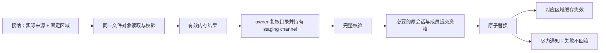

# 模型存储

上级契约：[模型管理](../overview.md#seam-contract)。

## 职责与边界

本级负责模型文件的只读来源访问、固定存储区域内的精确缓存以及原子持久化提交。整体策略是“文件与索引分离、业务与数据库解耦”：文件都在事务外生成并经 staging 原子发布，再用 SQLite 短事务提交索引；Java 负责区域选择、业务键与资格检查，native 私有持有 SQLite 连接与 schema。

两个独立下级子系统分别展开细分能力：[派生物](derived-artifacts.md#seam-contract)定义几何、未绑定动画输入与 AOT 制品的身份、提交和组合加载；[玩家偏好](preferences.md#seam-contract)定义按 UUID 存取的偏好数据及高频状态周期提交。

## Seam Contract

| 消费者问题 | 契约 |
|---|---|
| 从用户来源建立并结束一次精确读取阶段 | [用户来源与精确读取](#用户来源与精确读取) |
| 复用精确缓存、提交可选持久工作并参与共享清理 | [精确缓存与持久工作](#精确缓存与持久工作) |
| 读取独立预览图，或按原成员资格提交管理补图 | [独立图片与提交资格](#独立图片与提交资格) |
| 执行有界数据库操作并安全关闭 native 资源 | [数据库执行](#数据库执行) |
| 按 UUID 存取偏好、执行首次继承并关闭周期缓冲 | [玩家偏好与周期提交](preferences.md#seam-contract) |

完整模型制品导出由[资产管线](../../asset-pipeline/overview.md#导出批次与提交)负责组合，不能把普通缓存写入成功当作导出完成。

### 共同规则

适用范围：前三个契约共同继承事实权威、固定区域与目录观察前提。数据库执行继承固定区域。持久交接、原子替换与坏读规则只适用于精确缓存及独立图片的持久路径，不作为来源读取的前置工作。

本子系统细化[身份与来源](../overview.md#身份与来源)，管理来源读取、固定存储区域、精确缓存与持久提交。缓存层不拥有目录、权限或会话权威；用户的 `direct` 容器与原始来源（raw source）属于只读输入，不属于派生缓存。

产品依据见[来源只读](../../../product-decisions/decisions/artifact-storage.md#dduser-model-sources-are-readonly)与[精确内容提交](../../../product-decisions/decisions/catalog-publication.md#bccache-publishes-only-verified-exact-content)。客户端 target、服务端发送字节和音频 PCM 的运行期保留归各自资源 owner，不由存储层统一管理。

#### 固定区域与目录观察

进程启动时一次性探测并冻结目录布局。全局来源目录与全局 CACHE 目录必须同时启用或同时停用，远端内容不能单独回退到全局目录（规则见[平台目录政策](../../../product-decisions/decisions/platform-baselines.md#bcglobal-model-directory-selection)）。

每份内容在接纳时就锁定它的持久化存储区域：全局来源与纯远端内容使用启用的全局 CACHE，实例来源与 builtin 使用实例 CACHE；若全局目录未启用，则统一落入实例 CACHE。已经绑定的旧工作不会因为后续来源切换而跨区。存储区域不参与业务身份、权限判断或渲染器 ABI。

存储 owner 统一通过 Java 标准库复核固定根目录、路径范围与目录观察记录，writer 与 validator 共用同一个 staging channel。目录结构稳定前提与观察拒收边界见[缓存维护约束](../../../product-decisions/decisions/artifact-storage.md#bccache-maintenance-does-not-own-sources)。

目录观察通过可选的 `fileKey`、文件类型与真实路径检查目录是否被替换，但不构成不可伪造的物理身份证明。在底层文件系统不提供 `fileKey` 时，同路径同类型的替换可能无法被察觉，这一限制由目录稳定前提兜底。此外，路径复核不提供句柄相对操作的竞态隔离。查询索引时不访问 payload 文件路径；同一次打开只复核一次目录，后续独立读取时再重新核验目录资格。

#### 数据流与交接

上图展示了持久化写入的先后顺序：普通可选存盘失败时仍可向调用方交付有效内存结果，而管理端补图提交（commit）只有在持久化成功后才算完成。不同路径之间不共享全局事务。

#### 持久替换与坏读

所有缓存文件都先在数据库事务外生成、完成校验，并通过所属文件池的 staging 目录原子发布，最后再由 SQLite 短事务更新精确索引。每次生产独占预留一个整数文件名；如果文件发布或索引写入失败，最多留下孤儿文件或缓存未命中，绝不会覆盖索引当前指向的旧有效文件。读取时发现损坏不会删除物理文件；`converted` 缓存确认内容损坏时，只按原生产实例撤销它的复用资格，物理删除仍交由共享清理流程在安全窗口内执行。

#### 存储证据与依赖

几何与表达式派生物的本地加载信任范围不同，详见[派生物复用](derived-artifacts.md#seam-contract)。当前存储能力以及主循环执行 atomic move 的成本证据见[支持状态](../../../status/support-and-verification.md)，不能仅凭原子语义推导主线程延迟已验证。

### 用户来源与精确读取

**边界与权威**

存储层向资产与资源消费者提供精确来源的读取能力，继承[共同规则](#共同规则)中的事实权威与[目录观察前提](#固定区域与目录观察)。

**前置条件与输入**

每个读取阶段都绑定到已接纳的 capability、实际文件对象以及独立的预期校验信息（expected），绝不按路径字符串合并来源。同一阶段内，同源动画按实际消费批次复用打开的通道；图片和 raw 单流则在流读取结束时关闭。读取前后都会复核文件长度，每个 payload 仍按 descriptor 与摘要独立校验。

**结果与保证**

不同来源的读取和校验策略如下：

- **`direct` 容器**：从当次已校验的 preamble 建立 `ContainerId`。读 metadata 时校验 preamble，读 Manifest 或其他 chunk 时校验对应 chunk，只读 preamble 不强制读取 Manifest。同 CID 且同校验 profile 的不可变 metadata 证明可以复用，但新打开的可变 preamble 仍须重新校验。Catalog 在实际读取 Manifest 时检查模型身份与内嵌 preview 声明，图片 payload 延后到读图时校验。常规读取不遍历未消费的 chunk，也不要求整文件长度精确匹配；`direct` 不建立本地稳定副本，因此用户修改外部文件可能导致后续局部读取失败，但已校验通过的字节继续有效。
- **raw、legacy、builtin 与 remote**：Catalog 扫描 raw 与 legacy 时按[来源转换规则](../../asset-pipeline/overview.md#冻结输入与单向转换)直接解析为完整 inline 容器；builtin 和显式 export 保留各自的数据捕获方式。只有 remote owner 可以建立“metadata 前缀 + 外置 chunk 底层存储”的拆分形态。完整离线校验入口仍会遍历全部 payload。

**所有权与时序**

读取阶段 owner 在关闭时先封口禁止新的借用，再由最后一个活动借用者关闭底层 channel（无活动借用则当场关闭）。同一个 channel 上的 `seek -> read -> validate` 完整串行执行，封口操作不阻塞等待进行中的 I/O。借用视图不拥有 channel 的物理关闭权。

长期存活的 source、module、target 和实体不保留空闲 channel，后续独立读取必须重新核验资格并开启新阶段。已经失败的阶段不会自行重开，此前已经验证完毕的字节仍可独立继续使用。普通动画读取失败时，由批次 owner 结束当前阶段；既有 fallback 或后续健康动画通过原 capability 在新阶段重新取得读取资格。阶段切换不会重试当次损坏的动画，也不会把阶段封口拒绝误记进健康动画的长期失败门禁。关闭失败、取消和 OOM 直接终止所属操作。

**失败与拒收**

运行时接纳来源时会建立独立的精确读取实例。一旦发生访问或校验失败，会单向撤销该实例后续的读取资格；但在标记生效前已经开始且校验成功的读取仍然有效，新建立的实例也不会继承旧的失败标记。整个过程绝不回写用户原件，也不维护全局路径失败表。强引用只能保活内存中的内容对象，不能保证磁盘上的用户文件不被修改。

**证据与依赖**

读取阶段的具体身份、借用与拒收实现见[固定区域与文件边界](implementation/persistence.md#固定区域与文件边界)；验证范围见[存储证据与依赖](#存储证据与依赖)。

### 精确缓存与持久工作

**边界与权威**

存储层为内容 owner 提供精确缓存和可选的异步持久化工作，不接管运行期资源的生命周期。继承[共同规则](#共同规则)的事实权威、固定区域与持久交接规则。

**前置条件与输入**

#### 精确身份与原子提交

远端 metadata 始终要求精确匹配当前 publication 的完整二元组，其他远端表示不能替代。`hash:` 同模型的本地替代仍须具备实际来源证明，命名身份始终要求精确二元组。单个 chunk 按目标 descriptor 校验，metadata 校验通过不代表未读 chunk 有效。

`PREAMBLE` 与 `Manifest` 以连续的 metadata 前缀一并校验并原子提交（格式见[Manifest prefix 标准](../../../standards/model-schema/manifest-and-identity.md#exact-tuple-与-representation-激活)）。把两者打包避免了拆成两个文件和引入 ready 标记文件的复杂性，代价是必须共同读取与原子提交。

远端 descriptor 只能指定固定的编码格式，不能携带路径、URL 或自定义 provider。原子可见性、内容完整性、提交资格与写入隔离各自独立成立，满足其中一项不能替代其余条件。

**结果与保证**

完整校验后的所属文件池 staging 按[持久替换规则](#持久替换与坏读)原子提交。有效内存结果与磁盘文件提交彼此独立交付；几何、未绑定动画输入及 AOT 制品的精确加载边界见[派生物契约](derived-artifacts.md#seam-contract)。动画输入与 AOT 各自生成、保留并提交，任一类持久化失败只结束该类任务，FULL 候选由构造方在对外发布前核对两者的组合一致性。

**所有权与时序**

`ModelStorageInfra` 拥有全进程唯一的派生存储工作域，各存储区域共享这个工作域，同时各自保留自己的文件访问能力。工作接纳只限制总任务数；队列饱和时直接拒绝可选写入，既不阻塞等待空位，也不退回调用线程同步执行。已经生成好的完整内存结果不等待持久化完成。

每个持久化任务只捕获精确键、固定存储区域以及完整不可变输入，不持有页面、target、实体、fetcher 或会话引用。任务在同步执行期间保活不可变输入与共享 native 底层内存，执行完毕立即释放，不做字节估算或容量预约。具体队列参数与事务细节见[派生持久工作](implementation/persistence.md#派生持久工作)。

#### Remote 使用事件

只有在成功向资源消费者交付 metadata 或 chunk 时，remote owner 才会记录当时的 UTC 秒级时间戳；目录扫描、索引查询、仅下载落盘、失败和取消都不产生使用事件。`ModelStorageInfra` 持有唯一的 `StorageWriteBuffer`，按实际区域的 remote 能力与 `ContainerId` 合并最大时间戳，由主循环按单调时钟每秒尝试提交一次。数据库更新时取已有值与新值的原子最大值，防止并发写入导致旧值回退，且始终记录事件发生时间而非提交时间。

受控域显式关闭时，先停止事件生产者，再用专用 drain 流程排空已接纳工作，最后关闭 `DatabaseWork`。[JVM 进程退出](../../runtime/overview.md#jvm-进程退出)不触发这条关闭链，允许丢失尚未提交的近期使用事件。当前 remote 缓存不附带自动淘汰或删除流程。

#### 共享存储与清理

缓存目录布局、复用规则与启动清理机制按以下规则协作：

- **身份与版本隔离**：`converted` 作用域保存 `DATA`、来源相对路径、转换语义或 profile 以及完整 `MODEL_SCHEMA`。几何使用 `CACHE_GEOMETRY`，动画输入与 AOT 共用 `ANIMATION` 类别与 `CACHE_ANIMATION`，并通过内部私有布局域隔离各自的精确键，不改变全局版本清理政策。YSM 发布版本号不参与缓存复用或淘汰；宿主不额外增加引擎 ABI 门槛，引擎内部的 expected、格式与 loader 校验照常保留（见[ABI 规则](../../../abi/maintenance.md)）。
- **扁平文件池与 ID 分配**：各存储区域的分配器单调分配 `uint64`，索引只记录整数 file ID，物理路径由固定 CACHE 根、文件池和 ID 推导得出。`converted`、`bake`、`remote`、`preview` 的正式文件与 staging 统一采用固定深度、无扩展名的 16 位小写十六进制文件名。ID 分配绝不回绕，遇到正式文件、staging 或尚未清理的归属占用时继续避让递增。每次生产的实例 token 与 file ID 相互独立，迟到的损坏反馈只撤销原 token。旧缓存布局一律不读取、不迁移、不自动删除；玩家偏好保持原有存储边界。
- **暖比较与缓存读取**：Catalog 按来源相对路径查询候选——v1 和 v2 读文件头已存 MD5，ZIP 与 7z 比较完整成员名、展开大小和可选 CRC，v3 保留 footer，`direct` 校验 preamble 与 CID，raw 目录沿用既有观察。目录头可解码且暖比较不提取成员 payload，必要 CRC 缺失时退回完整解析。暖提示只用于建立候选而不打开 `converted` 文件；如果实际加载 metadata 失败，则冷转换一次（来源稳定性要求见[转换契约](../../asset-pipeline/overview.md#来源转换与内容准入)）。所有缓存文件读取都直接以 `READ + NOFOLLOW_LINKS` 打开，不预先查存在性、属性或权限，打开后再校验长度和内容。缺失、访问被拒、普通 I/O 错误、目录越界拒绝和内容损坏统一归为未命中（miss），诊断日志保留原始原因；取消、关闭、OOM 和程序错误继续向外传播，局部异常捕获不吞掉后续冷生产。已失败的读取阶段不自动重开，也不混用读取实例。
- **跨进程协调与本地保留保护**：每个实际 CACHE 根拥有唯一的跨进程协调域，同根路径别名与同 JVM 内的多个服务共享同一个 coordinator。业务方消费缓存前必须先登记；保护范围覆盖正在读取的通道、延迟打开能力以及已接纳的持久化工作。正常启动时的跨进程竞争支持可取消地等待，不当作目录故障回退；多个不同的 CACHE 根不会同时持有 admission 锁。进程意外崩溃时，锁占用由 SQLite 与操作系统自动回收，不维护 PID 文件、心跳或活动行。本进程曾取得或发布的 `(pool, fileId, token)`（包括无句柄的延迟能力及排队或运行中的持久工作）都记入本地保留集合，一直持续到 JVM 结束；文件取得、来源更新、发布与删除共用本地根门禁，数据库 worker 不反向获取该门禁。这种做法的代价是长运行进程会延后物理回收，且集合大小随进程累计使用量增长。
- **启动期 72 小时定时清理（prune）**：每个 CACHE 根在每次进程启动后，只在首次合格扫描收尾时尝试一次清理。触发前提是：启用来源完成完整观察、最终一致性校验和索引发布全部成功，且距该根上次整轮清理成功至少满 72 小时（无记录视为到期，UTC 时钟回退不提前触发）；本地与全局 CACHE 独立判断和提交，普通 reload 不重试。Catalog 负责持久化逐根的完成日期、重置 revision 以及全局根待执行的 `all` 标记。
- **清理执行窗口**：清理开始时先获取 admission 锁并封住本进程的新缓存取得，接着暂释自身的 `SHARED` 锁并立即尝试获取 `EXCLUSIVE` 锁。若 admission 锁被占用，则保留原 `SHARED` 锁并跳过两个文件池；若存在其他并发消费进程导致 `EXCLUSIVE` 获取失败，则恢复 `SHARED` 锁后跳过两池。成功独占后，重新读取完成日期与启动 revision，扫描全根所有必要索引，依次清理 `converted` 与 `bake`，最后按条件提交新的完成日期。在两池交接及日期事务真正退出之前不放行启动后续步骤，且必须先恢复 `SHARED` 锁再释放 admission 锁；若恢复 `SHARED` 失败，则封口该根，排空现有使用者后关闭登记。
- **回收判定与执行**：`converted` 按本轮完整作用域的过期来源关系或适用 schema 政策回收。`bake` 满足以下任一条件即可回收：确认失去全部来源引用（覆盖所有 ABI 与 schema）、类型 ABI 确认不支持，或适用 schema 不匹配。`direct`、builtin、remote 以及未扫描作用域的持久引用都会继续保活对应产物；来源状态未知不能当作无引用，任何必要数据库缺失或不可读都会让整轮放弃删除。资格判断全程不打开 payload 文件。只有在尚无 Bake 库且尚未向消费者交付前的排他窗口，才允许初始化根覆盖记录；已有 Bake 库或来源库重建后，不能用局部扫描来抹掉未知状态。本地根会清理与当前对应 schema 完整值不同的 `converted` 与 `bake`；全局根在普通模式下保留仍有引用且 ABI 兼容的其他 schema，只有收到 `all` 标记时才追加版本清理。ABI 是否支持严格按类型兼容规则判断，字符串不同、缺少 renderer 或模块未加载不构成不支持。所有删除决定都必须服从本地保留集合保护。每个待删对象依次执行“按原 token 撤销资格 -> 删除物理文件 -> 清除归属记录”；中途部分失败不回滚已删文件，也不推进完成日期。Remote、preview、未知文件、旧缓存布局和用户来源一律不纳入删除集合。
- **手动预约命令**：`/ysmclient cache prune-next [all]`（要求客户端本机权限）与 `/ysm cache prune-next [all]`（要求服务端管理等级 2）逐根提交“清空日期并推进 revision”，仅用于预约下次启动执行清理。全局根的 `all` 标记在同一事务中持久化，不带 `all` 的命令会保留已有的 `all` 标记，停用的根不会被打开。旧一轮清理在提交日期时按接纳时的 revision 做条件更新并消费本轮标记，防止覆盖新命令的预约。命令反馈在提交后逐根确认，一根失败不回滚另一根；命令本身不获取文件变更门禁，也不引入跨根事务、定时器或后台重试服务。

**失败与拒收**

坏读与文件替换失败遵循[持久替换与坏读](#持久替换与坏读)。

派生存储工作域显式关闭时，先封口新任务接纳与提交，再取消排队任务并中断正在执行的任务。即便取消或关闭已返回，正在运行的同步借用仍会保活输入引用直到 worker 实际返回；后台持久化工作绝不等待宿主、资源 worker 或页面 tick。所有借用结束后，owner 清空内存复用缓存，再释放 CACHE 根的消费登记。关闭流程不等待 Cleaner 或进程 RSS 回落。JVM 直接退出时会放弃这些在途持久化工作，依靠原子文件发布与 SQLite 短事务保证磁盘仍处于合法状态。

**证据与依赖**

本契约依赖[存储证据与依赖](#存储证据与依赖)中的派生物加载边界与持久提交成本证据，具体队列与事务实现见[派生持久工作](implementation/persistence.md#派生持久工作)。

### 独立图片与提交资格

**边界与权威**

图片存储向页面展示与管理功能交付独立预览图，继承[共同规则](#共同规则)的固定区域、目录观察与持久交接规则，不拥有模型或会话权威。

独立预览图通过 `ContainerId` 弱关联到模型，不改动模型源字节或业务身份。模型声明了内嵌预览图时，内嵌图绝对优先且加载失败不回退到独立图；只有在未声明内嵌图时才探测独立图片缓存。损坏的独立预览图只按未命中处理，不会把模型标记为损坏。可替换的独立预览图也不会放宽模型内嵌媒体、图标或 pack cover 的校验标准。

**前置条件与输入**

普通服务端分发时只读取有界的编码字节，由客户端完整解码后再展示或写入本地已校验缓存；管理端探测与上传仍做完整的媒体校验。`PreviewStore` 会复制外部传入的任意字节数组；内部生成的 `Image` 则直接移交给 `PendingPreview`，生产方随后停止使用原可变引用，下游消费者只读共享内容。这种直接移交保留了原始内存分配，因此编码输出切片的底层容量可能略大于实际编码长度。合法资格必须由完整解码建立并仅随封闭内容存在，对外暴露的字节数组与 `Image` 一律给出副本。从磁盘新读入的数据和外部原始输入各自独立校验；`accept` 与 `commit` 的封闭内容入口复用已有解码资格，并在 staging 阶段逐字节核对副本，避免重复解码媒体。弱关联省去了重新封装模型文件的麻烦，代价是图片有效不代表模型本身有效，且损坏媒体可能在客户端解码前先经网络传输。

**结果与保证**

普通 `accept` 允许在落盘失败时仍交付有效内存图片；管理端 `commit` 则只有在磁盘持久替换成功后才算完成。后台 worker 完成完整校验并准备好 staging 文件后，再进入原会话与成员的 effect gate 复核提交资格并执行原子替换：门禁内绝不做媒体解码或 staging 写入 I/O，文件原子发布成功后，在同一资格窗口内提交 SQLite 索引。

磁盘缓存的持久提交与运行期渲染资源 Ready 相互独立，后续宿主纹理上传失败不会回滚已经校验并提交的磁盘文件。

**所有权与时序**

以下事件会立即撤销旧的补图提交资格：成员被移除后重新加入、更换容器表示、请求取消或会话关闭。持久化提交成功后，必须在原替换门禁内同步递增该区域的图片版本观察，再发出通知；通知发送失败不会回滚已经完成的提交。

图片版本观察本身不读文件，旧读取结果携带的是读取开始时的版本号；未改动的已校验文件可保留原版本，被拒绝的提交不改变版本。客户端直接观察 Catalog owner 已接纳扫描的代次，因此即使内容未变，目录 reload 也会使旧独立图版本失效。普通 `accept` 落盘失败时交付的内存图片携带独立证明，不会冒充未变的磁盘版本。图片版本只反映原 owner 的有效性变化，既不授予访问权限，也不增加持久化成功条件。持久化成功后会撤销对应区域的[服务端图片保留](../server-resources/overview.md#图片失效与旧请求)，而仅内存交付不触发持久化失效。独立预览图的空间回收不借用 target LRU 或 converted prune，目前没有自动扫描或定时清理机制。

**失败与拒收**

普通 `accept` 持久化失败时保留有效内存交付；管理端 `commit` 必须持久替换成功才算完成。坏读与替换失败遵守[持久替换与坏读](#持久替换与坏读)，提交门禁拒收不会改动图片版本。

**证据与依赖**

本契约依赖原会话与成员的提交资格及[服务端图片保留](../server-resources/overview.md#图片失效与旧请求)。验证边界沿用[存储证据与依赖](#存储证据与依赖)。

### 数据库执行

**边界与权威**

Java 负责存储区域选择、完整业务键构造、模型访问资格以及文件原子发布。`NativeCacheCatalog`、`NativeCacheRemote`、`NativeBakeIndex`、`NativeFileIdAllocator` 和 `NativePlayerData` 只暴露各自对应的业务操作；native 对象私有持有 SQL 语句、schema、数据库连接、prepared statement 与短事务。公开接口与 JNI 载体一律不暴露 SQL、内部角色标识、表结构、游标或 SQLite 错误码。数据库索引提交成功也不自动证明磁盘文件已发布或内容已校验。

**前置条件与输入**

调用方必须先锁定实际根目录。`StorageProbe` 会在独立临时目录中验证数据库读写与跨进程协调能力，不触碰真实玩家偏好；`AssetDirectoryProbe` 在启用全局目录前调用该探测，一旦失败就整组停用全局目录，运行期不再换根。Java 负责固定并复核根目录与祖先目录观察；native 自行决定私有文件名，拒绝内部符号链接和非普通文件，并在私有打开流程中核验业务角色、compatibility epoch 与 schema revision。只有确认是由本次打开新创建的空文件才允许初始化；已存在的空库、未知库、角色不符、损坏或版本不支持的文件一律拒绝，并保留原文件不动。

按实际内容的 `ContentStorageBinding`，各类数据库能力的归属固定如下：
- 全局 `models` 使用全局 CACHE 的 `Catalog`；
- 实例 `models` 与 builtin 使用实例 CACHE 的 `Catalog`；
- 纯 remote 内容使用全局 CACHE 的 `Remote`；
- 派生索引统一归实际存储区域的 `Bake`；
- 玩家偏好事实使用全局 DATA 的 `PlayerData`。

全局目录停用时，上述能力整组回退到实例区域。本地内容替代远端请求后，仍沿用其本地所属的 `Catalog`。同一个 CACHE 根下的 `Catalog` 与 `Remote` 各自维护来源与文件索引，不会因为初始化存储区域而凭空创建实例 `PlayerData` 或 `Remote` 文件。

#### 数据库身份与演进

业务库通过文件名中的 `epoch` 隔离无法安全共存的读写版本。库内记录的业务角色和 `epoch` 必须与预期一致，`schema revision` 只在该 `epoch` 内递增编号。Native 层隐藏具体文件名和版本描述，不把版本参数扩散到 Java 或公共 JNI 接口。

同一 `epoch` 内的演进必须保证双向安全：旧读者可读、旧写者不会破坏新字段与约束。当前及同 `epoch` 更新的 revision 只开放已知能力且绝不降级版本号，低于当前 revision 的旧库会被明确拒绝；所有读写使用显式列名并保留未知扩展数据。一旦无法证明双向读写兼容，就必须提升 `epoch`。

首次初始化在 SQLite 写事务内一次性建立空的当前表结构，并写入 `storage_meta.compatibility_epoch` 与 `PRAGMA user_version` 两个版本号，且只允许初始化本次新创建的目标文件。并发打开时，后来者可以直接接纳已经提交的有效布局，可识别的创建竞争返回资源竞争错误；如果首次观察就发现文件已存在但尚未初始化，打开方无法区分正在创建的并发进程还是上次崩溃留下的残片，必须明确返回格式不兼容并保留原文件。赢家完成初始化后，后续新操作可以正常重开，但原失败操作不自动等待、重试或接管初始化。

当前所有业务库均从 revision 1 起计。项目尚未发布，当前只按既定 `epoch` 文件名创建空库，不导入旧数据库，也不保留升级迁移入口，旧文件保持原位不动。玩家模型跨版本的 donor 首次继承仍由[玩家偏好](preferences.md#偏好读写与首次继承)负责，与数据库 schema 版本无关。

协调协议必须与其保护的物理文件命名空间同步演进：新布局的 `converted` 与 `bake` 共用根级 admission 与 consumer 协调协议；新旧布局彻底隔离，不读取、迁移或自动清理旧文件池。协调库损坏时直接拒绝对应能力，绝不另建一套保护绕过原库。

**结果与保证**

`StorageResult` 明确区分六种结果状态：`FOUND`、`MISSING`、`COMMITTED`、`REJECTED`、`FAILED` 和 `CANCELLED`。失败归入稳定类别（资源竞争、接纳容量、访问与 I/O、格式不兼容、内容错误、关闭、取消或内部失败），原始 SQLite 扩展错误码仅留在 native 私有诊断日志中。`committed` 独立反映真实的数据库提交事实，即使提交后的清理步骤失败也不能改标为未提交。访问错误、忙等待超时、schema 不兼容和内容错误绝不伪装成 `MISSING`。客户端偏好调用方可按[临时降级契约](preferences.md#偏好读写与首次继承)在查询失败时临时使用空值或默认选择，但这不会改写数据库失败结果或原库记录。偏好单项更新是原子事务，首次填充在同一短事务内完成“插入或读取已有值”；Java 负责 payload 语义校验与 donor 选择；分页按完整键游标式推进，不跨调用持有 SQLite 游标。

无 payload 的结果状态以及单个 usage 数值直接通过基础类型数组返回。复杂结果由独立的 native owner 保护，Java 接管后立即复制为独立值并关闭该 owner，返回值不再依赖后续操作或业务库对象存活。如果接管、字符串解码或 payload 构造失败，则抛出 `StorageDeliveryException`：当完整响应头已知时保留真实提交状态，否则报告提交状态未知，调用方绝不能据此自动重放写入。

**所有权与时序**

`ModelStorageInfra` 拥有独立的 `DatabaseWork` 执行域，按区域登记懒创建的各类业务库资源。队列中等待与正在执行的任务合计上限为 64 项，饱和时立即拒绝，绝不退回调用线程执行。单个后台 worker 串行执行每项完整业务操作；偏好写缓冲把一个有界有序批次作为一个任务提交，批内保留下来的每一项仍逐条调用原有业务 JNI，各自维持独立事务。队列为空时 worker 线程自动退出，但业务库对象、私有连接以及按需准备好的 prepared statement 会一直保留到 owner 关闭，以省去反复建连和重编译 SQL 的开销，代价是空闲期间继续占用连接资源。

每项数据库工作持有独立的 `NativeCancellation`：native 层的 busy 等待最多持续 250 ms，每 2 ms 复核一次取消状态，SQLite progress hook 也直接读取同一取消状态。每次操作结束时清理 hook、参数绑定和游标；异常事务的回滚不受原取消标记阻断。如果操作结束后无法恢复干净状态，或私有路径资格校验失败，该业务库对象会立即封口并拒绝后续请求，不自动重开。打开与初始化数据库也在 `DatabaseWork` 中执行，不占用模型资源 worker。显式关闭时先封口并取消排队任务与活动等待，等正在进行的 JNI 调用、数据复制和回调全部结束后，再统一关闭所有业务库资源。该执行域独立于 `DerivedStorageWork`，不等待宿主或资源 worker；JVM 退出时不触发这条关闭链。

`NativeCoordination` 使用两个 rollback-journal 库分别提供 admission 锁和实际的 `SHARED` 消费保护。清理任务持有 admission 锁，暂释自身 `SHARED` 锁后尝试升级 `EXCLUSIVE` 锁；若检测到其他活跃消费者，则跳过本次清理。在释放 admission 锁之前必须恢复自身的 `SHARED` 锁，且恢复操作不受原取消标记阻断；一旦恢复失败，则继续扣住 admission 锁，调用方必须封口并排空全部文件消费者后再关闭资源。`CacheRootCoordinator` 按实际根目录合并路径别名与同 JVM 内的多个服务，让文件取得、发布、来源更新与清理共用本地门禁。正常启动竞争支持可取消地等待，且多个不同根绝不同时持有 admission 锁。

**失败与拒收**

`Catalog`、`Remote` 和 `FileIdAllocator` 使用 WAL 模式；`Bake` 使用 `DELETE` 日志模式，确保 cache-only 只读打开时不会创建 WAL 附属文件。业务库统一使用 `synchronous=NORMAL`，不承诺断电持久性；协调库独立于 WAL 写入。遇到数据库失败时，绝不做猜测性修复、不回退旧版存储、也不在运行中切换根目录。工作域关闭后的请求一律返回 `CLOSED`，不再接触 native handle。

**证据与依赖**

`NativeStorageIntegrationTest` 覆盖真实 JNI 交互、同 JVM 内另一 SQLite 并发访问、schema 拒收与 busy 取消；`DatabaseWorkTest` 覆盖队列容量、排队取消与关闭借用；`SharedStorageProcessTest` 覆盖真实多进程写入与协调；native 侧 `storage_test.cc` 覆盖 ID 分配器、故障回滚与恢复失败时扣留 admission 锁。文件层测试还覆盖真实 `converted` 读取、崩溃恢复和独立 JVM 下的文件发布；具体平台验证范围见验证文档。

## 设计取舍

文件与路径检查统一使用 Java 标准库，换取实现简单和跨平台一致，前提是操作期间目录结构保持稳定。数据库层把 SQLite 细节完全封装在 native 私有对象中，避免 Java 持有 SQL 和平台锁逻辑，同时把业务资格判断留在 Java 侧。

用文件名 `epoch` 做版本隔离，以冷索引、空偏好和保留旧文件换取跨版本互不污染；项目尚未发布，只创建和校验当前布局，省去历史迁移包袱。原位初始化保留了既有文件系统前提，代价是并发首次打开时可能显式失败。协调协议随新文件池命名空间整体切换，避免互不知晓的协议同时改动同一文件池。

## 实现与验证入口

各类数据库能力、事务边界与文件读取的类映射见[持久提交落实](implementation/persistence.md)。
