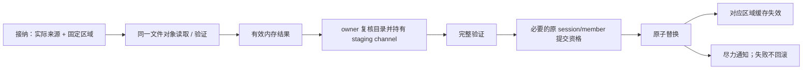

# 模型存储

## 职责与边界

本子系统细化[身份与来源](../overview.md#身份与来源)，拥有来源读取、固定存储区域、精确缓存与持久提交。Cache 不拥有目录、权限或会话权威；用户 direct container 与 raw source 不属于派生缓存。

产品依据见[来源只读](../../../product-decisions/decisions/artifact-storage.md#dduser-model-sources-are-readonly)及[精确内容提交](../../../product-decisions/decisions/catalog-publication.md#bccache-publishes-only-verified-exact-content)。Target、服务端 bytes 与 PCM 的活动保留分别归资源 owner，不统一归 storage。

## 运行作用域与所有权

进程一次选择并固定目录配置。全局来源与 CACHE 共同启用或停用，不能由 remote 单独回退。规则见[平台目录政策](../../../product-decisions/decisions/platform-baselines.md#bcglobal-model-directory-selection)。

持久工作在内容接纳时固定区域：全局来源与纯远端使用启用的全局 CACHE，实例来源与 builtin 使用实例 CACHE；全局停用时统一用实例 CACHE。旧工作不随来源切换改区。区域不参与业务身份、权限或 renderer ABI。

`ModelStorageInfra` 拥有唯一派生存储工作域，各区域共享该域并保留自己的文件能力。接纳只限制工作数；饱和直接拒绝可选写入，不等待容量，也不在调用线程执行。完整内存结果不等待持久终态。

工作只保留精确 key、固定区域及完整不可变输入，不保留页面、target、entity、fetcher 或 session。Job 保活不可变输入和共享 native backing，直到本次同步工作结束；不估算或预约字节。具体参数及事务落实见[派生持久工作](implementation/persistence.md#派生持久工作)。

存储 owner 用 Java 标准库复核固定根、路径范围与目录观察，writer/validator 借用同一 staging channel。目录结构稳定前提及观察拒绝边界见[缓存维护约束](../../../product-decisions/decisions/artifact-storage.md#bccache-maintenance-does-not-own-sources)。

目录观察比较可选 `fileKey`、类型与真实路径，不证明不可伪造的物理身份。缺少 `fileKey` 时，同路径同类型替换可能不可见；目录稳定前提覆盖此限制。缓存命中仍应通过完整内容验证。

## 数据流与交接

图示持久写入的偏序；普通可选存盘可交付内存结果，管理 commit 只在持久成功后完成。各路径不共享一个全局事务。

### 用户来源与精确读取

Direct container 直接打开和验证，不建立稳定副本。来源后续修改或删除可使未来读取局部失败；已经完整验证的 target/bytes 继续有效。Raw/legacy 经[冻结输入与单向转换](../../asset-pipeline/overview.md)进入当前容器。

Runtime 接纳时建立精确读取实例。访问或验证失败单向撤销原实例的后续读取资格；标记前已经开始且验证成功的读取仍有效，新实例不继承旧标记。不回写原件，不建全局路径失败表。强引用保活内容对象，不保证用户文件不变。

读取阶段由已接纳 capability、实际文件对象及独立 expected 限定，不按路径字符串合并来源。同阶段的同源动画按实际消费批次复用；图片和 raw 单流沿流结束关闭。读取前后仍核验长度，各 payload 保留 descriptor/hash 验证。

阶段 owner 先封口新借用，再由最后活动借用者关闭 channel。I/O 锁覆盖完整 seek/read/validate，生命周期锁只保护接纳和借用计数。借用视图不拥有物理关闭权。长期 source、module、target 和实体不保留空闲 channel；后续独立读取重新复核资格。失败阶段不自行 reopen，已验证结果继续独立使用。普通动画失败由批次 owner 结束当前阶段；既有 fallback 或后续健康动画经原 capability 在新阶段重新取得资格。阶段切换不重试本次坏动画，也不把封口拒绝写入健康动画的长期 gate。关闭失败、取消与 OOM 终结所属操作。

### 精确身份与原子提交

Remote metadata 始终匹配当前 publication 的完整 tuple；其他 remote 表示不能替代。同模型本地替代仍须实际来源证明。Chunk 按目标 descriptor 验证，metadata 成功不证明未读 chunk 有效。

PREAMBLE 与 Manifest 以连续 metadata prefix 一同验证和提交，没有独立半成品价值。布局见[Manifest prefix 标准](../../../standards/model-schema/manifest-and-identity.md#exact-tuple-与-representation-激活)。避免两文件与 ready marker，代价是共同读取与原子提交。

完整验证后，以同目录 staging 原子替换；不支持 atomic move 或替换失败时保留旧有效文件。Remote、精确 converted 与独立图片坏读只返回 miss/失败，不删除、移动或隔离当前目标；后续有效同 key 内容可覆盖。可变索引及其他 cache 按自身规则清理，不能从共享 helper 推断同样的清理权限。

Remote descriptor 只选择固定 encoding，不能提供路径、URL 或 provider。原子可见性、内容完整性、提交资格和写入隔离各自成立，任一项不能代替其余条件。

### 独立图片与提交资格

独立 preview 以 `ContainerId` 弱关联，不改变源 bytes 或模型身份。声明内嵌图优先，声明图失败不回退；未声明才探测独立 cache。坏独立图只是 miss，不把模型标记为损坏。可替换独立图不放宽模型内嵌媒体、icon 或 pack cover 的验证。

普通服务端分发只读有界 encoded bytes，客户端完整解码后才展示或写已验证图片；管理探测与上传仍完整验证媒体。`PreviewStore` 复制外部任意 bytes；内部 `Image` 直接移交给 `PendingPreview`，生产方停止使用可变别名，后续消费者只读共享内容。直接移交保留原 allocation，编码输出切片可能持有大于 encoded 长度的容量。资格仍由完整解码建立，只随封闭内容存在，对外 bytes 与 image 均给副本。新磁盘读取和外部 raw 输入各自验证；accept/commit 的封闭内容入口复用资格，staging 逐字节核对副本，不重复媒体解码。弱关联减少模型重新封装，代价是图片不证明模型内容有效，坏媒体也可能先被传输。

普通 accept 可交付有效内存图；管理 commit 只以持久替换成功完成。Worker 完整验证并准备 staging 后，在原 session/member effect gate 内复核资格并原子替换；gate 内不解码、不执行 staging I/O 或等待文件锁。

成员移除重加、换表示、取消和 session close 撤销旧资格。成功提交在原替换门禁内同步更新区域内的图片版本观察，再通知；反馈失败不反转提交。`PreviewStore.observe` 不读图；旧读结果携带读取时版本。未改变的已验证文件可保留版本，拒绝提交不改变版本。Client 直接观察 Catalog owner 已接纳扫描的代次；无内容变化的 reload 也使旧独立图版本失效。accept 持久化失败仍可交付有效内存图；此结果使用独立证明，不冒充未变的磁盘版本。版本只投影原 owner 的有效性事实，不授予权限，也不新增持久成功条件。持久成功撤销对应区域的[服务端图片保留](../server-resources/overview.md#图片失效与旧请求)，有效内存交付不声称持久替换。独立 preview 的空间回收不借 target LRU 或 converted prune；当前没有自动扫描或定时清理。

## 生命周期与失败

派生存储关闭先封口接纳和 commit，再取消排队工作并中断运行工作。取消或 shutdown 取得终态后，运行中的同步借用仍保留输入引用，直到 worker 返回。工作不等待 host、资源 worker 或页面 tick。全部借用结束后，owner 清空内存复用，再释放 converted 消费登记。关闭不等待 Cleaner 或物理 RSS 回落。

### 共享存储与清理

Converted 按逻辑 DATA 根与完整转换版本隔离，custom/auth 共用 scope。索引事务锁内重读最新值、合并负责类别并提交；摘要定位仍需完整头部校验。不同 DATA/版本可重复占盘，但不能相互覆盖或清理。

Converted 复用同时核验来源、完整转换版本、逻辑路径、对象位置与当前 Schema。旧 Schema 从 raw source 重建，不迁移旧 payload；cache 位置不能替代本地来源证明。

每个参与进程在扫描前通过实际 OS 锁登记消费者。Catalog coordinator 等已有 prune 后登记，启动调用方不等待。登记覆盖后台扫描及 runtime 使用；进程先停止全部使用者，再释放登记。

首次扫描后，整个 scope 的 custom/auth 及适用 builtin 完整观察、最终一致性与索引提交均成功，且无其他消费者，才执行一次保守 prune。保留集合覆盖本进程本次曾使用或发布的对象。其他情况跳过；清理只触及 converted 派生物，不触及用户来源或其他 cache。

OS 锁使残留登记文件不冒充活动进程，不需要 PID/心跳/超时恢复。代价是并发使用时延后清理；首次保留集合不成为长期引用图。异常清理不掩盖原始失败。

## 关键契约与设计取舍

Java 标准库统一路径、文件与锁，移除 Windows/Unix 文件能力的 JNA 适配成本。代价是依赖操作期目录结构稳定；路径复核不提供句柄相对操作的竞态隔离。磁盘 cache 的成功提交和运行资源 Ready 独立，后续 host 失败不回滚已验证文件。Geometry 与 expression 的本地信任范围不同，见[派生物复用](derived-artifacts.md)。

## 实现与验证入口

能力、事务与读取映射见[持久提交落实](implementation/persistence.md)。当前存储能力和主循环 atomic move 成本证据见[支持状态](../../../status/support-and-verification.md)；不能由原子性推导主线程成本已验证。
