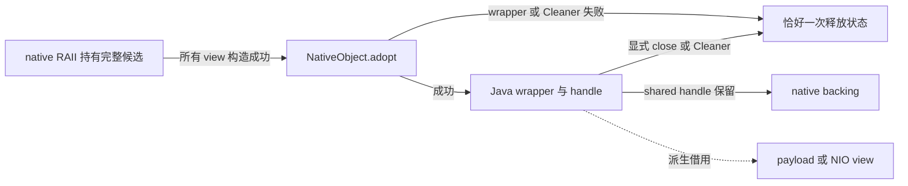

# JNI 与内存

本页定位[JNI 所有权契约](../overview.md#jni-能力与结果交付)中的同步借用、输出采用与关闭责任。Java wrapper、派生 view 和 native backing 三者的寿命分别判断。

## Buffer 传递

`BufferArgument` 与 `BufferInput` 负责在 JNI 两侧传递并验证有界缓冲区范围；描述符只在本次同步调用期间有效，不是持久 handle。Critical array 拿到的原始地址不能逃出同步调用窗口；direct buffer 输入不做拷贝，原负责方必须保活至调用结束。

`BufferOutput` 会将独立分配的内存交给 `NativeHeapBuffer` 的 Storage，确保释放协议与分配方式配对。接收方既可以显式关闭 Storage，也可以把整个 Storage 移交给 GC 管理的 wrapper。三种切片与拷贝语义互不通用：所有 `slice()` 都是纯借用，`SharedBuffer.ownedSlice()` 共享同一个 GC 负责方，`copy()` 则创建独立的 Storage，具体入口见[Buffer 与所有权](../../../development/infrastructure.md#buffer-与所有权)。`Image.probe` 保留 GC 管理的输入缓冲，解码出的像素输出与原压缩 backing 各自独立。

`NativeArchive.getFile()` 借用归档内部的临时缓冲，下一次提取就会将其覆盖。如需跨次读取或异步保留内容，调用方必须先做拷贝；这也正是[raw capture](../../asset-pipeline/implementation/conversion-and-export.md#raw-capture-与编译)的输入边界。

## Protobuf bytes seam

Java 侧的不可变 Protobuf message 可以安全共享，但 JNI 边界绝不暴露 QuickBuffers 对象、Builder、parse cursor 或 allocator。跨语言调用前，Java 先准备好明确拥有的字节切片，在同步窗口内借给 native；畸形字节、native 业务拒绝与 Java wrapper 构造失败各自保留不同的结果语义。返回的 handle 或独立字节按对应协议接管，不能用部分解析的消息或裸指针绕过。

## Opaque handle

`NativeObject` 统一承接强类型不透明对象的共享所有权。`CastOpaquePtr` 可以检查空指针与类型标签，但无法证明任意非空地址尚未被释放；Java 侧的 `get()` 会先拒绝已经关闭的对象。

几何返回结果必须先写回映射且确认没有未决异常（pending exception）。音频与 legacy 结果则先在 native RAII 保护下构造出载体和全部 view，再整体交付 handle。Java 侧在调用前备好 adoption 工厂，使 wrapper 或 Cleaner 注册失败与正常清理共用同一份恰好一次的释放状态，避免半成品重复释放。通用构造回滚机制见[基建](../../../development/infrastructure.md#生命周期与构造回滚)。

`AudioNormalizer.Result` 一次保活首页与全部音频块，关闭后所有派生 view 立即失效。Legacy result 在协议校验之前即已持有所有权，校验失败便立即关闭；调用其 `acquire()` 可以为同一底层 backing 创建新的独立共享 handle。`serialize` 产出的独立字节与被借用的源模型各自拥有独立生命周期。

一旦从对象中提取了裸指针、direct buffer 地址或数组引用，JNI 或 `Unsafe` 调用必须在 `finally` 块中对原负责方执行 `reachabilityFence`。只对派生 view 或打包描述符做 fence，无法阻止底层 backing 被 Cleaner 提前回收。Fence 本身不提供 `close` 与并发使用之间的互斥：可变 decoder 仍须遵守原负责方的串行约束，取消状态则由下节所述的局部门禁保护。

## 取消状态与借用

本节落实[协作取消](../overview.md#协作取消)。`NativeCancellation` 通过 `NativeObject.adopt` 接管强类型 handle，复用原有的恰好一次释放状态，不改动其他 native wrapper 的关闭协议。

`borrow` 只在进入和退出同步回调时获取门禁锁并增减计数，执行 native 工作期间不持锁。回调结束时在 `finally` 中归还计数并对 wrapper 执行 fence，因此取消请求可以与消费者并发执行，同时 Cleaner 不会释放仍在借用中的对象。调用 `close` 时先封口拒绝新借用，等最后一个回调归还计数后再调用基类释放。继承自基类的 `get()` 仍只提供裸借用，不建立上述保护窗口。

Native 侧的 `CancellationState` 内存序与跨窗口共享保留机制归底层能力层维护，详见 C++ native 仓库的 `docs/infrastructure/cancellation.md`。

## 存储结果交付

三类存储业务 wrapper 的操作与 `close` 均串行执行；`DatabaseWork` 持有懒创建的底层资源，待所有工作排空后再关闭。Java 侧接管独立结果负责方后，按具名业务字段复制字符串和字节数组并立即关闭该负责方；复制出的值可在后续操作以及业务对象关闭后继续使用。

结果头只携带业务结束状态、稳定失败类别、真实 `committed` 标记和 payload 数量，数据库原始错误码、表结构以及通用的 operation/key/row 协议均不暴露给 Java。如果采用或复制阶段失败，由 `StorageDeliveryException` 保留已知的提交事实；若连结果头都未能读取，则标记提交状态未知，绝不伪造“未提交”结果，也不自动重放写操作。独立结果负责方的 native RAII、Java 采用与关闭共用既有释放协议。

## 共享 geometry

`GeoModel` 构造成功后会撤销消费者对 `NativeBakedModel` 的显式关闭权。运行期与存储层各自持有强引用，同步 JNI 借用期间继续对原 wrapper 执行 fence。序列化与渲染只读共享同一份底层 backing，结束某个消费者只撤掉它自己的引用。Cleaner 是已共享 wrapper 唯一的物理释放入口，而尚未共享的构造失败仍按构造回滚及时释放。

Java 存储域负责统计容器、编解码器及 staging 验证工作集，逻辑释放不承诺进程 RSS 立即回落。

## 音频 checkpoint

`OpusDecoder.Checkpoint` 是不暴露 `close` 的共享不可变值，底层 handle 在最后一个强引用消失后自动回收。缓存淘汰只撤掉缓存自身的引用，绝不能直接关闭仍被其他播放共享的 checkpoint。每次 `restore` 返回一个独占的 decoder，由本次播放结束时显式关闭，不共享活动解码游标。

捕获 checkpoint 只允许发生在正常、尚未进入 `endInput` 或 EOS 的完整 Ogg page 边界，且要求当前 page 与 PCM 输出已排空、parser 已进入音频阶段。此时尚未凑齐的 packet 允许存在，但必须拷贝其字节，不能保留输入缓冲的借用地址。Checkpoint 只保存恢复解码必需的状态，不整份复制带 owning pointer 的 decoder，也不向进程外序列化。

同一个串行 worker 在不推进 decoder 进度的窗口内查询尺寸、预约内存预算并执行捕获。内存预算覆盖 native 解码状态、内部拥有的缓冲区以及 handle；如果采用失败则立即释放。多个并发 `restore` 只读访问共享 checkpoint，每次各自构造独立的解码状态；恢复失败时保留原始 cause 并结束本次播放，不悄悄回退或自动重试。PCM 保留与播放入口见[音频设计](../../model-management/audio/overview.md)。

## 帧内借用

`NativeModelState` 的姿态、locator 视图以及 `Render` 的不可重入边界由[帧执行](../../rendering/implementation/frame-execution.md)定义，其内存排布不作为公开文件格式。

`VertexBufferAccessor.ysm$reserve` 在完成扩容后返回 `ReservedVertexRange`，交付本次可写地址、非负字节容量与 backing anchor。Vanilla 适配器的 anchor 直接保活宿主的 `ByteBuffer`，Embeddium 适配器则转交同一借用。该对象既不创建额外的 NIO view，也不取得关闭权。

Direct JNI 直接消费交付的地址和容量，不再二次查询 direct buffer；fallback JNI 仍借用实际的 `int[]`。遇到合法空输出时，native 不会读取输出地址或矩阵；非空输出仍由计算层校验容量是否足够。Java 在 JNI 返回后对 anchor、consumer、矩阵和模型状态统一执行 fence，确保整个 native 并行渲染期间对象均存活。

借用期间严禁再次 reserve、扩容、重置或释放底层 backing，也严禁重入 renderer。只有在计算成功后才推进顶点数；无论最终提交推进还是放弃写入，借用窗口随之结束，anchor 后续仍可达并不会延长该借用窗口。
