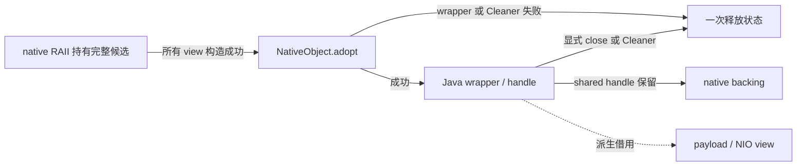

# JNI 与内存

本页定位[JNI 所有权契约](../overview.md#jni-能力与结果交付)中的同步借用、输出采用和关闭责任。Java wrapper、派生 view 和 native backing 的寿命分别判断。

## Buffer 传递

`BufferArgument` 与 `BufferInput` 在 JNI 两侧传递并验证有界范围；描述符只用于本次调用，不是持久 handle。Critical array 的地址不能逃出同步窗口；direct input 不复制 backing，原 owner 应覆盖调用期。

`BufferOutput` 将 owning allocation 交给 `NativeHeapBuffer` Storage，释放协议与分配配对。接收方显式关闭 Storage，或将整个 Storage 交给 GC wrapper。所有 `slice()` 均只借用；`SharedBuffer.ownedSlice()` 保留共同 GC owner；`copy()` 建立独立 Storage。三者不能互换，具体入口见[Buffer 与所有权](../../../development/infrastructure.md#buffer-与所有权)。`Image.probe` 保留 GC 管理的输入，像素输出与压缩 backing 独立。

`NativeArchive.getFile()` 借用 archive 缓存，下次 extract 可覆盖。需要跨读取或异步保留时，调用方先复制；这正是[raw capture](../../asset-pipeline/implementation/conversion-and-export.md#raw-capture-与编译)的输入边界。

## Protobuf bytes seam

Java immutable message 可以共享，但 JNI 不暴露 QuickBuffers、Builder、parse cursor 或 allocator。调用先形成明确拥有的 protobuf bytes，并在同步窗口借给 native；malformed bytes、native 拒绝与 Java wrapper 失败保持不同结果语义。返回 handle 或 owning bytes 按自身协议接管，不能以 partial message 或裸 pointer 绕过。

## Opaque handle

`NativeObject` 统一承接 typed opaque shared ownership。`CastOpaquePtr` 可检查空值和类型，不能验证任意非空地址仍活着；Java `get()` 先拒绝已关闭对象。

几何返回应先完成映射写回且无 pending exception。音频与 legacy 结果先在 native RAII 下构造载体及全部 view，再交付 handle。Java 在调用前准备 adoption factory；wrapper/Cleaner 注册失败与后续 cleanup 共用一次释放状态，不分享半成品关闭权。通用构造回滚见[基建](../../../development/infrastructure.md#生命周期与构造回滚)。

`AudioNormalizer.Result` 一次保活首页与全部 chunks，关闭使派生 view 失效。Legacy result 在协议校验前已经 owning，失败即关闭；其 `acquire()` 可创建共享 backing 的独立 handle。`serialize` 的 owning bytes 与被借用模型是两个独立 owner。

提取 raw pointer、direct buffer 或 array 后，JNI/Unsafe 调用在 `finally` fence 原 owner。只 fence 派生 view 或打包描述符不能阻止 backing 被 Cleaner 回收。Fence 不提供 close/use 互斥；mutable decoder、取消 token 和显式关闭仍遵守原 owner 的串行化。

## 共享 geometry

`NativeBakedModel` 在 `GeoModel` 成功构造后撤销消费者的显式关闭权。运行与存储各持强引用；同步 JNI 借用继续 fence 原 wrapper。序列化和渲染只读同一 backing，终结一个消费者只撤销本消费者的引用。Cleaner 是共享 wrapper 的唯一物理释放路径，未共享构造失败仍可回滚。

Typed 容量查询统计固定结构、各 SIMD vector 的 capacity 与骨骼 metadata。序列化尺寸复用 serializer 的推导，输出提前预约精确容量。Java 存储域另计容器、codec 和 staging 验证工作集；逻辑归还不承诺 RSS 立即下降。

## 音频 checkpoint

`OpusDecoder.Checkpoint` 是不暴露 close 的共享不可变值；内部 handle 在最后强引用消失后回收。缓存淘汰只撤引用，不能直接关闭仍被共享的值。每次 restore 返回独占 decoder，由播放终态关闭，不共享活动 cursor。

捕获只允许正常、尚未 endInput/EOS 的完整 Ogg page 边界；page/PCM 输出已排空且 parser 已进入 audio。尚未完成的 packet 仍可存在，但应复制其 bytes，不保留输入借用地址。Checkpoint 保留恢复所需状态，不复制整个带 owning pointer 的 decoder，也不序列化到进程外。

同一串行 worker 在不推进 decoder 的窗口查询尺寸、预约预算并捕获。预算覆盖 native 状态、owned buffers 与 handle；adoption 失败仍及时释放。并发 restore 只读共享值，每次产生独立状态；恢复失败保留 cause 并结束本次播放，不隐藏回退或重试。PCM 保留与播放入口见[音频设计](../../model-management/audio/overview.md)。

## 帧内借用

`NativeModelState` 的 pose、locator 与 Render 不可重入边界由[帧执行](../../rendering/implementation/frame-execution.md)定义，不作为公共文件布局。

`VertexBufferAccessor.ysm$reserve` 返回 `BorrowedNativeBuffer`，只用于本次同步写入。Builder 扩容应先于取得区域地址，native 并行写入应在 JNI 返回前全部结束，成功后才推进顶点数。借用期间不再次 reserve、扩容、重置或释放 backing；推进或放弃写入后，借用窗口结束。Anchor 保活 builder，不延长该窗口。
