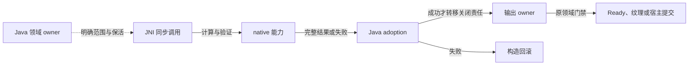

# Native 运行边界

上级契约：[系统边界](../README.md#系统边界)。

## 职责与边界

Native 层是供 Java 调用的纯能力层，接收明确的字节缓冲、几何数据、骨骼状态和输出区间并执行计算。模型来源、身份判定、授权、资源预算、存储业务规则、结果发布与对象生命周期仍完全归 Java 侧掌握。受支持平台由[平台决策](../../product-decisions/requirements/req-platform-availability.md)和[当前状态](../../status/support-and-verification.md)限定，能够用 CMake 构建并不等同于产品可用。

## Seam Contract

按本次交接定位对应契约：

- 借用输入缓冲并接纳 native 返回结果：[JNI 能力与结果交付](#jni-能力与结果交付)。
- 请求 native 消费者协作终止：[协作取消](#协作取消)。
- 获取设备硬件分档的默认配置：[设备默认交付](#设备默认交付)。
- 为自有专属后台线程应用调度策略：[调用线程策略交付](#调用线程策略交付)。

### 共同规则

适用范围：本页的“JNI 能力与结果交付”“协作取消”“设备默认交付”和“调用线程策略交付”。四项契约共同遵守以下模块依赖方向、ABI 准入、领域发布与失败边界。

#### 能力与依赖方向

| 边界 | 当前职责 | 依赖方向 |
|---|---|---|
| 通用 runtime 基础 | 缓冲区、内存分配、CPU 能力探测、日志、状态码与通用数据结构 | 位于最底层，不依赖 codec、renderer、JNI 或 legacy 业务 |
| 生成 Proto 类型 | Native 所需的当前 Schema 值类型与序列化接口 | 独立于运行算法，仅由渲染、legacy 和外层 glue 按需消费 |
| `ysm::codec` | 哈希、压缩、归档解包、图像和音频编解码算法 | 依赖通用 runtime，不依赖 JNI 胶合层 |
| `ysm::gfx::bake` 与 `ysm::gfx::renderer` | 几何烘焙、数学计算与 CPU 顶点渲染 | 依赖通用 runtime，仅在需要 Schema 输入的边缘消费生成 Proto 类型 |
| `ysm::java` | JNI 描述符、方法注册、引用管理、buffer 与类型化 handle 基础设施 | 依赖通用 runtime，不承载领域算法 |
| `ysm::storage` | 三类存储业务能力，以及私有 SQL、Schema、连接、statement、短事务和协调锁 | 依赖通用 runtime，私有链接 SQLite 与 SQLiteCpp；不依赖 JNI，也不裁决模型资格 |
| `ysm::legacy` | 旧版 bundle 与 v3 格式解码、历史编解码器以及向当前 Schema 的转换 | 复用通用 codec，并在转换边缘消费生成 Proto 类型 |
| `ysm::lib` 与 legacy Java bridge | 将上述能力封装为 Java 唯一加载的共享库，并管理 JNI 返回值与结果负责方的边界 | 位于最外层聚合；各算法模块不得反向依赖胶合层 |

这种分层只约束 C++ 内部的依赖方向，不会在 native 侧造出第二套模型权威。Java 侧仍掌握来源、身份、预算、存储业务规则、发布与生命周期；各个 native 子系统之间也不能借共享库聚合偷偷交换业务状态。Storage 的公开业务声明与 JNI 载体不暴露数据库后端类型或原始错误码；查询结果会交给 Java 成为独立值，交付失败与真实提交事实分别报告。数据库执行与资源时序见[数据库执行](../model-management/storage/overview.md#数据库执行)。

Native 层只为存在实际消费者的场景增加能力。跨语言两侧不需要对称复制身份 API、session 或 cache 负责方，提前镜像这些机制只会产生双份权威、双份生命周期和额外错误路径。格式标准仍约束所有实现，但不要求没有消费需求的一侧提前实现解析。

#### Native ABI 准入

全部 JNI 入口、共享内存布局、handle 协议与初始化配置共用一个全局 native ABI。共享库通过导出变量声明当前 ABI，Java 侧先用动态库符号查询检查该导出变量是否存在，不依赖待验证库自身的 JNI 探针。需要注意，符号检查本身不能阻止操作系统加载动态库或执行其静态构造。完整规则见[ABI 索引](../../abi/maintenance.md#native-符号门禁)。

Native 函数返回成功，并不自动等于模型 Ready、纹理已注册或顶点已提交给宿主。每一项外部效果都必须经由对应的 Java 负责方接纳，避免计算层越权获得业务发布能力。加载线程、一次性注册、能力入口和 Android 适配见[Native 实现](implementation/runtime-capabilities.md)。

Native 初始化和加载线程归属于当前进程，调用 native 能力不会创建另一套业务运行时。Java 负责方保活同步输入、接纳输出并裁决外部效果；native RAII 只保护尚未移交给 Java 的对象。共享 handle 保活底层 backing，但由它派生的 view 不拥有独立关闭权。

#### 能力失败边界

普通 native 能力失败由原领域负责方按常规路径隔离或降级，跨 JNI 边界不会扩大失败许可。[默认模型例外](../../product-decisions/shared.md#condefault-failure-exception)仅适用于指定的默认模型路径，不能扩展到普通模型、联动功能或任意 native 调用。硬件分档的保守默认策略也仅适用于本页的[设备查询](#设备配置默认)契约。

JNI 载体、缓冲区与 handle 的有效性依赖[ABI 索引](../../abi/maintenance.md#native-符号门禁)与本页规定的调用期保活条件。平台发布范围和现有验证结论由[支持状态](../../status/support-and-verification.md)限定。

### JNI 能力与结果交付

**边界与权威**

本契约继承[共同规则](#共同规则)，按[能力与依赖方向](#能力与依赖方向)划分 Java 领域权威与 native 计算职责；native 返回结果本身不授予 Ready、纹理注册或宿主顶点输出发布权。

**前置条件与输入**

模型数据跨 JNI 只传递 Protobuf 字节、显式 buffer 负责方或强类型 handle，不暴露 QuickBuffers message、Builder、parse cursor 或 allocator。调用期同步借用与返回所有权输出严格分开；裸地址和 `jlong` 数值本身不证明底层资源仍然存活。

跨语言调用的校验职责分三层落实：
- **Java 调用方**：保证逻辑输入范围合法、裸地址指向预期布局、相关资源在调用期间存活，并遵守该能力声明的并发约束。
- **JNI 胶合层**：负责载体转换后确保 native 所需的类型、范围和计数依然成立；复用 Java 侧已建立并持续维持的保证，不做重复检查或另建恢复路径，但对尚未建立或可能变化的条件必须在触发非法内存访问前拦住。
- **Native 计算能力**：只在已接纳的输入与输出容量边界内执行。

一旦容量、内存布局或资源身份发生变化，由触发变更的负责方重新建立上述保证。Native 无法凭任意非空地址推断对象寿命，强类型 handle 校验也不能替代原负责方的保活与关闭约束。

**结果与保证**

下图中实线表示结果所有权交付，虚线表示同步调用期借用。

**所有权与时序**

#### JNI 与所有权

输入的负责方必须保活至整个同步 JNI 调用结束；返回对象则要等 Java 侧采用（adoption）成功后，才把关闭责任移交给接收方。如果在构造 wrapper、派生 view 或注册 Cleaner 时失败，仍由构造路径立即回收资源，绝不泄漏半成品。派生 view 不取得底层 backing 的独立关闭权，各类对象严格按各自的释放协议回收。

`reachabilityFence` 只保证同步调用期间对象不被 GC 提前回收，不能防止显式 `close` 与并发使用相撞。临时独立缓冲、共享资源和绑定线程的 GPU 资源须按[生命周期规则](../model-management/client-resources/overview.md#引用撤销与物理关闭)各自收尾，不能指望一个 fence 解决所有关闭竞争。

JNI 调用返回后，借用的地址不会变成持久资源。如需跨调用或异步保留数据，接收方必须走协议允许的独立保留或拷贝。复用、扩容、invalidate 和关闭按原能力规则结束借用窗口；帧状态与宿主输出的具体窗口见[渲染交接](../rendering/overview.md#资源与状态)和[宿主提交](../rendering/overview.md#并行输出与宿主提交)。

音频 checkpoint 是可共享的不可变值，每次恢复产出供单次播放独占的 decoder。Checkpoint 不持有会话、输入借用地址或活动解码时间线，也不向进程外序列化。共享 checkpoint 只需撤掉强引用、交由原 handle 负责方回收；私有 decoder 则在播放结束时显式关闭。捕获条件与采用规则见[checkpoint 契约](implementation/jni-and-memory.md#音频-checkpoint)。

**失败与拒收**

#### 失败与交接

Native 调用失败时不会提交任何领域状态。Java 包装层按协议解释 `false`、`null` 或 fallback 返回值，绝不把默认失败值当成有效模型或渲染输出；需要详细错误分类的能力使用各自的结构化结果协议。

JNI 胶合层与 Java 包装层必须完整保留能力声明的合法空结果、拒绝与失败语义。计算成功仅代表满足该能力的交付条件，Java 接纳方仍须检查包装完整性、完成资源采用并复核当前领域资格。采用失败时立即释放尚未移交的 native 结果，不伪造 Ready 或成功输出，也不靠解析日志文本推断恢复策略。

**证据与依赖**

载体与 handle 布局依赖[Native ABI 准入](#native-abi-准入)。具体的 buffer、opaque handle、checkpoint 与采用细节见[JNI 实现](implementation/jni-and-memory.md)；平台证据范围遵循[共同规则](#共同规则)。

### 协作取消

**边界与权威**

本契约继承[共同规则](#共同规则)。通用 runtime 提供单向取消状态，JNI 外层将其适配为 `NativeCancellation`。取消状态本身不依赖业务逻辑、调度器或 JNI；native 消费者直接读取状态，由消费者自行决定检查点、结束方式与恢复策略。

**前置条件与输入**

Java 消费者通过 `borrow` 在同步回调中借出强类型 handle，回调期间不保留也不销毁原 handle。需要在回调结束后继续持有状态的 native 消费者，必须在有效借用窗口内主动取得独立的共享所有权。

**结果与保证**

新建的取消状态默认为“未取消”，请求取消后单向变为“已取消”，重复或并发的取消请求均幂等。在取消请求返回之后发起的检查必然可见已取消状态；与取消请求并发重叠的检查则可能看到任一状态。多个消费者可以共享同一取消状态，彼此独立的取消状态互不影响。

**所有权与时序**

发起取消请求可与活动中的消费者并行，无需等待消费者持有的执行锁。Java wrapper 在同步借用结束前始终保持可达；调用 `close` 时先封口拒绝新借用，再等待已有借用全部退出，最后释放 handle。需要注意，`close` 既不会主动触发取消，也不证明底层工作已经结束。已取得独立共享保留的 native 消费者可继续读取该状态，并在自身结束时释放保留。

借用回调内部不得调用或等待同一个 wrapper 的 `close`。重复关闭幂等；如果等待关闭时线程被中断，须等关闭完成后再恢复中断标志。Cleaner 与显式关闭共享同一份恰好一次（exactly-once）的释放责任，借用本身不取得销毁权。

**失败与拒收**

关闭开始后，所有新的借用、取消请求和状态查询一律被拒绝。创建失败时不交付 wrapper；JNI 取消请求或查询失败时显式抛出异常，不伪装成“未取消”或“请求成功”。Wrapper 或 Cleaner 注册失败由采用路径回收。取消信号本身不接管业务提交、回滚、恢复或资源释放，这些后果归各能力负责方按自身协议处理。

**证据与依赖**

取消共享状态与借用门禁见[JNI 与内存](implementation/jni-and-memory.md#取消状态与借用)，native 核心状态由 `CancellationState` 实现。`CancellationTest` 覆盖非数据库消费者与最后一份保留的释放；`NativeCancellationIntegrationTest` 覆盖真实 JNI 调用、借用与关闭互斥、Cleaner 回收以及采用失败回滚。

### 设备默认交付

**边界与权威**

#### 设备配置默认

本契约继承[共同规则](#共同规则)。Native 侧负责只读的硬件探测与[统一分档规则](../../product-decisions/decisions/device-quality.md#bcdevice-derived-configuration-defaults)，Java 侧提供 JVM 最大堆字节数、解释分档结果并将其映射为具体配置默认值。设备总 CPU 拓扑与渲染器可调度拓扑分开探测，避免进程亲和性（affinity）或核心休眠状态干扰设备默认分档。

**前置条件与输入**

调用前须满足[Native ABI 准入](#native-abi-准入)，并由 Java 传入 JVM 最大堆字节数；探测过程中严格区分设备总拓扑与可调度拓扑。

**结果与保证**

Java 在首次构造配置默认时探测一次，并将结果缓存为不可变的进程级快照，两份配置共享该结果，后续读取配置或打开界面不再重复探测。Native 侧不保存第二份全局档位，也不额外启动采样线程。正常流程下 native 加载早于配置初始化；如果提前访问或加载失败，拿到保守默认结果后不再后台重试。

**所有权与时序**

缓存的进程级分档结果随进程存活；设备查询只读硬件事实，不创建新的业务运行时或后台线程，其余进程寿命规则见[共同规则](#共同规则)。

**失败与拒收**

系统应能区分“边界探测失败”与“合法低配设备”，但两者最终都产出保守默认配置。可选的系统 API 符号一律动态解析，缺失时不阻塞最低支持平台的加载。探测操作只读，不修改 SIMD 选择、进程 affinity 或渲染器绑定。具体编码与初始化顺序见[实现](implementation/runtime-capabilities.md#设备配置默认)。

**证据与依赖**

统一分档逻辑落实[设备决策](../../product-decisions/decisions/device-quality.md#bcdevice-derived-configuration-defaults)，编码与初始化顺序见[设备配置实现](implementation/runtime-capabilities.md#设备配置默认)。平台支持证据不超出[共同规则](#共同规则)。

### 调用线程策略交付

**边界与权威**

#### 调用线程调度

本契约继承[共同规则](#共同规则)。Java 侧选定线程职责与固定调度策略，native 侧仅修改当前调用线程的 OS 调度属性，不拥有 executor、任务结束状态或发布权。`NORMAL` 策略原样保留继承状态；低档策略只应用于 YSM 明确自有的专属平台线程（platform thread），绝不套用在宿主 executor 的单项任务上，且每个新线程独立尝试应用。

**前置条件与输入**

仅在自有专属线程入口按本节[调用线程调度](#调用线程调度)规则传入固定策略；调用前须已通过[Native ABI 准入](#native-abi-准入)并完成 runtime 初始化。

**结果与保证**

各平台策略统一遵循“先查基线、再应用并读回确认”的原则，且按平台落实如下约束：
- **通用规则**：如果基线查询失败，不盲目修改宿主线程属性；线程已处于更低优先级档位时不得反向调高；部分步骤成功时不得报告完整应用。策略不改动进程 affinity、CPU Sets 或 native 渲染线程池，也不承诺 I/O 待遇不变。
- **Windows**：进入 background mode 后应恢复正常的内存优先级；如果 CPU 基线已低于 `LOWEST`，则只保留纯 CPU 调整并报告降级；失败回滚只撤销本次成功进入的 background mode，不把原本就是 `IDLE` 的线程调高。
- **Linux 与 Android**：保留宿主原有的实时调度器与 idle 调度器设置；设置 `nice` 或 `BATCH` 不代表获得了特定 `cpuset` 或 CPU 配额。
- **macOS**：请求 QoS 仅表达调度倾向，不证明实际 CPU 时间份额或系统不会覆盖（override）。

**所有权与时序**

线程创建、worker 循环以及线程池容量归[运行组合](../runtime/overview.md#容量与线程策略)管理；本契约不接管 executor 或任务生命周期。

**失败与拒收**

可恢复的调度失败、JNI 失败或诊断异常绝不能吞掉原 worker 循环（VM 致命错误照常传播）。失败后不叠加 Java 线程优先级作为 fallback，也不尝试强行还原整条线程状态。正常优先级的线程池必须由正常线程创建，防止在低档后台线程中懒创建时意外继承低档 OS 状态。OS 调度属性本身不证明前台帧率收益。线程责任映射见[运行模型](../runtime/overview.md#容量与线程策略)，平台实现细节见[运行能力](implementation/runtime-capabilities.md#调用线程调度)。

**证据与依赖**

平台级调用落实见[运行能力](implementation/runtime-capabilities.md#调用线程调度)，支持范围与性能结论受[共同规则](#共同规则)中的现有验证证据约束。

## 设计取舍

明确划定调用期保活与结果采用边界虽然增加了 Java 包装层责任，但从根源上避免了跨语言裸指针失效以及 Cleaner 与显式 `close` 竞争。

共享不可变音频 checkpoint 与每播放独占 decoder 的组合，支持并发恢复解码，同时省去了业务层引用计数或淘汰回调；代价是恢复时需要深拷贝编解码器与解析器状态，并单独计入内存预算。

用导出符号做 ABI 门禁减少了 JNI 自举阶段的耦合，代价是需要维护一次临时 JNA 句柄查询及各平台的符号导出规则。

仅对自有专属后台线程应用固定调度策略，减少了跨负责方的状态污染，代价是后台任务在竞争激烈时耗时可能拉长。

在进程内缓存不可变的设备分档结果，简化了初始化与恢复逻辑，代价是运行期间不会动态重新分档。

## 实现与验证入口

[运行能力](implementation/runtime-capabilities.md)定位加载线程、初始化顺序与失败映射；[JNI 与内存](implementation/jni-and-memory.md)定位 buffer、opaque handle、结果视图、采用与构造回滚以及音频 checkpoint。平台发布范围与当前验证结论见[当前状态](../../status/support-and-verification.md)。
