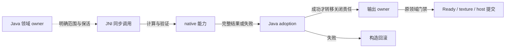

# Native 运行边界

上级契约：[系统边界](../README.md#系统边界)。

## 职责与边界

Native 是 Java 调用的能力层，消费明确的 bytes、几何、骨骼状态和输出范围。Java 仍拥有来源、identity、授权、预算、存储、发布与生命周期。支持平台由[平台决策](../../product-decisions/requirements/req-platform-availability.md)和[当前状态](../../status/support-and-verification.md)限定，CMake 可构建不等于产品可用。

## Seam Contract

按本次交接定位契约：

- 借用输入并接纳 native 结果：[JNI 与资源](#jni-能力与结果交付)。
- 取得配置默认：[设备默认](#设备默认交付)。
- 为自有专属线程应用策略：[线程策略](#调用线程策略交付)。

### 共同规则

适用范围：本页的 JNI 能力与结果交付、设备配置默认、调用线程策略三项交接。各项共用以下依赖方向、ABI 准入、领域发布和失败边界。

#### 能力与依赖方向

| 边界 | 当前职责 | 依赖方向 |
|---|---|---|
| 通用 runtime 基础 | buffer、分配、CPU capability、日志、状态与通用数据结构 | 位于底层，不依赖 codec、renderer、JNI 或 legacy 业务 |
| 生成 Proto 类型 | Native 所需的当前 schema 值类型与序列化接口 | 独立于运行算法；由渲染、legacy 和最终 glue 按需消费 |
| `ysm::codec` | hash、压缩、archive、图像和音频算法 | 依赖通用 runtime，不依赖 JNI glue |
| `ysm::gfx::bake` / `ysm::gfx::renderer` | baked 数据、数学与 CPU render | 依赖通用 runtime；只在需要 schema 输入的实现边缘消费生成 Proto 类型 |
| `ysm::java` | JNI descriptor、注册、引用、buffer 与 typed handle 基础设施 | 依赖通用 runtime，不实现领域算法 |
| `ysm::legacy` | legacy bundle/v3 解码、历史 codec 与 current schema 投影 | 复用通用 codec，并在投影边缘消费生成 Proto 类型 |
| `ysm::lib` 与 legacy Java bridge | 把上述能力适配成唯一 Java 可加载的共享库，并拥有 JNI 返回值/结果 owner 的边界 | 作为最外层聚合；算法不应反向依赖该 glue |

这个拆分约束的是依赖方向，不增加第二套模型 authority。Java 仍决定来源、identity、预算、存储、发布和生命周期；Native 子系统之间也不能借共享库聚合关系交换这些业务状态。

Native 只增加有实际消费者的能力。跨语言两侧不需要对称的 identity API、session 或 cache owner；提前复制这些机制会产生第二份 authority、生命周期与错误路径。格式标准仍约束每个实现，但不要求没有消费者的一侧提前增加解析能力。

#### Native ABI 准入

全部 JNI、共享内存、handle 和初始化配置契约共用一个全局 native ABI。库以导出变量声明该 ABI，Java 只查询期望符号是否存在，不依赖待验证库的 JNI 探针。符号检查不能阻止 OS 加载和静态构造。精确规则见[ABI 索引](../../abi/maintenance.md#native-符号门禁)。

Native 返回成功也不自动完成 Ready、纹理注册或宿主顶点提交。每项外部效果仍由对应 Java owner 接纳，避免计算层获得业务发布权。加载线程、一次性注册、能力入口和 Android 适配见[Native 实现](implementation/runtime-capabilities.md)。

Native 初始化与加载线程属于进程，调用不创建另一套业务运行时。Java owner 保活同步输入、接纳输出并裁决外部效果；native RAII 保护尚未交付的对象。共享 handle 保留 backing，但派生 view 没有独立关闭权。

#### 能力失败边界

普通能力失败由原领域 owner 隔离或降级；跨 JNI 不扩大失败许可。[默认模型例外](../../product-decisions/shared.md#condefault-failure-exception)只适用于指定 default 路径，不扩展为普通模型、联动或任意 native 调用的失败例外。设备配置的保守默认仅适用本页[设备查询](#设备配置默认)契约。

JNI 载体、buffer 与 handle 的约束依赖[ABI 索引](../../abi/maintenance.md#native-符号门禁)和本页的调用期保留条件。平台发布范围与当前证据由[支持状态](../../status/support-and-verification.md)限定；计算成功不证明上层领域接纳完成。

### JNI 能力与结果交付

本项显式继承[共同规则](#共同规则)。

**边界与权威**

Java 领域权威与 native 计算职责按[能力与依赖方向](#能力与依赖方向)划分；本项不授予 Ready、纹理或宿主输出发布权。

**前置条件与输入**

模型数据跨 JNI 只传 protobuf bytes、明确的 buffer owner 或 typed handle，不暴露 QuickBuffers message、Builder、parse cursor 或 allocator。同步借用与 owning output 分开；raw address 和 `jlong` 本身不证明资源仍然存活。

Java 调用方负责逻辑输入范围、原始地址所指布局、资源保活及能力声明的并发约束。JNI 胶合负责确保载体转换后，native 所需的类型、范围与计数表示成立。胶合应复用 Java 侧已建立并持续维持的保证，不重复检查或另建恢复机制；未建立或可能变化的条件应在造成失效访问前检查。计算能力负责在所接纳的输入和输出容量内执行。

容量、布局或资源身份变化后，由改变这些前提的 owner 重新建立保证。Native 不能从任意非空地址证明对象寿命，typed handle 检查也不替代原 owner 的保留与关闭约束。

**结果与保证**

图中实线表示结果交付，虚线表示调用期借用。

**所有权与时序**

#### JNI 与所有权

输入 owner 应覆盖整个调用窗口，返回对象在采用成功后才移交关闭责任。Wrapper、view 或 Cleaner 注册失败仍由构造路径回收，不能泄漏半成品。派生 view 不取得 backing 的独立关闭权；对应类型使用自己的释放协议。

`reachabilityFence` 只保证同步调用期 owner 可达，不允许 close 与使用并发。临时 owning buffer、共享资源和 thread-affine GPU 各按[生命周期规则](../model-management/client-resources/overview.md#引用撤销与物理关闭)终结，不能用一个 fence 替代。

调用返回不把借用地址变为持久资源。需要跨调用或异步保留时，接收方应取得协议允许的独立保留或复制。复用、扩容、invalidate 和关闭分别按原能力结束借用；帧状态与宿主输出的具体窗口由[渲染交接](../rendering/overview.md#资源与状态)和[宿主提交](../rendering/overview.md#并行输出与宿主提交)定义。

音频 checkpoint 是可共享的不可变值，恢复结果是每播放独占的 decoder。Checkpoint 不持有会话、输入借用地址或活动解码时间线，也不序列化到进程外。共享值只撤强引用并交给原 handle owner 回收，私有 decoder 仍在播放终态显式关闭。捕获条件与 adoption 规则见[checkpoint 契约](implementation/jni-and-memory.md#音频-checkpoint)。

**失败与拒收**

#### 失败与交接

Native 返回失败不提交领域状态。Java 包装解释 false、null 或 fallback，不能把默认返回当作有效模型或输出；需要分类诊断的能力使用自己的结构化结果协议。

JNI 胶合与 Java 包装应保留能力声明的合法空结果、拒绝和失败语义。计算成功只证明该能力结果满足自己的交付条件；Java 接纳方仍负责包装完整性、资源采用和当前领域资格。采用失败释放尚未交付的结果，不伪造 Ready 或成功输出，也不从日志文本推断恢复策略。

**证据与依赖**

载体与 handle 依赖[Native ABI 准入](#native-abi-准入)。具体 buffer、opaque handle、checkpoint 与 adoption 见[JNI 实现](implementation/jni-and-memory.md)；平台证据沿[共同规则](#共同规则)判断。

### 设备默认交付

本项显式继承[共同规则](#共同规则)。

**边界与权威**

#### 设备配置默认

Native 拥有只读设备查询与[统一分档规则](../../product-decisions/decisions/device-quality.md#bcdevice-derived-configuration-defaults)。Java 只提供 JVM 最大堆 byte 值、解释最终结果并映射配置默认。设备总拓扑与 renderer 可调度拓扑分开，避免进程 affinity 或停车状态改变设备默认。

**前置条件与输入**

JVM 最大堆 byte 输入、设备总拓扑与可调度拓扑的边界见本项[设备配置默认](#设备配置默认)；调用先满足[Native ABI 准入](#native-abi-准入)。

**结果与保证**

Java 在首次构造配置默认时缓存一个不可变进程结果。两个配置共享该结果；后续读配置或开屏不再探测。Native 不保留另一份全局档位，也不新增采样线程。加载早于配置初始化；提前访问或加载失败取得的保守结果不后台重试。

**所有权与时序**

进程结果与初始化寿命按本项结果字段维持；设备查询不建立另一套业务运行时，见[共同规则](#共同规则)。

**失败与拒收**

边界失败与合法低配应可区分，但都给出保守默认。可选系统符号只动态查询，缺失时不影响最低平台加载。查询不修改 SIMD、affinity 或 renderer 绑定。编码和初始化顺序见[实现](implementation/runtime-capabilities.md#设备配置默认)。

**证据与依赖**

统一分档消费[设备决策](../../product-decisions/decisions/device-quality.md#bcdevice-derived-configuration-defaults)，编码与初始化顺序见[设备配置实现](implementation/runtime-capabilities.md#设备配置默认)。平台证据不超出[共同规则](#共同规则)。

### 调用线程策略交付

本项显式继承[共同规则](#共同规则)。

**边界与权威**

#### 调用线程调度

Java 选择线程职责与固定策略，native 只修改调用线程，不拥有 executor、任务终态或发布权。`NORMAL` 保留继承状态；低档策略只应用到明确自有的专属 platform thread。宿主 executor 的单项任务不使用此包装，每个新线程独立尝试。

**前置条件与输入**

适用线程、固定策略和继承状态按本项[调用线程调度](#调用线程调度)进入；加载与符号条件继承[Native ABI 准入](#native-abi-准入)。

**结果与保证**

平台策略先查询基线，再应用并读回；基线查询失败不盲改宿主。已有更低档位不应提高，部分成功不能报告完整应用。Windows 的 background mode 应恢复正常 memory priority；低于 LOWEST 的 CPU 基线只保留 CPU-only 并报告降级。回滚只撤本次成功进入的 background mode，不能把已有 IDLE 提高。Linux/Android 保留宿主实时与 idle scheduler，nice/BATCH 不代表 cpuset 或配额。macOS QoS 请求不证明实际份额或 override。策略不改进程 affinity、CPU Sets 或 native render pool，也不保证 I/O 待遇不变。

**所有权与时序**

线程创建、worker loop 与容量 owner 由[运行组合](../runtime/overview.md#容量与线程策略)拥有；本项不接管 executor 或任务终态。

**失败与拒收**

可恢复调度、JNI 与诊断失败不吞掉原 worker loop；VM 致命错误仍传播。不叠加 Java priority fallback，也不恢复整条线程。正常池由正常 owner 创建，防止低档线程懒创建时继承低档状态。OS 属性不证明前台收益。当前责任映射见[运行模型](../runtime/overview.md#容量与线程策略)，平台落实见[运行能力](implementation/runtime-capabilities.md#调用线程调度)。

**证据与依赖**

平台调用落实见[运行能力](implementation/runtime-capabilities.md#调用线程调度)，支持与性能结论受[共同规则](#共同规则)中的当前证据限制。

## 设计取舍

明确保活和采用边界增加包装责任，但避免跨语言裸指针、Cleaner 与显式 close 竞争。

共享 checkpoint 与每播放独占 decoder 允许并发恢复，又不引入业务 refcount 或淘汰回调；代价是深拷贝 codec/parser 状态及独立内存计价。

导出符号 ABI 门禁减少 JNI 自举耦合，代价是临时 JNA 句柄和跨平台导出规则。

仅对自有专属线程应用固定策略，减少跨 owner 状态，但后台耗时可能增加。

缓存不可变进程分档结果，减少初始化与恢复状态，代价是运行期间不重新分档。

## 实现与验证入口

[运行能力](implementation/runtime-capabilities.md)定位加载线程、初始化与失败结果；[JNI 与内存](implementation/jni-and-memory.md)定位 buffer、opaque handle、结果视图、adoption、构造回滚和 checkpoint。平台发布范围与验证结论见[当前状态](../../status/support-and-verification.md)。
