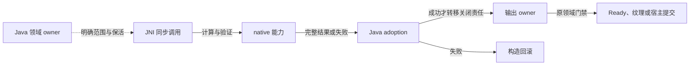

# Native 运行边界

上级契约：[系统边界](../README.md#系统边界)。

## 职责与边界

Native 层是供 Java 调用的纯计算能力层，接收显式字节缓冲、几何数据、骨骼状态与输出区间并返回结果。模型来源、身份判定、授权、资源预算、存储业务规则、结果发布与对象生命周期归 Java 侧管理。受支持平台以[平台决策](../../product-decisions/requirements.md#reqplatform-availability)和[当前状态](../../status/support-and-verification.md)为准。

## Seam Contract

按本次交接定位对应契约：

- 借用输入缓冲并接纳 native 返回结果：[JNI 能力与结果交付](#jni-能力与结果交付)。
- 请求 native 消费者协作终止：[协作取消](#协作取消)。
- 获取设备硬件分档的默认配置：[设备默认交付](#设备默认交付)。
- 为自有专属后台线程应用调度策略：[调用线程策略交付](#调用线程策略交付)。

### 共同规则

适用范围：本页四项契约。

#### 能力与依赖方向

Native 侧按算法模块与最外层 JNI 共享库单向分层聚合；算法模块不反向依赖胶合层，也不在 native 内部建立第二套业务权威、session 或跨子系统隐式状态。Storage 的公开声明与 JNI 载体不暴露数据库后端类型或原始错误码；查询结果交付 Java 成为独立值，交付失败与真实提交事实分别报告（数据库时序见[数据库执行](../model-management/storage/overview.md#数据库执行)）。

Native 层仅按实际消费需求增加能力，不与 Java 侧对称镜像身份 API、session 或 cache 负责方。

#### Native ABI 准入

全部 JNI 入口、共享内存布局、handle 协议与初始化配置共用一个全局 native ABI。共享库通过导出变量声明当前 ABI，Java 侧先用动态库符号查询检查该导出变量是否存在，而不依赖待验证库自身的 JNI 探针（注意：符号检查无法阻止 OS 加载动态库或执行静态构造）。完整规则见[ABI 索引](../../abi/maintenance.md#native-符号门禁)。

Native 初始化和加载线程归属于当前进程；native RAII 只保护尚未移交给 Java 的对象，共享 handle 保活底层 backing，派生 view 无独立关闭权。所有外部业务效果（Ready、纹理注册、宿主提交）均由 Java 侧负责方接纳后再发布。加载线程与平台入口见[Native 实现](implementation/runtime-capabilities.md)。

#### 能力失败边界

普通 native 能力失败由原 Java 领域负责方按常规路径隔离或降级；[默认模型例外](../../product-decisions/shared.md#condefault-failure-exception)仅适用于指定默认模型路径，硬件分档保守默认仅适用于[设备配置默认](#设备配置默认)。平台支持范围和当前验证结论见[支持状态](../../status/support-and-verification.md)。

### JNI 能力与结果交付

**前置条件与输入**

模型数据跨 JNI 只传递 Protobuf 字节、显式 buffer 负责方或强类型 handle，不暴露 QuickBuffers message、Builder、parse cursor 或 allocator。调用期同步借用与返回所有权输出严格分开；裸地址和 `jlong` 数值本身不证明底层资源存活（内存安全边界）。

跨语言校验分三层协作：
- **Java 调用方**：保证逻辑输入范围合法、裸地址指向预期布局、相关资源在调用期间存活，并满足对应能力的并发前提。
- **JNI 胶合层**：载体转换后确保 native 所需类型、范围和计数成立；复用 Java 侧已持续维持的保证，对尚未建立或可能变化的条件在触发非法内存访问前拦截。
- **Native 计算能力**：只在已接纳的输入与输出容量边界内执行。

容量、内存布局或资源身份变化时，由触发变更的负责方重新建立上述前提；强类型 handle 校验不替代原负责方的保活与关闭责任。

**结果与保证**

下图中实线表示结果所有权交付，虚线表示同步调用期借用。

**所有权与时序**

#### JNI 与所有权

输入负责方在同步 JNI 调用结束前保持存活；返回对象在 Java 侧 adoption 成功后才移交关闭责任。若构造 wrapper、派生 view 或注册 Cleaner 时失败，由构造路径立即回收底层资源，不泄漏半成品。

`reachabilityFence` 只防止同步调用期间 GC 提前回收，不能防止显式 `close` 与并发使用竞态。临时独立缓冲、共享资源与绑定线程的 GPU 资源按[生命周期规则](../model-management/client-resources/overview.md#引用撤销与物理关闭)各自收尾。

JNI 调用返回后借用地址即失效；跨调用或异步保留数据需走协议允许的独立保留或拷贝。帧状态与宿主输出的具体借用窗口见[渲染交接](../rendering/overview.md#资源与状态)和[宿主提交](../rendering/overview.md#并行输出与宿主提交)。

音频 checkpoint 是可共享的不可变值，每次恢复产出供单次播放独占的 decoder。Checkpoint 不持有会话、借用地址或活动时间线，也不跨进程序列化；共享 checkpoint 撤掉强引用后交由原 handle 负责方回收，私有 decoder 在播放结束时显式关闭。详见[checkpoint 契约](implementation/jni-and-memory.md#音频-checkpoint)。

**失败与拒收**

#### 失败与交接

Native 调用失败时不提交领域状态。Java 包装层按协议解释 `false`、`null`、fallback 返回值或结构化结果协议，完整保留合法空结果、拒绝与失败语义；采用失败时立即释放尚未移交的 native 结果，不依赖解析日志文本推断恢复策略。

**证据与依赖**

载体与 handle 布局依赖[Native ABI 准入](#native-abi-准入)；buffer、opaque handle、checkpoint 与采用细节见[JNI 实现](implementation/jni-and-memory.md)。

### 协作取消

**边界与权威**

通用 runtime 提供单向取消状态，JNI 外层适配为 `NativeCancellation`。取消状态不依赖业务逻辑、调度器或 JNI；native 消费者直接读取状态并自行决定检查点、结束与恢复方式。

**前置条件与输入**

Java 消费者通过 `borrow` 在同步回调中借出强类型 handle，回调期间不保留也不销毁原 handle。回调结束后仍需读取状态的 native 消费者，须在有效借用窗口内主动取得独立共享所有权。

**结果与保证**

新建状态为“未取消”，请求取消后单向变为“已取消”，重复或并发取消均幂等。取消请求返回后发起的检查必然可见已取消；与取消请求并发重叠的检查可能看到任一状态。多个消费者可共享同一取消状态。

**所有权与时序**

发起取消可与活动消费者并行，无需等待消费者执行锁。`close` 先封口拒绝新借用，再等待已有借用全部退出，最后释放 handle。注意：`close` 既不主动触发取消，也不证明底层工作已结束；已取得独立共享保留的 native 消费者可继续读取并在自身结束时释放。

**内存/死锁硬边界：** 借用回调内部不能调用或等待同一个 wrapper 的 `close`（会自锁）。重复关闭幂等；等待关闭期间遇到线程中断须等关闭完成后再恢复中断标志。Cleaner 与显式关闭共享同一份 exactly-once 释放责任。

**失败与拒收**

关闭开始后拒绝所有新借用、取消请求与状态查询。JNI 取消请求或查询失败时显式抛异常，不伪装成“未取消”或“成功”；wrapper 或 Cleaner 注册失败由采用路径回收。取消信号本身不接管业务提交、回滚或资源释放。

**证据与依赖**

共享状态与借用门禁见[JNI 与内存](implementation/jni-and-memory.md#取消状态与借用)，native 核心为 `CancellationState`。测试覆盖见 `CancellationTest` 与 `NativeCancellationIntegrationTest`。

### 设备默认交付

**边界与权威**

#### 设备配置默认

Native 侧执行只读硬件探测与[统一分档规则](../../product-decisions/decisions/device-quality.md#bcdevice-derived-configuration-defaults)，Java 侧传入 JVM 最大堆字节数、解释分档结果并映射为默认配置。探测过程区分设备总 CPU 拓扑与渲染器可调度拓扑，避免进程亲和性（affinity）或核心休眠干扰默认分档。

**结果与保证**

Java 在首次构造配置默认时探测一次，并将结果缓存为不可变的进程级快照，供两份配置共享，后续读取或打开界面不再重复探测；native 侧不保存全局档位也不启动采样线程。正常流程下 native 加载早于配置初始化；提前访问或加载失败时返回保守默认结果且不再后台重试。

**失败与拒收**

系统区分“边界探测失败”与“合法低配设备”，两者最终均产出保守默认配置。可选系统 API 符号动态解析，缺失时不阻塞最低支持平台加载。探测只读，不修改 SIMD 选择、进程 affinity 或渲染器绑定。编码与初始化顺序见[设备配置实现](implementation/runtime-capabilities.md#设备配置默认)。

### 调用线程策略交付

**边界与权威**

#### 调用线程调度

Java 侧选定线程职责与固定调度策略，native 侧仅修改当前调用线程的 OS 调度属性，不拥有 executor 或任务生命周期。`NORMAL` 原样保留继承状态；低档策略仅用于 YSM 自有专属平台线程（platform thread），不套用在宿主 executor 单项任务上，每个新线程独立尝试应用。

**结果与保证**

各平台统一遵循“先查基线、再应用并读回确认”：
- **通用**：基线查询失败时不修改宿主线程属性；线程已处于更低优先级档位时不反向调高；部分步骤成功时不报告完整应用；不改动进程 affinity、CPU Sets 或 native 渲染线程池，不承诺 I/O 待遇不变。
- **Windows**：进入 background mode 后恢复正常内存优先级；CPU 基线已低于 `LOWEST` 时只保留纯 CPU 调整并报告降级；失败回滚只撤销本次成功进入的 background mode，不把原本就是 `IDLE` 的线程调高。
- **Linux 与 Android**：保留宿主原有实时调度器与 idle 调度器设置；设置 `nice` 或 `BATCH` 不保证特定 `cpuset` 或 CPU 配额。
- **macOS**：请求 QoS 仅表达调度倾向，不保证实际 CPU 时间份额或系统不覆盖。

**失败与拒收**

可恢复的调度失败、JNI 失败或诊断异常不吞掉原 worker 循环（VM 致命错误照常传播）；失败后不叠加 Java 线程优先级作为 fallback，也不强行还原整条线程状态。**关键前提**：正常优先级线程池须由正常线程创建，避免在低档后台线程中懒创建时意外继承低档 OS 状态。线程容量与归属见[运行模型](../runtime/overview.md#容量与线程策略)，平台实现细节见[运行能力](implementation/runtime-capabilities.md#调用线程调度)。

## 设计取舍

- **显式调用期保活与结果采用**：增加 Java 包装层责任，但从根源避免跨语言裸指针失效及 Cleaner 与显式 `close` 竞态。
- **共享不可变音频 checkpoint + 独占 decoder**：支持并发恢复解码并省去业务层引用计数或淘汰回调；代价是恢复时需深拷贝编解码器与解析器状态并计入内存预算。
- **导出符号 ABI 门禁**：减少 JNI 自举阶段耦合；代价是需维护临时 JNA 句柄查询及各平台符号导出规则。
- **仅对自有专属后台线程应用固定调度策略**：减少跨负责方状态污染；代价是竞争激烈时后台任务耗时可能拉长。
- **进程内缓存不可变设备分档结果**：简化初始化与恢复逻辑；代价是运行期间不动态重新分档。

## 实现与验证入口

[运行能力](implementation/runtime-capabilities.md)定位加载线程、初始化顺序与失败映射；[JNI 与内存](implementation/jni-and-memory.md)定位 buffer、opaque handle、结果视图、采用与构造回滚以及音频 checkpoint。平台发布范围与当前验证结论见[当前状态](../../status/support-and-verification.md)。
