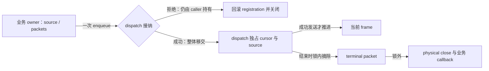

# 资产传输

本页定位[typed 组装](../overview.md#typed-capability-与业务组装)与[dispatch 所有权](../overview.md#分发所有权与负载保护)。字段、数值上限与 coverage 规则由[协议](../../../standards/protocol-v1/README.md#typed-model-distribution)定义。

## Typed request 与 action owner

Metadata、model chunk、presentation page owner 先形成完整 canonical miss descriptor；全 cache hit 不分配 ID。超帧时才顺序启动 child。每个 child 持有独立 admission、assembly、cancel 和 terminal，parent 不持 child backing。失败或取消停止未启动项并取消活动 child；迟到 outcome 只释放原 child，不重开 parent。Required children 与 cache hits 全部完成后才发布一次结果。

## Server admission 与 source closure

Handler 的 structural pass 先于 connection-local high-water 推进。Business pass 随后读取当前 `ServerModelSession`，验证 exact identity、membership、用途与授权。完整 descriptor 通过后才创建 source plan；protected chunk 授权早于 source lookup。业务 transfer owner 在首次 acquisition 前建立，使同步返回与异步迟到都已有责任方。

Pack cover 用完整目录地址匹配当前公开根和 descriptor，不按同名 pack 回退。合法逻辑来源链接可指向根外，不能套用 cache 的写入 containment；仍复核来源和 regular-file。普通展示图片只接纳 catalog icon 或已验证 Manifest 的作者头像、GUI 前景/背景，不能把任意 blob 或运行纹理当展示图。

Preview 优先取得已声明 thumbnail 的验证 chunk；声明存在但缺块或验证失败是真实 failure，不能回退独立图。无声明时由 `ServerResourceRuntime.acquirePreview` 交出 encoded bytes lease，普通请求不 bake 或生成。共享 bytes 不授予权限，保留见[服务端资源](../../model-management/server-resources/overview.md)。

Range packet 接管 bytes、byte lease 或带强引用的 file range。外部可变 bytes 在接管时隔离，lease 保持到 packet terminal；file cursor 每次只打开本次读取句柄。Source 只解释范围和释放，typed owner 解释 natural key、授权和业务失败。取消停止后续取得，交付竞争失败方归还自己的 lease。

## Receiver-local assembly 与 publication

Receiver 拒绝请求 descriptor 之外的 natural key。Metadata/chunk 完成后经[分层验证](../../asset-pipeline/implementation/container-and-validation.md)交存储提交；page owner 等全部 slots terminal 后一次发布 staged futures。Preview 的 `ABSENT` 与 icon/cover 的 `UNAVAILABLE` 不混用。

`ClientAssetRepository` 从原 remote representation Manifest 冻结内嵌声明，不借同 `ModelId` 的本地表示推断。独立 preview 以完整 coverage 和媒体验证接纳，不校验服务端提供的模型绑定/hash，再按 `ContainerId` 提交。Icon/cover 仍核对 descriptor。独立坏媒体的确定性 CONTENT 拒绝可归约缺图，声明内嵌图失败仍为失败；访问、容量、取消、native linkage 和分配失败不能伪装缺图。

Preview DATA、服务端 ABSENT、解码拒绝与延迟缺图发布携带原 session member token。图可读通知撤销旧 token，过时结果只结束旧工作，不建 GUI 缺图镜像。`ClientAssetTransfer` 在同一 session monitor 取得缺图事实与 token，再于锁外调用 receiver。Token 规则归[模型会话](../../model-management/sessions/overview.md)；通知不含图片、不发起请求、不授予权限。

显式管理补图每次 admission 重新核对 level 2 与 published exact identity。`RenderTargetChunkPlan` 只验证主目标实际默认依赖，不扩大 grants。`ServerPreviewWork` 的额度覆盖 assembly、迟到 worker、owner fact 以及 accepted dispatch 仍持有的 source；取消不能提前归还物理占用。上传由 client tick 推进有限 cursor，复用带宽与 writability 门禁；worker 不等待网络或 host。持久提交与通知交接见[存储设计](../../model-management/storage/overview.md)，wire 限制见[管理协议](../../../standards/protocol-v1/README.md#显式管理补图)。

## 全局 dispatch owner

`ResourceDispatchWorker` 由 server model service 唯一持有。完整 child packets 在一个临界区全有或全无地转移；业务层不读取 queue snapshot 推断容量。拒绝或异常时 caller 回滚 registration，关闭尚未交付的 source/packet；成功后 dispatch 独占 cursor、重试和关闭。Packet callback 在 acquisition 前绑定 transfer owner。

构造 frame 前检查 transport 压力，构造后按实际 frame size 复检，只有 `trySend` 成功才推进 cursor。连接仍有效时 transient failure 重建同一 frame；cancel、disconnect、production failure 和 shutdown 均回到 dispatch 关闭已接纳 source。Monitor 内仅摘除终态，physical close 与 callback 在锁外执行，避免 enqueue/completion 的反向锁关系。

## 分发负载保护

Dispatch 同时执行全局速率、transport 背压和 per-player 有界接纳，玩家之间轮转，单玩家保持 FIFO。局部调优数值不定义另一个容量 authority。Client 连续意图归[需求设计](../../model-management/demand/overview.md)；页面关闭只取消 exact page action，不关闭 dispatch 或 cache 已拥有的 backing。
