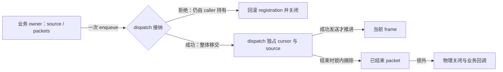

# 资产传输

本页定位[类型化组装](../overview.md#typed-capability-与业务组装)与[dispatch 所有权](../overview.md#传输接管与发送终态)的代码落实。字段定义、数值上限与覆盖范围（coverage）规则由[协议](../../../standards/protocol-v1/README.md#typed-model-distribution)规定。

## Typed request 与 action owner

- 元数据、模型块与展示页面负责方先整理完整的规范缺失描述（canonical miss descriptor）；若全命中本地 cache，不分配传输 ID。
- 仅当完整描述超出单帧上限时按顺序启动子传输（child）。每个子传输有独立的准入、组装、取消与结束状态，父传输不持有子传输 backing。
- 任一失败或取消都会停止未启动子项并取消进行中子项；迟到子项仅释放原 child，不重开已结束父传输。全部必需子项与 cache 命中就绪后，父传输一次性发布结果。

## Server admission 与 source closure

- **结构与业务准入**：服务端接收处理器先校验结构，通过后再推进该连接本地高水位序号；随后读取当前 `ServerModelSession`，逐项校验目标身份、目录成员资格、请求用途与访问权限。受保护块（protected chunk）的权限检查早于数据源查找，完整 descriptor 通过准入后才创建数据源计划。
- **轮询与事件边界**：业务传输负责方在首次申请资源前即建立并持有使用权。`ServerAssetTransfers` 在既有 tick 轮询未就绪成员，已 Ready 成员推进游标后不回退；资源侧不主动推送完成事件，网络侧仅保留管理事实、packet 结束状态与生产失败几类事件交接。

不同展示资源的来源限制：

- **Pack 封面**：按完整目录地址匹配当前公开根与 descriptor，不按同名 pack 回退。合法的逻辑来源符号链接可指向公开根之外，仍需复核来源合法性且目标须为普通文件（regular file）。
- **普通展示图片**：仅接受目录 icon 或已验证 Manifest 声明的作者头像、GUI 前景与背景。
- **预览图（Preview）**：优先取 Manifest 声明的 thumbnail 已验证块；若声明存在但缺块或校验失败，按真实失败处理，不回退到独立预览图。未声明内嵌缩略图时，由 `ServerResourceRuntime.acquirePreview` 交出使用权，网络层逐项轮询 Ready/Missing 并累计字节数，越界即停。普通请求不触发烘焙或现场生成；共享字节保留规则见[服务端资源](../../model-management/server-resources/overview.md)。

`RangePacket` 可持有字节数组（构造时拷贝隔离）、独立 Ready 使用权或带强引用的文件区间（按范围读取时临时打开句柄）：

- 构造时由 `RangePacket.lease` 建立自身保留，整批子传输 packet 构造完毕后统一结束申请阶段临时使用权。
- 中途构造失败时立即关闭已构造 packet 并释放本请求申请使用权，不把半成品送入队列。
- Packet 保留持续至 dispatch 结束；source 仅管按范围读取与释放，自然键、授权校验与业务失败由各业务负责方解释。

## Receiver-local assembly 与 publication

- 接收器拒绝不在请求 descriptor 覆盖范围内的自然键。元数据与模型块收齐后经[分层验证](../../asset-pipeline/implementation/container-and-validation.md)再交存储提交；展示页面等全部槽位结束后一次性发布 future 结果。预览图 `ABSENT` 与 icon/封面的 `UNAVAILABLE` 分开语义。
- `ClientAssetRepository` 直接从远端模型表示的 Manifest 冻结内嵌缩略图声明。独立预览图覆盖完整且通过媒体验证即可接纳并按 `ContainerId` 提交；icon 与封面继续核对 descriptor。独立预览图遇坏媒体导致的确定性 `CONTENT` 拒绝可归约为缺图；声明内嵌缩略图校验失败则按真实失败处理，权限不足、容量超限、取消、native 链接错误或内存分配失败同样作为真实失败传播。
- 预览图数据、服务端 `ABSENT`、解码拒绝与延迟缺图发布均携带原会话成员 token。“图已可读”通知到达时撤销旧 token，过时异步结果只结束旧工作、不写入 GUI 缺图状态。`ClientAssetTransfer` 在同一 session 监视器内读取缺图事实与 token，再于锁外调用接收器。Token 规则归[模型会话](../../model-management/sessions/overview.md)；可读通知本身不带图片数据，也不发起请求或授权限。

显式管理补图（管理员上传预览图）边界如下：

- **准入与范围**：每次准入复核操作者 level 2 权限与已发布模型精确身份；`RenderTargetChunkPlan` 仅校验主目标实际需要的默认依赖。
- **配额与保留归还**：`ServerPreviewWork` 配额覆盖组装、迟到 worker、负责方状态、资源读取与已入队 source。管理块申请交入独立读取保留，由资源侧在拒收、未启动退出或读取结束时归还；已交 dispatch 的保留由 packet 物理关闭回调归还，不依赖 session tick，取消操作不提前归还物理占用。
- **客户端上传**：由 client tick 推进有限游标并复用带宽与可写门禁，worker 不阻塞等网络或宿主。持久提交与通知见[存储设计](../../model-management/storage/overview.md)，线协议限制见[管理协议](../../../standards/protocol-v1/README.md#显式管理补图)。

## 全局 dispatch owner

`ResourceDispatchWorker` 由游戏服务端模型服务唯一持有。同一父请求下完整子 packet 集合在单一临界区内全有或全无移交，不通过读取队列快照猜测容量；入队被拒或抛错时调用方立即回滚登记并关闭未交付 source/packet，入队成功后 dispatch 独占游标、重试与关闭权。Packet 回调在申请资源前绑定至对应传输负责方。

发送循环在构造 frame 前查传输背压，构造后按实际帧大小复检，仅 `trySend` 成功才推进读取游标。连接有效时，瞬态发送失败在下次重试原地重建同一帧；取消、断连、生产失败与服务端关闭均回到 dispatch 统一关闭已接纳 source。监视器锁内仅摘除已结束条目，物理关闭与业务回调放在锁外执行，避免入队与完成回调形成反向锁顺序。

## 分发负载保护

Dispatch 施加三道保护：全局速率限制、传输层背压与单玩家有界接纳；发送调度在玩家间轮转，单玩家内保持 FIFO。局部调优参数仅管各自门禁。客户端连续需求合并归[需求设计](../../model-management/demand/overview.md)；关闭界面只取消对应页面操作，不影响 dispatch 或本地 cache 已接管的 backing。
