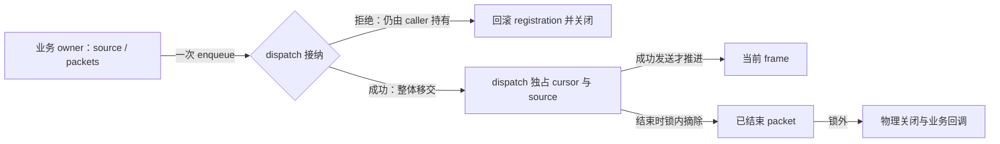

# 资产传输

本页定位[类型化组装](../overview.md#typed-capability-与业务组装)与[dispatch 所有权](../overview.md#传输接管与发送终态)的代码落实。字段定义、数值上限与覆盖范围（coverage）规则由[协议](../../../standards/protocol-v1/README.md#typed-model-distribution)规定。

## Typed request 与 action owner

元数据、模型块和展示页面的负责方会先整理出完整的规范缺失描述（canonical miss descriptor）；如果全部命中本地 cache，就不会分配传输 ID。只有当完整描述超出单帧上限时，才按顺序启动子传输（child）。每个子传输拥有独立的准入、组装、取消与结束状态，父传输不持有子传输的 backing。任一失败或取消都会停止尚未启动的子项并取消正在进行的子项；迟到的子项结果只用来释放原 child，不会重新打开已经结束的父传输。直到所有必需子项和 cache 命中项全部就绪后，父传输才对外发布一次结果。

## Server admission 与 source closure

服务端接收处理器先做结构校验，通过后才推进该连接本地的高水位序号。接着进入业务准入阶段：读取当前 `ServerModelSession`，逐项校验目标身份、目录成员资格、请求用途与访问权限。只有完整 descriptor 通过准入，才会创建数据源计划；受保护块（protected chunk）的权限检查必须早于数据源查找。业务传输负责方在首次申请资源前即已建立，并持有本次请求的使用权。`ServerAssetTransfers` 在既有 tick 中轮询尚未就绪的成员，已经 Ready 的成员推进游标后不再回退。资源侧不会主动推送“取得完成”事件；网络侧只保留管理事实、packet 结束状态和生产失败这几类事件交接。

不同展示资源各有专属的来源限制：
- **Pack 封面**：必须按完整目录地址匹配当前公开根和 descriptor，不能按同名 pack 回退。合法的逻辑来源符号链接可以指向公开根之外，不能机械套用 cache 写入的目录 Containment 限制，但仍需复核来源合法性且目标须为普通文件（regular file）。
- **普通展示图片**：只接受目录 icon，或已验证 Manifest 声明的作者头像、GUI 前景与背景，不能把任意 blob 或运行时纹理当作展示图下发。
- **预览图（Preview）**：优先获取 Manifest 中已声明 thumbnail 对应的已验证块；一旦声明存在但缺块或校验失败，就按真实失败处理，不能回退到独立预览图。若模型未声明内嵌缩略图，则由 `ServerResourceRuntime.acquirePreview` 立即交出本次请求的使用权，网络层逐项轮询 Ready 或 Missing，并累计实际字节数，一旦越界就不再启动后续读取。普通请求不会触发烘焙或现场生成。共享字节本身不附带访问权限，保留规则见[服务端资源](../../model-management/server-resources/overview.md)。

Range packet 可以持有字节数组、独立的 Ready 资源使用权，或带强引用的文件区间。外部传入的可变字节数组在构造时即做拷贝隔离。构造时由 `RangePacket.lease` 先建立自身保留，待整个子传输的 packet 集合全部构造完毕后，再统一结束申请阶段的所有临时使用权。如果中途构造失败，立即关闭已构造出的 packet 并释放本请求仍持有的申请使用权，绝不把半成品子传输送入队列。Packet 保留持续到 dispatch 结束；文件游标每次按范围读取时才临时打开句柄。Source 只负责按范围读取和释放资源，自然键、授权校验与业务失败语义归各类型的业务负责方解释。

## Receiver-local assembly 与 publication

接收器会拒绝任何不在请求 descriptor 覆盖范围内的自然键。元数据与模型块收齐后，先经[分层验证](../../asset-pipeline/implementation/container-and-validation.md)再交给存储层提交；展示页面负责方则等全部槽位进入结束状态后，一次性发布暂存的 future 结果。预览图的 `ABSENT` 与 icon 或封面的 `UNAVAILABLE` 语义分开，不能混用。

`ClientAssetRepository` 直接从对应的远端模型表示 Manifest 中冻结内嵌缩略图声明，不会借同名 `ModelId` 的本地表示去推断。独立预览图只要覆盖完整并通过媒体验证即可接纳，不校验服务端提供的模型绑定或哈希，随后按 `ContainerId` 提交；icon 和封面则仍需核对 descriptor。对于独立预览图，坏媒体导致的确定性 `CONTENT` 拒绝可以归约为缺图，而声明了内嵌缩略图却校验失败则必须算作真实失败；权限不足、容量超限、取消、native 链接错误或内存分配失败，都不能伪装成缺图。

预览图数据、服务端 `ABSENT`、解码拒绝以及延迟缺图发布都会携带原会话成员的 token。一旦“图已可读”的通知到达，就会撤销旧 token，过时的异步结果只能结束旧工作，不会在 GUI 中写入缺图状态。`ClientAssetTransfer` 在同一个 session 监视器内读取缺图事实与 token，再于锁外调用接收器。Token 规则归[模型会话](../../model-management/sessions/overview.md)；可读通知本身不携带图片数据，也不会主动发起请求或授予权限。

显式管理补图（管理员上传预览图）沿以下边界推进：
- **准入与范围**：每次准入都重新核对操作者的 level 2 权限以及已发布模型的准确身份。`RenderTargetChunkPlan` 只校验主目标实际需要的默认依赖，不扩大授权范围。
- **配额与保留归还**：`ServerPreviewWork` 的配额覆盖组装、迟到 worker、负责方状态、资源读取以及已进入 dispatch 队列的 source。管理块申请会向资源侧交入独立读取保留，由资源侧在拒收、未启动退出或真实读取结束时归还；已交给 dispatch 的保留则由 packet 的物理关闭回调归还，不依赖 session tick，取消操作也不能提前归还物理占用。
- **客户端上传**：由 client tick 推进有限游标，复用带宽与可写性门禁；worker 不阻塞等待网络或宿主。持久提交与通知交接见[存储设计](../../model-management/storage/overview.md)，线协议限制见[管理协议](../../../standards/protocol-v1/README.md#显式管理补图)。

## 全局 dispatch owner

`ResourceDispatchWorker` 由游戏服务端模型服务唯一持有。同一父请求下完整的子 packet 集合在一个临界区内全有或全无地移交，业务层不会读取队列快照去猜测剩余容量。如果入队被拒绝或抛异常，调用方立即回滚登记并关闭尚未交付的 source 和 packet；一旦入队成功，dispatch 便独占游标、重试与关闭权。Packet 回调在申请资源之前就已绑定到对应的传输负责方。

发送循环在构造 frame 前先检查传输背压，构造后按实际帧大小再次复检，只有 `trySend` 成功才推进读取游标。连接仍然有效时，遇到瞬态发送失败会在下次重试原地重建同一帧；取消、断连、生产失败和服务端关闭都会回到 dispatch 统一关闭已接纳的 source。监视器锁内只负责摘除已结束的条目，物理关闭和业务回调均放在锁外执行，避免入队与完成回调之间形成反向锁顺序。

## 分发负载保护

Dispatch 同时施加三道保护：全局速率限制、传输层背压和单玩家有界接纳；发送调度在玩家之间轮转，单个玩家内部保持 FIFO 顺序。局部调优参数只管各自门禁，不代表另一层的容量上限。客户端连续需求的合并归[需求设计](../../model-management/demand/overview.md)；关闭界面时只取消对应的页面操作，不会关闭 dispatch 或本地 cache 已接管的 backing。
