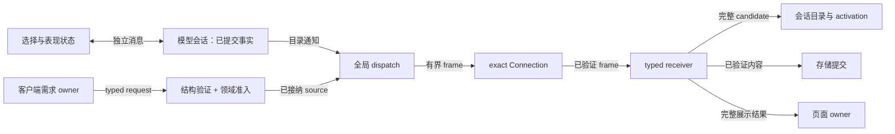
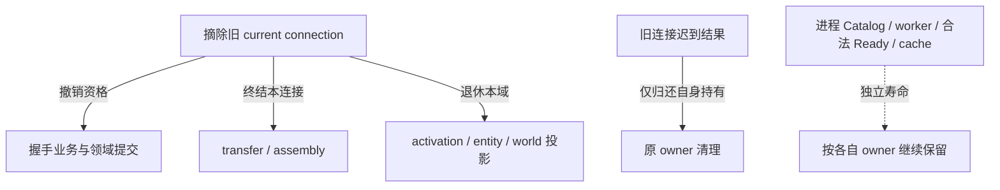

# 网络

上级契约：[系统边界](../README.md#系统边界)。

## 职责与边界

网络在 exact Minecraft `Connection` 内传递目录、资产、选择和表现状态。网络拥有物理帧验证、路由、typed assembly 和传输终态；模型会话拥有目录、授权与选择事实。Native 压缩和 hash 不拥有 session。

本页细化[系统架构](../README.md#系统边界)的远端交接。产品依据见[有界分发](../../product-decisions/requirements/req-bounded-model-distribution.md)、[模型授权](../../product-decisions/decisions/model-authorization.md)和[信任边界](../../product-decisions/decisions/trust-boundaries.md)。Wire 由 [Protocol V1](../../standards/protocol-v1/README.md)唯一规定。

[玩家状态](player-state.md#seam-contract)是本域的完整下级子系统，拥有选择反馈、报告 baseline 与表现投影的交接契约。

## Seam Contract

- 收到 bytes 后建立了什么结构与交付保证：[帧准入与类型化交付](#帧准入与类型化交付)。
- 哪个连接可执行业务，退出如何撤销资格：[连接业务资格与撤销](#连接业务资格与撤销)。
- source 与 packet 何时转移，发送失败由谁终结：[传输接管与发送终态](#传输接管与发送终态)。

### 共同规则

适用范围：“帧准入与类型化交付”“连接业务资格与撤销”和“传输接管与发送终态”。三项契约继承本节的数据流、失败归属、产品未决项与验证限制。

下图的边表示数据或接纳结果，不表示同步等待。

#### 失败归属

非法外部输入属于接纳拒绝；权限拒绝、BUSY、UNAVAILABLE 和取消按所属请求终结。内容失败、协议失败与连接撤销沿各自 owner 隔离，不能把一次业务拒绝升级为 Minecraft 连接失败。具体消息的失败状态由协议定义，不以异常类型统一裁决。

内部交付违反覆盖范围、结果完整性或所有权保证时，应保留原因与责任身份。所属 owner 按[普通失败隔离](../../product-decisions/decisions/failure-isolation.md#bcordinary-failure-keeps-game-running)收尾，不能伪造发送完成、合法缺失或权限结论。

当前 forced-selection 相对 `RESTRICTED_AUTH` 的例外仍待[Q-09](../../complexity-map/java-models-and-network/open-questions.md#q-09)裁决，不能以实现补写授权。验证与支持缺口见[网络问题](../../status/known-issues/network.md)。

### 帧准入与类型化交付

**边界与权威**

本契约继承[共同规则](#共同规则)的数据流与失败归属。

#### Transport 与物理预算

Transport 只解释 frame、方向、长度、压缩和 exact consumption。短 Proto 使用 simple frame，大 Proto 或 attachment 使用 full frame，共用一条 wire path。业务 key、授权、完成和发布归 typed owner。

物理预算由协议规定，为宿主 framing、发送缓冲和未来适配留余量。Forge 当前最大包不是目标；单帧限制也不预留发送容量或承诺送达。协议仍处于 unstable，兼容成本见[协议兼容决策](../../product-decisions/decisions/session-failure.md#ddprotocol-compatibility-has-bounded-cost)。

#### Typed capability 与业务组装

固定消息类型限定接收数据可选择的能力。Descriptor 不能选择任意 host path、URL、Java 类或执行后端；磁盘能力由[存储设计](../model-management/storage/overview.md)限定。

Collection operation、metadata sequence、model/presentation range 的完成条件不同。各 receiver 保有 natural key、bounds、coverage、terminal 和 publication，只复用机械 helper，避免通用 header 产生非法组合。

**前置条件与输入**

#### 接收准入与执行权限

网络 bytes 通过 frame 与 Proto 验证后，只取得固定类型的消息资格。解码成功不证明请求主体、当前成员、用途、权限或业务上下文有效。服务端按[客户端输入校验](../../product-decisions/decisions/trust-boundaries.md#ddvalidate-client-before-effect)在投入受保护资源或写入权威事实前完成业务准入；客户端对普通服务端业务的信任不豁免[能力底线](../../product-decisions/decisions/trust-boundaries.md#ddtrusted-server-with-capability-floor)。

**结果与保证**

目录描述先于完整内容；加入游戏不下载全部 model body。选择与资产需求独立推进，cache 命中不携带访问权限。存储与 activation 依赖[模型会话](../model-management/sessions/overview.md)的当前资格，不能从收到 bytes 推导 Ready。

Typed owner 只消费本请求 descriptor 覆盖的结果，并在完整 coverage 与适用内容验证后发布。Frame 关闭不撤销已转移的 backing 保留；投递或接纳失败时，仍持有 payload 的 owner 负责归还。具体责任映射见[连接与消息准入](implementation/transport-and-session.md)和[receiver publication](implementation/asset-transfer.md#receiver-local-assembly-与-publication)。

**所有权与时序**

Typed receiver 拥有本次请求的 coverage、组装和 terminal；模型资源 backing 的保留不因传输结束而自动结束。

领域执行另依赖[连接业务资格与撤销](#连接业务资格与撤销)，发送责任另依赖[传输接管与发送终态](#传输接管与发送终态)。

**失败与拒收**

本契约继承[共同规则](#共同规则)的外部输入拒收、内部违约归属与隔离。

**证据与依赖**

Wire 能力与物理限制以 [Protocol V1](../../standards/protocol-v1/README.md) 为准；产品未决项及验证限制继承[共同规则](#共同规则)。

### 连接业务资格与撤销

**边界与权威**

本契约继承[共同规则](#共同规则)的数据流与失败归属。

**前置条件与输入**

Netty 接收不取得领域写权限。接收适配器捕获来源 exact connection，把消息及跨投递所需的 backing 保留交给对应 owner；服务端主线程执行领域准入与事实提交。排队期间 connection、session 和权限可能变化，执行入口应核对原 connection 与原 owner，不能借当前玩家或 replacement session 继续旧请求。已接纳请求的授权有效期另由[请求时授权](../../product-decisions/decisions/model-authorization.md#ddrequest-time-authorization)定义。

**结果与保证**

#### Exact connection 与业务资格

握手业务资格与 catalog `ACTIVE` 独立。Client 将 ACCEPT 成功交给有序 transport 后发布业务资格；server 在业务执行时复核 exact session active，不另建 ACK。Selection、PlayerState、收藏与控制不等待 catalog publication。

**所有权与时序**

一条 exact connection 至多对应一个 model session。网络线程捕获来源连接，owner thread 执行时再次核对；玩家 UUID 和 global current 不能借用 replacement session。Publication 与 data transfer 的 ID stream 分属当前连接，只在连接替换时重置。

#### 连接撤销交接

连接撤销先摘除 current connection，使旧接纳与提交资格失效。随后各责任方终结旧连接的 transfer、assembly、activation 与玩家/entity/world 投影。模型会话按同一交接撤销本域提交资格；迟到结果只能丢弃结果或关闭自己仍持有的数据，不能写入 replacement authority。

上述箭头只规定资格撤销先于后续接纳，不为各资源终态虚构串行顺序。已接纳共享资源按各自合法使用继续保留。Disconnect 不等待或清空进程 Catalog、worker、registered image 与已验证磁盘 cache，也不删除本地文件、配置或持久 selection。宿主 Netty drain 不能替代精确连接核对或共享资源的终态。

Game server stopping 结束本服务的 session transfers 与 dispatch；进程资源由[运行作用域](../runtime/overview.md)结束。协议、业务与内容失败不应混成一个失败范围。

**失败与拒收**

Collection assembly、commit 或 activation 失败只结束 catalog/resource owner，客户端进入 intrinsic default；已握手业务资格仍有效。协议失败、disconnect 和 replacement 同时撤销业务资格。目录失败不能回退到可能与远端权威冲突的本地 catalog；断开连接后才恢复最新 local snapshot。

**证据与依赖**

当前领域权威、请求时授权和投影依赖[模型会话](../model-management/sessions/overview.md#seam-contract)；产品未决项与验证限制继承[共同规则](#共同规则)。

### 传输接管与发送终态

**边界与权威**

本契约继承[共同规则](#共同规则)的数据流与失败归属。

一个 game server service 持有一个全局 dispatch owner，独占已接纳 transmission 的 cursor、背压、重试和关闭。

**前置条件与输入**

#### 分发所有权与负载保护

业务 owner 在 source acquisition 前建立；完整 child packet 集只转移一次。

全局限速、连接背压、per-player 接纳和 client 防抖分别控制总量、发送压力、单玩家占用和需求扰动。限速不能证明 queue 有容量，防抖也不能代替 server 保护。Siblings 独立接纳，不作 all-children reservation 或回滚。容量不足局部拒绝资产请求，以延后资源取得满足[gameplay 优先](../../product-decisions/decisions/workload-budget.md#ddgameplay-traffic-precedes-asset-distribution)。

**结果与保证**

接纳失败时 caller 关闭仍持有的资源，成功后只由 dispatch 关闭。

#### 事实提交与通知

目录通知依赖[会话的权威提交契约](../model-management/sessions/overview.md#权威提交与通知)。网络消费已提交 snapshot，不以编码或 enqueue 结果改写领域事实；transport 不为该交接增加 ACK 或补发历史。

Collection 与 selection 使用独立消息路径，网络不建立跨消息联合提交。真实 FULL baseline、best-effort 丢失后果和动画消费见[玩家状态契约](player-state.md)。新请求与已接纳使用的区别由[新使用资格](../model-management/sessions/overview.md#新使用资格)定义。

**所有权与时序**

Queue 不保存整文件或预生成 frame 列表；cursor 按范围读取，重试重建本帧。

#### 超帧动作与子传输

完整 descriptor 能放进一个 frame 时只建一个 transfer。只有超帧才顺序启动有限 children；child 独立接纳与终结，parent 只保存未启动项、结果和取消关系。早期 child 已提交的 immutable cache 不因后续 child 失败回滚。管理补图复用同一 typed transfer 和 dispatch，不增加跨请求 reservation。

**失败与拒收**

Source 已接纳不保证后续 range I/O 成功。Production failure 由 dispatch 关闭已接纳 source 并交回本次业务终态，不转为 ABSENT 或发送成功；普通 I/O 失败不因来源属于内部对象而成为契约违约。精确关闭与回调交接见[全局 dispatch owner](implementation/asset-transfer.md#全局-dispatch-owner)。

**证据与依赖**

持久提交与活动 backing 分别由[存储](../model-management/storage/overview.md#seam-contract)及[服务端资源](../model-management/server-resources/overview.md#seam-contract)保留；精确关闭和回调见[全局 dispatch owner](implementation/asset-transfer.md#全局-dispatch-owner)。产品未决项与验证限制继承[共同规则](#共同规则)。

## 设计取舍

按范围读取并在重试时重建 frame，以局部 I/O 换取有界驻留和单一关闭责任。

## 实现与验证入口

- [连接与消息准入](implementation/transport-and-session.md)：路由、BusinessSession 和失败归属。
- [目录传递](implementation/catalog-sync.md)：collection receiver 与领域 publication 的交接。
- [资产传输](implementation/asset-transfer.md)：source、assembly 和 accepted transmission 的关闭责任。
- [玩家状态落实](implementation/player-state.md)：实际报告者、baseline 和应用者。
