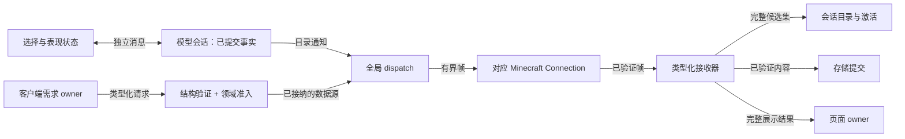
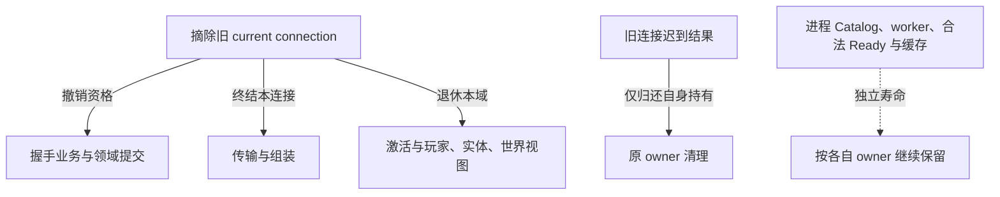

# 网络

上级契约：[系统边界](../README.md#系统边界)。

## 职责与边界

网络层依托同一个 Minecraft `Connection` 传递目录、资产、模型选择和表现状态。模块边界按事实归属划分：网络层负责物理帧校验、消息路由、按消息类型组装数据，以及管理传输结束状态；模型会话层掌握目录、授权和选择事实；Native 层的压缩与哈希只提供计算能力，不持有会话状态。

本页细化[系统架构](../README.md#系统边界)中的远端交接。产品依据见[有界分发](../../product-decisions/requirements/req-bounded-model-distribution.md)、[模型授权](../../product-decisions/decisions/model-authorization.md)和[信任边界](../../product-decisions/decisions/trust-boundaries.md)。线协议（wire）由 [Protocol V1](../../standards/protocol-v1/README.md) 唯一规定。

[玩家状态](player-state.md#seam-contract)是本域的完整下级子系统，负责选择反馈、状态报告基线与表现数据消费的交接契约。

## Seam Contract

- 收到字节流后建立哪些结构与交付保证：[帧准入与类型化交付](#帧准入与类型化交付)。
- 哪条连接具备业务资格，退出时如何撤销：[连接业务资格与撤销](#连接业务资格与撤销)。
- 数据源与 packet 何时移交，发送失败由谁收尾：[传输接管与发送终态](#传输接管与发送终态)。

### 共同规则

适用范围：“帧准入与类型化交付”“连接业务资格与撤销”和“传输接管与发送终态”。三项契约继承本节的数据流、失败归属、产品未决项与验证限制。

下图的连线表示数据传递或接纳结果，不表示同步等待。

#### 失败归属

失败按来源分流处理：非法外部输入在入口直接拒收；权限拒绝、`BUSY`、`UNAVAILABLE` 和取消只结束对应的那次请求。内容失败、协议失败与连接撤销各自按负责方隔离，不能把单次业务拒绝升级为整条 Minecraft 连接失败。具体消息的失败状态以协议定义为准，不按异常类型统一裁决。

如果内部交付违反了覆盖范围、结果完整性或所有权保证，必须保留失败原因与责任身份，由所属负责方按[普通失败隔离](../../product-decisions/decisions/failure-isolation.md#bcordinary-failure-keeps-game-running)收尾，不能伪造“发送完成”“合法缺失”或权限结论。

强制选择走普通 grant 机制，`RESTRICTED_AUTH` 照常控制资产访问，没有独立绕过路径。当前验证与支持缺口见[网络问题](../../status/known-issues/network.md)。

### 帧准入与类型化交付

**边界与权威**

收到网络字节流后，传输层只做物理帧解包与固定类型的 Protobuf 解码，再把合法消息路由给对应类型的业务负责方，由业务负责方完成内容组装、校验与发布。本契约同时继承[共同规则](#共同规则)的数据流与失败归属。

#### Transport 与物理预算

传输层只关心帧格式、传输方向、长度、压缩以及字节是否恰好消费完。短 Protobuf 消息走 simple frame，大消息或带附件的消息走 full frame，两者共用同一条 wire 通道。业务键、授权校验、完成判定和结果发布归各消息类型对应的业务负责方。

物理预算由协议规定，目的是为宿主封包、发送缓冲和后续适配留出余量。Forge 当前最大包尺寸不是设计目标，单帧限制也不意味着预留了发送容量或承诺送达。协议目前仍处于 unstable 阶段，兼容成本见[协议兼容决策](../../product-decisions/decisions/session-failure.md#ddprotocol-compatibility-has-bounded-cost)。

#### Typed capability 与业务组装

消息类型集合是固定的，以此限定收到的数据能触发哪些能力。请求中的 descriptor 不能任意指定宿主机路径、URL、Java 类或执行后端；磁盘读写能力由[存储设计](../model-management/storage/overview.md)限定。

集合操作（collection operation）、元数据序列，以及模型或展示资源的范围请求各有不同的完成条件。各类型接收器独立维护自己的自然键、边界、覆盖范围（coverage）、结束状态和发布逻辑，只复用机械性的辅助代码，避免通用消息头拼出非法组合。

**前置条件与输入**

#### 接收准入与执行权限

网络字节流通过帧格式与 Protobuf 校验，只说明它具备固定类型消息的结构资格，不代表请求主体、成员资格、用途、权限或业务上下文都有效。服务端在投入受保护资源或写入权威状态前，必须按[客户端输入校验](../../product-decisions/decisions/trust-boundaries.md#ddvalidate-client-before-effect)完成业务准入；客户端虽信任普通服务端业务，仍须守住[能力底线](../../product-decisions/decisions/trust-boundaries.md#ddtrusted-server-with-capability-floor)。

**结果与保证**

目录描述先于完整资产送达，加入游戏时不会拉取全部模型内容。模型选择和资产拉取独立推进，本地 cache 命中不附带访问权限。存储提交与激活（activation）仍取决于[模型会话](../model-management/sessions/overview.md)里的当前资格，不能仅凭收到字节流就判定模型已 Ready。

各类型负责方只消费本请求 descriptor 覆盖范围内的结果，在覆盖完整并通过内容校验后才发布。单个帧关闭不会撤销已经移交的 backing 保留；如果在投递或接纳阶段失败，仍持有 payload 的负责方必须负责归还。具体责任映射见[连接与消息准入](implementation/transport-and-session.md)和[receiver publication](implementation/asset-transfer.md#receiver-local-assembly-与-publication)。

**所有权与时序**

对应类型的接收器独占本次请求的覆盖范围、组装过程与结束状态；已经建立的模型资源 backing 保留不会随着传输结束而自动释放。

领域执行还受[连接业务资格与撤销](#连接业务资格与撤销)约束，发送责任还受[传输接管与发送终态](#传输接管与发送终态)约束。

**失败与拒收**

非法帧、超限载荷或未知类型在传输入口直接拒收，不进入业务层；接收组装期间出现范围越界、覆盖不全或内容校验失败时，由对应接收器终止本次请求并释放已持有的中间数据，不发布半成品。其余外部输入拒收、内部违约归属与失败隔离遵循[共同规则](#共同规则)。

**证据与依赖**

线协议能力与物理限制以 [Protocol V1](../../standards/protocol-v1/README.md) 为准；产品未决项及验证限制继承[共同规则](#共同规则)。

### 连接业务资格与撤销

**边界与权威**

本契约界定哪条连接具备执行业务消息的资格，以及连接断开或替换时如何撤销旧资格并清理在途状态，数据流与失败归属继承[共同规则](#共同规则)。

**前置条件与输入**

Netty 接收线程本身不持有领域写权限。接收适配器收到消息后先捕获来源对应的同一个连接，将消息连同跨线程投递所需的 backing 保留交给对应负责方，由服务端主线程执行业务准入并提交事实。排队期间连接、会话和权限都可能变化，因此执行入口必须再次核对原连接与原负责方，不能借当前玩家身份或替换后的新会话继续执行旧请求。已接纳请求的授权有效期另由[请求时授权](../../product-decisions/decisions/model-authorization.md#ddrequest-time-authorization)定义。

**结果与保证**

#### Exact connection 与业务资格

握手建立的业务资格与目录的 `ACTIVE` 状态相互独立。客户端将 `ACCEPT` 成功交给有序传输层后，即开放本连接的业务资格；服务端在执行业务时复核对应会话是否仍然有效，不另建确认回包（ACK）。因此选择、玩家状态和控制消息无需等待目录发布完成。

**所有权与时序**

一条 Minecraft 连接至多对应一个模型会话。网络线程捕获来源连接，负责方线程执行时再次核对，不能凭玩家 UUID 或全局 current 状态去借用替换后的新会话。目录发布（publication）与数据传输的 ID 流各自绑定当前连接，只在连接替换时重置。

客户端 `current/state` 的动画查询消费[共享事实读写窗口](../integration/overview.md#共享事实读写窗口)。连接的写入口和跨帧同步 getter 仍归连接负责方独占；Netty 接收、激活完成回调和缺服提示都不能绕过负责方投递直接改写 `current/state`。绘制阶段按需交接单个实体，不授予触发 failure、disconnect 或 replacement 的权限。

#### 连接撤销交接

连接撤销先摘除当前的活跃连接，使旧连接的接纳与提交资格立即失效；随后各负责方分别结束旧连接名下的传输、组装、激活，以及玩家、实体和世界的远端视图状态。模型会话按同一交接撤销自身的提交资格。旧连接迟到的结果只能丢弃或关闭自己仍持有的数据，绝不能写入替换后的新权威状态。

图中箭头只规定“先撤销资格，再挡住后续接纳”，并不要求各类资源的收尾按严格串行顺序执行。已接纳的共享资源按各自合法使用继续保留：断连既不等待也不清空进程 Catalog、worker、已注册图像和已验证磁盘 cache，也不会删除本地文件、配置或持久化选择。宿主的 Netty 排空（drain）不能替代对原连接的核对，也不能当作共享资源已经结束的依据。

游戏服务端停止时，结束本服务下的会话传输与分发；进程级资源的释放归[运行作用域](../runtime/overview.md)。协议失败、业务失败与内容失败各自独立，不能混成一个失败范围。

**失败与拒收**

目录集合的组装、提交或激活失败时，只结束目录与资源负责方，客户端退回内置默认（intrinsic default），但已握手的业务资格仍有效。协议失败、断连和连接替换则会同时撤销业务资格。目录失败不能回退到可能与远端权威冲突的本地 catalog，断开连接后才恢复最新的本地 snapshot。

**证据与依赖**

当前领域权威、请求时授权和视图状态依赖[模型会话](../model-management/sessions/overview.md#seam-contract)；产品未决项与验证限制继承[共同规则](#共同规则)。

### 传输接管与发送终态

**边界与权威**

一个游戏服务端实例持有一个全局 dispatch 负责方，在业务传输通过接纳后，独占这批传输的读取游标（cursor）、背压、重试与关闭责任；数据流与失败归属继承[共同规则](#共同规则)。

**前置条件与输入**

#### 分发所有权与负载保护

业务负责方必须在申请数据源（source acquisition）前建立。发起资源申请时即交出本次请求的使用权，网络层在原有的 transfer tick 中轮询资源是否可读，等待期间不重复申请。按类型切分的块保留完整批次和成员顺序；独立预览图则根据累计实际读取的字节数决定是否启动下一项读取。同一请求的完整子 packet 集合只整体移交一次。

负载保护由四层协同：全局限速控制总量、连接背压控制发送压力、单玩家配额控制个人占用、客户端防抖抑制需求抖动。各层不能互相替代：限速不代表发送队列一定有容量，防抖也不能代替服务端保护。同级子请求（siblings）各自独立接纳，不做全子项预留或联动回滚。容量不足时局部拒绝资产请求，通过延后资产拉取满足[gameplay 优先](../../product-decisions/decisions/workload-budget.md#ddgameplay-traffic-precedes-asset-distribution)。

**结果与保证**

Packet 先建立独立的 Ready 资源保留，随后释放申请阶段的临时使用权。接纳失败时，调用方关闭自己仍持有的 packet 和 source；接纳成功后，关闭权完全移交给 dispatch。会话退出时只撤销发送资格并取消 packet，不会把已接纳资源的关闭权从 dispatch 手里夺回。

#### 事实提交与通知

目录通知依赖[会话的权威提交契约](../model-management/sessions/overview.md#权威提交与通知)。网络层只消费已经提交的 snapshot，不以编码或入队结果反过来改写领域事实；传输层也不为该交接增加 ACK 或补发历史。

目录集合与模型选择使用独立消息，复用同一连接原有的发送 FIFO，不建立跨消息的联合提交。玩家状态同步不等待目录发布，而依赖目录资格的资源请求仍须通过各自的门禁检查。完整选择初值、增量、best-effort 丢包后果以及动画消费见[玩家状态契约](player-state.md)。新请求与已接纳使用的区分由[新使用资格](../model-management/sessions/overview.md#新使用资格)定义。

**所有权与时序**

发送队列不保存整份文件，也不预先展开成 frame 列表；发送时由 cursor 按范围读取，遇到可重试错误时重新构造当前帧。

#### 超帧动作与子传输

完整 descriptor 能装进单个 frame 时只建一次传输；只有超出单帧限制时，才按顺序启动有限个子传输（child）。每个子传输独立接纳并独立结束，父传输只保存尚未启动的项、结果与取消关系。早期子传输写入不可变 cache 的内容，不因后续子传输失败而回滚。管理员补图复用同一套类型化传输和 dispatch，不增加跨请求的容量预留。

**失败与拒收**

数据源被接纳后，并不保证后续按范围读取一定成功。如果读取或生产阶段失败，由 dispatch 关闭已接纳的 source，并将本次失败结果交回对应负责方，不能转为 `ABSENT` 或伪装成发送成功；普通 I/O 失败虽发生在内部对象上，仍按常规失败处理，不算契约违约。精确关闭与回调交接见[全局 dispatch owner](implementation/asset-transfer.md#全局-dispatch-owner)。

**证据与依赖**

持久提交与活动 backing 分别由[存储](../model-management/storage/overview.md#seam-contract)及[服务端资源](../model-management/server-resources/overview.md#seam-contract)保留；精确关闭和回调见[全局 dispatch owner](implementation/asset-transfer.md#全局-dispatch-owner)。产品未决项与验证限制继承[共同规则](#共同规则)。

## 设计取舍

发送队列选择按范围读取并在重试时重建当前帧，用局部 I/O 换取有界的内存驻留和单一的关闭责任，避免把整份资产或预切分帧列表长期压在队列中。

## 实现与验证入口

- [连接与消息准入](implementation/transport-and-session.md)：路由、`BusinessSession` 和失败归属。
- [目录传递](implementation/catalog-sync.md)：collection receiver 与领域发布的交接。
- [资产传输](implementation/asset-transfer.md)：source、assembly 和已接纳传输的关闭责任。
- [玩家状态落实](implementation/player-state.md)：实际报告者、基线和应用者。
