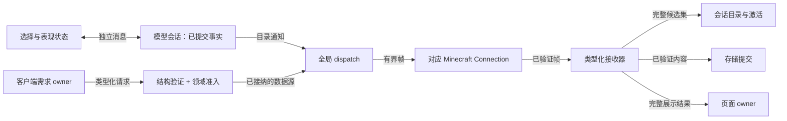
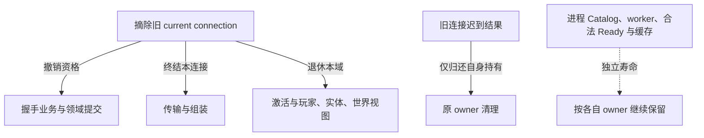

# 网络

上级契约：[系统边界](../README.md#系统边界)。

## 职责与边界

网络层依托同一个 Minecraft `Connection` 传递目录、资产、模型选择和表现状态。网络层负责物理帧校验、消息路由、按消息类型组装数据以及传输结束状态；模型会话层掌握目录、授权和选择事实；Native 层只提供压缩与哈希计算，不持有会话状态。

产品依据见[有界分发](../../product-decisions/requirements.md#reqbounded-model-distribution)、[模型授权](../../product-decisions/decisions/model-authorization.md)和[信任边界](../../product-decisions/decisions/trust-boundaries.md)。线协议（wire）由 [Protocol V1](../../standards/protocol-v1/README.md) 唯一规定。下级子系统见[玩家状态](player-state.md#seam-contract)。

## Seam Contract

- 收到字节流后建立哪些结构与交付保证：[帧准入与类型化交付](#帧准入与类型化交付)。
- 哪条连接具备业务资格，退出时如何撤销：[连接业务资格与撤销](#连接业务资格与撤销)。
- 数据源与 packet 何时移交，发送失败由谁收尾：[传输接管与发送终态](#传输接管与发送终态)。

### 共同规则

适用范围：本页三项契约。

#### 失败归属

失败按来源分流：非法外部输入在入口拒收；权限拒绝、`BUSY`、`UNAVAILABLE` 和取消只结束该次请求，不升级为整条 Minecraft 连接失败。内部交付违约保留原失败原因与责任身份，按[普通失败隔离](../../product-decisions/decisions/failure-isolation.md#bcordinary-failure-keeps-game-running)收尾。强制选择走普通 grant，`RESTRICTED_AUTH` 照常控制资产访问，无独立绕过路径。当前验证缺口见[网络问题](../../status/known-issues/network.md)。

### 帧准入与类型化交付

**边界与权威**

#### Transport 与物理预算

传输层只管帧格式、传输方向、长度、压缩与字节是否恰好消费完。短 Protobuf 消息走 simple frame，大消息或带附件走 full frame，共用同一 wire 通道。业务键、授权、完成判定与发布归各消息类型对应的业务负责方。物理预算由协议规定以预留宿主封包余量；协议当前处于 unstable 阶段，兼容成本见[协议兼容决策](../../product-decisions/decisions/session-failure.md#ddprotocol-compatibility-has-bounded-cost)。

#### Typed capability 与业务组装

固定消息类型集合限定远端能触发的能力；descriptor 不能任意指定宿主机路径、URL、Java 类或执行后端，磁盘读写由[存储设计](../model-management/storage/overview.md)限定。各类型接收器独立维护自然键、边界、覆盖范围（coverage）、结束状态与发布逻辑。

**前置条件与输入**

#### 接收准入与执行权限

通过帧格式与 Protobuf 校验只说明具备结构资格：服务端在投入受保护资源或写入权威状态前按[客户端输入校验](../../product-decisions/decisions/trust-boundaries.md#ddvalidate-client-before-effect)完成业务准入；客户端信任普通服务端业务同时守住[能力底线](../../product-decisions/decisions/trust-boundaries.md#ddtrusted-server-with-capability-floor)。

**结果与保证**

目录描述先于完整资产送达，加入游戏时不拉取全部模型内容；选择与资产拉取独立推进，本地 cache 命中不附带访问权限，存储提交与激活仍取决于[模型会话](../model-management/sessions/overview.md)当前资格。各类型负责方只在覆盖完整且内容校验通过后发布；单帧关闭不撤销已移交的 backing 保留，投递或接纳失败时由仍持有 payload 的一方归还（实现映射见[连接与消息准入](implementation/transport-and-session.md)与[receiver publication](implementation/asset-transfer.md#receiver-local-assembly-与-publication)）。

**失败与拒收**

非法帧、超限载荷或未知类型在传输入口拒收；接收组装期间范围越界、覆盖不全或内容校验失败时，对应接收器终止本次请求并释放中间数据，不发布半成品。

### 连接业务资格与撤销

**前置条件与输入**

Netty 接收线程不持有领域写权限。接收适配器捕获来源对应的精确连接，连同跨线程 backing 保留交由服务端主线程执行准入与提交。排队期间连接、会话与权限可能变化，执行入口会再次核对原连接与原负责方，不借当前玩家身份或新会话执行旧请求。已接纳请求授权有效期见[请求时授权](../../product-decisions/decisions/model-authorization.md#ddrequest-time-authorization)。

**结果与保证**

#### Exact connection 与业务资格

握手建立的业务资格与目录 `ACTIVE` 状态相互独立。客户端将 `ACCEPT` 交给有序传输层后即开放业务资格，服务端执行业务时复核对应会话有效（无额外 ACK），因此选择、玩家状态和控制消息无需等待目录发布完成。

**所有权与时序**

一条 Minecraft 连接至多对应一个模型会话；目录 publication 与数据传输的 ID 流绑定当前连接，连接替换时重置。

客户端 `current/state` 的动画查询消费[共享事实读写窗口](../integration/overview.md#共享事实读写窗口)，连接写入口与跨帧同步 getter 归连接负责方独占；绘制阶段按需交接单实体不触发 failure、disconnect 或 replacement。

#### 连接撤销交接

连接撤销先摘除当前活跃连接使旧资格立即失效，再分别结束旧连接名下的传输、组装、激活以及玩家、实体、世界的远端视图；迟到结果只丢弃或关闭自身仍持有的数据，不写入新权威状态。

图中箭头只规定先撤销资格，不要求各类资源收尾严格串行。断连不等待也不清空进程 Catalog、worker、已注册图像、已验证磁盘 cache 或本地文件/配置/持久化选择；Netty 排空不代表原连接已核对或共享资源已结束。游戏服务端停止时结束本服务会话传输与分发，进程级资源见[运行作用域](../runtime/overview.md)。

**失败与拒收**

目录集合组装、提交或激活失败时只结束目录与资源负责方、客户端退回 intrinsic default，已握手业务资格仍有效；协议失败、断连和连接替换同时撤销业务资格。目录失败不回退可能冲突的本地 catalog，断连后才恢复最新本地 snapshot。

**证据与依赖**

依赖[模型会话](../model-management/sessions/overview.md#seam-contract)。

### 传输接管与发送终态

**边界与权威**

一个游戏服务端实例持有一个全局 dispatch 负责方，业务传输接纳后独占读取游标（cursor）、背压、重试与关闭责任。

**前置条件与输入**

#### 分发所有权与负载保护

业务负责方在申请数据源（source acquisition）前建立；发起申请即交出本次使用权，网络层在 transfer tick 中轮询可读性，等待期间不重复申请。按类型切分的块保留完整批次与成员顺序；独立预览图按累计实读字节数决定是否启动下一项。同一请求的完整子 packet 集合只整体移交一次。

负载保护由四层协同：全局限速、连接背压、单玩家配额、客户端防抖，互不替代。同级子请求独立接纳，容量不足时局部拒绝资产请求以保障[gameplay 优先](../../product-decisions/decisions/workload-budget.md#ddgameplay-traffic-precedes-asset-distribution)。

**结果与保证**

Packet 先建立独立 Ready 资源保留，再释放申请阶段临时使用权。接纳失败时由调用方关闭仍持有的 packet 和 source；接纳成功后关闭权移交 dispatch。会话退出只撤销发送资格并取消 packet，不从 dispatch 夺回关闭权。

#### 事实提交与通知

目录通知消费[会话已提交 snapshot](../model-management/sessions/overview.md#权威提交与通知)，编码或入队结果不反向改写领域事实，也不增加 ACK 或历史补发。目录集合与模型选择走独立消息、共用同一连接发送 FIFO（玩家状态同步见[玩家状态契约](player-state.md)，新使用与已接纳区分见[新使用资格](../model-management/sessions/overview.md#新使用资格)）。

**所有权与时序**

发送队列不保存整份文件或预展开的 frame 列表，发送时由 cursor 按范围读取，可重试错误时重建当前帧。

#### 超帧动作与子传输

完整 descriptor 装得进单 frame 时只建一次传输；超限时按顺序启动有限个子传输，各自独立接纳和结束，父传输只保存未启动项、结果与取消关系。早期子传输写入不可变 cache 的内容不因后续失败回滚。管理员补图复用同一套类型化传输和 dispatch。

**失败与拒收**

数据源被接纳后仍可能在按范围读取或生产阶段失败：dispatch 关闭已接纳 source 并将失败交回对应负责方，不转为 `ABSENT` 或伪装成功；普通 I/O 失败按常规失败处理（见[全局 dispatch owner](implementation/asset-transfer.md#全局-dispatch-owner)）。

**证据与依赖**

持久提交与活动 backing 分别依赖[存储](../model-management/storage/overview.md#seam-contract)及[服务端资源](../model-management/server-resources/overview.md#seam-contract)。

## 设计取舍

发送队列选择按范围读取并在重试时重建当前帧，用局部 I/O 换取有界的内存驻留和单一的关闭责任，避免把整份资产或预切分帧列表长期压在队列中。

## 实现与验证入口

- [连接与消息准入](implementation/transport-and-session.md)：路由、`BusinessSession` 和失败归属。
- [目录传递](implementation/catalog-sync.md)：collection receiver 与领域发布的交接。
- [资产传输](implementation/asset-transfer.md)：source、assembly 和已接纳传输的关闭责任。
- [玩家状态落实](implementation/player-state.md)：实际报告者、基线和应用者。
