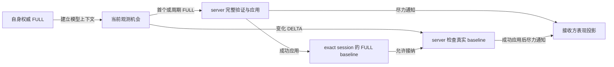

# 玩家状态契约

上级契约：[网络](overview.md#seam-contract)。

## 职责与边界

玩家状态子系统传递选择请求、权威状态与受限表现报告。服务端裁决游戏和模型事实，客户端维护报告机会并消费表现投影。

## Seam Contract

- 请求 Accepted 与权威状态、安装是什么关系：[选择请求与处置](#选择请求与处置)。
- 报告机会和服务端真实 FULL baseline 何时建立：[表现报告与真实基线](#表现报告与真实基线)。
- 收到权威更新后如何应用，哪些事件不补播：[权威更新与表现消费](#权威更新与表现消费)。

### 共同规则

适用范围：本页“选择请求与处置”“表现报告与真实基线”和“权威更新与表现消费”共同继承本节的权威划分与产品依据；后两项另继承实体路由与输入证据限制。

#### 权威模型

模型与纹理选择是客户端请求，由 server 按目录、配置和授权裁决。Gameplay/effects 来自 `ServerPlayer` 与 `level`；animation/Roaming 只接受协商范围内且通过模型语义验证的报告。Molang、挥手与实体动画是受限请求或事件。投射物与载具状态由 server 下发；收藏完整快照验证后一次替换。

当前实体路由在当前 `level` 解析 `Entity#getId()`，禁用 `EntityRef.player_id`。未来稳定路由键也不能替代 authenticated peer。RemotePlayer 的输入应以实际下发与应用为据，不能从 accessor 存在推断已同步。

本页细化[事实提交与通知](overview.md#事实提交与通知)。产品权威见[玩家状态同步](../../product-decisions/decisions/player-state-sync.md)与[模型授权](../../product-decisions/decisions/model-authorization.md)。

### 选择请求与处置

**边界与权威**

本契约继承[共同规则](#共同规则)的权威划分与产品依据。

**前置条件与输入**

握手就绪即可发送业务，不等待目录 `ACTIVE`。

本地预取失败不抑制选择发送，ACTIVE 请求也不先改本地权威模型、纹理或 Roaming。

**结果与保证**

选择 disposition 只终结当前请求。

Accepted 不更新 capability，也不证明匹配 FULL 已安装；权威状态与安装分别由状态更新和 entity binding 提供。

**所有权与时序**

客户端为新意图分配 ID，同目标未完成点击可复用，A → B → A 使用新 ID。

Server 回显有效请求 ID；客户端复核原连接与当前 ID，迟到结果不能结束 replacement。

**失败与拒收**

反馈期限结束不撤销独立实体需求，迟到权威更新仍正常应用。

**证据与依赖**

Wire 字段与耗尽规则见[选择协议](../../standards/protocol-v1/README.md#选择授权与状态顺序)。

选择连续意图由[需求设计](../model-management/demand/overview.md)裁决，状态输入由[动画设计](../animation/overview.md)消费。

### 表现报告与真实基线

**边界与权威**

本契约继承[共同规则](#共同规则)的权威划分、实体路由与输入证据限制。

**前置条件与输入**

#### 报告机会与真实 baseline

新业务会话或权威模型上下文改变后，客户端先等待自身权威 FULL，再形成依赖模型和 Roaming 的报告。Server 在 session active、选择解析与 catalog authority commit 后，先尝试发送自身 FULL，再入队 collection；客户端无需等待 collection 完成。

Roaming 报告需要当前 namespace 的已知恢复基线。未知状态暂缓机会，不推进首轮 FULL、观测或周期时序；明确空状态允许空 FULL。自身 FULL 先接纳恢复基线，再发布 reporter authority。FULL 省略 Roaming 时按已接受模型描述解析 namespace 并明确清空，不等待模型安装。

Server 验证 authenticated sender、exact connection、active session、协商策略、主体与内容后才写入事实。

**结果与保证**

Server 只有完整应用成功的 FULL 才建立真实 baseline；此前 DELTA 被拒绝，直到后续独立 FULL 到达，不立即补发。

**所有权与时序**

报告者在调用宿主发送前推进观测、首次机会与周期时序。

模型或纹理变化后的 baseline 与动画保留见[权威更新与表现消费](#权威更新与表现消费)。

`ClientRoamingSession` 选择保留快照或已恢复的 runtime。保留快照不依赖 installation；runtime 样本在原 installation barrier 内捕获并提交。退休使 runtime 机会失效，同 module 重装不能恢复资格，也不能从 replacement 重采样。捕获与提交在同次主线程调用中完成，保留快照仍服从当前 `BusinessSession` 与模型 authority。已编码 payload 保留原 subject/namespace。

**失败与拒收**

#### 报告与通知失败

编码或提交失败不恢复 dirty，不在下一 tick 重放。

下行构造或广播失败不回滚事实或 baseline，也不留下待广播状态。

**证据与依赖**

基线与 best-effort 通知细化[事实提交与通知](overview.md#事实提交与通知)；产品依据及输入证据限制继承[共同规则](#共同规则)。

### 权威更新与表现消费

**边界与权威**

本契约继承[共同规则](#共同规则)的权威划分、实体路由与输入证据限制。

**前置条件与输入**

客户端只在捕获连接仍 current 且整条消息有效时应用。

**结果与保证**

Model section 显式建立指派，动画 DELTA 不建立指派。

同消息的合法 gameplay/effects/Roaming 继续应用；未安装或暂停只结束当前瞬时播放机会，后来 Ready 不补播。

**所有权与时序**

模型上下文以模型 ID 判定；同模型切换纹理保留动画和已接纳的 FULL baseline。客户端在接纳权威模型变化后清空动画，发送选择请求本身不撤销动画。

每次 tracker、tick 或周期 FULL 都是独立机会，不能把本地发送成功解释为 peer 收到或接纳。

**失败与拒收**

当前表现消息不维护 per-entity revision；合法延迟或重复可能覆盖较新投影。

Reset/reload 与本地限制保留已接纳请求，不要求额外同步恢复。

**证据与依赖**

状态输入依赖[动画设计](../animation/overview.md#seam-contract)；产品依据和 RemotePlayer 输入的证据限制继承[共同规则](#共同规则)。

## 设计取舍

报告机会与真实 baseline 分开，避免将本地发送当作远端接纳。该选择省去重放或补发状态，代价是投影可能等到后续独立机会才更新。

## 实现与验证入口

实现映射见[玩家状态落实](implementation/player-state.md)，实机证据见[网络状态](../../status/known-issues/network.md)。
