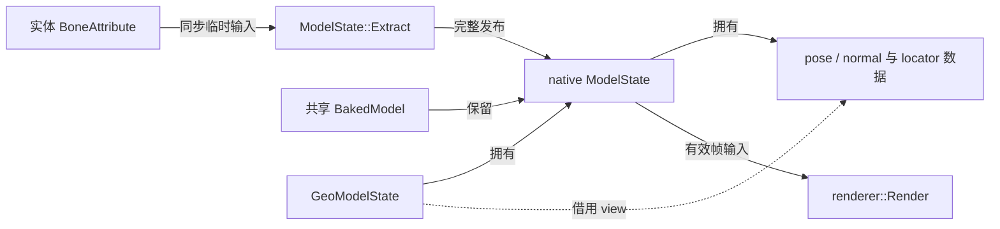
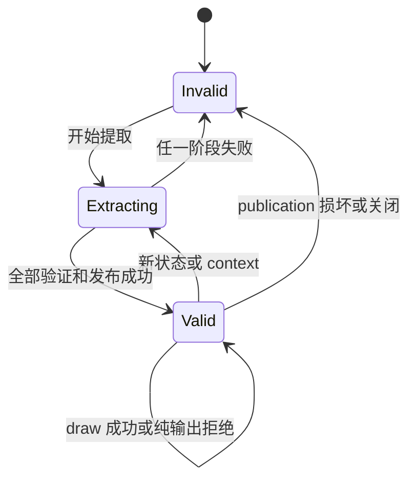

# 帧状态、发布与借用

本页落实[资源与状态](../overview.md#资源与状态)、[三阶段交接](../overview.md#三阶段契约)及[并发边界](../overview.md#状态与绘制并发)。

## 输入、输出与状态

`GeoModelState.extract()` 发起提取，native 不保留 `BoneAttribute`。开始时撤销 Java 消费资格，JNI 在验证其余输入前撤销 native valid。层级、schedule、JNI 写回及 Java view/count/locator 后置检查全部成功才发布。任一后置失败均不可消费。

`NativeModelState.invalidate()` 撤销两侧资格并清 Java view/count；可保留分配容量。View 与 locator 消费应在下一次 Extract、invalidate 或 close 前结束；Java 可达性不延长 native 地址有效期。

## 层级遍历与可见性

Java 属性与 native 层级共用 `BakedModel` 的骨骼顺序。Extract 组合父级 pose；非有限属性、零 scale 或非有限结果跳过整棵 subtree。隐藏当前几何仅影响当前骨骼及 locator；隐藏子级保留当前骨骼并跳过后代。

颜色、透明度和 glow 不随层级继承；非法 packed 值使提取失败。Locator 映射指向当前有效 pose，不长期复制或保留旧 view。跨域通道定义见[骨骼输出](../../animation/implementation/processor-and-bone-output.md#boneattribute)。

## 局部根提取

`extractSubtree()` 接受当前模型合法根与完整同序属性，忽略外部祖先的变换、隐藏和无效属性。负数、越界根或数组不匹配使结果失效，不用特殊 index 表示整模。只有本次 render/locator indices 指向的 pose 可消费。

第一人称 owner 对精确 target/GeoModel 保留 LeftArm、RightArm、Background 三份输出。双手读取共同 animation-only 属性，背景读取声明初始属性；缺根只影响对应部分。新采样或实际求值撤销双手准备资格，损坏结果可从正常 producer 恢复，不能重放已提交动作。

三份输出跨帧保留；变体、换模或退休在借用退出后关闭。`PreparedPart` 绑定精确安装、几何、part 与 revision，不保活资源。合法空几何仍能完成手部消费。

## Java 预调度与 context

每次 draw 刷新矩阵、光照、相机与 metadata；pose 复用不复用旧 draw 输入。`RenderContext` 决定姿态语义和复用条件，与线程选择分开。

| 路径 | 状态与执行 |
|---|---|
| 合格 level entity | Canonical immutable，可由 Java worker 求值和 Extract，render 按需汇合 |
| 未预调度 level entity | 仍可 immutable，同步执行 |
| inventory、paperDoll、firstPersonMod | Mutable，同步求值，不覆盖 canonical 槽 |
| 本地第一人称 irisShadow | 强制 mutable，避免第三人称状态复用 |
| GUI preview | Immutable 仅指同帧复用；模型列表经 exact GUI 许可准备，其他 GUI 保留同步入口，不进入世界预调度集合 |
| 独立 hand owner | 正常 level immutable 时间线；背景不推进动画，三部分局部提取 |

Canonical 资格仅在完整发布后记录，并检查实际有效性、精确模型、context 与采样请求。新帧、mutable 求值或不兼容请求撤销资格。恢复输出不重置动作门禁。

`GeoRenderData` 绑定 owner 与 installation，`consumePrepared` 在同一调用窗口借用。第三人称取消和消费使用同一数据；hook 返回后复核该结果，不能二次 update 修补交接。GUI 另核对 Matching。回调 reset/retire 立即撤资格，物理释放等借用退出。

## 任务发布与并发边界

模型列表固定 `GuiFrameInput` 后，为每个私有实例授予一次 exact GUI 任务许可。完整绑定、动画和 Extract 在同一执行者内完成；同卡冷前景、背景沿同一任务准备。主线程可执行首卡并注册其图片，再 join 后台任务；首卡或注册失败仍完整交接全部已接纳任务。任务返回但未 join 时不开放实例访问；提交拒绝归还未接纳能力。页面结束先封口，交接后再关闭自有输入。

GUI 的 prepared draw 沿 `consumePrepared` 借用本次输出，保留原 hook 与资格复核，不再 update。Renderer、dispatcher、buffer、GL 和额外实体绘制留主线程。此许可只适用于模型列表显式采用的 GUI entity，不改变世界预调度或 FULL 中央预览的执行 owner。

每次 `renderLevel` 的 HEAD 开始实体异步调用范围，RETURN 完整交接本次登记的全部任务。登记发生在提交前。主线程可先取得单个实体的对应 `Future.get` 并消费，同时让其他实体继续运行；RETURN 仍完成全部剩余 get 与投影归约。完成但未 get 的任务不开放更新态。

任务的 Future 覆盖动画、Extract 和完整 finally。某个任务、投影或清理失败时，交接继续覆盖其余实体，最后传播归约失败；中断后继续 get，再恢复中断标志。普通内容失败与被宿主捕获后继续运行的路径均不得留下任务。宿主主线程未返回且导致崩溃退出的路径不在支持范围内；HEAD/RETURN 不为该路径提供 finally 包装。

调用范围之外的显式实体更新同步执行；独立 transient 编译可以跨调用存活，但只交付独立程序，不访问实体更新态。同一 entity 的各 context 求值串行。

`RenderSchedule` 约束当前帧容量和不重叠输出区间。进程级 `ParallelExecutor` 的任务只读已发布状态；全部任务结束并建立可见性后才能交付输出。

当前共享 executor、透明 scratch 与 fallback 要求 `renderer::Render` 全局串行，调用始终从 Minecraft render thread 发起。同一 `ModelState` 的 Extract、Render、resize 与释放也串行；不同实体的 Java 动画及 Extract 可并行。池的存在不证明 renderer 可重入。
