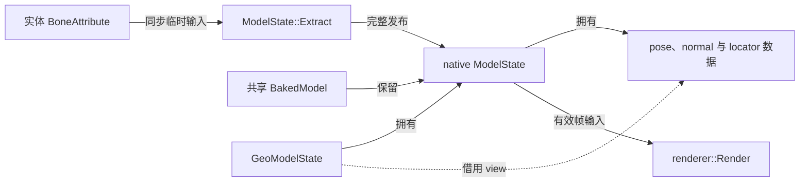
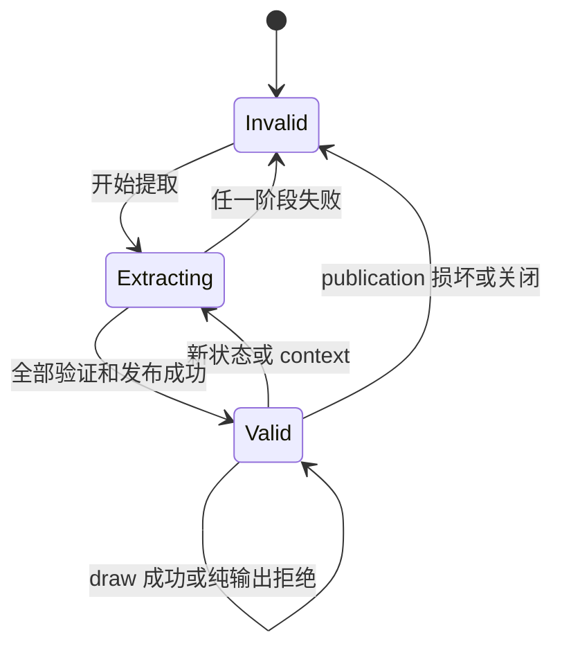

# 帧状态、发布与借用

本页落实[资源与状态](../overview.md#资源与状态)、[三阶段契约](../overview.md#三阶段契约)以及[状态与绘制并发](../overview.md#状态与绘制并发)。

## 输入、输出与状态

提取由 `GeoModelState.extract()` 发起，native 侧不保留输入的 `BoneAttribute`。调用开始时先撤销 Java 侧的消费资格，JNI 入口在校验其余输入前也会先撤销 native 侧的 valid 标志。只有层级遍历、调度构建、JNI 写回以及 Java 侧的 view、计数和 locator 后置检查全部通过后，才会对外发布结果；任一后置检查失败都会让本次结果保持不可消费。

`NativeModelState.invalidate()` 会同时撤销两侧的消费资格并清空 Java 侧的 view 与计数，但可以保留已分配的底层缓冲容量。所有对 view 和 locator 的消费都必须在下一次 Extract、invalidate 或 close 之前结束；Java 侧对象仍然可达并不能延长 native 地址的有效期。

## 层级遍历与可见性

Java 侧属性数组与 native 侧层级共用 `BakedModel` 固定的骨骼顺序。Extract 按层级组合父级姿态；遇到非有限属性值、零缩放或非有限计算结果时，直接跳过整棵子树。隐藏当前几何只影响当前骨骼及其 locator；隐藏子级则保留当前骨骼并跳过所有后代。

颜色、透明度和发光度（glow）不沿骨骼层级继承，非法的 packed 值会导致本次提取直接失败。Locator 映射指向当前有效姿态，不做长期拷贝，也不保留旧 view。跨子系统的通道定义见[骨骼输出](../../animation/implementation/processor-and-bone-output.md#boneattribute)。

## 局部根提取

`extractSubtree()` 接收当前模型内的合法根骨骼索引和完整的同序属性数组，计算时忽略该根之外祖先节点的变换、隐藏标记与无效属性。传入负数索引、越界根索引或长度不匹配的数组都会使结果失效，不约定特殊索引来代表整模。提取完成后，只有本次 render 与 locator 索引指向的姿态数据允许被消费。

第一人称负责方针对对应的 target 与 `GeoModel` 维护三份独立输出：`LeftArm`、`RightArm` 和 `Background`。左右手读取共享的纯动画（animation-only）属性，背景读取模型声明的初始属性；缺少某一侧的根骨骼只影响对应部分。遇到新采样或实际求值时撤销左右手的准备资格；损坏的输出可以从正常的 producer 恢复，但不能重放已经提交的动作。

这三份输出跨帧保留；发生变体切换、换模或实体退休时，须等当前借用退出后再关闭。`PreparedPart` 绑定特定的安装、几何、部位（part）与修订号（revision），本身不保活模型资源。合法的空几何依然能够完成手部消费。

## Java 预调度与 context

每次绘制都会重新刷新矩阵、光照、相机与绘制元数据；复用姿态时绝不复用旧的绘制输入。`RenderContext` 决定姿态语义和复用条件，与任务落在哪条线程执行相互独立。

| 路径 | 状态与执行 |
|---|---|
| 合格的 level 实体 | 写入规范不可变槽（canonical immutable），可由 Java worker 求值并 Extract，渲染时按需汇合 |
| 未预调度的 level 实体 | 仍可使用 immutable 槽，在当前线程同步执行 |
| inventory、paperDoll、firstPersonMod | 使用可变槽（mutable），同步求值，不覆盖 canonical 槽 |
| 本地第一人称 irisShadow | 强制使用 mutable 槽，避免误复用第三人称状态 |
| GUI 预览 | immutable 仅指同帧内复用；模型列表经专属 GUI 许可准备，其他 GUI 保持同步入口，不进入世界预调度集合 |
| 独立 hand 负责方 | 沿正常 level immutable 时间线推进；背景不推进动画，三部分分别做局部提取 |

Canonical 复用资格只在完整发布后记录，复用前会检查状态是否仍有效，以及模型、context 和采样请求是否一致。进入新帧、触发 mutable 求值或收到不兼容请求都会撤销该资格。恢复输出不重置动作门禁。

`GeoRenderData` 绑定实体负责方与当前安装，`consumePrepared` 在同一调用窗口内完成借用。第三人称取消宿主渲染与实际消费使用同一份数据；hook 返回后必须复核这份结果，不能通过二次 update 修补交接。GUI 路径另行核对 Matching。回调触发 reset 或 retire 时立即撤销消费资格，物理释放则等到借用退出后执行。

## 任务发布与并发边界

### GUI 模型列表准备任务

模型列表先固定本帧的 `GuiFrameInput`，再为每个私有预览实例授予一次专属的 GUI 任务许可。单个实例的完整绑定、动画求值和 Extract 在同一个执行者内连续完成，同一张卡片的冷前景与背景也沿该任务一并准备。主线程可以先执行首张卡片并注册其纹理，再 `join` 其余后台任务；即使首卡执行或注册失败，也必须把所有已接纳的后台任务完整交接完毕。任务已经返回但尚未 `join` 时，不对外开放该实例的访问；提交被拒时立即归还尚未接纳的能力。页面关闭时先封口，待所有在途任务交接完成后再关闭自有输入。

GUI 的 prepared 绘制通过 `consumePrepared` 借用本次输出，保留原有的 hook 与资格复核，不再触发 update。Renderer、dispatcher、buffer、GL 调用和额外实体绘制一律留在主线程。这套许可机制只服务于模型列表显式采用的 GUI 实体，不改变世界预调度或 FULL 中央预览的执行归属。

### 世界渲染异步调用范围

每次 `renderLevel` 的 `HEAD` 开启本帧的实体异步调用范围，`RETURN` 负责把本次登记的全部任务完整交接完毕：
- **单次登记**：每个实体负责方在同一调用范围内只登记一次——预调度实体在提交任务前登记，同步实体在首次接纳投影前登记。实体自身维持已登记状态，队列直接接纳而不再重复判重；调度方在单次范围内至多调度同一负责方一次。提交失败、reset 或 retire 都不会提前撤销登记，等所有任务和最终投影全部交接完毕后，再由协调方统一结束登记。
- **按需单实体汇合**：实体渲染时可提前交接并消费单个负责方——如果目标任务还在队列里，可直接就地执行原任务；若已进入其他状态，则只等待对应 `Future.get`，让其他实体继续在后台运行。接管范围与执行权归[实体任务交接](../../animation/entity-lifecycle.md#执行权与任务交接)。
- **统一收尾**：`RETURN` 先完成全部剩余任务的 `Future.get`，再统一完成最终的 `body -> arm` 投影归约。已经完成但尚未 `get` 的任务不开放其更新后的状态。

任务的 `Future` 覆盖动画求值、Extract 以及完整的 `finally` 块。如果某个任务、投影或清理抛出异常，交接流程仍继续覆盖其余实体，最后把归约后的失败向外传播；等待期间收到中断时，先继续完成全部 `get`，最后再恢复线程的中断标志。普通内容失败或被宿主捕获后继续运行的路径，都不得遗留未交接的任务。如果宿主主线程因未捕获崩溃直接退出而未到达 `RETURN`，则不在支持范围内，`HEAD`/`RETURN` 也不为崩溃退出额外加套 `finally`。

### 并发边界与串行约束

在 `renderLevel` 调用范围之外发起的显式实体更新一律同步执行。独立的 transient 编译任务可以跨调用范围存活，但只产出独立程序对象，不触碰实体更新态。同一个实体在不同 context 下的求值始终串行。

共享事实的读取还受[宿主读写窗口](../../integration/overview.md#共享事实读写窗口)约束。接管任务或单实体 `get` 只归还该实体的私有访问权；组合方要等全部普通世界读者与 GUI 读者都交接完毕，才会重新开放下一次共享写入。等待任务完成期间不轮询宿主队列。

`RenderSchedule` 约束当前帧的输出容量与互不重叠的输出区间。进程级 `ParallelExecutor` 的工作任务只读取已发布状态，所有任务结束并建立内存可见性后才交付顶点输出。

由于当前共享了 executor、透明排序临时缓冲与 fallback 缓冲，`renderer::Render` 必须全局串行，且始终由 Minecraft render thread 发起调用。同一个 `ModelState` 的 Extract、Render、resize 与释放同样串行；不同实体的 Java 动画求值与 Extract 则可以并行。存在线程池并不代表 renderer 可重入。
