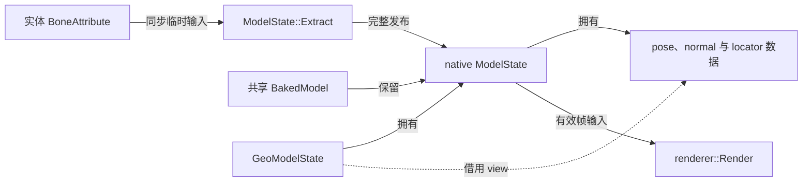
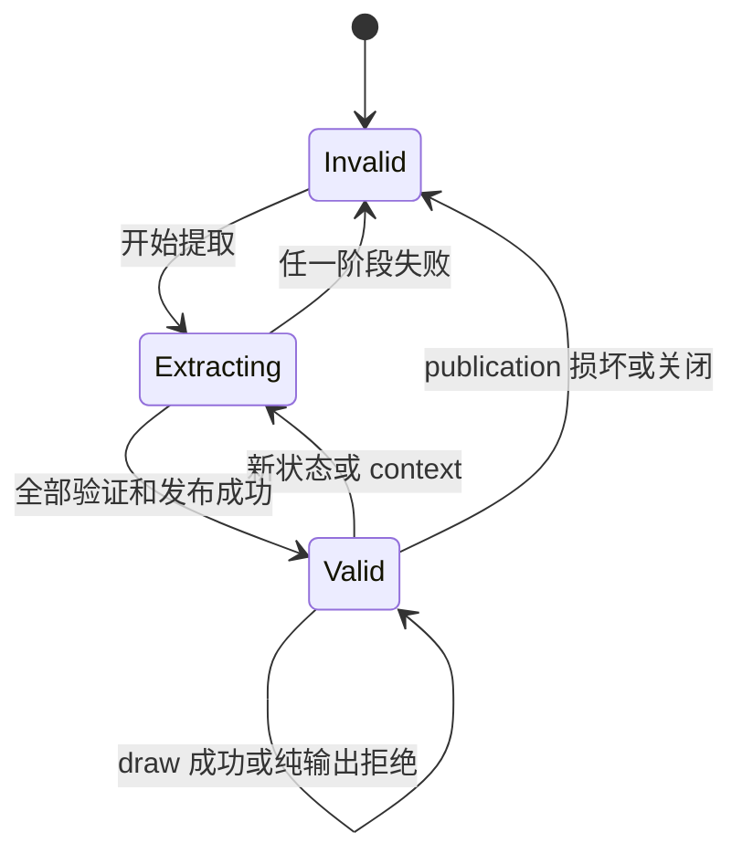

# 帧状态、发布与借用

本页对应[资源与状态](../overview.md#资源与状态)、[三阶段契约](../overview.md#三阶段契约)与[状态与绘制并发](../overview.md#状态与绘制并发)，列出逐帧提取、局部根输出、Java 预调度与当前并发边界的实现映射。

## 输入、输出与状态

- **先撤后发**：`GeoModelState.extract()` 开始时先撤销 Java 侧消费资格，JNI 入口校验输入前同步撤销 native 侧 valid 标志，native 不保留输入 `BoneAttribute`。层级遍历、调度构建、JNI 写回及 Java 侧 view/计数/locator 后置检查全部通过后才发布结果，任一步失败均保持不可消费。
- **失效与借用有效期（内存安全边界）**：`NativeModelState.invalidate()` 同时撤销两侧消费资格并清空 Java 侧 view 与计数（可保留已分配底层缓冲）。所有 view 与 locator 消费须在下一次 Extract、`invalidate` 或 `close` 前结束——Java 引用可达不延长底层 native 地址有效期。

## 层级遍历与可见性

- Java 属性数组与 native 层级共用 `BakedModel` 固定前序骨骼顺序。Extract 按层级组合父级姿态；遇到非有限属性值、零缩放或非有限计算结果时跳过整棵子树。
- 隐藏当前几何仅影响本骨骼及其 locator；隐藏子级保留当前骨骼并跳过全部后代。颜色、透明度与 glow 不沿层级继承，非法 packed 值直接令提取失败。Locator 映射指向当前有效姿态，不做长期拷贝。通道定义见[骨骼输出](../../animation/implementation/processor-and-bone-output.md#boneattribute)。

## 局部根提取

- **`extractSubtree()`**：接收当前模型内合法根骨骼索引与完整同序属性数组，计算时忽略根外祖先的变换、隐藏标记与无效属性；负数、越界根索引或长度不匹配直接失效。提取完成后仅允许消费本次 render 与 locator 索引指向的姿态数据。
- **第一人称三槽**：针对对应 target 与 `GeoModel` 维护 `LeftArm`、`RightArm`、`Background` 三份独立输出（跨帧保留，变体切换、换模或实体退休时待借用退出后关闭）：
  - 左右手读共享纯动画属性，缺某一侧根骨骼仅影响该侧，合法空几何仍算手部消费成功；新采样或实际求值撤销左右手准备资格，损坏输出可由正常 producer 恢复（不重放已提交动作）。
  - 背景读模型声明初始属性。
  - `PreparedPart` 绑定安装、几何、部位与修订号（revision），不保活模型资源。

## Java 预调度与 context

每次绘制都从宿主取得当前矩阵、光照与相机。`RenderContext` 决定姿态语义与复用条件，提交 worker 或同步执行由宿主调用路径决定。

### 常规动画输出

未安装骨骼物理的实体沿用以下槽位与执行路径。

| 路径 | 状态与执行 |
|---|---|
| 合格的 level 实体 | 写规范不可变槽（canonical immutable），由 Java worker 求值并 Extract，渲染按需汇合 |
| 未预调度的 level 实体 | 使用 immutable 槽，在当前线程同步执行 |
| inventory、paperDoll、firstPersonMod | 使用可变槽（mutable），同步求值，不覆盖 canonical 槽 |
| 本地第一人称 irisShadow | 使用 mutable 槽，与第三人称状态隔离 |
| GUI 预览 | immutable 仅限同帧复用；模型列表走专属 GUI 许可，其余 GUI 同步执行 |
| 独立 hand 负责方 | 沿正常 level immutable 时间线推进；背景不推进动画，三部分分别局部提取 |

- **Canonical 复用**：仅在完整发布后记录复用资格，复用前校验状态有效且模型、context、采样请求一致；进入新帧、触发 mutable 求值或收到不兼容请求时撤销资格。恢复输出不重置动作门禁。

### 骨骼物理的主槽与观察槽

带物理的玩家安装通过 `PhysicsRenderPass.classify` 统一决定输出槽和物理资格。分类按表中顺序匹配，`immutable` 只影响姿态复用。因此本地玩家第一人称视角下的 Iris 世界阴影也可以观察已经接纳的物理样本。

| 优先级 | 条件 | 输出与物理行为 |
|---|---|---|
| `PURE_ANIMATION_ONLY` | `level` 为假，或命中 `inventory`、`paperDoll`、`firstPersonMod` | 从 `renderDataPool` 取槽，提取纯动画 |
| `WORLD_OBSERVER` | 剩余路径中命中 `irisShadow` 或 `offScreen` | 从 `renderDataPool` 取槽，读取有效样本。样本失效时输出纯动画 |
| `CANONICAL` | 剩余世界路径 | 独占 `mainRenderData`。仅合格主更新可以复位或步进，其余请求可观察有效样本 |

当相同帧和插值参数的正文骨属性可供复用时，不可变观察路径直接读取它们。观察先于正文到达，或需要独立求值时，`AnimationProcessor.observePose` 读取现有 controller 队列，以独立的骨快照和随机数状态计算姿态。`AnimationSession` 保存骨属性数组，在观察退出时恢复。正文独占组件时间推进、动作提交和主槽写入，先到的观察保留同帧正文的主更新资格。`ysm.bone_pivot_abs` 始终读取主槽。

`PlayerPhysicsSession` 单独记录已接纳主样本的帧。`updateAnimationOnly` 先完成主动画时，同帧合格的正文仍可推进一次物理。

### 实体根与载具预采样

载具模型启用时，`AnimationParallelTicker.scheduleAll` 在提交任何 worker 之前为已安装匹配自定义模型的载具采样。它把载具倾角和各骑手的竖直偏移保存为本次世界调用的只读数据。提取、`RenderUtil.adjustPassengerPosition` 与绘制共用这份数据，骑手无需等待载具任务。所有任务汇合后，调度器清空快照。倾角取提交前已完成的载具姿态，因此可落后载具本轮求值一帧。

`EntityRootTransform` 保留双精度实体插值位置供历史位移判定。供模拟使用的根位置另计骑手、床方向、翻转抬升、宿主蹲姿与模型局部偏移。根旋转与替换绘制共享身体朝向、睡姿、爬梯锁朝向、`Dinnerbone` 翻转及匹配载具倾角。提取成功时将本次根随 `GeoRenderData` 发布，缓存命中沿用已发布的根。绘制在宿主已平移的 `PoseStack` 上只应用根的局部变换。

### 物理提交与绘制借用

`nExtractWithPhysics` 在一次 JNI 调用中推进或观察物理并提取骨姿态。复位和步进先短暂借用 Java 骨属性以采集驱动输入，释放借用后运行 Jolt，再借用骨属性完成提取。观察只使用提取阶段的借用。`ModelState::Extract` 在遍历骨层级时合成 `BonePhysicsDelta`，将最终姿态留在原有帧输出中。

- `PHYSICS_ACCEPTED` 与求解结果共同决定 `PlayerPhysicsSession` 提交主样本基线还是进入降级。求解成功即提交基线，即使本次绘制提取失败，同帧后续提取也只观察。
- `EXTRACT_OK` 表示当前绘制结果通过 native 与 Java 的发布检查。观察、复位和步进都使用这条绘制发布边界。
- `PlayerPhysicsSession` 在接受主样本或撤销旧样本时递增代际。`GeoRenderData.physicsSampleEpoch` 参与姿态缓存命中和 `canConsume` 检查，防止阴影和正文继续消费传送、换世界或故障前准备的结果。`PURE_ANIMATION_ONLY` 的输出使用独立标记。

`GeoRenderData` 绑定实体负责方与当前安装，`consumePrepared` 在同一调用窗口完成借用。第三人称取消宿主与实际消费共用同一份结果，hook 返回后重新核验。GUI 额外核对 Matching。回调触发 reset 或 retire 时立即撤销消费资格，资源释放延后至借用退出。

### 穿戴物理调试叠加

`/ysmclient physics debug` 为选中的玩家开启调试。命令补全读取当前安装的不可变物理声明，首次步进前和独立成品都可按节点、部件对或约束标识选取。开关在目标实体的异步更新交接后切换该世界的接触监听。世界重建时沿用当前开关，关闭调试的世界保持监听为空。

第三人称正文在 `postRender` 后，通过 `visitPhysicsSample` 在绘制借用内复制已完成的主样本。JNI 将变换还原到模型空间，线框直接沿用当前 `PoseStack`。`IGuiOverlay` 使用同一份 Java 快照，按安装身份和物理样本代际核对有效期。若当前正文未发布调试样本，面板显示静态声明与不可用原因。

接触流形汇总最近一次成功主步的所有碰撞子步。监听从开启后的下一次完整主步开始采样。暂停中开启调试时，面板仍可显示已完成的位姿，并标记上一主步未采样。

字段折行后超出一屏时，面板在页脚显示页码和翻页命令。用 `/ysmclient physics page next`、`prev` 或正整数页码查看，命令补全列出当前可用页。切换调试对象或选取其他节点、部件对或约束时从第一页开始。翻页只改变 HUD 的视图页码。同一屏能显示全部字段时省略页脚。

## 任务发布与并发边界

### GUI 模型列表准备任务

- 模型列表先固定本帧 `GuiFrameInput`，再为每个私有预览实例授予单次专属 GUI 任务许可，在单一执行者内连续完成绑定、动画求值与 Extract（含同卡片冷前景与背景）。
- 主线程可先执行首张卡片并注册纹理，再 `join` 其余后台任务；首卡失败仍须完整交接全部已接纳后台任务。
- 任务返回后、`join` 前不开放实例访问；提交被拒立即归还许可；页面关闭先封口，待在途任务交接完成后关闭自有输入。
- `consumePrepared` 借用本次输出并保留原有 hook 与资格复核；renderer、dispatcher、buffer、GL 调用与额外实体绘制留在主线程。该许可仅用于显式采用的模型列表 GUI 实体。

### 世界渲染异步调用范围

每次 `renderLevel` 的 `HEAD` 开启本帧实体异步范围，`RETURN` 完成全部已登记任务的交接：

- **单次登记**：预调度实体在提交前登记，同步实体在首次接纳投影前登记；单次范围内至多登记和调度同一负责方一次。提交失败、reset 或 retire 不提前撤销登记，等全部任务与最终投影交接完毕后统一结束。
- **按需单实体汇合**：渲染实体时若目标任务仍在队列未领取，渲染线程可直接就地执行；否则仅等待对应 `Future.get`，其余实体继续后台运行。范围与权限见[实体任务交接](../../animation/entity-lifecycle.md#执行权与任务交接)。
- **统一收尾与异常**：`RETURN` 完成全部剩余 `Future.get` 后归约最终 `body -> arm` 投影。`Future` 覆盖求值、Extract 与完整 `finally`；单实体失败时仍交接其余实体再传播归约失败；等待遇中断先完成全部 `get` 再恢复中断标志。主线程未捕获崩溃绕过 `RETURN` 的场景不在支持范围内。

### 并发边界与串行约束

- `renderLevel` 范围外的显式实体更新同步执行；独立 transient 编译可跨范围存活，仅产出独立程序对象。同一实体在不同 context 下串行求值。
- 共享事实读取遵循[共享事实读写窗口](../../integration/overview.md#共享事实读写窗口)：单实体按需 `get` 仅归还该实体私有访问权，全部世界读者与 GUI 读者交接完毕后才重开共享写入；等待任务期间不轮询宿主队列。
- `RenderSchedule` 划分当前帧互不重叠的输出区间；进程级 `ParallelExecutor` 仅读取已发布状态，全部任务结束并建立内存可见性后交付顶点输出。
- **当前 `NativeRenderer` 并发前提**：因当前共享了 executor、透明排序临时缓冲（scratch）与 fallback 缓冲，`renderer::Render` 目前由 Minecraft render thread 按全局串行发起（若未来拆分这些共享可变缓冲与执行态，可放开多实体并发 `Render`）。同一个 `ModelState` 的 Extract、Render、resize 与释放按串行使用；不同实体的 Java 动画求值与 Extract 并行执行。
