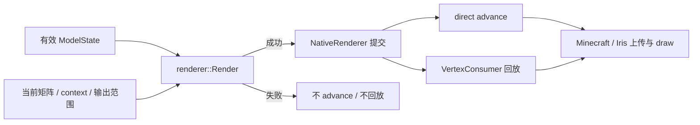

# 顶点输出与宿主接管

本页落实[输出与失败](../overview.md#输出与失败)和[宿主提交](../overview.md#并行输出与宿主提交)，定位输出成功、姿态失效及宿主已消费的不同边界。

## 主流程

Java 选择纹理、`RenderType` 与 draw metadata；`NativeRenderer` 适配 `RenderParameters`。Native 不接收纹理像素或 GPU 句柄，也不提交 draw。

## 变换与面语义

Position、normal 与 clip-space 分别使用上层提供的矩阵。RGB 组合为 `round(parent * bone / 255)`；opaque 保留上层 alpha，透明分区将上层 alpha 乘以 bone alpha。Glow `-1` 保留上层 light，`0–15` 同时覆盖 block/sky light；属性不向后代继承。

Native 以本次最终变换解释 baked winding，double-sided 背面反转输出 normal。非保角变换后归一化 normal，Vanilla/Iris direct 共用该语义。PBR tangent 同样按最终变换修正镜像和背面 handedness；无 PBR 时输出确定零值。

## RenderType、context 与 VertexKind

`RenderType` 决定宿主状态与 consumer，native context 表示绘制环境，`VertexKind` 选择输出布局；Iris shadow 不是一种 VertexKind。

| 当前路径 | 选择与交接 |
|---|---|
| Vanilla direct | Consumer 暴露 accessor 且布局为 NEW_ENTITY；成功后 advance |
| Iris direct | Accessor 与 Iris layout 均已识别；成功后 advance |
| Fallback | 无 accessor 或未知 layout；native 成功后回放原 consumer |

`NativeRenderer.render()` 同步返回 boolean。有效空结果经 publication 校验后成功；非空结果应使用本次发布容量，并在 advance 或完整回放后才返回 true。Java 容量、调用数量与 native schedule 不一致使结果失效，不能从顶点数推断成功。

姿态完整但外部区间不足或宿主矩阵非法，只拒绝本次输出。坏 pose、无效状态或无法证明完整性的失败撤销 publication。组合溢出按 source pose/normal 是否完整区分；混合失败中状态损坏优先，不能按错误文本或 status 名称猜测来源。

全部 YSM 可控失败不 advance、不回放。Consumer 已开始回放后的异常原样传播，不返回正常 boolean，也没有通用回滚。预留区间不等于宿主接管。

表达式 OOM 在取得有效 Prepared 前由实体执行 owner 结束。输出层不持有 consumer 阶段标记，也不将 consumer 自身异常改写为 YSM 资源失败。

## 顶点输出区间与 translucent 排序

透明输出只在本次模型 draw 内远到近排序，Iris shadow 保持生成顺序；跨 draw 混合归 Minecraft。Java 关闭重复的局部 culling 与 upload-time sorting，使 native 成为这些操作的单一执行方；未写容量不得暴露旧数据。

保证范围见[透明范围](../../../product-decisions/decisions/transparency-scope.md)和[输出等价](../../../product-decisions/decisions/geometry-regions.md#bcoutput-paths-are-visually-equivalent)。完整实机证据与失败组合缺口见[渲染问题](../../../status/known-issues/rendering.md)。
