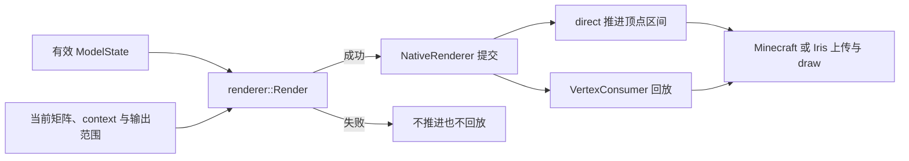

# 顶点输出与宿主接管

本页落实[输出与失败](../overview.md#输出与失败)和[顶点输出与宿主接管](../overview.md#顶点输出与宿主接管)，说明输出成功、姿态失效以及宿主已消费三者的区分边界。

## 主流程

Java 侧负责选择纹理、`RenderType` 与绘制元数据，再由 `NativeRenderer` 将参数适配为 `RenderParameters`。Native 侧不接收纹理像素或 GPU 句柄，也不提交 draw 调用。

## 变换与面语义

顶点位置（position）、法线（normal）和裁剪空间（clip-space）分别使用上层传入的矩阵。RGB 颜色按 `round(parent * bone / 255)` 组合；不透明分区保留上层 alpha，透明分区则将上层 alpha 乘以骨骼 alpha。发光度（glow）为 `-1` 时沿用上层光照，在 `0–15` 范围内则同时覆盖方块光（block light）和天空光（sky light）；这些颜色与光照属性不向后代骨骼继承。

Native 依据本次最终变换来解释烘焙绕序，双面几何的背面会反转输出法线。经过非保角变换后会对法线重新归一化，Vanilla 与 Iris 的 direct 路径共用这套语义。PBR 切线同样按最终变换修正镜像与背面手性（handedness）；未启用 PBR 时输出确定零值。

## RenderType、context 与 VertexKind

`RenderType` 决定宿主渲染状态与目标 consumer，native context 表达绘制环境，`VertexKind` 选择输出顶点布局；Iris shadow 属于绘制环境，不是一种 `VertexKind`。

| 当前路径 | 选择与交接 |
|---|---|
| Vanilla direct | Consumer 暴露了 accessor 且顶点布局为 `NEW_ENTITY`；native 成功后直接推进区间 |
| Iris direct | Accessor 与 Iris 顶点布局均已识别；native 成功后直接推进区间 |
| Fallback | 无 accessor 或遇到未知布局；native 成功后将数据回放到原 consumer |

`NativeRenderer.render()` 同步返回 `boolean`，并从当前帧状态读取顶点数。有效空结果通过发布校验后直接返回成功；非空结果则必须在推进 direct 区间或完成整段回放后才返回 `true`。如果 Java 发布的顶点数与 native 调度计划不一致，直接判为结果失效，不能仅凭非零顶点数推断输出成功。

失败按原因分两类处理：如果姿态本身完整，只是外部输出区间不足或宿主矩阵非法，仅拒绝本次输出而不破坏已有姿态；如果姿态损坏、状态无效或无法证明数据完整，则撤销当前发布状态。数值组合溢出时，同样按源姿态和法线是否完整来区分归类；遇到混合失败时状态损坏优先，绝不靠错误文本或 status 名称去猜故障来源。

所有 YSM 可控失败都不会推进 direct 区间，也不会触发 fallback 回放。一旦 consumer 已经开始回放且中途抛异常，异常原样向外传播，不返回普通 `boolean`，也不提供通用回滚。预留输出区间本身不代表宿主已经接管。

表达式求值触发的 OOM 在产生有效 Prepared 之前就由实体执行负责方收尾。输出层既不维护 consumer 阶段标记，也不把 consumer 自身抛出的异常改写成 YSM 资源失败。

## 顶点输出区间与 translucent 排序

透明顶点只在单次模型 draw 内部按由远及近排序，Iris shadow 路径保持原始生成顺序；跨 draw 之间的透明混合仍交由 Minecraft 处理。Java 侧关闭重复的局部剔除与上传阶段排序，让 native 成为这两步的唯一执行者；未写入的预留容量不得暴露旧内存数据。

透明语义与输出等价的产品保证范围见[透明范围](../../../product-decisions/decisions/transparency-scope.md)和[输出等价](../../../product-decisions/decisions/geometry-regions.md#bcoutput-paths-are-visually-equivalent)。完整实机证据与失败组合缺口见[渲染问题](../../../status/known-issues/rendering.md)。
