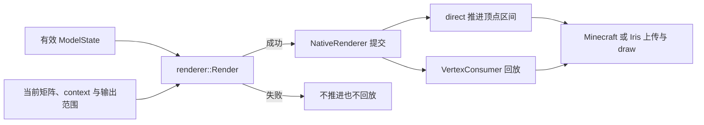

# 顶点输出与宿主接管

本页对应[输出与失败](../overview.md#输出与失败)和[顶点输出与宿主接管](../overview.md#顶点输出与宿主接管)，说明顶点变换、输出路径选择与失败归类的当前实现映射。

## 主流程

Java 侧负责纹理、`RenderType` 与绘制元数据选择，`NativeRenderer` 将参数适配为 `RenderParameters`。Native 侧仅产出顶点数据，不接触纹理像素、GPU 句柄或 draw 提交。

## 变换与面语义

- **矩阵与属性合成**：顶点位置、法线与裁剪空间分别应用上层传入矩阵。RGB 按 `round(parent * bone / 255)` 组合；不透明分区保留上层 alpha，透明分区将上层 alpha 乘以骨骼 alpha；glow 为 `-1` 时沿用上层光照，`0–15` 同时覆盖方块光与天空光。颜色与光照不向后代继承。
- **绕序、法线与切线**：Native 按本次最终变换解释烘焙绕序，双面几何背面反转输出法线，非保角变换后重归一化法线（Vanilla 与 Iris direct 路径一致）。PBR 切线同步修正镜像与背面手性；未启用 PBR 时输出零值。

## RenderType、context 与 VertexKind

`RenderType` 决定宿主渲染状态与目标 consumer，native context 表达绘制环境（Iris shadow 属绘制环境而非 `VertexKind`），`VertexKind` 选择输出顶点布局：

| 当前路径 | 选择与交接 |
|---|---|
| Vanilla direct | Consumer 暴露 accessor 且布局为 `NEW_ENTITY`；native 成功后直接推进区间 |
| Iris direct | Accessor 与 Iris 顶点布局均已识别；native 成功后直接推进区间 |
| Fallback | 无 accessor 或未知布局；native 成功后将数据回放至原 consumer |

- **提交判定**：`NativeRenderer.render()` 同步返回 `boolean`。有效空结果通过发布校验后直接返回 `true`；非空结果须在推进 direct 区间或完成整段回放后才返回 `true`；Java 发布顶点数与 native 调度计划不一致时直接判为状态失效。
- **失败分类与宿主传播**：

| 失败类型 | 处理方式 |
|---|---|
| 姿态完整，但外部输出区间不足、宿主矩阵非法或纯输出侧数值溢出 | 仅拒绝本次输出，保留原姿态状态；不推进 direct，不触发 fallback 回放 |
| 姿态损坏、状态无效、顶点数不匹配或源数据完整性存疑（混合失败时优先） | 撤销当前发布状态；不推进 direct，不触发 fallback 回放 |
| Fallback 回放期间宿主 consumer 抛异常 | 原样向外传播异常，无回滚 |
| 表达式求值期 OOM | 在产出 Prepared 前由实体执行负责方收尾，绘制阶段拿不到 Prepared |

## 顶点输出区间与 translucent 排序

- 透明顶点仅在单次模型 draw 内部按由远及近排序（Iris shadow 保持原始生成顺序），跨 draw 透明混合交由 Minecraft。Java 侧关闭重复的局部剔除与上传排序，由 native 独占这两步；未写入的预留容量不得暴露旧内存数据（内存安全边界）。
- 透明范围与输出等价保证见[透明范围](../../../product-decisions/decisions/transparency-scope.md)与[输出等价](../../../product-decisions/decisions/geometry-regions.md#bcoutput-paths-are-visually-equivalent)，验证缺口见[渲染问题](../../../status/known-issues/rendering.md)。
