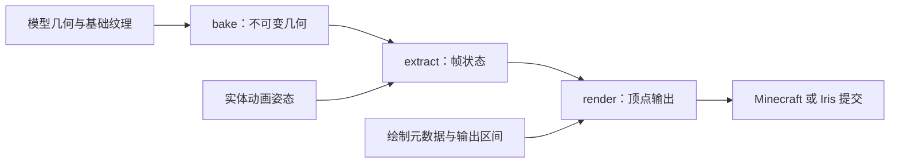

# 渲染设计

上级契约：[系统边界](../README.md#系统边界)。

## 职责与边界

CPU 渲染管线负责将已验证的模型几何与骨骼姿态转换为 Minecraft 可直接提交的顶点数据。跨语言分工明确：Java 侧负责选择纹理、绘制状态和宿主输出路径；native 侧完成几何烘焙（bake）、帧状态提取（extract）和顶点计算（render）；最终的缓冲区上传与 draw 调用仍交由 Minecraft 或 Iris 完成。

## Seam Contract

按本次交接定位对应契约：

- 获取可消费的几何、帧状态或 locator：[帧状态发布与借用](#帧状态发布与借用)。
- 将顶点交给宿主 consumer 并裁决宿主接管：[顶点输出与宿主接管](#顶点输出与宿主接管)。

### 共同规则

适用范围：本页的“帧状态发布与借用”与“顶点输出与宿主接管”两项交接。

#### 本地呈现边界

玩家对本机模型、第一人称手臂和模型音效的显隐控制见[本地呈现决策](../../product-decisions/decisions/local-presentation-control.md#ddlocal-player-controls-presentation)。这些开关只决定本机是否采用 YSM 呈现，不影响服务端游戏事实或其他玩家的同步状态。

本机 body 的状态生产职责与绘制许可分开：自身模型被屏蔽时，body 仍继续推进逻辑与动画求值，而第一人称手臂（arm）等纯消费者会结束当前运行；待所有屏蔽限制解除后，再按最新请求恢复。

精确派生 cache 的键和校验规则由[模型存储设计](../model-management/storage/derived-artifacts.md)定义；renderer 只提供自身的 bake profile，不解释容器身份。输出与容量失败分类见[顶点输出](implementation/vertex-output.md)，支持范围与视觉缺口见[渲染问题](../../status/known-issues/rendering.md)。[GPU Compute Renderer](../../future/gpu-compute-renderer.md)仍是后续演进方向。

渲染管线的三个阶段按数据依赖划分，不绑定固定线程：Java 动画 worker 执行求值与 Extract，native render worker 消费准备好的帧状态。当前任务发布与并发细节见[帧执行](implementation/frame-execution.md#任务发布与并发边界)。

#### 设计目标

[一致渲染需求](../../product-decisions/requirements.md#reqrender-model-consistently)要求在受支持路径下保持姿态、表面、UV、材质和透明语义一致。管线内部的数据布局与执行策略可随时替换，内部 `BakedModel`、schedule 以及序列化 cache 不构成公开模型格式。

#### 三阶段契约

| 阶段 | 输入 | 输出与边界 |
|---|---|---|
| Bake | 几何定义、基础纹理 alpha、UV 约定与 bake 选项 | 产出不可变几何与骨骼映射；不上传纹理，不计算动画 |
| Extract | 已烘焙几何与实体的 `BoneAttribute` | 产出帧状态、借用 view、locator 与调度计划；不生成顶点 |
| Render | 有效帧状态、本次矩阵与光照上下文、顶点布局与输出区间 | 成功生成顶点后交给宿主 consumer；不修改动画状态，也不提交 GPU draw |

#### 共享资源保留

当前实现中，Renderer 通过模型管理提供的 lease 保活共享资源，自身只持有渲染所需的可变帧状态，不在渲染层另建 target cache、常驻 pin 或独立引用计数。通用保留与物理关闭权由[模型生命周期](../model-management/overview.md#新使用接纳与独立保留)定义。

#### 状态与绘制并发

- 对同一个帧状态，Extract、Render、resize 与释放按串行使用。
- 当前 `NativeRenderer` 共享了 executor、透明排序临时缓冲（scratch）与 fallback 缓冲，因此尽管底层有 worker pool，`Render` 调用侧目前仍按全局串行执行；不同实体的 Java 动画求值与 Extract 可并行。若未来需要多实体并行 `Render`，需先拆分上述共享可变缓冲与执行态。

具体并发限制见[并发边界](implementation/frame-execution.md#任务发布与并发边界)，当前的视觉、重入与组合验证缺口见[渲染问题](../../status/known-issues/rendering.md)。

### 帧状态发布与借用

**前置条件与输入**

帧结果只在产生它的原负责方、原安装、对应输出槽以及兼容的采样上下文中有效。跨线程任务交接只提供内存可见性；发生安装替换、结果撤销或 hook 修改绘制许可后，消费者需重新检查接纳资格，不凭仍可达的 view、相同模型内容或已完成任务复用旧资格。实体执行权见[任务交接](../animation/entity-lifecycle.md#执行权与任务交接)。

**结果与保证**

Extract 完整通过后，按[三阶段契约](#三阶段契约)交付帧状态、借用 view、locator 与调度计划。几何可见面遵循下列统一规则。

#### 几何与可见面

Cube 是否完整按原始六面结构判断，不因纹理存在透明洞或省略全透明面而改变。正尺寸完整块要求三轴尺寸均大于零，负尺寸完整块要求三轴尺寸均小于零；任一轴零厚度都不具备这两类完整块的面剔除资格。

| 几何条件 | 可见面规则 |
|---|---|
| 完整、完全不透明的正尺寸块 | 背面剔除 |
| 完整负尺寸块（含三轴镜像） | 正面剔除，不因不透明或透明分类改变 |
| 不完整块或透明正尺寸块 | 保留可见背面 |

负尺寸描边依靠正面剔除保留背面外壳，因此烘焙会保留负尺寸块而非拒绝或取绝对值。完整且完全不透明的正尺寸块省去被遮挡的背面；其余情况保留可见背面，防止切换观察角度时出现缺面。一轴镜像、二轴镜像以及从模型内部向外观察不在该可见面保证范围内。

上述规则落实[创作结果与输出等价](../../product-decisions/decisions/geometry-regions.md)，由 Bake 映射到[四逻辑分区](implementation/bake-and-partition.md#四逻辑分区)。逻辑面语义不限定底层物理数组或 SIMD 布局。

**所有权与时序**

#### 资源与状态

不可变 `BakedModel` 跨实体共享；`ModelState` 保留所需的底层 backing，并独占姿态、可见骨骼和调度计划。Java 侧只借用 native view，Extract 完成后不保留输入的 `BoneAttribute`。下一次 Extract、invalidate 或 close 发生前须结束旧 view 与 locator 的消费——Java 引用可达不延长底层 native 地址的有效期（内存安全边界）。实体或第一人称输出的负责方保活帧状态与模型 lease，prepared 结果对象本身不接管生命周期。

规范输出槽（canonical）与可变输出槽（mutable）分开保存，但同一实体仍共享底层动画状态。重复观察不重置逻辑动作门禁，恢复派生输出也不重放已提交动作。不同绘制上下文的复用条件与第一人称局部根输出见[帧执行](implementation/frame-execution.md)。

**失败与拒收**

`GeoModelState` 开始提取前先撤销旧的消费资格；只有层级遍历、调度构建、JNI 写回以及 Java 侧的 view、计数与 locator 后置校验全部通过后才发布新结果，任一步失败都会使结果保持不可消费。一次成功的 draw 不撤销当前姿态；“本次输出条件不合法”和“姿态状态本身损坏”分开处理。

**证据与依赖**

依赖[实体执行权](../animation/entity-lifecycle.md#执行权与任务交接)和[JNI 能力与结果交付](../native-runtime/overview.md#jni-能力与结果交付)；帧内借用、局部根提取与验证入口见[帧执行](implementation/frame-execution.md)。

### 顶点输出与宿主接管

**前置条件与输入**

输入帧状态需满足[帧状态发布与借用](#帧状态发布与借用)中的原负责方、原安装、输出槽与采样上下文资格。

三个正交维度决定最终输出：Java 的 `RenderType` 决定宿主渲染状态与目标 consumer，native context 表达绘制环境，`VertexKind` 选择顶点内存布局。无论 direct 还是 fallback 路径，都在 native 计算成功后才向宿主提交；预先申请输出区间本身不代表宿主已消费。

**结果与保证**

宿主接管遵循当次准备与消费一致的原则：
- **第三人称**：仅在持有有效 Prepared 结果或具备明确主动隐藏依据时取消宿主渲染，准备与消费阶段使用同一份结果。
- **第一人称左右手**：仅在对应一侧实际消费成功时取消该侧宿主手臂，合法空几何也算消费成功；缺少对应骨骼根时保留该侧宿主渲染。背景槽只附加初始姿态。
- **Hook 复核**：Hook 回调返回后重新核对负责方、安装、输出槽与通道，不通过第二次 update 修补旧结果。

`NativeRenderer` 解释 native 返回结果，确认成功后才推进 direct 顶点区间或向原 consumer 完整回放 fallback 数据；内存预留成功、非零顶点数或部分写入不视作消费成功。绘制调用方依据该结果决定是否取消宿主渲染，native 层不直接干预宿主。

**所有权与时序**

#### 并行输出与宿主提交

并行顶点任务各自写入预先分配的、互不重叠的输出区间，同一个几何组不跨任务拆分。

宿主输出区间仅同步借用给本次 native Render 调用（内存安全边界）：Buffer 负责方在取得原始地址前完成扩容，随后传入可写地址、字节容量和 backing anchor（direct JNI 直接写裸地址，fallback 路径借用 Java 数组）。借用期间不能再次预约、扩容、重置或释放该 backing；native 在返回前结束全部并行写入，Java 侧保活相关对象至调用返回，不把借用地址留给异步任务。JNI 地址、容量与采用责任见[JNI 能力与结果交付](../native-runtime/overview.md#jni-能力与结果交付)。

**失败与拒收**

#### 输出与失败

明确区分“合法空结果”与“失败”：
- **纯输出拒绝**：姿态完整但外部输出区间不足或宿主矩阵非法时，只拒绝本次输出，保留原姿态状态。
- **状态撤销**：无法证明姿态完整或状态已损坏时，撤销当前发布状态。
- **可控失败与宿主异常**：YSM 可控失败不推进 direct 区间，也不触发 fallback 回放；consumer 已开始回放且中途抛出异常时原样传播，不提供回滚。

实体求值阶段触发 OOM 时，由执行负责方终止本次求值，绘制阶段拿不到可用 Prepared 结果，不退回单动画或表达式默认值强行输出；该 OOM 边界不包裹宿主 consumer。

[输出等价契约](../../product-decisions/decisions/geometry-regions.md#bcoutput-paths-are-visually-equivalent)约束受支持路径下的视觉结果；公共求值或绘制错误不默认靠切换输出路径兜底恢复。

**证据与依赖**

依赖[帧状态发布与借用](#帧状态发布与借用)和[JNI 能力与结果交付](../native-runtime/overview.md#jni-能力与结果交付)。详细实现与结果分类见[顶点输出](implementation/vertex-output.md)；视觉、重入与组合验证缺口见[渲染问题](../../status/known-issues/rendering.md)。

## 设计取舍

按完整几何组预先分配互不重叠的输出区间，省去了多线程共享 append 竞争，同时保证顶点顺序确定、内存访问连续且输出容量一次算清。代价是按组数做近似均衡时，如果个别几何组特别大，仍可能出现尾部负载不均。

## 实现与验证入口

- [Bake 与派生身份](implementation/bake-and-partition.md)：不可变几何、逻辑分区与 cache 资格。
- [帧执行](implementation/frame-execution.md)：发布、借用、局部根与并发边界。
- [顶点输出](implementation/vertex-output.md)：宿主接管与失败分类。
