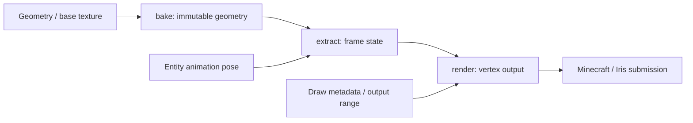

# 渲染设计

上级契约：[系统边界](../README.md#系统边界)。

## 职责与边界

CPU 渲染管线把已验证几何与骨骼姿态变成 Minecraft 可提交的顶点。Java 选择纹理、绘制状态和宿主输出；native 完成 bake、extract 和顶点计算；Minecraft/Iris 负责上传与 draw。

## Seam Contract

按本次交接定位契约：

- 取得可消费的几何、帧状态或 locator：[帧状态交付](#帧状态发布与借用)。
- 把顶点交给宿主 consumer 并裁决接管：[宿主输出](#顶点输出与宿主接管)。

### 共同规则

适用范围：本页的帧状态发布与借用、顶点输出与宿主接管两项交接。两项共同遵守本地呈现、三阶段职责、资源保留和并发边界。

#### 本地呈现边界

本机模型、第一人称手臂和模型音效的控制见[本地呈现决策](../../product-decisions/decisions/local-presentation-control.md#ddlocal-player-controls-presentation)。这些控制决定是否采用 YSM 呈现，不改变服务端游戏事实或其他玩家状态。

本机 body 的 producer 职责与绘制许可分开。自身屏蔽时 body 继续逻辑推进，arm 等纯消费者结束当前运行；解除全部限制后按最新请求恢复。

精确派生 cache 由[模型存储设计](../model-management/storage/derived-artifacts.md)定义；renderer 只提供 bake profile，不解释容器身份。输出与容量失败见[顶点输出](implementation/vertex-output.md)，支持与视觉缺口见[渲染问题](../../status/known-issues/rendering.md)。[GPU Compute Renderer](../../future/gpu-compute-renderer.md)仍是后续方向。

阶段按数据依赖划分，不保证固定线程。Java 动画 worker 可以求值并 Extract；native render worker 只消费准备好的状态。当前发布与执行关系见[帧执行](implementation/frame-execution.md#任务发布与并发边界)。

#### 设计目标

[一致渲染需求](../../product-decisions/requirements/req-render-model-consistently.md)要求保持受支持的姿态、表面、UV、材质和透明语义。数据布局和执行策略可以替换；内部 `BakedModel`、schedule 和 serialized cache 不成为公开模型格式。

#### 三阶段契约

| 阶段 | 输入 | 输出与边界 |
|---|---|---|
| Bake | 几何、基础纹理 alpha、UV 约定和 bake 选项 | 不可变几何与骨骼映射；不上传纹理、不计算动画 |
| Extract | 已烘焙几何和 entity 的 `BoneAttribute` | 帧状态、借用 view、locator 与调度计划；不生成顶点 |
| Render | 有效帧状态、本次矩阵/光照/context、顶点布局和输出区间 | 成功生成后交给宿主 consumer；不改变动画或提交 GPU draw |

#### 共享资源保留

Renderer 通过模型管理的 lease 保活共享资源，只拥有渲染所需的可变状态。另建 target cache、default pin 或引用计数会复制加载、淘汰和关闭判断。通用保留与物理关闭权由[模型生命周期](../model-management/overview.md#新使用接纳与独立保留)定义。

#### 状态与绘制并发

同一状态的 Extract、Render、resize 和释放串行。当前 renderer 的共享 executor、透明 scratch 与 fallback 要求 render 全局串行；不同实体的 Java 动画与 Extract 可以并行。当前并发限制见[并发边界](implementation/frame-execution.md#任务发布与并发边界)，不能据 worker pool 推定 render 可重入。

视觉、重入和组合验证缺口见[渲染问题](../../status/known-issues/rendering.md)。

### 帧状态发布与借用

本项显式继承[共同规则](#共同规则)。

**边界与权威**

Bake 与 Extract 向帧消费者交付几何、骨骼映射和状态；阶段职责与非公开制品范围见[三阶段契约](#三阶段契约)和[设计目标](#设计目标)。

**前置条件与输入**

帧结果只在原 owner、安装、输出槽及相容采样/context 中有效。任务交接提供可见性，不能将旧结果变成当前结果。安装替换、结果撤销及 hook 改变许可后，消费者应重新判断接纳资格；不能靠仍可达的 view、相同模型内容或已经完成的任务恢复旧资格。实体执行权由[任务交接](../animation/entity-lifecycle.md#执行权与任务交接)提供。

**结果与保证**

帧状态、借用 view、locator 与 schedule 按[三阶段契约](#三阶段契约)交付。

#### 几何与可见面

Cube 的完整性按原始六面结构判断，不随纹理透明洞或全透明面省略而变化。完整块的正尺寸资格要求三轴均正，负尺寸资格要求三轴均负；零厚度不获得这两类完整块剔除资格。

| 几何条件 | 可见面规则 |
|---|---|
| 完整、完全不透明的正尺寸块 | 背面剔除 |
| 完整负尺寸块，包括三轴镜像 | 正面剔除，不因不透明或透明分类改变 |
| 不完整块或透明正尺寸块 | 保留可见背面 |

负尺寸描边通过正面剔除保留背面外壳，不能仅因尺寸为负而拒绝或取绝对值。完整正尺寸不透明块可省去被遮挡的背面；其他上述情况保留可见背面，避免改变观察角度后作品缺面。一轴、二轴镜像和从模型内部观察不属于这组可见面保证范围；该范围不扩展为所有借助实现特性的艺术技巧保证。

这些规则落实[创作结果与输出等价](../../product-decisions/decisions/geometry-regions.md)，由 Bake 映射到[逻辑分区](implementation/bake-and-partition.md#四逻辑分区)。逻辑面语义不规定物理数组或 SIMD 布局。

**所有权与时序**

#### 资源与状态

不可变 `BakedModel` 可以共享；`ModelState` 保留所用 backing，拥有 pose、可见骨骼和 schedule。Java 只借用 view，Extract 不保留输入 attribute。下次 Extract、invalidate 或 close 前，应结束旧 view 和 locator 消费；view 可达不延长地址有效期。实体或第一人称输出 owner 负责保留状态和模型 lease，prepared 结果本身不接管这些资源。

Canonical 与 mutable 输出隔离保存，但同一 entity 仍共享动画状态。重复观察不能重置逻辑动作门禁；恢复派生输出也不能重放已提交动作。不同 context 的复用条件与第一人称局部根输出见[帧执行](implementation/frame-execution.md)。

**失败与拒收**

`GeoModelState` 接纳 native 提取结果。提取先撤销旧消费资格，全部遍历、调度、JNI 写回和 Java view/count/locator 后置验证成功后才发布。发布只授权消费这份帧状态，不自动授权宿主接管。任何后置失败都使结果不可消费。成功 draw 不撤销姿态；本次输出条件无效与姿态本身损坏分别处理。

**证据与依赖**

发布依赖[实体执行权](../animation/entity-lifecycle.md#执行权与任务交接)和[JNI 采用](../native-runtime/overview.md#jni-能力与结果交付)。帧内借用、局部根及证据入口见[帧执行](implementation/frame-execution.md)。

### 顶点输出与宿主接管

本项显式继承[共同规则](#共同规则)。

**边界与权威**

Native 只计算顶点；宿主接管由绘制调用方按消费结果裁决。分工与共享资源权威见[共同规则](#共同规则)。

**前置条件与输入**

帧输入先满足[帧状态发布与借用](#帧状态发布与借用)中的原 owner、安装、输出槽及采样/context 资格。

Java 的 `RenderType` 决定宿主状态，native context 表达绘制环境，`VertexKind` 选择布局。三者正交。Direct 与 fallback 都在 native 成功后才提交；预留区间不等于宿主已经消费。

**结果与保证**

宿主接管另有当次准备与消费边界。第三人称只有有效 Prepared 或明确主动隐藏依据才能取消宿主，准备与消费使用同一结果。左右手只有对应侧实际消费成功才取消，合法空几何也算成功；缺根保留该侧宿主。背景只附加初始姿态。Hook 后应复核精确 owner、安装、输出和通道，不能用第二次 update 修补旧结果。

Native 完成顶点计算与宿主消费成功是两个事实。`NativeRenderer` 解释计算结果，成功后才推进 direct 区间或完整回放 fallback；两条路径都不把分配成功、非零顶点数或部分写入当作消费成功。绘制调用方据本次消费结果裁决接管，不由 native 计算层取消宿主。

**所有权与时序**

#### 并行输出与宿主提交

并行任务只写预先分配的互不重叠区间，几何组不在任务间拆分。

宿主输出区间只借给本次同步 native Render。调用方保留 backing，并在取得地址前完成扩容；借用期间不再次预约、扩容、重置或释放该 backing。Native 在返回前结束全部并行写入；Java 随后提交或放弃本次输出，不能把地址留给后续异步工作。JNI 的地址、容量与采用责任见[能力交接](../native-runtime/overview.md#jni-能力与结果交付)。

**失败与拒收**

#### 输出与失败

合法空结果与失败应区分。姿态完整但外部区间不足或宿主矩阵非法时，只拒绝本次输出；无法证明 pose 完整时撤销状态。YSM 可控失败不 advance direct，也不回放 fallback；consumer 已开始回放后的异常仍传播，不具有通用回滚。

实体求值阶段的 OOM 由执行 owner 终结，本次没有 Prepared 可供绘制；不会以单动画或表达式默认值继续输出。该边界不包围宿主 consumer，也不为输出入口增加阶段标记或异常 relay。

[输出等价契约](../../product-decisions/decisions/geometry-regions.md#bcoutput-paths-are-visually-equivalent)只约束受支持路径的作品结果。共同求值或绘制错误不会因切换输出路径消失，恢复应由故障 owner 判断，不能默认另一条路径可用于恢复。

**证据与依赖**

输出依赖[帧状态发布](#帧状态发布与借用)及[JNI 地址与采用责任](../native-runtime/overview.md#jni-能力与结果交付)。实现与结果分类见[顶点输出](implementation/vertex-output.md)；视觉、重入和组合缺口沿[共同规则](#共同规则)的证据限制判断。

## 设计取舍

按完整几何组分配互不重叠的输出区间，保持确定性、连续访问和单一输出容量，并省去共享 append。按组数近似均衡仍可能产生尾部不均衡。

## 实现与验证入口

- [Bake 与派生身份](implementation/bake-and-partition.md)：不可变几何、逻辑分区及 cache 资格。
- [帧执行](implementation/frame-execution.md)：发布、借用、局部根与并发边界。
- [顶点输出](implementation/vertex-output.md)：宿主接管与失败来源。
