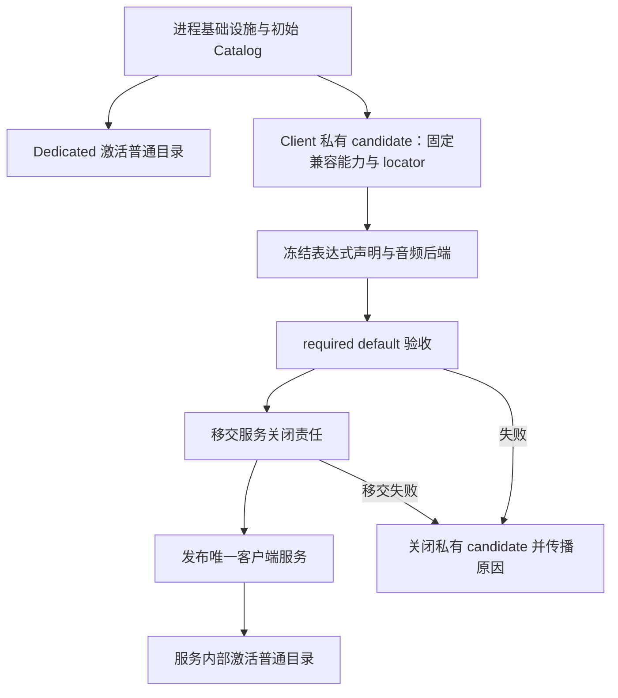
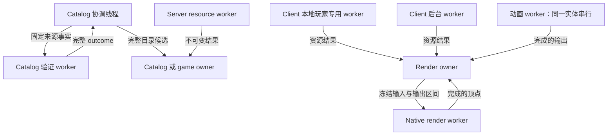
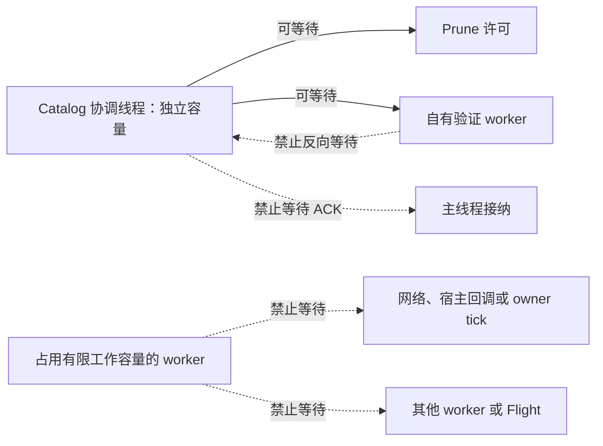

# 运行作用域与执行契约

上级契约：[系统边界](../README.md#系统边界)。

## 职责与边界

运行组合层衔接进程级基础设施、客户端服务、游戏服务端与各领域负责方，提供统一的启动、后台执行与关闭边界。运行时按事实寿命划分负责方；即使客户端与内置服务端（integrated server）位于同一 JVM 进程内，双方也各自独立维护所属状态。

## Seam Contract

| 消费者问题 | 契约 |
|---|---|
| 何时可以取得已发布服务，连接或服务结束后保留什么？ | [服务组装与生命周期](#服务组装与生命周期) |
| 提交有界后台工作后，由谁交付最终结果并处理拒收？ | [有限工作调度与领域交接](#有限工作调度与领域交接) |

### 共同规则

适用范围：服务组装与生命周期、有限工作调度与领域交接。

运行组合层负责拉起进程基础设施、客户端服务与游戏服务端，各领域负责方自行裁决接纳、取消、发布与真实结束状态。

#### 不可变发布

领域边界只对外发布完整且通过校验的值；Builder、parse cursor 以及半成品留在局部构造范围内。不可变 payload 可跨模块共享，独立 view 按约定承担验证、索引、信任边界或资源所有权职责。

#### 运行作用域与所有权

| 作用域 | 拥有的事实 | 结束边界 |
|---|---|---|
| 进程基础设施 | Native 可用性、builtin 契约、存储、Local Catalog、共享执行容量 | JVM 退出；进程内受控域可显式关闭 |
| 客户端服务 | 客户端目录视图、共享资源、required default | 客户端服务关闭 |
| 游戏服务端 | 服务端会话、授权、选择、dispatch、内置导出环境 | 本次游戏服务端停止 |
| 单条连接 | 协议协商、业务资格、查询、传输、组装与远端视图 | 连接撤销或替换 |
| 实体与 draw | 模型安装、私有求值状态、输出槽与帧内借用 | 实体退休或借用窗口结束 |

作用域层级不自动连带关闭底层资源：连接退出不会退休进程 Catalog，服务端资源可跨多次游戏服务端启停继续保留。各类资源的最终关闭条件见[模型管理](../model-management/overview.md)和[内存边界](../native-runtime/overview.md)。

#### 生命周期与失败

当前 Java OOM 防御集中在所属操作的高层边界：必要子工作将失败向上交回，已接纳的工作由原负责方收尾，不设全局恢复状态或清理期二次 OOM 防御。

### 服务组装与生命周期

**前置条件与输入**

客户端服务对外发布前，先通过下述 required 默认模型验收并完成关闭责任移交；普通模型目录扫描不阻塞服务发布。

**结果与保证**

#### 启动与进入世界

下图中箭头表示必需的先后顺序，普通目录激活不属于 required 验收流程。

Catalog 独占幂等激活、扫描接纳与扫描结束状态，组装层不缓存首次扫描结果或激活状态。激活只把扫描任务交给后台执行，不阻塞等待普通模型扫描完成。普通目录加载失败不回滚已完成的 required 发布，required 默认模型失败也不降级为普通目录诊断。

每次客户端发起连接以及 dedicated 服务端新建游戏服务时，自动触发一次 reload（integrated 模式仅走客户端连接入口，重复获取已有服务不重复触发）。这些自动入口直接丢弃本次 future，不阻塞握手或进入世界；显式 reload 命令照常观察结果。

目录正忙时自动 reload 直接被拒绝，不排队。正在进行的扫描沿用进入前捕获的输入快照，因此进入世界不保证已完成最新一轮扫描；下一次进入世界或显式 reload 提供新机会。提前激活目录会更早占用 CPU、I/O 与内存，也可能让并发运行的其他进程跳过已转换缓存的清理（converted prune）。

#### 启动模型一次性预热

客户端服务发布后，利用主菜单等尚无玩家的空档，尽力预热一次普通玩家的 FULL 资源。每个客户端服务生命周期最多提交一次 Offline、`BACKGROUND` 优先级的请求，准备几何、MAIN 与 FP_ARM 动画输入及完整 FULL AOT 编译，按普通基础纹理和 PBR 门禁观察 Ready；GUI 相关内容仍按需解析。预热属于 required default 之后的可选消费者，失败按普通资源契约结束。

预热目标在首次服务 tick 时固定配置中的 `SessionMode` 与当前账户 UUID；若此时世界里已有玩家则直接放弃：
- `AUTO` 模式预热普通 `builtin:default` 及其默认纹理；
- 仅显式 `LOCAL` 模式读取该 UUID 的完整本地选择（Local selection），保留已发布角色、版本与纹理意图。偏好缺失或读取失败时回退普通 builtin（不改写持久化偏好）；记录为显式 intrinsic、读取取消或采用资格失效时直接结束。有效本地选择指向的模型尚未发布到目录时持续等待，不拿 builtin 顶替。

偏好查询与本地 Catalog 完整发布两路异步汇合，任一方先到达即可触发判断。等待期间出现玩家，或账户、模式变化即永久放弃本次预热；真正提交前再复核上述条件、权限与本地来源。一旦提交即消耗唯一机会，后续不重试；目标模型始终未发布时保持目录观察直到服务关闭。

提交后持续持有同一个 lease，在 Pending 期间观察，进入 Ready、Missing、Failed、Ended 或服务显式关闭时释放。预热进行中玩家进入世界时，预热只沿该 lease 收尾，实际玩家由资源系统独立复用或替换 Flight。预热到达 Ready 后进入普通缓存，不保证驻留到进入世界，也不等待三类派生物完成持久化。预热不运行动画，不创建实体私有实例，未消费动画保持延迟解码。服务显式关闭时，先终止预热的采用资格、偏好查询、目录订阅和 lease，再关闭资源管理器。

**所有权与时序**

#### 结束与替换

单条连接撤销遵循[连接撤销交接](../network/overview.md#连接撤销交接)：旧连接的在途结果仍归原负责方清理，不写入新连接。客户端断连撤销远端视图后恢复最新 Local Catalog，合法 Ready 资源与共享后台工作按各自契约保留。Netty 排空、对端退出或 GC 不代表当前会话已关闭。

游戏服务端停止时结束本次游戏服务及其内置导出环境，不与客户端状态混清。导出环境先封口拒绝新提交与新接纳，再结束自身关注状态与迟到结果，只等待不依赖宿主或 tick 的自有 worker；已提交的导出制品和其他消费者的资源继续保留，见[预览与导出](../asset-pipeline/overview.md#导出批次与提交)。

#### JVM 进程退出

**决策：** 整个 JVM 进程退出时，YSM 直接放弃仍在内存中的模型、动画运行资源及后台工作，不执行模型运行时清理，不等待后台任务结束，也不 flush 或排空数据库。YSM 自建 Java 后台线程全部设为 daemon，不拖延退出。正常退出与异常终止均允许丢失近期未提交的偏好、使用事件或派生缓存；已落盘的持久值继续依靠事务、内容校验与原子发布保持整份合法。

宿主仍按自身生命周期销毁窗口、渲染器、纹理与声音等设施，进程退出策略不承诺在宿主设施销毁前完成 YSM 的后台工作或资源回收。

#### 进程内受控关闭

断线、退出世界、实体退休、换模、缓存淘汰以及构造失败回滚发生后 JVM 仍继续运行，旧周期的资格、后台工作与资源保留仍按各自领域生命周期清理，不套用进程退出策略。

显式 service 或 runtime 关闭用于未发布候选回滚、自动化测试和受控资源域终结：组合方先停止自有生产者，再结束在途工作并释放自身引用；各实体负责方仍独立承担对应的 `get` 或 `join`、最外层绘制借用退出及私有实例清理。服务不登记全量实体或 store 来制造全局退休屏障。

显式存储关闭按顺序收尾：停止业务生产者 → 用专用推进流程排空已接纳的写入前缀 → 结束数据库借用 → 释放 CACHE 根登记。已接纳的 flush 请求保证履行原前缀，失败与未知状态见[存储关闭](../model-management/storage/preferences.md#周期提交与关闭)。该能力仅在显式关闭时触发，生产 JVM 退出不调用。受控关闭中的等待不依赖普通 tick，保留调用线程中断标志；取消与超时不代表真实退休；单项清理失败时继续执行后续清理并汇总错误。

**证据与依赖**

依赖[模型管理契约](../model-management/overview.md#seam-contract)与[网络契约](../network/overview.md#seam-contract)；代码映射见[实现入口](#实现与验证入口)，验证边界见[支持状态](../../status/support-and-verification.md)。

### 有限工作调度与领域交接

**前置条件与输入**

提交方在提交任务前固定输入并建立必要的资源保留。

#### 有限工作与发布

下图中连线表示任务派发或结果交接，不表示 worker 等待接收方接纳；各个执行域的容量彼此独立。

为避免有界线程池饱和或关闭时出现死锁等待环，当前有界池 worker 遵循无反向等待假设：在固定输入上连续执行有限阶段，完成后交回不可变结果，执行期间不阻塞等待网络、宿主回调、负责方 tick、其他 worker 或 Flight。同一任务内存在依赖的步骤在当前 worker 内连续跑完；需要跨执行域推进的后续工作等前一阶段结束后再发起。

Catalog 协调线程是唯一例外：它使用独立于验证池的专用容量，允许等待 prune 许可和自有验证 worker 的结果，前置等待期间不占用验证池线程、不持有进程或 Catalog 监视器锁、也不等待主线程 ACK。验证 worker 不反向等待协调线程，关闭过程也不依赖主线程推进。

下图刻画当前阻塞等待拓扑（实线表示允许等待，虚线表示禁止等待），协调线程拥有独立容量是该例外无环的前提：

该无等待拓扑仅针对上述有界后台工作域，不限制渲染线程汇合 native 帧计算，也不限制启动验收或受控关闭中的等待（见[服务组装与生命周期](#服务组装与生命周期)及[顶点输出与宿主接管](../rendering/overview.md#顶点输出与宿主接管)）。

**结果与保证**

#### 调度与领域终态交接

有界工作域调度方只负责排队、领取与运行任务；提交被接纳仅表示进入队列，若提交被拒收，输入清理与失败收尾归原负责方。网络 dispatch 的数据源、读取游标与关闭责任见[传输接管与发送终态](../network/overview.md#传输接管与发送终态)。

接收方在自身负责方窗口内复核身份与接纳资格后提交结果；拒收不会改写原工作结束状态，也不把清理责任转嫁给新负责方。Catalog、客户端渲染与游戏服务端各自单写权威事实，先提交事实再发通知（通知失败不回滚）；GPU 纹理注册、上传与释放遵守宿主线程要求。

**所有权与时序**

#### 数据流与交接

以下两节说明当前执行容量分配与线程调度策略；具体资源的物理关闭责任仍归各资源负责方。

#### 客户端资源调度

客户端资源拉取按优先级分为两类：`LOCAL_PLAYER` 用于真实本地玩家加载、显式选模后的 FULL 准备及 required bootstrap；`BACKGROUND` 用于启动预热、GUI 假玩家、悬浮预览、其他实体及独立资源任务。调度类别只作用于加载链路，不进入资源身份键，也不延续到安装后的声音播放或动画求值。

当前客户端从总容量中划出专用 worker 只领取 `LOCAL_PLAYER` 队列，其余 worker 承担 `BACKGROUND` 任务，以把本地玩家从后台长任务排队中隔离出来（代价是后台少一个并发位，且无法消除磁盘、锁、网络或 GPU 竞争）。

Flight 与共享 preparation 记录调度类别：合法的本地玩家消费者可把尚未结束的后台任务单向提升到 `LOCAL_PLAYER`，已开始执行的任务不抢占或重启。

#### 容量与线程策略

Catalog、客户端资源、服务端资源和动画线程池各自拥有独立的有界容量。Java 结合 native 探测到的物理核数与 JVM 可用处理器数估算容量，native 查询失败时回退 JVM 数值。Native 渲染线程池独立限制包含调用线程在内的总并发度。各池的局部比例和调优常量属于实现参数。自建后台线程的 daemon 规则见[JVM 进程退出](#jvm-进程退出)。

服务端资源 worker 空闲时可全部退出，有新任务到达时按需重建并重新应用原调度策略，不影响 runtime 或资源负责方寿命。

Java 在自有专属平台线程的 worker 循环入口一次性应用固定 OS 调度策略，不包装宿主 executor 中的单项任务。`NORMAL` 保留继承状态，低档策略不叠加 Java 线程优先级，应用失败时保留实际状态并照常执行。具体平台行为见[调用线程调度](../native-runtime/overview.md#调用线程调度)。

**失败与拒收**

成功撤回尚未领取的排队任务时，原负责方负责结束请求并释放未交付输入；撤回失败不代表任务已完成。已被 worker 领取的任务仍沿原交接路径走到真实结束状态，调度方的异常日志、关闭标志或线程退出不替代领域真实结果。

**证据与依赖**

同步帧计算汇合依赖[渲染契约](../rendering/overview.md#seam-contract)；执行池与生命周期代码映射见[实现入口](#实现与验证入口)，验证边界见[支持状态](../../status/support-and-verification.md)。

## 设计取舍

- **按事实寿命划分作用域 + 无反向等待拓扑**：避免连接断开误关进程级共享资源；有界 worker 不阻塞等待外部推进，并为 Catalog 协调线程配备独立容量，从结构上消除饱和与关闭死锁环。
- **本地玩家专用 worker**：隔离本地玩家与后台长任务的排队延迟；代价是后台少一个并发位，且无法消除磁盘、锁、网络或 GPU 竞争。
- **一次性启动预热**：复用常规准备链路，把目标模型加载前移到无玩家空档；代价是提前消耗 CPU、I/O、内存与显存，且后台优先级不提供主菜单帧时间上界（实际收益待实测）。
- **JVM 退出放弃优雅关闭**：近期内存状态允许丢失且 OS 会统一回收进程资源，去掉全域安装登记、store 封口与排空屏障可避免退出卡顿并解耦宿主销毁；代价是退出时不保存未提交内存态，持久数据完整性由各自事务与原子发布保证。

## 实现与验证入口

- [生命周期与发布映射](implementation/lifecycle-and-publication.md)：启动窗口、服务移交、不可变消息与关闭链。
- [执行容量映射](implementation/execution.md)：关键队列、发布线程与线程策略入口。
- [辅助保留](implementation/auxiliary-resources.md)：不归模型 lease 管理的进程级保留。
- [支持与证据边界](../../status/support-and-verification.md)：设计与当前验证范围。
