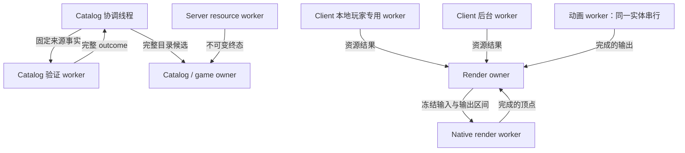
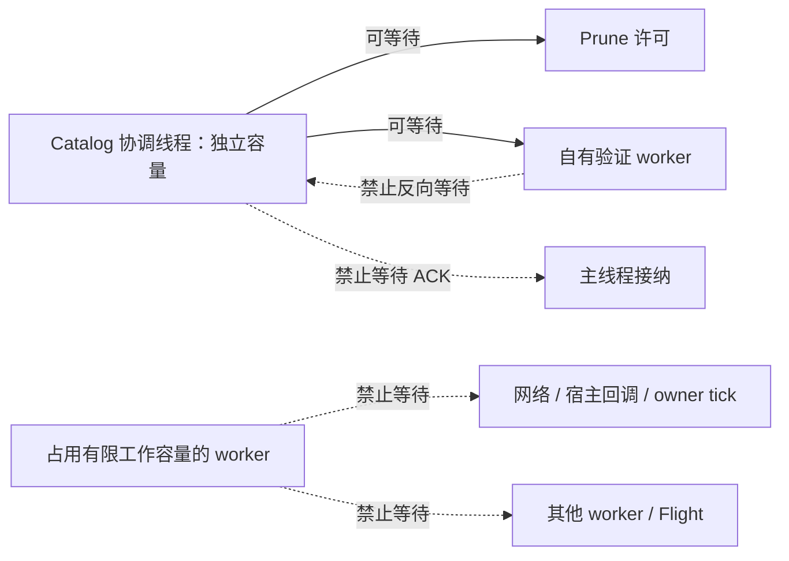
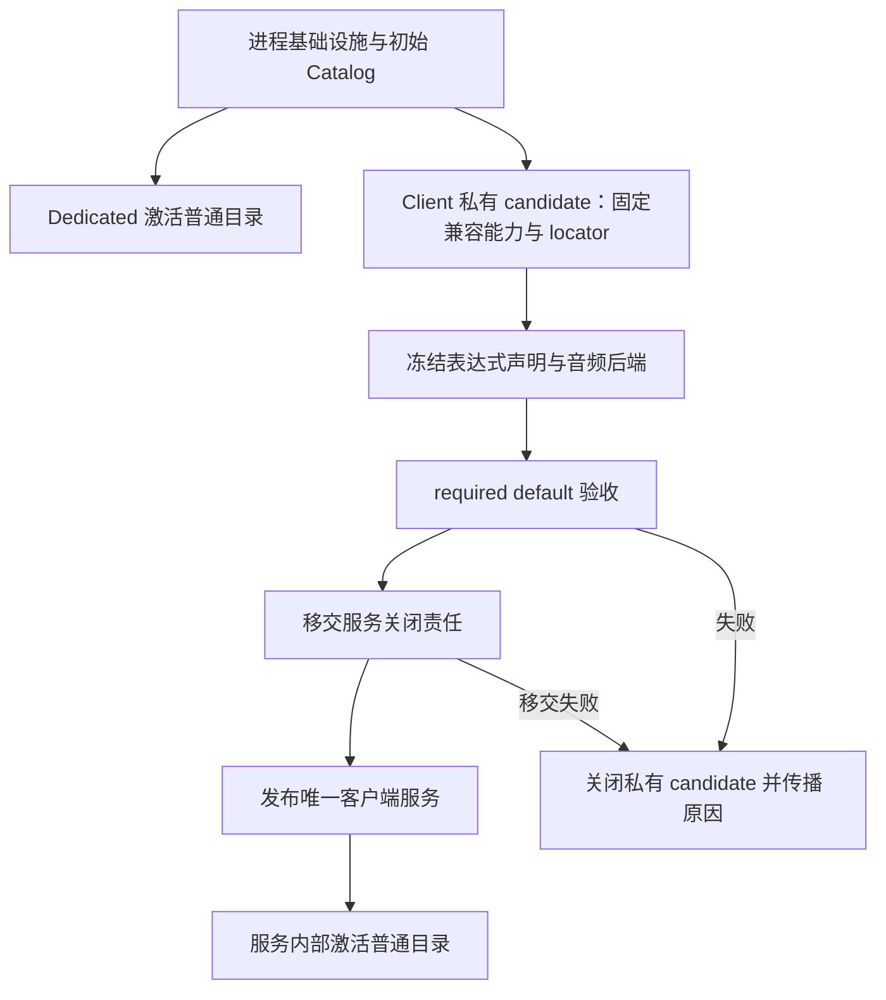
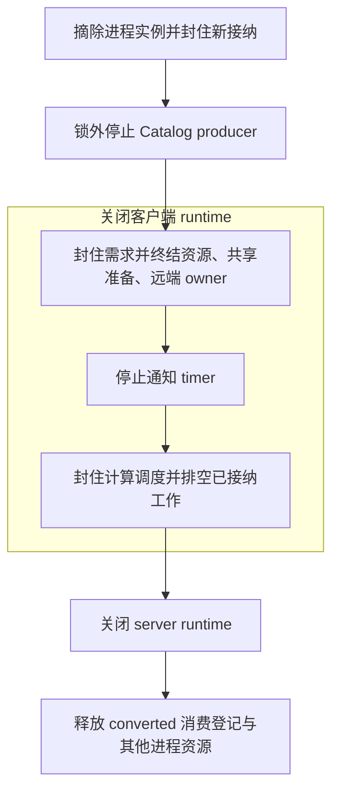

# 运行作用域与执行契约

本页细化[系统边界](../README.md#系统边界)的启动、执行与关闭组合。运行时按事实寿命划分 owner；同一 JVM 内的 client 与 integrated server 仍独立修改所属状态。

## 职责与边界

运行组合建立进程基础设施、客户端服务和游戏服务端。领域 owner 裁决自己的接纳、取消、发布与真实终态；组合层不成为第二个完成裁决者。Native 提供计算与调用线程能力，不复制领域权威。

## 运行作用域与所有权

| 作用域 | 拥有的事实 | 结束边界 |
|---|---|---|
| 进程基础设施 | Native 可用性、builtin contract、存储、Local Catalog、共享执行容量 | 进程关闭 |
| 客户端服务 | 客户端目录投影、共享资源、required default | 客户端服务关闭 |
| 游戏服务端 | Server session、授权、选择、dispatch、integrated export environment | 本次游戏服务端停止 |
| Exact connection | 协商、业务资格、查询、transfer、assembly、远端投影 | 连接撤销或替换 |
| 实体与 draw | 安装、私有求值状态、输出槽与临时借用 | 实体退休或借用窗口结束 |

职责树不代表全部 backing 的关闭关系。连接退出不退休进程 Catalog；服务端资源可跨游戏服务端保留。资源的最终关闭条件由[模型管理](../model-management/overview.md)和[内存边界](../native-runtime/overview.md)定义。

## 数据流与交接

### 有限工作与发布

图中的边表示任务或结果交接，不表示 worker 等待接纳。各执行域容量独立。

Worker 连续执行固定输入上的有限阶段，再向原 owner 交回不可变终态。占用容量期间不等待网络、宿主回调、owner tick、其他 worker 或 Flight，避免饱和和关闭形成等待环。同一任务的依赖阶段连续执行；独立项目分别接纳。跨域后续工作只在前一 worker 终态后发起。

Catalog 协调线程使用独立容量，可以等待 prune 许可和自有验证 worker。前置等待不占验证池、不持进程或 Catalog monitor，也不等待主线程 ACK。验证 worker 不反向等待协调线程；关闭不依赖主线程推进。

下图只表示等待限制，不重复上图的结果交接。实线是允许的等待，虚线是禁止的等待；协调线程的独立容量是这一例外成立的前提。

这些限制适用于上述有限工作域，不能据此推导 render owner 不汇合 native 帧计算，或把启动验收、关闭等待都视为违规。启动与关闭的偏序见[生命周期与失败](#生命周期与失败)，同步渲染边界见[渲染三阶段契约](../rendering/overview.md#三阶段契约)。

Catalog owner、client render owner 与 server game owner 单写各自事实。Owner 先提交事实再通知；通知失败不回滚提交。GPU 注册、上传与释放遵守宿主线程要求。

已有 Java OOM 防御集中在所属操作的高层边界。必要子工作上交失败，accepted work 由原 owner 终结；不增加全局恢复状态、逐入口包装或 cleanup 再次 OOM 的防御层。未设防路径不由这条规则推导新增捕获。

### 不可变发布

领域边界只发布完整且通过适用验证的值。Builder、parse cursor 和半成品留在局部构造范围。无效输入在所属边界失败，不发布 partial value。不可变 payload 可共享；独立 view 应承担验证、索引、信任或资源所有权职责。

## 生命周期与失败

### 启动与进入世界

以下箭头表示必需先后关系，普通目录激活不属于 required 验收。

Catalog 独占幂等激活、扫描接纳和终态。组装层不保存首次扫描结果或激活状态。激活只接纳后台工作，不等待普通模型扫描或消费者登记。普通目录失败不回滚 required publication；required 失败不能降级为目录诊断。

每次客户端连接和 dedicated 新建游戏服务都尝试 reload。Integrated 只走客户端连接入口，重复取得已有服务不触发。入口丢弃本次 future，不等待或挂接 callback，不把扫描设为握手或世界可用门禁。显式 reload 命令仍观察结果。

忙时拒绝本次尝试，不追加扫描队列。已有扫描可继续使用进入前捕获的输入；进入世界不保证完成新一轮扫描。下次进入或显式 reload 提供新机会，文件变化本身不建立恢复资格。提前激活可更早占用 CPU、I/O 和内存，也可能使其他进程跳过 converted prune。

### 结束与替换

Exact connection 撤销遵守[连接撤销交接](../network/overview.md#连接撤销交接)。旧结果仍归原 owner 处置，不能写入新连接。Client disconnect 撤销远端投影后恢复最新 Local Catalog；合法 Ready 和共享工作按各自契约保留。Netty drain、另一侧退出和 GC 不是本次 session 的关闭条件。

Game server stop 结束本次服务及 integrated export environment，不合并 client/server 状态。Export 先封住提交与新接纳，再结束自身 interest 和迟到结果；只等待不依赖 host/tick 的自有 worker。已提交制品及其他消费者资源保留，详见[预览与导出](../asset-pipeline/overview.md#预览与导出)。

进程关闭的箭头表示必需顺序。每个阶段即使失败，也继续后续清理并保留错误。

排队节点撤回不转移业务取消权，原 owner 仍终结 future 和未交付输入。等待不依赖 tick，保留调用线程中断信息，不以超时证明退休。Converted 登记锁覆盖全部使用期。文件 I/O 和 native 计算未必立即响应中断，退出没有耗时上界。

## 关键契约与设计取舍

### 客户端资源调度

真实本地玩家取得、显式选模 FULL 准备和 required bootstrap 使用 `LOCAL_PLAYER`。GUI 假玩家、hover、其他实体及独立资源任务使用 `BACKGROUND`。类别只覆盖取得链，不进入资源身份，也不传播到安装后的声音或动画。

客户端从既有容量划出专用 worker，只领取本地玩家工作；其余 worker 承担后台任务。专用 worker 不借用后台长任务。该选择隔离排队等待，代价是后台少一个计算位置，不能消除磁盘、锁、网络或 GPU 竞争，也不承诺端到端延迟。

Flight 与共享 preparation 各自持有调度类别。合法本地玩家消费者可单向提升未结束工作；已领取工作不抢占或重启。调度模块只裁决排队与领取，领域 owner 保留取消、终态及资源责任。

### 容量与线程策略

Catalog、客户端资源、服务端资源和动画池各有有界容量。Java 依据 native 物理核心数与 JVM 可用处理器数估算容量；native 查询失败时回退 JVM。Native 渲染池独立限制包含调用线程的总并发。局部比例和调优常量不构成跨域契约。

服务端资源 worker 可全部空闲退出；后续任务重建 worker 并应用原策略。这不结束 runtime 或资源 owner。

Java 在自有专属 platform thread 的整个 worker loop 入口应用固定策略。Native 只修改调用线程的 OS 属性；不包装宿主 executor 的单项任务。`NORMAL` 保留继承状态，不能恢复已降低的 OS 属性。低档策略不叠加 Java priority；失败保留实际状态并继续原工作。平台规则见[Native 调度](../native-runtime/overview.md#调用线程调度)。

## 实现与验证入口

- [生命周期与发布映射](implementation/lifecycle-and-publication.md)：启动窗口、服务移交、不可变消息与关闭链。
- [执行容量映射](implementation/execution.md)：关键队列、发布线程与策略入口。
- [辅助保留](implementation/auxiliary-resources.md)：不归模型 lease 的进程保留。
- [支持与证据边界](../../status/support-and-verification.md)：设计与当前验证范围。
