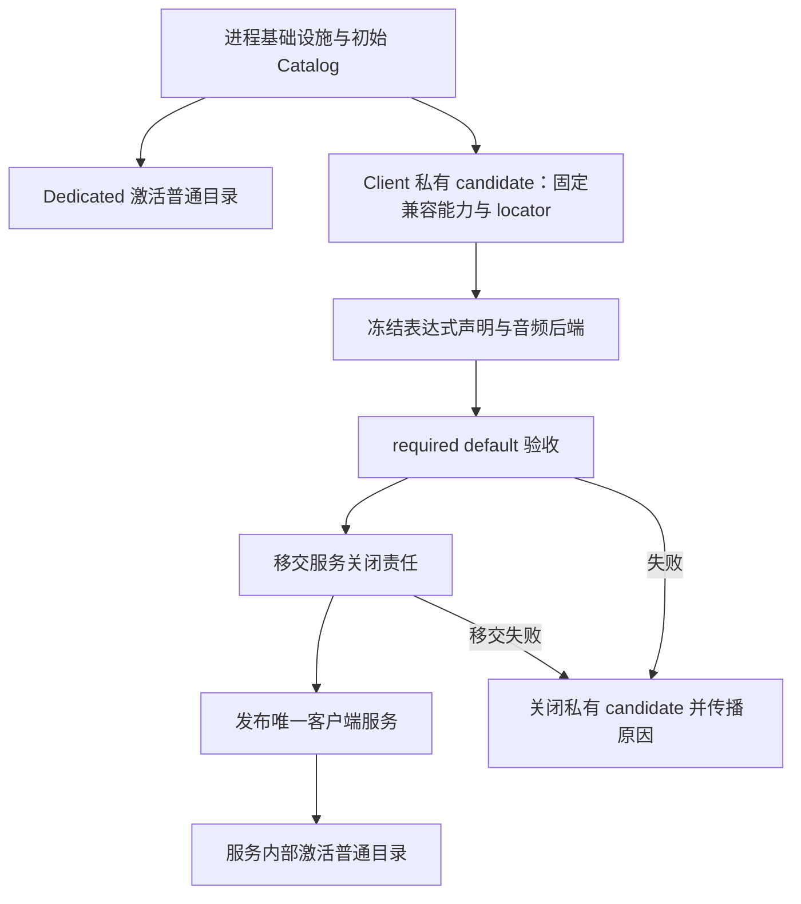
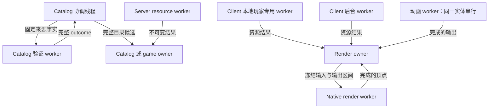
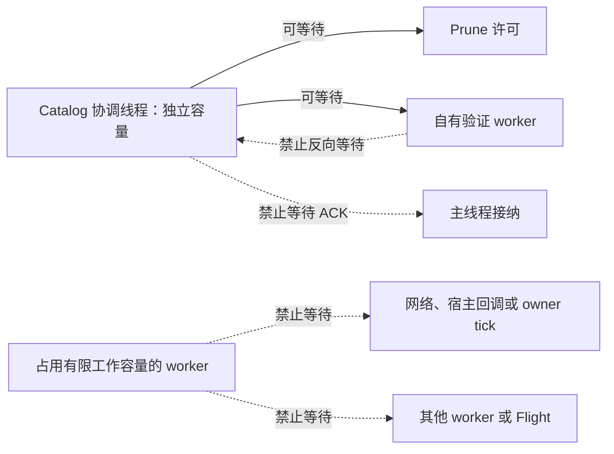

# 运行作用域与执行契约

上级契约：[系统边界](../README.md#系统边界)。

本页细化[系统边界](../README.md#系统边界)中的启动、执行与关闭组合。运行时按事实寿命划分负责方；即使客户端与内置服务端（integrated server）位于同一 JVM 进程内，双方也各自独立维护所属状态。

## 职责与边界

运行组合层负责衔接进程级基础设施、客户端服务、游戏服务端与各领域负责方，对外提供统一的启动、后台执行与关闭边界。

## Seam Contract

| 消费者问题 | 契约 |
|---|---|
| 何时可以取得已发布服务，连接或服务结束后保留什么？ | [服务组装与生命周期](#服务组装与生命周期) |
| 提交有界后台工作后，由谁交付最终结果并处理拒收？ | [有限工作调度与领域交接](#有限工作调度与领域交接) |

### 共同规则

适用范围：服务组装与生命周期、有限工作调度与领域交接共同继承以下事实权威、不可变发布与运行作用域规则；OOM 规则仅约束已设置防御的操作边界。

运行组合层负责拉起进程基础设施、客户端服务与游戏服务端，但各领域负责方自行裁决接纳、取消、发布和真实结束状态，组合层不会变成第二个完成裁决者。Native 层只提供计算与调用线程策略能力，不复制领域权威。

#### 不可变发布

领域边界只对外发布完整且通过校验的值。Builder、parse cursor 以及半成品一律留在局部构造范围内；无效输入在所属边界直接失败，不对外暴露部分状态。不可变 payload 可跨模块共享，独立 view 则按约定承担验证、索引、信任边界或资源所有权职责。

#### 运行作用域与所有权

| 作用域 | 拥有的事实 | 结束边界 |
|---|---|---|
| 进程基础设施 | Native 可用性、builtin 契约、存储、Local Catalog、共享执行容量 | JVM 退出；进程内受控域可显式关闭 |
| 客户端服务 | 客户端目录视图、共享资源、required default | 客户端服务关闭 |
| 游戏服务端 | 服务端会话、授权、选择、dispatch、内置导出环境 | 本次游戏服务端停止 |
| 单条连接 | 协议协商、业务资格、查询、传输、组装与远端视图 | 连接撤销或替换 |
| 实体与 draw | 模型安装、私有求值状态、输出槽与帧内借用 | 实体退休或借用窗口结束 |

上述作用域层级不代表所有底层资源的连带关闭关系：连接退出不会退休进程 Catalog，服务端资源也可以跨多次游戏服务端启停继续保留。各类资源的最终关闭条件由[模型管理](../model-management/overview.md)和[内存边界](../native-runtime/overview.md)定义。

#### 生命周期与失败

现有的 Java OOM 防御集中在所属操作的高层边界：必要子工作把失败向上交回，已接纳的工作由原负责方收尾；不额外引入全局恢复状态、逐入口异常包装，也不为清理路径里再次 OOM 叠加新的防御层。未设防的路径不能由此反推需要新增 OOM 捕获。

### 服务组装与生命周期

**边界与权威**

运行组合层为宿主提供服务拉起、进入世界与关闭的组合边界，同时继承[共同规则](#共同规则)的事实权威、不可变发布、运行作用域和既有 OOM 边界。

**前置条件与输入**

所有领域操作都只能在所属负责方的合法生命周期窗口内进入。客户端服务在对外发布前，必须先通过下述 required 默认模型验收并完成关闭责任移交；普通模型目录扫描不作为服务发布的阻塞门禁。

**结果与保证**

#### 启动与进入世界

下图中箭头表示必需的先后顺序，普通目录激活不属于 required 验收流程。

Catalog 独占幂等激活、扫描接纳与扫描结束状态，组装层不缓存首次扫描结果或激活状态。激活只负责把扫描任务交给后台执行，不阻塞等待普通模型扫描完成或消费者登记。普通目录加载失败不会回滚已完成的 required 发布，反过来 required 默认模型失败也不能降级为普通目录诊断。

每次客户端发起连接以及 dedicated 服务端新建游戏服务时，都会尝试触发一次 reload。Integrated 模式下只走客户端连接入口，重复获取已有服务不会重复触发。这些自动入口会直接丢弃本次 future，既不阻塞等待也不挂接回调，不会把目录扫描变成握手或进入世界的门禁；显式 reload 命令则照常观察执行结果。

如果目录正忙，本次自动 reload 会被直接拒绝，不会追加进扫描队列。正在进行的扫描继续使用进入前捕获的输入快照，因此进入世界并不保证已经完成最新一轮扫描。下一次进入世界或显式 reload 会提供新的扫描机会，本地文件变化本身不会自动建立重试资格。提前激活目录会更早占用 CPU、I/O 和内存，也可能让并发运行的其他进程跳过已转换缓存的清理（converted prune）。

#### 启动模型一次性预热

客户端服务发布后，会利用主菜单等尚未出现玩家的空档，尽力预热一次普通玩家的 FULL 资源。每个客户端服务生命周期内最多提交一次 Offline、`BACKGROUND` 优先级的请求，准备几何、MAIN 与 FP_ARM 动画输入以及完整 FULL AOT 编译，并按普通基础纹理和 PBR 门禁观察 Ready；GUI 相关内容仍按需解析。预热属于 required default 之后的可选消费者，失败时按普通资源契约结束。

预热目标在首次服务 tick 时固定配置中的 `SessionMode` 与当前账户 UUID；如果此时世界里已经有玩家，则直接放弃本次机会。目标选择遵循以下规则：
- `AUTO` 模式预热普通 `builtin:default` 及其默认纹理；
- 只有显式 `LOCAL` 模式才读取该 UUID 的完整本地选择（Local selection），并保留已发布角色、版本与纹理意图。如果偏好缺失或读取失败，本次预热回退到普通 builtin，但不改写持久化偏好；如果记录的是显式 intrinsic、读取被取消或采用资格已失效，则直接结束预热。当有效本地选择指向的模型尚未发布到目录时，持续等待该模型发布，不拿 builtin 顶替。

偏好查询与本地 Catalog 完整发布两路异步汇合，任一方先到达均可触发判断。等待期间一旦出现玩家，或账户、模式发生变化，即永久放弃本次预热机会；真正提交资源请求前还会再复核上述条件、当前权限与本地来源。一旦提交便消耗掉唯一机会，后续 reload、条件重新满足、同步拒收或普通失败都不重试。如果目标模型始终未发布，预热会保持目录观察直到服务显式关闭。

提交后，预热持续持有同一个 lease：在 Pending 期间保持观察，进入 Ready、Missing、Failed、Ended 或服务显式关闭时释放。若在预热进行中玩家进入世界，预热只沿该 lease 收尾，实际玩家消费者由资源系统独立复用或替换 Flight。预热到达 Ready 后资源进入普通缓存，但既不保证一定驻留到进入世界，也不等待三类派生物完成持久化。预热不运行动画，也不创建实体私有实例，未消费的动画保持延迟解码。服务显式关闭时，先终止预热的采用资格、偏好查询、目录订阅和 lease，再关闭资源管理器。

**所有权与时序**

#### 结束与替换

单条连接撤销严格遵循[连接撤销交接](../network/overview.md#连接撤销交接)。旧连接的在途结果仍归原负责方清理，绝不写入新连接。客户端断连撤销远端视图后，会恢复最新的 Local Catalog；合法 Ready 资源和共享后台工作按各自契约继续保留。Netty 排空、对端退出或 GC 都不构成当前会话的关闭条件。

游戏服务端停止时，结束本次游戏服务及其内置导出环境，不会把客户端与服务端状态混在一起清理。导出环境先封口拒绝新提交与新接纳，再结束自身关注状态与迟到结果，且只等待不依赖宿主或 tick 的自有 worker；已提交的导出制品和其他消费者的资源继续保留，详见[预览与导出](../asset-pipeline/overview.md#导出批次与提交)。

#### JVM 进程退出

**决策：** 整个 JVM 进程退出时，YSM 直接放弃仍在内存中的模型、动画运行资源及后台工作，不执行模型运行时清理，不等待后台任务结束，也不 flush 或排空数据库。YSM 自建的 Java 后台线程全部设为 daemon，不会拖延 JVM 退出。无论是正常退出还是异常终止，都允许丢失近期尚未提交的偏好、使用事件或派生缓存；而每一份已经落盘的持久值仍须整份合法，既有的事务、内容校验与原子发布机制保持不变。

宿主仍按自身生命周期销毁窗口、渲染器、纹理与声音等设施，宿主设施的关闭权不转移给模型运行时。进程退出策略不承诺在宿主设施销毁之前完成 YSM 的全部后台工作或资源回收。

#### 进程内受控关闭

断线、退出世界、实体退休、换模、缓存淘汰以及构造失败回滚发生后，JVM 进程还会继续运行，因此旧周期的资格、后台工作与资源保留必须继续按各自领域生命周期清理，绝不能拿进程退出策略来跳过这些日常收尾责任。

显式的 service 或 runtime 关闭用于未发布候选回滚、自动化测试和受控资源域终结。组合方先停止自有生产者，再结束在途工作并释放自身持有的引用；各实体负责方仍独立承担对应的 `get` 或 `join`、最外层绘制借用退出以及私有实例清理。服务不会通过登记全量实体或 store 来制造全局退休屏障，因此关闭服务也不证明外部仍持有的 store 已全部清理。

显式存储关闭按顺序收尾：先停止业务生产者，再用专用推进流程排空已接纳的写入前缀，随后结束数据库借用，最后释放 CACHE 根登记。已接纳的 flush 请求保证履行原前缀，失败与未知状态按[存储关闭](../model-management/storage/preferences.md#周期提交与关闭)上报。该能力只在显式关闭时触发，生产 JVM 退出不会调用。受控关闭中的等待不依赖普通 tick，会保留调用线程的中断标志，且取消与超时都不能当作真实退休的证明；单项清理失败时继续执行后续清理并汇总保留错误。

**失败与拒收**

启动阶段的 required 失败与普通目录加载失败分别按[启动与进入世界](#启动与进入世界)规则收尾；显式受控关闭中若某一步骤失败，仍按各负责方的既定顺序继续完成其余清理。

**证据与依赖**

资源寿命依赖[模型管理契约](../model-management/overview.md#seam-contract)，连接替换依赖[网络契约](../network/overview.md#seam-contract)。生命周期代码映射见[实现入口](#实现与验证入口)，当前验证边界见[支持状态](../../status/support-and-verification.md)。

### 有限工作调度与领域交接

**边界与权威**

执行调度方只向领域负责方提供排队、领取与执行容量，不接管业务裁决；同时继承[共同规则](#共同规则)的事实权威、不可变发布、运行作用域和既有 OOM 边界。

**前置条件与输入**

提交方必须在提交任务前固定全部输入并建立必要的资源保留，领域操作只在自身负责方的合法窗口内执行。有限工作域的阻塞等待限制与 Catalog 协调线程的例外边界见下节[有限工作与发布](#有限工作与发布)。

#### 有限工作与发布

下图中连线表示任务派发或结果交接，不表示 worker 等待接收方接纳；各个执行域的容量彼此独立。

占用有界池容量的 worker 在固定输入上连续执行有限阶段，完成后把不可变结果交回原负责方。执行期间严禁阻塞等待网络、宿主回调、负责方 tick、其他 worker 或 Flight，防止线程池饱和或关闭时形成死锁等待环。同一任务内存在依赖的步骤在当前 worker 内连续跑完；彼此独立的子项则分别提交接纳。需要跨执行域推进的后续工作，只能等前一阶段 worker 结束后再发起。

Catalog 协调线程是唯一例外：它使用独立于验证池的专用容量，允许等待 prune 许可和自有验证 worker 的结果。前置等待期间既不占用验证池线程，也不持有进程或 Catalog 监视器锁，更不等待主线程 ACK。验证 worker 绝不能反向等待协调线程，整个关闭过程也不依赖主线程推进。

下图专门刻画阻塞等待规则（实线表示允许等待，虚线表示禁止等待），协调线程拥有独立容量是这条例外能够成立的前提。

上述规则仅约束这些有界后台工作域，不能据此推导出渲染线程不能汇合 native 帧计算，也不能把启动验收或受控关闭中的等待判为违规。启动与关闭的偏序见[服务组装与生命周期](#服务组装与生命周期)，同步渲染交接见[顶点输出与宿主接管](../rendering/overview.md#顶点输出与宿主接管)。

**结果与保证**

#### 调度与领域终态交接

上述有界工作域的调度方只负责排队、领取与运行任务。提交被接纳只保证任务进入执行队列，不代表业务一定成功，也不保证任务完成时消费者仍具备资格。如果提交被拒收，输入清理与失败收尾仍归原负责方。网络 dispatch 的数据源、读取游标与关闭责任另归[传输接管与发送终态](../network/overview.md#传输接管与发送终态)。

接收方在自己的负责方窗口内提交结果，并重新核对当前身份与接纳资格。接收方拒收结果不会改写原工作的结束状态，也不会把清理责任转嫁给新负责方；资源后续如何保留由接收方契约决定。

Catalog 负责方、客户端渲染负责方与游戏服务端负责方各自单写自己的权威事实：一律先提交事实，再发通知，通知失败不回滚已提交事实。GPU 纹理注册、上传与释放严格遵守宿主线程要求。

**所有权与时序**

#### 数据流与交接

以下两节限定执行容量分配与线程调度策略；具体资源的物理关闭责任仍归各资源负责方。

#### 客户端资源调度

客户端资源拉取按优先级分为两类：`LOCAL_PLAYER` 用于真实本地玩家加载、显式选模后的 FULL 准备以及 required bootstrap；`BACKGROUND` 用于启动预热、GUI 假玩家、悬浮预览、其他实体以及独立资源任务。调度类别只作用于加载链路，不进入资源身份键，也不延续到安装后的声音播放或动画求值。

客户端从现有总容量中划出专用 worker，只领取 `LOCAL_PLAYER` 队列的任务；其余 worker 承担 `BACKGROUND` 任务，专用 worker 不会顺手帮跑后台长任务。这样做的目的是把本地玩家从后台排队中隔离开来，代价是后台少了一个可用并发位；它无法消除磁盘、锁、网络或 GPU 竞争，也不承诺固定的端到端延迟。

Flight 与共享 preparation 各自记录调度类别。合法的本地玩家消费者可以把尚未结束的后台任务单向提升到 `LOCAL_PLAYER`，但已经开始执行的任务不会被抢占或重启。调度模块只管排队和领取，取消、结束状态与资源责任仍由领域负责方掌握。

#### 容量与线程策略

Catalog、客户端资源、服务端资源和动画线程池各自拥有独立的有界容量。Java 结合 native 探测到的物理核数与 JVM 可用处理器数估算容量，native 查询失败时回退到 JVM 数值。Native 渲染线程池独立限制包含调用线程在内的总并发度。各池的局部比例和调优常量属于实现参数，不构成跨域契约。YSM 自建 Java 后台线程的 daemon 规则见[JVM 进程退出](#jvm-进程退出)。

服务端资源 worker 在空闲时可以全部退出，有新任务到达时再按需重建并重新应用原调度策略，这一过程不会结束 runtime 或资源负责方。

Java 在自有专属平台线程的整个 worker 循环入口一次性应用固定调度策略：native 只调整当前调用线程的 OS 属性，绝不包装宿主 executor 里的单项任务。`NORMAL` 策略保留继承状态，不会反向恢复已被降低的 OS 优先级。低档策略不叠加 Java 线程优先级，应用失败时保留实际状态并照常执行原任务。具体平台行为见[调用线程调度](../native-runtime/overview.md#调用线程调度)。

**失败与拒收**

如果成功撤回了尚未领取的排队任务，原负责方必须负责结束该请求并释放未交付输入；撤回失败本身不能证明任务已经完成。已经被 worker 领取的任务仍须沿原交接路径走到真实结束状态。调度方的异常日志、关闭标志或线程退出都不能替代领域层的真实结果。

调度器关闭与服务终结的组合顺序见[结束与替换](#结束与替换)。

**证据与依赖**

同步帧计算汇合依赖[渲染契约](../rendering/overview.md#seam-contract)。具体执行池与生命周期代码映射见[实现入口](#实现与验证入口)，当前验证边界见[支持状态](../../status/support-and-verification.md)。

## 设计取舍

按事实寿命切分运行作用域，避免了连接断开误关进程级共享资源。禁止有界 worker 等待外部推进，同时给 Catalog 协调线程配备独立容量，从结构上消除了饱和与关闭时的等待环。为本地玩家划出专用 worker 隔离了排队延迟，代价是减少一个后台并发位，且无法消除磁盘、锁、网络与 GPU 竞争。

一次性启动预热直接复用常规准备链路，额外引入的协调仅限于账户偏好查询、本地目录观察和短期 lease。它把一部分加载开销前移到无玩家空档，代价是提前消耗目标模型的 CPU、I/O、内存与显存（自定义 Local 模型可能远重于 builtin）；后台优先级只隔离排队，不提供主菜单帧时间或资源占用的硬上界，实际收益仍有待宿主实测。

生产环境的 JVM 退出不再承担整个模型运行时的优雅关闭。既然近期内存状态允许丢失，且操作系统会在进程终结时统一回收内存、文件句柄与线程，维护全域安装登记、store 封口与排空屏障就失去了需要保护的后续使用者。去掉这些协调避免了退出卡顿，也解除了宿主设施销毁与后台任务收尾之间的耦合；代价是退出时不保存最新内存态、不产出完整清理报告，也不保证后台任务走到领域终态，持久数据的完整性仍由各自事务与原子发布保证。

## 实现与验证入口

- [生命周期与发布映射](implementation/lifecycle-and-publication.md)：启动窗口、服务移交、不可变消息与关闭链。
- [执行容量映射](implementation/execution.md)：关键队列、发布线程与线程策略入口。
- [辅助保留](implementation/auxiliary-resources.md)：不归模型 lease 管理的进程级保留。
- [支持与证据边界](../../status/support-and-verification.md)：设计与当前验证范围。
