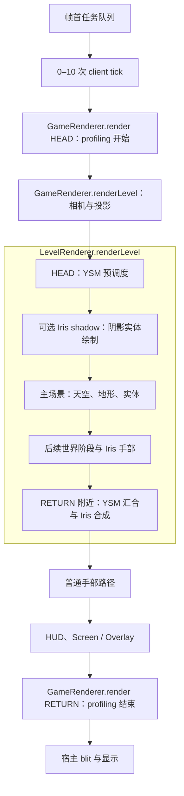

# 客户端帧流程与宿主接入

本页说明客户端主线程在一帧内何时进入 YSM，以及世界渲染、Iris shadow 和 GUI 如何共享绘制入口。范围覆盖 Minecraft 1.20.1 与 Forge 47.4 客户端；接入规则归[宿主输入与绘制借用](../integration/overview.md#宿主输入与绘制借用)，动画与顶点交接归[帧执行](../rendering/implementation/frame-execution.md)和[顶点输出](../rendering/overview.md#顶点输出与宿主接管)。

## 帧内顺序

下图展示宿主主线程在一帧内的调用顺序。世界、shadow、手部和 GUI 各自按当次条件执行，方框内的 shadow 与主场景实体绘制同属一次 `LevelRenderer.renderLevel` 调用。

| 阶段 | YSM 与宿主的交接 |
|---|---|
| Client tick | Forge `ClientTickEvent` START 推进资源、需求、会话、纹理与预览；END 检查移动输入。预览图生成在 target Ready 后可同步离屏绘制并回读像素。 |
| `GameRenderer.render` | HEAD 与 RETURN 包围 native profiling 区间；该区间包含 GUI，不包含前置的 tick 与后置的 blit。 |
| `LevelRenderer.renderLevel` | HEAD 标记世界绘制开始并调用 `AnimationParallelTicker.scheduleAll`；RETURN 附近调用 `waitAll`，等待剩余任务并完成投影交接。 |
| 实体 | 玩家经 `RenderPlayerEvent.Pre` 接入，投射物与载具在 `EntityRenderDispatcher.render` 调用具体 renderer 前接入。绘制按需等待时可接管仍在队列中的原任务，再完成对应 `get`、准备与消费；范围与权限见[实体任务交接](../animation/entity-lifecycle.md#执行权与任务交接)。 |
| GUI | HUD 纸娃娃与背包人物使用各自的 render context。模型页面为列表预览建立独立的 GUI 任务许可，`join` 后在主线程绘制；其余 GUI 入口可直接同步求值。 |

一帧与一次逻辑 tick 并不一一对应。渲染主线程负责发起绘制，Java worker 可并行执行动画求值与 Extract，随后主线程在 native 顶点输出前同步汇合 worker，再交给宿主的 buffer 与 GPU 提交路径。任务发布与借用边界见[帧执行](../rendering/implementation/frame-execution.md#任务发布与并发边界)。

读写窗口按帧严格分隔：会话、当前 Catalog 与输入的写入必须在任务发布之前完成，下一次写入必须等待全部普通任务和 GUI 读者交接完毕。单实体的按需 `get` 不会提前结束共享读窗口，主线程接管排队任务也不改变这一约束。权威规则与例外见[共享事实读写窗口](../integration/overview.md#共享事实读写窗口)。

## Minecraft 主线程任务

`Minecraft` 的事件循环维护主线程任务队列。正常 `runTick` 会在 client tick 与 `GameRenderer.render` 之前调用 `runAllTasks`；帧首的 `progressTasks` 是另一条独立队列，排空顺序早于事件循环队列。

| 提交方式 | 执行时机 |
|---|---|
| 从其他线程调用 `execute` 或 `submit` | 进入事件循环队列，等待主线程取出执行；`submit` 返回 `CompletableFuture`。 |
| 从主线程调用 `execute` 或 `submit` | 通常在调用点立即同步执行；若主线程正处于排空队列任务的过程中，嵌套提交会改为入队。 |
| `tell` | 始终直接入队，包括从主线程自身调用的情况。 |

队列排空期间新提交的任务可以在同一次排空中继续执行，排空结束后入队的任务通常等到下一次排空。此外，`managedBlock` 等待期间也会轮询该队列，因此队列任务可能在某个调用栈中途穿插执行。客户端启动等待必需（required）资源时正是利用这一窗口，见[生命周期映射](../runtime/implementation/lifecycle-and-publication.md#生命周期与线程)。

## Shadow 与重复绘制

启用 Iris 后，shadow pass 会在主场景天空与地形之前执行。Iris 使用独立的阴影 buffer 调用宿主 `LevelRenderer.renderEntity`，因此阴影实体会复用 YSM 的实体接入点，同一实体的首次任务汇合也可能发生在 shadow pass。YSM 通过 render context 区分 shadow 与主场景。

动画逻辑推进与 Extract 复用是分别判定的：由于 shadow 与主场景的 context 不同，切换 pass 时可能需要重新 Extract；本地玩家处于第一人称视角时，shadow pass 会用 mutable context 生成第三人称身体。细节见[帧执行](../rendering/implementation/frame-execution.md#java-预调度与-context)。

普通手部绘制位于 `LevelRenderer.renderLevel` 之后。启用 Iris shader pack 时，Iris 会把 solid 手部提前到世界透明阶段之前，并在世界返回附近按条件绘制 translucent 手部。YSM 在 `RenderHandEvent` 中附加第一人称背景，并在 `RenderArmEvent` 成功消费对应手臂后取消该侧的宿主绘制；具体交接规则见[宿主适配](../integration/implementation/host-adapters.md#已有事件表面)。
