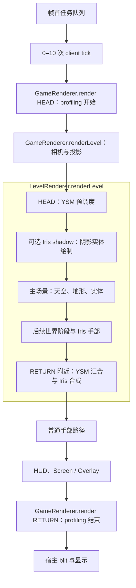

# 客户端帧流程与宿主接入

本页说明 Minecraft 1.20.1 / Forge 47.4 客户端主线程在一帧内进入 YSM 的时机，以及世界渲染、Iris shadow 与 GUI 的入口关系。接入契约见[宿主输入与绘制借用](../integration/overview.md#宿主输入与绘制借用)，帧状态与顶点提交见[帧执行](../rendering/implementation/frame-execution.md)和[顶点输出](../rendering/overview.md#顶点输出与宿主接管)。

## 帧内顺序

世界、shadow、手部与 GUI 按当次条件执行，方框内 shadow 与主场景实体绘制同属一次 `LevelRenderer.renderLevel` 调用：

| 阶段 | YSM 与宿主的交接 |
|---|---|
| Client tick | `ClientTickEvent` START 推进资源、需求、会话、纹理与预览；END 检查移动输入。预览图在 target Ready 后可同步离屏绘制并回读像素。 |
| `GameRenderer.render` | HEAD 与 RETURN 包围 native profiling 区间（含 GUI，不含前置 tick 与后置 blit）。 |
| `LevelRenderer.renderLevel` | HEAD 标记世界绘制开始并调 `AnimationParallelTicker.scheduleAll`；RETURN 附近调 `waitAll` 等待剩余任务并完成投影交接。 |
| 实体 | 玩家经 `RenderPlayerEvent.Pre` 接入，投射物与载具在 `EntityRenderDispatcher.render` 调用具体 renderer 前接入。按需汇合时可就地执行仍在队列中的原任务，随后完成对应 `get`、准备与消费，见[实体任务交接](../animation/entity-lifecycle.md#执行权与任务交接)。 |
| GUI | HUD 纸娃娃与背包人物使用各自 render context。模型页面为列表预览授予独立 GUI 任务许可，`join` 后在主线程绘制；其余 GUI 同步求值。 |

- **线程协作**：渲染主线程发起绘制，Java worker 并行执行动画求值与 Extract，主线程在 native 顶点输出前同步汇合 worker 再提交给宿主 buffer 与 GPU。详见[任务发布与并发边界](../rendering/implementation/frame-execution.md#任务发布与并发边界)。
- **共享读写窗口**：会话、Catalog 与输入写入在任务发布前完成；下一次共享写入等待全部世界任务与 GUI 读者交接完毕（单实体按需 `get` 或接管排队任务不提前结束共享读窗口）。详见[共享事实读写窗口](../integration/overview.md#共享事实读写窗口)。

## Minecraft 主线程任务

`Minecraft` 事件循环维护主线程任务队列：正常 `runTick` 在 client tick 与 `GameRenderer.render` 前执行 `runAllTasks`，帧首 `progressTasks` 为另一条更早排空的独立队列。

| 提交方式 | 执行时机 |
|---|---|
| 其他线程调用 `execute` / `submit` | 入队等待主线程执行；`submit` 返回 `CompletableFuture` |
| 主线程调用 `execute` / `submit` | 通常立即同步执行；若主线程正在排空队列，嵌套提交改为入队 |
| `tell` | 无论调用线程，始终直接入队 |

排空期间新入队任务可在同次排空执行；`managedBlock` 等待期间也会轮询该队列（客户端启动等待 required 资源即利用该窗口，见[生命周期与线程](../runtime/implementation/lifecycle-and-publication.md#生命周期与线程)）。

## Shadow 与重复绘制

- **Iris shadow 复用**：shadow pass 在主场景天空与地形前经独立阴影 buffer 调用 `LevelRenderer.renderEntity`，复用 YSM 实体入口（单实体首次任务汇合也可能发生在 shadow pass）。
- **Context 隔离**：逻辑推进与 Extract 复用分别判定；shadow 与主场景 context 不同，切换 pass 时可能重新 Extract。本地玩家第一人称视角下的 shadow pass 使用 mutable context 生成第三人称身体，见[Java 预调度与 context](../rendering/implementation/frame-execution.md#java-预调度与-context)。
- **第一人称手部时机**：普通手部绘制位于 `renderLevel` 之后；启用 Iris shader pack 时，solid 手部提前至世界透明阶段前，translucent 手部按条件位于世界返回附近。YSM 在 `RenderHandEvent` 附加第一人称背景，在 `RenderArmEvent` 成功消费对应手臂后取消该侧宿主绘制，见[已有事件表面](../integration/implementation/host-adapters.md#已有事件表面)。
