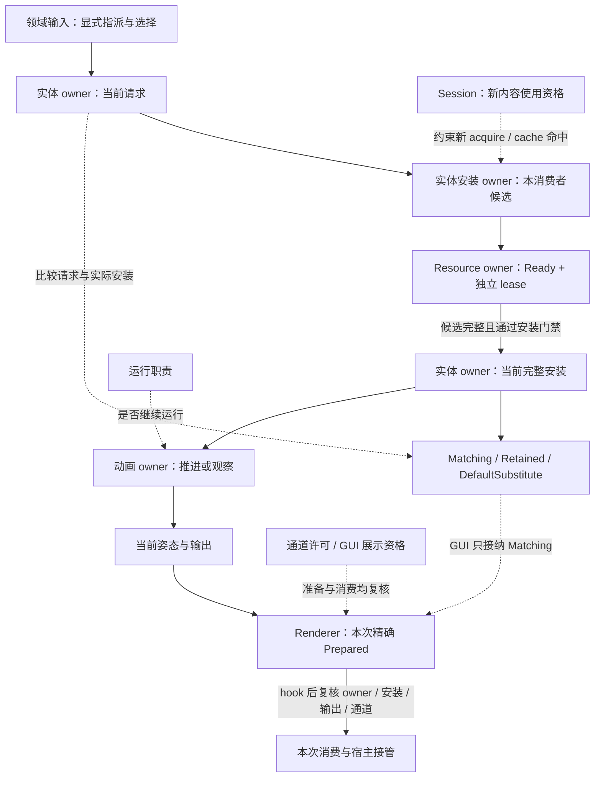

# 实体表现状态组合

本页串联指派、资源准备、实体安装与当次呈现的跨子系统组合，说明“资源已 Ready 但尚未显示”以及“同一安装在不同场景下表现不同”的根因。详细契约分属[实体安装](../animation/entity-lifecycle.md#指派请求与安装关系)、[页面选择](../client-presentation/overview.md#选择与资源需求)与[渲染交接](../rendering/overview.md#顶点输出与宿主接管)。

## 状态关系

下图各节点由对应 owner 独立维护（实线为数据或结果交付，虚线为资格约束或比较）；新请求仍在准备时，合法旧安装可继续产出画面：

核心隔离维度：
- **阶段独立成立**：服务端 Accepted、metadata Ready、target Ready、完整安装与当次消费成功彼此独立；body 安装完成不代表第一人称 arm 可读，同一 subject 下的多 owner 私有状态隔离。见[会话提交](../model-management/sessions/overview.md#权威提交与通知)、[Ready 与宿主交接](../model-management/client-resources/overview.md#ready-与宿主交接)和[对象寿命与模型使用](../animation/entity-lifecycle.md#对象寿命与模型使用)。
- **操作身份与安装分离**：`usage` 只反映当前完整安装；新选择操作即使选中同一模型，其操作身份仍独立于旧安装。页面退出仅停止自身用途，在途 GUI 帧借用仍经 `join` 结束。
- **运行职责与绘制许可分离**：producer 在绘制被屏蔽时继续推进逻辑状态；同帧额外观察不重复提交动作，当次 Prepared 仅服务本次绘制。见[本地呈现边界](../rendering/overview.md#本地呈现边界)、[时间推进与观察](../animation/overview.md#时间推进与观察)和[宿主输入与绘制借用](../integration/overview.md#宿主输入与绘制借用)。

## 场景对照

| 场景 | 可观察结果与边界 | 规则正文 |
|---|---|---|
| 未指派，但默认模型已驻留 | 保留宿主模型。资源 Ready 不自动建立指派；LocalPlayer 初始 default 来自显式指派，远端玩家来自 model section。 | [指派与安装关系](../animation/entity-lifecycle.md#指派请求与安装关系) |
| 请求经历 A → B → C，B 迟到 | 当前请求为 C，合法旧安装 A 在世界中继续以 Retained 展示，迟到的 B 仅关闭自身候选；GUI 等待 C 的图片或占位。 | [安装关系](../animation/entity-lifecycle.md#指派请求与安装关系)、[GUI 选择](../client-presentation/overview.md#选择与资源需求) |
| 当前请求尚无合法安装 | Humanoid 用 default 临时替代，scoped replacement 保留或恢复宿主。显式请求 default 且匹配时为 Matching。 | [安装关系](../animation/entity-lifecycle.md#指派请求与安装关系) |
| Target 已 Ready，安装窗口 Busy | Ready 仍有效，接收者保留独立 lease 并在后续 tick 重试；纹理导航遇 Busy 直接拒绝，不保留自动跳转意图。 | [用途交接](../model-management/demand/overview.md#用途准备与独立接收)、[选择与资源需求](../client-presentation/overview.md#选择与资源需求) |
| 屏蔽本机模型或暂停纯消费者 | 本机 body 停止绘制但继续 producer 逻辑推进；arm 等纯消费者结束当前使用并保留指派与网络投影，解除后按最新请求重建。 | [呈现边界](../rendering/overview.md#本地呈现边界)、[暂停与重建](../animation/entity-lifecycle.md#暂停reset-与-retire) |
| 目录移除与 intrinsic-default-only | 目录移除不撤销合法旧安装；进入 default-only 后普通安装失去求值与消费资格，在同步边界结束旧使用，保留指派与连接。 | [安装关系](../animation/entity-lifecycle.md#指派请求与安装关系)、[失败与恢复](../animation/entity-lifecycle.md#失败记忆与恢复) |
| 第三人称与第一人称接管宿主 | 第三人称凭有效 Prepared 或主动隐藏依据取消宿主；第一人称左右手按各自消费成功与否接管（合法空输出算成功，缺根保留该侧宿主）；背景附加初始姿态。 | [顶点输出与宿主接管](../rendering/overview.md#顶点输出与宿主接管) |
| 外部 hook 改变请求、安装或许可 | 原 Prepared 失效，消费入口重新核验（不通过二次 update 修补）；已进入 consumer 后抛异常直接传播，无回滚。 | [宿主借用](../integration/overview.md#宿主输入与绘制借用)、[输出与失败](../rendering/overview.md#输出与失败) |

延伸入口：[实体生命周期](../animation/entity-lifecycle.md)、[查询与借用](../animation/entity-lifecycle.md#查询与借用)、[实体替换、retire 与物理回收](resource-lifecycle.md#实体替换retire-与物理回收)，已知缺口见[动画问题](../../status/known-issues/animation.md)与[渲染问题](../../status/known-issues/rendering.md)。
