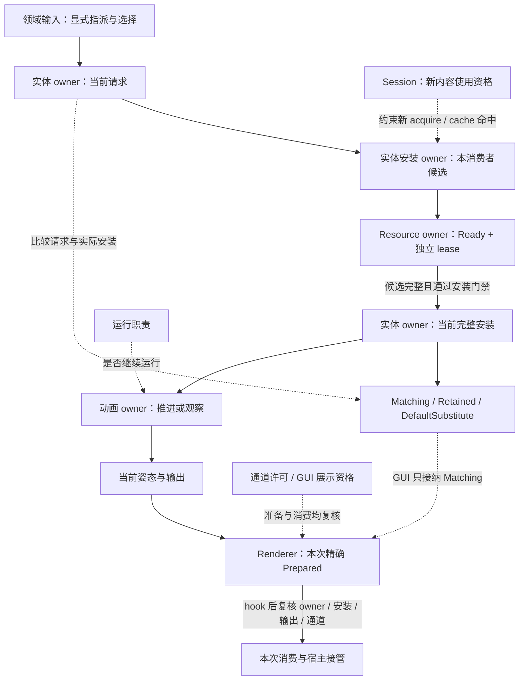

# 实体表现状态组合

本页串联指派、资源准备、实体安装与当次呈现，回答“资源已经 Ready 为何仍未显示”以及“同一安装为何在世界、GUI 和第一人称下表现不同”。具体规则分别归属于[实体安装](../animation/entity-lifecycle.md#指派请求与安装关系)、[页面选择](../client-presentation/overview.md#选择与资源需求)与[渲染交接](../rendering/overview.md#顶点输出与宿主接管)，本页不另建状态机。

## 状态关系

下图中，实线表示输入或结果交付，虚线表示资格约束或状态比较。各节点由不同 owner 独立维护，并非一个全局统一枚举的先后阶段；当新请求对应的资源仍在准备时，合法的旧安装依然可以继续产出画面。

`usage` 只反映完整的实体安装。新一次选择操作的身份与当前已安装的操作身份分开呈现：即便选中的是同一个模型，旧安装也不能证明本次选择已经完成。页面退出只停止自身用途，仍在运行的 GUI 帧借用仍按既有的 `join` 流程结束。

请求被服务端接纳（Accepted）只表示选择请求已处理；metadata Ready、target Ready、完整安装和当次消费成功是各自独立成立的事实。同样，body 安装完成也不代表第一人称 arm 可读，同一 subject 下的多个 owner 各自隔离私有状态。依据见[会话提交](../model-management/sessions/overview.md#权威提交与通知)、[Ready 与宿主交接](../model-management/client-resources/overview.md#ready-与宿主交接)及[对象寿命与模型使用](../animation/entity-lifecycle.md#对象寿命与模型使用)。

运行职责与绘制许可也彼此独立：producer 可以在被屏蔽绘制的情况下继续推进逻辑状态。同帧的额外观察不会重复提交动作，当次准备好的渲染结果也不预留未来帧的消费资格。依据见[本地呈现边界](../rendering/overview.md#本地呈现边界)、[时间推进与观察](../animation/overview.md#时间推进与观察)和[宿主适配与借用](../integration/overview.md#宿主输入与绘制借用)。

## 场景对照

| 场景 | 可观察结果与边界 | 规则正文 |
|---|---|---|
| 未指派，但默认模型已驻留 | 保留宿主模型。资源准备完成本身不建立指派；LocalPlayer 的初始 default 来自显式指派，远端玩家来自 model section。 | [指派与安装关系](../animation/entity-lifecycle.md#指派请求与安装关系) |
| 请求经历 A → B → C，B 迟到 | 当前请求为 C，合法旧安装 A 在世界中继续以 Retained 展示，迟到的 B 只关闭自身候选。GUI 则等待 C 的图片或占位，不用 A 的 3D 冒充 C。 | [安装关系](../animation/entity-lifecycle.md#指派请求与安装关系)、[GUI 选择](../client-presentation/overview.md#选择与资源需求) |
| 当前请求尚无合法安装 | Humanoid 可用 default 临时替代，scoped replacement 则保留或恢复宿主。若显式请求本身就是 default 且安装匹配，关系为 Matching 而非 DefaultSubstitute。 | [安装关系](../animation/entity-lifecycle.md#指派请求与安装关系) |
| Target 已 Ready，但安装窗口 Busy | Ready 依然有效，接收者保留独立 lease 并在后续 tick 重试；纹理导航遇到 Busy 则直接拒绝本次进入，不保留自动跳转意图。 | [用途交接](../model-management/demand/overview.md#用途准备与独立接收)、[选择与资源需求](../client-presentation/overview.md#选择与资源需求) |
| 屏蔽本机模型或暂停纯消费者 | 本机 body 停止绘制但继续承担 producer 逻辑推进；arm 等纯消费者结束当前使用并保留指派与网络投影，解除限制后按最新请求重建。 | [呈现边界](../rendering/overview.md#本地呈现边界)、[暂停与重建](../animation/entity-lifecycle.md#暂停reset-与-retire) |
| 目录移除与 intrinsic-default-only | 目录移除不会撤销合法旧安装；进入 default-only 后普通安装失去求值与消费资格，并在同步边界结束旧使用，但不会清空指派或断开 Minecraft 连接。 | [安装关系](../animation/entity-lifecycle.md#指派请求与安装关系)、[失败与恢复](../animation/entity-lifecycle.md#失败记忆与恢复) |
| 第三人称与第一人称接管宿主 | 第三人称需要有效 Prepared 或明确的主动隐藏依据。第一人称左右手按各自实际消费成功与否决定接管：合法空输出算成功，缺根则保留该侧宿主；背景只附加声明初始姿态。 | [三阶段与宿主交接](../rendering/overview.md#顶点输出与宿主接管) |
| 外部 hook 改变请求、安装或许可 | 原 Prepared 立即失效，消费入口重新核验，不能再跑一次 update 去修补旧交接。已进入 consumer 后抛出异常直接传播，不重画宿主来伪装回滚。 | [宿主借用](../integration/overview.md#宿主输入与绘制借用)、[输出与失败](../rendering/overview.md#输出与失败) |

安装替换与退休的完整规则见[实体生命周期](../animation/entity-lifecycle.md)，跨子系统保留与物理清理见[资源生命周期场景](resource-lifecycle.md#实体替换retire-与物理回收)。查询接口返回的结果只反映查询时刻的状态，不构成后续执行的承诺；查询边界见[查询与借用](../animation/entity-lifecycle.md#查询与借用)，联合运行验证范围见[动画问题](../../status/known-issues/animation.md)与[渲染问题](../../status/known-issues/rendering.md)。
