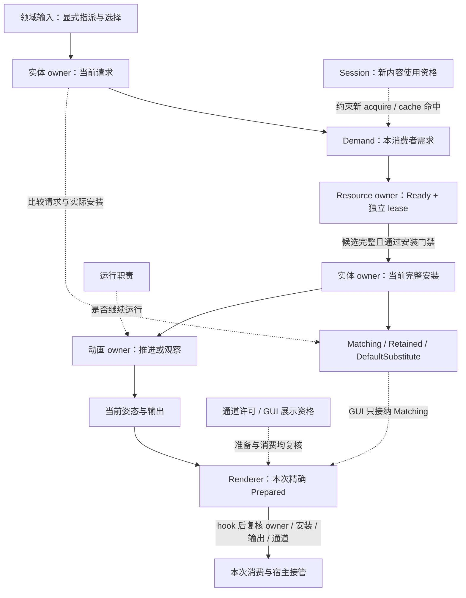

# 实体表现状态组合

本页连接指派、资源、安装与当次呈现，回答“已经 Ready，为何仍未显示”以及同一安装为何在世界、GUI 和第一人称产生不同结果。规则归[实体安装](../animation/entity-lifecycle.md#指派请求与安装关系)、[页面选择](../client-presentation/overview.md#选择与资源需求)与[渲染交接](../rendering/overview.md#三阶段契约)，本页不建立另一套状态机。

## 状态关系

实线表示输入或结果交付，虚线表示资格约束或状态比较。节点属于不同 owner，不是一个全局枚举的阶段；资源准备未完成时，合法旧安装仍可提供输出。

选择 Accepted 只表达请求处置；metadata Ready、target Ready、完整安装与成功消费分别成立。Body 安装也不证明 arm 可读，同一 subject 的多个 owner 不共享私有状态。依据见[会话提交](../model-management/sessions/overview.md#权威提交与通知)、[Ready 与宿主交接](../model-management/client-resources/overview.md#ready-与宿主交接)及[对象寿命与模型使用](../animation/entity-lifecycle.md#对象寿命与模型使用)。

运行职责与绘制许可独立：producer 可以继续逻辑推进而不绘制。额外观察不重复提交动作；已准备结果也不预留未来消费资格。依据见[本地呈现边界](../rendering/overview.md#本地呈现边界)、[时间推进与观察](../animation/overview.md#时间推进与观察)和[宿主适配与借用](../integration/overview.md#宿主适配与借用)。

## 场景对照

| 场景 | 可观察结果与边界 | 规则正文 |
|---|---|---|
| 未指派，但 default 已驻留 | 保留宿主。资源完成不建立指派；LocalPlayer 的初始 default 来自显式指派，远端来自 model section | [指派与安装关系](../animation/entity-lifecycle.md#指派请求与安装关系) |
| A → B → C，B 迟到 | 当前请求是 C，合法 A 可继续 Retained；B 只结束自身候选。GUI 等待当前图片或占位，不用 A 的 3D 冒充 C | [安装关系](../animation/entity-lifecycle.md#指派请求与安装关系)、[GUI 选择](../client-presentation/overview.md#选择与资源需求) |
| 当前请求尚无合法安装 | Humanoid 可用 default 替代，scoped replacement 保留或恢复宿主。请求本身为 default 且安装匹配时是 Matching，不是 DefaultSubstitute | [安装关系](../animation/entity-lifecycle.md#指派请求与安装关系) |
| Target Ready，但安装窗口 Busy | Ready 仍有效，接收者保留自己的 lease，在后续 tick 重试；纹理导航直接拒绝本次进入，不保留自动跳转意图 | [用途交接](../model-management/demand/overview.md#用途准备与独立接收)、[选择与资源需求](../client-presentation/overview.md#选择与资源需求) |
| 屏蔽本机模型或暂停纯消费者 | 本机 body 停止绘制但继续 producer 工作；arm 等纯消费者结束当前使用，保留指派和网络投影，解除限制后按最新请求重建 | [呈现边界](../rendering/overview.md#本地呈现边界)、[暂停与重建](../animation/entity-lifecycle.md#暂停reset-与-retire) |
| 目录移除与 intrinsic-default-only | 目录移除不撤销合法旧安装；default-only 则禁止普通安装求值与消费，并在同步边界结束旧使用。它不清指派或关闭 Minecraft 连接 | [安装关系](../animation/entity-lifecycle.md#指派请求与安装关系)、[失败与恢复](../animation/entity-lifecycle.md#失败记忆与恢复) |
| 第三人称与第一人称接管宿主 | 第三人称需要有效 Prepared 或明确主动隐藏依据。左右手各以对应侧实际消费成功为准；合法空输出算成功，缺根保留该侧宿主。背景只附加初始姿态 | [三阶段与宿主交接](../rendering/overview.md#三阶段契约) |
| Hook 改变请求、安装或许可 | 原 Prepared 可能失效，消费入口重新核验，不能用第二次 update 修补旧交接。已进入 consumer 后的异常传播，不重画宿主来伪装回滚 | [宿主借用](../integration/overview.md#宿主适配与借用)、[输出与失败](../rendering/overview.md#输出与失败) |

安装替换与退休的状态转换直接见[实体生命周期](../animation/entity-lifecycle.md)，跨域保留和物理清理见[资源生命周期场景](resource-lifecycle.md#实体替换retire-与物理回收)。本页不把查询结果当成执行承诺，也不证明联合运行验证已经完成；查询边界见[查询与借用](../animation/entity-lifecycle.md#查询与借用)，证据范围见[动画问题](../../status/known-issues/animation.md)与[渲染问题](../../status/known-issues/rendering.md)。
