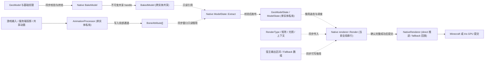

# 渲染数据流与所有权

本页汇总从模型几何、骨骼姿态、JNI 借用到宿主顶点提交的端到端数据流、数据载体所有权与当前并发边界。帧内调用顺序见[客户端帧流程](client-frame-seams.md)。

## 端到端数据流

下图中实线表示数据产出或所有权交付，虚线表示同步调用期借用（调用返回即失效，不延长底层资源寿命）：

- 动画求值与顶点输出不共享最终渲染矩阵或 GPU 状态；`GeoModelState` 仅经发布后的有效帧状态传递姿态、locator 与调度计划。
- 第一人称手部与背景通过 `extractSubtree` 产出三份局部根输出，GUI 列表预览使用独立 GUI 许可与私有实例，均与世界主槽隔离，见[局部根提取](../rendering/implementation/frame-execution.md#局部根提取)。

## 数据载体、所有权与借用窗口

| 载体 | 生产者与所有者 | 共享或独占范围 | 跨语言与借用边界 | 失效或释放条件 |
| --- | --- | --- | --- | --- |
| `GeoModel` / 纹理 | 资产管线产出，客户端资源 target 保活 | 不可变，跨实体经 `ResourceLease` 共享 | 烘焙前作为字节切片同步借给 native | 全部 lease 与缓存引用撤回后回收，见[客户端资源](../model-management/client-resources/overview.md#引用撤销与物理关闭) |
| `BakedModel` | Native `BakeModel` / `ReadBakedModel` 产出，Java `GeoModel` 持共享 handle | 不可变，跨实体及序列化只读共享 | 强类型 opaque handle 保活，共享后撤销显式关闭权 | 最后一份强引用消失后由 Cleaner 回收，见[共享 geometry](../native-runtime/implementation/jni-and-memory.md#共享-geometry)与[Bake 与派生身份](../rendering/implementation/bake-and-partition.md) |
| `BoneAttribute` | 实体私有 `AnimationProcessor` 原位写入 | 单实体 owner 独占 | 仅在 `ModelState::Extract` 同步调用内只读借用，native 不留存地址 | 下一次求值覆盖或实体安装退休，见[骨骼输出](../animation/implementation/processor-and-bone-output.md#boneattribute) |
| `GeoModelState` / `ModelState` | 实体或第一人称负责方持有，native 独占内部姿态与调度 | 单实体、单输出槽（canonical / mutable）独占 | Java 借用姿态与 locator view；调用方在 `Extract`/`Render` 期间保活 wrapper（内存安全边界） | 新 `Extract` 先撤销消费资格；换模、`invalidate` 或退休待借用退出后释放，见[帧执行](../rendering/implementation/frame-execution.md#输入输出与状态) |
| 宿主顶点输出区间 | 宿主 `VertexConsumer` 或 fallback 数组负责方 | 单次 `Render` 同步独占可写窗口 | Direct 交付预扩容裸地址与 anchor，fallback 借用 Java 数组；借用期不得扩容、重置或释放该 backing（内存安全边界） | `NativeRenderer` 确认完整成功后推进区间或回放，失败不推进；调用返回结束借用，见[顶点输出](../rendering/overview.md#顶点输出与宿主接管)与[帧内借用](../native-runtime/implementation/jni-and-memory.md#帧内借用) |

## 阶段并发与串行边界

| 阶段 | 执行线程归属 | 跨实体并发度 | 关键串行与同步边界 |
| --- | --- | --- | --- |
| 资产加载与 `BakeModel` | 后台资源 worker | 多模型并行，可与只读 `Extract` 并行 | 主线程在 tick 接纳不可变结果，见[资源所有权](resource-ownership.md) |
| 动画求值与 `Extract` | `renderLevel` 内由 Java 动画 worker 预调度；GUI 列表走独立 GUI worker；其余主线程同步 | **不同实体并行**；同一实体与同一 `ModelState` 串行 | 共享目录/会话/输入遵循[共享事实读写窗口](../integration/overview.md#共享事实读写窗口)；绘制按需 `Future.get` 汇合，见[任务发布与并发边界](../rendering/implementation/frame-execution.md#任务发布与并发边界) |
| `renderer::Render` | Minecraft Render thread 发起，内部 native 线程池并行写互不重叠区间 | **当前全局串行** | 因当前共享执行器、透明排序临时缓冲与 fallback 缓冲，目前按全局串行调用（拆分共享缓冲与执行态后可支持多实体并发）；返回前全部 native worker 结束，见[状态与绘制并发](../rendering/overview.md#状态与绘制并发) |
| 宿主上传与 GPU draw | Minecraft Render thread | 按宿主渲染 pass 顺序执行 | Iris shadow 与主世界共用实体入口但按 context 区分，不重复推进逻辑动作，见[Shadow 与重复绘制](client-frame-seams.md#shadow-与重复绘制) |
